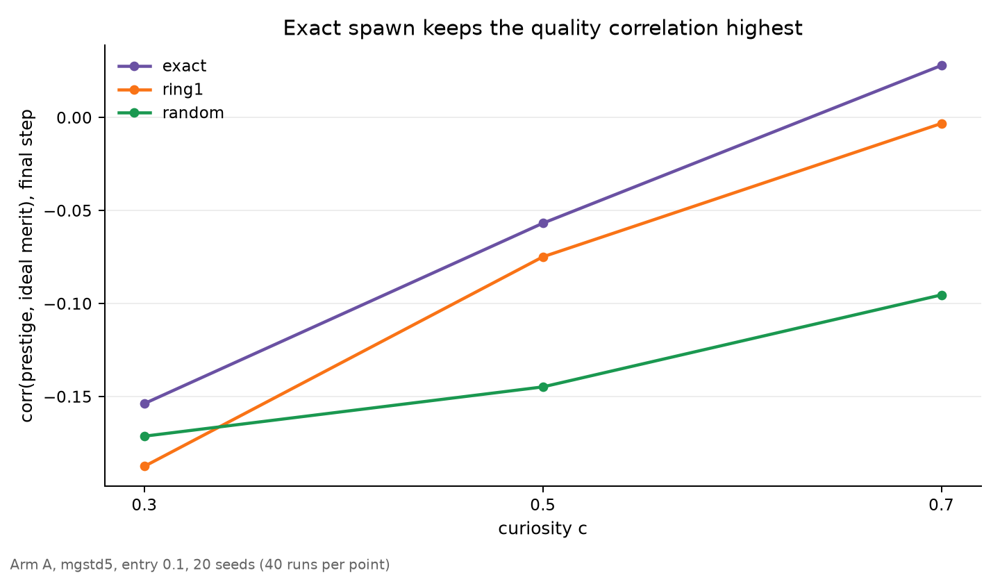
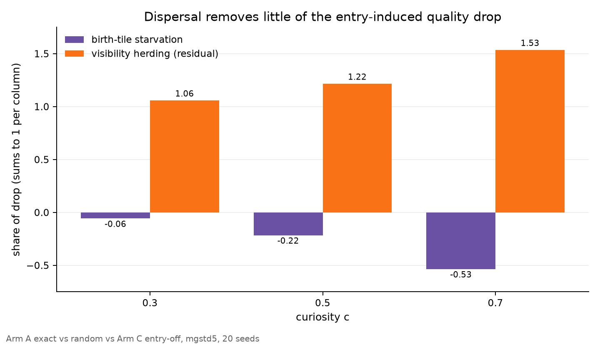
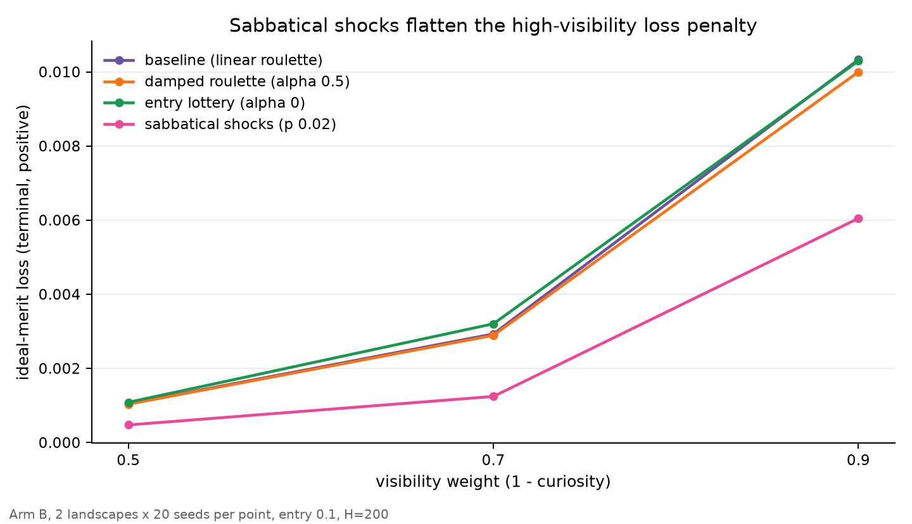
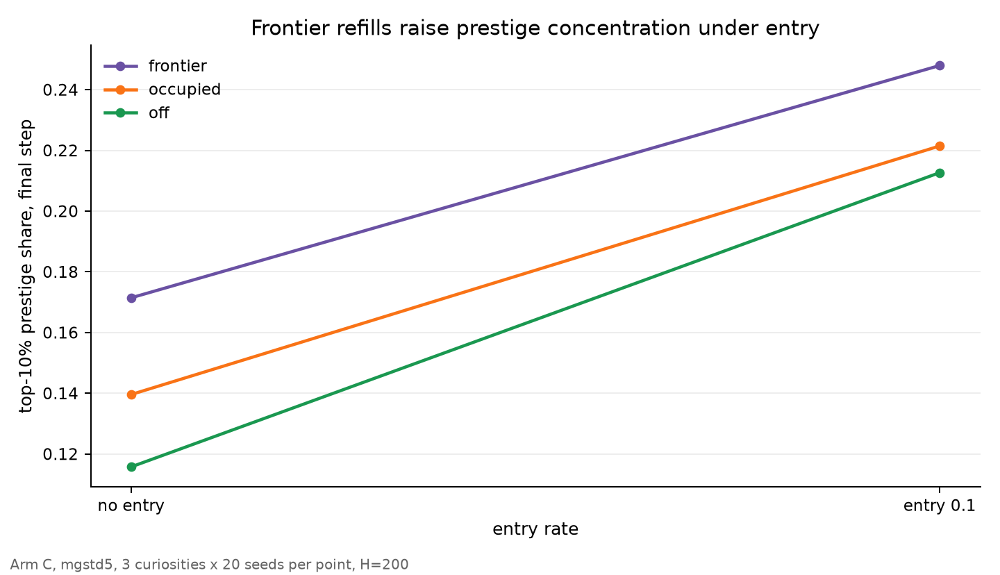

- **Source:** Antigravity inspection & evaluation round (Items 1.1–1.3), updated with empirical findings from `output/reports/interventions_v1.md` (72 cells / 1,440 runs)
- **Date:** 2026-11-14 (v1); 2026-11-15 (v2 — post-`interventions_v1` synthesis)
- **Related:** `AdmiralsLog/way_forward.md`, `output/reports/interventions_v1.md`, `output/reports/sensitivity_map_v1.md`, `output/reports/welfare_probe_v1.md`, `output/reports/career_flows_v1.md`
- **Spawned:** `P-0002` (exercised), `P-0003` (exercised), `P-0004` (exercised), `P-0007`, `IE-0001` (rejected)

# 1. One Unified Mechanism Story

Across the exploration waves (`sensitivity_map_v1`, `career_flows_v1`, `welfare_probe_v1`, and `interventions_v1`), the model exhibits three core macro-phenomena:
1. Activating prestige-proportional entry flips the quality correlation (`Corr_prestige_ideal_merit`) negative while local quantity correlation (`Corr_prestige_local_merit`) stays positive.
2. Newcomers never close the prestige gap with incumbents.
3. Epistemic welfare loss kinks sharply upward at visibility weight $\xi^* \in [0.6, 0.8]$, driven $31\times$ more strongly by the agent's internal visibility elasticity ($1-c$) than by the peer-prestige visibility toggle (`use_visibility_reward`, $2.6\%$).

Items 1.1, 1.2, and 1.3 form a single causal chain — now tested across 1,440 runs in [interventions_v1.md](file:///Users/joko/Git/sciencemodels/output/reports/interventions_v1.md) — explaining **why** this happens on the $20 \times 20$ torus, **which** institutional rules actually counter it, and **what** happens when the epistemic landscape itself regenerates.

---

# 2. Act I: Recruitment-Herding Dominance over Birth-Tile Starvation (1.1 — `P-0002` Tested)

In the baseline demographic rule (`sciencemodels/model.py:389-420`), two mechanisms are fused at birth:
- **Prestige-proportional matching:** A newcomer selects a supervisor $i$ with probability $P(\text{sup}_i) \propto \text{prestige}_i$.
- **Exact spatial co-location:** The newcomer is placed directly on the supervisor's current tile (`coords = sup.pos`).

Initially (`v1`), we hypothesized that **mechanical birth-tile starvation** (advisees spawning on tiles their supervisors had already multiplicatively depleted via `farm()`) drove a substantial fraction of the negative `Corr_prestige_ideal_merit` and the newcomer-incumbent gap.

**What `interventions_v1` Arm A proved ([interventions_v1.md](file:///Users/joko/Git/sciencemodels/output/reports/interventions_v1.md#L50-L92), 18 cells / 360 runs):**
- Dispersing newcomer birth tiles (`r_spawn` $\in \{\text{exact}, \text{ring1}, \text{random}\}$) **does not repair the entry-induced quality drop — it widens it** at every curiosity level ($c = 0.3$: $-0.154 \to -0.171$; $c = 0.5$: $-0.057 \to -0.145$; $c = 0.7$: $+0.028 \to -0.095$).
- In the formal decomposition $D_{\text{total}} = (\text{off} - \text{random}) + (\text{random} - \text{exact})$, the birth-tile starvation share is **negative everywhere** ($-5.7\%, -21.5\%, -53.5\%$), meaning **prestige-proportional recruitment plus visibility herding accounts for $105.7\%$ to $153.5\%$ of the quality drop**.
- Dispersing birth tiles also **widens the newcomer-incumbent prestige gap** by $0.08\%$ to $2.6\%$ on `mgstd5` and $5.0\%$ to $12.0\%$ on `noisypr5`.

**Why?** When newcomers spawn on `sup.pos` (`exact`), they at least start near a high-value Gaussian peak discovered by a founder. Dispersing their birth tile while keeping prestige-proportional supervisor credit and visibility-driven movement leaves founders with an unchallenged harvest monopoly on the peak while advisees herd into suboptimal rings. Thus, **evaluative attraction and elite recruitment — not birth-tile starvation — are the true drivers of the relational wedge** (recorded as rejected hypothesis [IE-0001-birth-tile-starvation-hypothesis.md](file:///Users/joko/Git/sciencemodels/AdmiralsLog/ideas/rejected/IE-0001-birth-tile-starvation-hypothesis.md)).

---

# 3. Act II: Attention-Side Shocks Beat Entry-Side Lotteries at the $\xi^*$ Kink (1.2 — `P-0003` Tested)

To test institutional counterforces in the spirit of Smaldino, Turner, & Contreras Kallens (2019), Gross & Bergstrom (2019), and Zollman (2010), `interventions_v1` Arm B ([interventions_v1.md](file:///Users/joko/Git/sciencemodels/output/reports/interventions_v1.md#L94-L127), 36 cells / 720 runs) crossed two policy levers across visibility weights $1-c \in \{0.5, 0.7, 0.9\}$:
1. **Entry Lotteries / Prestige Damping ($\alpha \in \{1.0, 0.5, 0.0\}$):** Supervisor roulette $P(\text{sup}_i) \propto \text{prestige}_i^\alpha$, from linear Matthew selection ($\alpha = 1.0$) to a pure placement lottery ($\alpha = 0.0$).
2. **Sabbatical / Maverick Relocation Shocks ($p_{\text{reloc}} \in \{0.00, 0.02\}$):** Relocating scientists trapped on depleted tiles ($k < 0.025$) to a random unexplored tile with probability $0.02$ per step, breaking status-quo lock-in (`agents.py:166`).

**What `interventions_v1` Arm B proved:**
- **Sabbatical shocks cut the high-visibility welfare loss penalty by ~40%** ($\text{loss}(0.9) - \text{loss}(0.5)$ drops from $0.00929$ to $0.00557$), reduce discrete convexity by **27%** ($0.00552 \to 0.00404$), cut absolute loss at weight $0.9$ by **41%** ($0.01033 \to 0.00605$), and improve `Corr_prestige_ideal_merit` at weight $0.9$ from $-0.2572$ to $-0.2391$.
- **Entry lotteries do virtually nothing to welfare loss:** setting $\alpha = 0.0$ (pure lottery) changes the high-visibility penalty by only **$-0.9\%$** ($-0.000079$) and concave damping ($\alpha = 0.5$) by $-3.5\%$, moving only top-10% prestige concentration slightly ($0.2091 \to 0.2039$).

**Substantive takeaway:** The $\xi^*$ welfare collapse is an **attention-side lock-in phenomenon**, not an entry-side matching artifact. Entry lotteries relax *who gets in*, but once on the grid, visibility-seeking entrants still herd into depleted clusters. Only interventions that directly inject transient spatial diversity (`p_reloc > 0`) break the conformity cascade.

---

# 4. Act III: Incumbent Bailouts vs. Unclaimed Frontier Paradigms (1.3 — `P-0004` Tested)

`interventions_v1` Arm C ([interventions_v1.md](file:///Users/joko/Git/sciencemodels/output/reports/interventions_v1.md#L129-L165), 18 cells / 360 runs) activated the dormant `new_questions` regeneration channel (`sciencemodels/model.py:422-429`), comparing `off`, `occupied` (the code's built-in rule where depleted tiles refill right under incumbents' feet), and `frontier` (new questions $U(0,1)$ open on random *unoccupied* tiles when an occupied tile depletes):

- **Occupied refill ("incumbent hot-field bailout") triggers hard epistemic lock-in:** Grid exploration collapses by **84%** (from $0.377$ to **$0.061$** of the torus), `Corr_prestige_ideal_merit` remains negative under entry ($-0.045$), and the newcomer-incumbent prestige gap widens **eleven-fold** (from $-0.019$ to **$-0.451$**). Because orthodoxy self-replenishes under the herd's feet, incumbents never move.
- **Frontier refill ("paradigm emergence") restores positive quality alignment (`+0.078`), but new paradigms go unclaimed:** Under `frontier` refills with entry on, `Corr_prestige_ideal_merit` flips from $-0.061$ to **$+0.078$**, yet top-10% prestige concentration reaches its highest level ($0.248$), the newcomer gap widens to **$-0.567$**, and **unclaimed frontier knowledge piles up across the grid** (`mean_grid_knowledge` rises $315\times$ from $0.0006$ to **$0.1895$**, while exploration drops from $0.377$ to $0.330$).

**Substantive takeaway:** Even when new paradigms emerge on the frontier (`frontier`), a community governed by visibility-weighted movement fails to migrate to them — leaving a massive stock of unharvested frontier questions on the table. Testing whether **sabbatical relocation shocks (`p_reloc > 0`) allow communities to harvest emerging frontier paradigms** is the immediate next interaction experiment ([P-0007-sabbatical-shocks-x-frontier-refills.md](file:///Users/joko/Git/sciencemodels/AdmiralsLog/proposals/P-0007-sabbatical-shocks-x-frontier-refills.md)).
