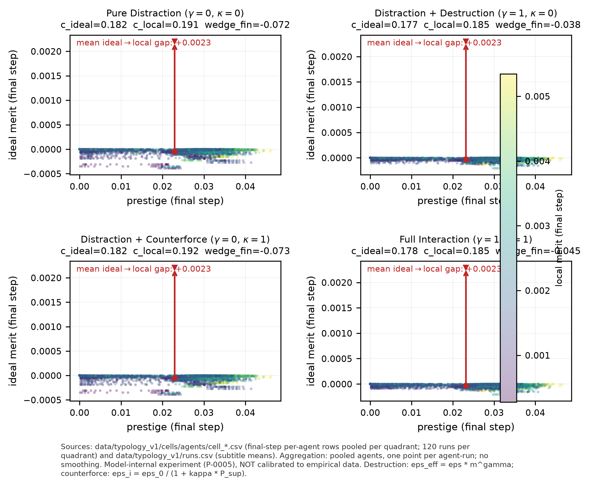
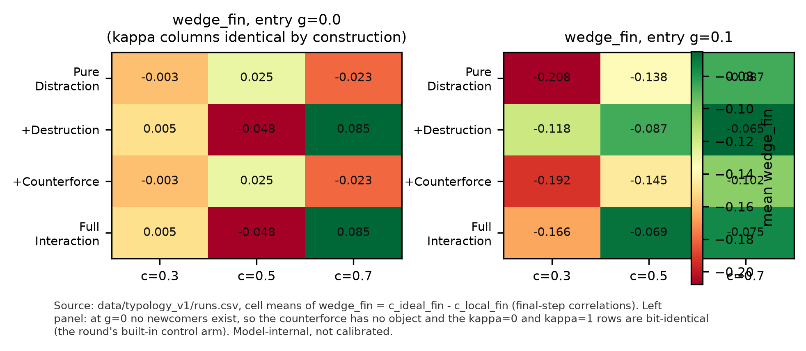

- **Source:** Antigravity inspection & evaluation round (Item 1.4), updated with empirical findings from `output/reports/typology_v1.md` (24 cells / 480 runs)
- **Date:** 2026-11-14 (v1); 2026-11-15 (v2 — post-`typology_v1` synthesis)
- **Related:** `context/Hunting_Proxy_Patterns.md`, `context/John_2023_Proxy_Failure.md`, `context/Braganza_2020_Irreproducibility.md`, `AdmiralsLog/way_forward.md`, `output/reports/typology_v1.md`
- **Spawned:** `P-0005` (exercised), `P-0008`, `IE-0002` (rejected), `IE-0003`

# 1. Purpose: Bridging the Qualitative DAGs to Simulation Primitives

`context/Hunting_Proxy_Patterns.md` (Kapeller, Paul, Braganza 2026) establishes a minimal causal grammar for proxy failure across biological, economic, and metascientific systems:
- **Proxy ($P$):** Observable metric used to regulate or reward agents.
- **Goal ($G$):** Underlying epistemic or social objective that $P$ is meant to track.
- **Aligned Action ($A$):** Effort that advances both $P$ and $G$ ($M \to A \to \{P, G\}$).
- **Proxy-Oriented Action ($AP_F$):** Activity motivated by $M$ that boosts $P$ without advancing (or while harming) $G$.
- **Three Failure & Stabilizing Channels:**
  1. **Distraction (indirect crowding out):** Pursuing $AP_F$ diverts time/placement away from $A$, reducing $G$ by neglect.
  2. **Destruction (direct crowding out, $AP_F \dashv G$):** Applying $AP_F$ directly degrades $G$ (the "blue path" in Fig. 1b).
  3. **Built-in Counterforce ($P \to G$):** When higher $P$ causally facilitates $G$ (e.g., resources or genuine superstar spillovers), it attenuates proxy failure unless overwhelmed by $AP_F$.

The `sciencemodels` ABM provides a formal testbed to turn this qualitative typology into a parameterized regime diagram (Path D of `AdmiralsLog/way_forward.md`).

---

# 2. Exact Mapping from Causal Typology to ABM Mechanics (Revised After `typology_v1`)

| Typology Element (`Hunting_Proxy_Patterns.md`) | ABM Counterpart in `sciencemodels` | Code / Formula Anchor & `typology_v1` Lesson |
| --- | --- | --- |
| **Motivation ($M$)** | Step-level utility maximization $R_i = (k_i/\bar{k})^{c_i} \cdot V_i^{1-c_i}$ + prestige-weighted recruitment | `agents.py:125-127`, `model.py:389-420` |
| **Goal ($G$)** | Epistemic ground truth: greedy-optimal knowledge harvest (`ideal_Merit` and cumulative `ideal_merit_cum`) | `metrics.py:53-106` |
| **Proxy ($P$)** | Agent prestige stocks (`prestige`, `prestige_vanishing`, `prestige_visibility`) and spatial visibility $V_i$ | `agents.py:64-84` |
| **Aligned Action ($A$)** | Curiosity-driven search toward high-novelty tiles ($c_i \to 1$) | `agents.py:125-127` |
| **Distraction ($AP_F$ indirect)** | Visibility-weighted movement ($1 - c_i \to 1$) and low-$\lambda$ partner choice: agents cluster near peers on depleted tiles instead of exploring high-$k$ tiles | Validated in `welfare_probe_v1` ($\xi^* \in [0.6, 0.8]$) and `typology_v1` (`Pure Distraction` `wedge_fin = -0.1444` at $g=0.1$) |
| **Destruction ($AP_F \dashv G$ direct)** | **Lesson from `typology_v1`:** Modelling destruction as candidate-perception noise ($\epsilon_{\text{eff}} = \epsilon \cdot m^\gamma$) acts as *exploratory annealing* rather than destruction (`ideal_loss_cum` drops $16.3\%$). True $AP_F \dashv G$ destruction must degrade **the knowledge stock or harvested merit directly** under crowding (e.g., over-trampling depletes tile knowledge without yielding harvest, or crowded tiles generate false-positive local merit with negative ideal merit). | Tested in `typology_v1.md` ([IE-0002](file:///Users/joko/Git/sciencemodels/AdmiralsLog/ideas/rejected/IE-0002-crowding-perception-noise-as-epistemic-destruction.md)); stock/harvest formulation proposed in [P-0008](file:///Users/joko/Git/sciencemodels/AdmiralsLog/proposals/P-0008-stock-destruction-and-normalized-counterforce.md) |
| **Counterforce ($P \to G$)** | **Lesson from `typology_v1`:** Unnormalized $\epsilon_i = \epsilon_0 / (1 + \kappa P_{\text{sup}})$ binds bit-wise ($114/120$ pairs) but is scale-trapped ($\le 0.0039$) because raw $\bar{P} \approx 0.025$. Superstar spillovers require dimensionless prestige normalization $\tilde{P}_{\text{sup}} = P_{\text{sup}} / \bar{P}_t$ ([IE-0003](file:///Users/joko/Git/sciencemodels/AdmiralsLog/ideas/IE-0003-dimensionless-prestige-normalization.md)). | Tested in `typology_v1.md`; normalized counterforce proposed in [P-0008](file:///Users/joko/Git/sciencemodels/AdmiralsLog/proposals/P-0008-stock-destruction-and-normalized-counterforce.md) |

---

# 3. Empirical Results from Path D v1 ([typology_v1.md](file:///Users/joko/Git/sciencemodels/output/reports/typology_v1.md), 24 cells / 480 runs)

In `typology_v1`, the four-quadrant crossing ($\gamma \in \{0,1\} \times \kappa \in \{0,1\}$ across $c \in \{0.3, 0.5, 0.7\}$ and $g \in \{0.0, 0.1\}$ on `mgstd5`) established three sharp analytical results:

1. **Pure Distraction Reproduces the Entry-Driven Proxy Wedge:**
   In the `Pure Distraction` quadrant ($\gamma = 0, \kappa = 0$), activating entry ($g = 0.1$) opens the endpoint wedge from `-0.0002` ($g=0.0$) to **`-0.1444`** ($g=0.1$), while raising curiosity from $c = 0.3$ to $c = 0.7$ narrows the wedge by `+0.0506` (`-0.1055 -> -0.0549`).
2. **Why Candidate-Perception Noise ($\epsilon_{\text{eff}} = \epsilon \cdot m^\gamma$) Acts as Simulated Annealing Rather Than Destruction (`IE-0002`):**
   Instead of worsening proxy failure, setting $\gamma = 1$ in the candidate-perception noise formula **narrows the endpoint wedge by `+0.0316`** (bootstrap 95% CI `[0.0101, 0.0532]`) and **cuts cumulative ideal-merit welfare loss by `16.3%`** (`-0.0783`, 95% CI `[-0.0977, -0.0598]`, `0.48 -> 0.40`). Two micro-mechanisms explain why:
   - In `sciencemodels/agents.py`, the current tile's own utility is evaluated noise-free, while candidate neighbors receive multiplicative noise $1 + \epsilon_{\text{eff}} \cdot \text{Uniform}(-1, 1)$. Amplifying noise on crowded neighbors creates positive upward noise spikes that help trapped agents clear the strict-improvement threshold (`agents.py:166`) and scatter off depleted herds.
   - At $m = 0$ (unoccupied frontier tiles), $m^\gamma = 0$ gives agents a **noise-free read on empty frontier tiles**.
   - **Theoretical implication for `Hunting_Proxy_Patterns.md`:** In spatial search models where proxy failure is driven by herding lock-in, *perceptual noise on crowded topics* is beneficial (annealing), whereas *epistemic destruction* ($AP_F \dashv G$) requires crowding to directly destroy the underlying epistemic stock $G$ (e.g., over-fishing/trampling unharvested knowledge or polluting the literature with false-positive claims that carry negative ideal merit).
3. **Why Unnormalized Superstar Counterforces ($\kappa = 1$) Are Scale-Trapped:**
   While the counterforce $\epsilon_i = \epsilon_0 / (1 + \kappa P_{\text{sup}})$ is verified bit-identical at $g = 0.0$ (control arm) and binds in `114 of 120` seed-paired runs at $g = 0.1$, its main effect is at most `0.0039` across all four measures (all 95% CIs spanning 0). Because raw `prestige` in the ABM averages `~0.0254`, $1 + 1.0 \cdot P_{\text{sup}} \approx 1.025$ reduces newborn perception noise by only `~2.5%`. Normalizing $P_{\text{sup}}$ by the population mean/max prestige ([P-0008](file:///Users/joko/Git/sciencemodels/AdmiralsLog/proposals/P-0008-stock-destruction-and-normalized-counterforce.md), [IE-0003](file:///Users/joko/Git/sciencemodels/AdmiralsLog/ideas/IE-0003-dimensionless-prestige-normalization.md)) is required to test $P \to G$ counterforces at full strength.

