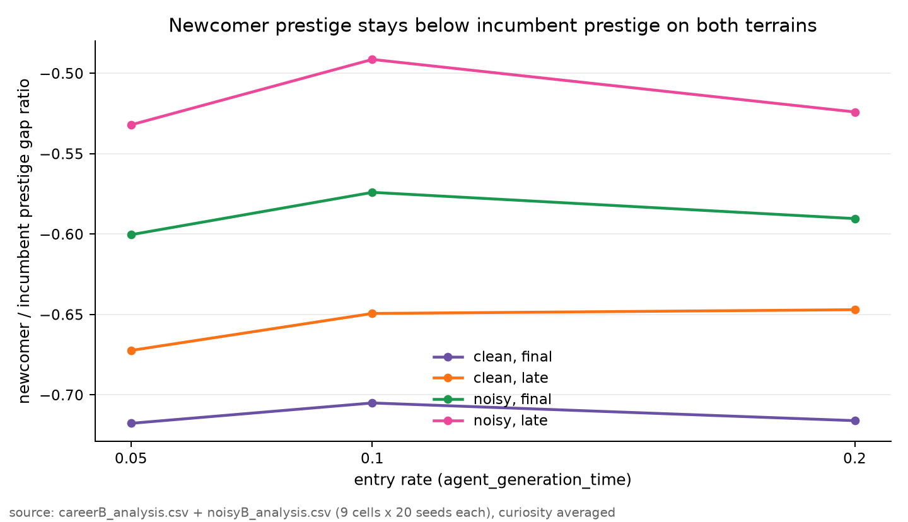
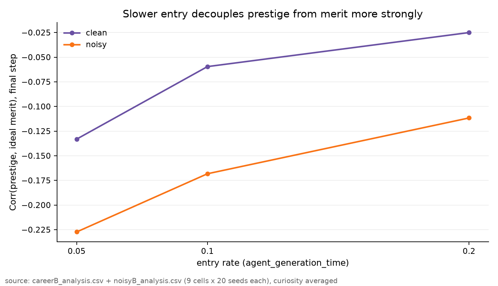

- **Source:** Antigravity inspection & evaluation round (Item 2: Publishable Results & Visual Alignment), updated after `F1`–`F4` (`path_b_probe_v2`, `interventions_v1`, `typology_v1`, `turnover_v1`)
- **Date:** 2026-11-14 (v1); 2026-11-15 (v2 — post-`F1..F4` update)
- **Related:** `AdmiralsLog/proposals/P-0001-phase1-paper.md`, `docs/related_publications.md`, `docs/connections_niklas.md`, `output/reports/sensitivity_map_v1.md`, `output/reports/career_flows_v1.md`, `output/reports/career_flows_noisy_v1.md`, `output/reports/welfare_probe_v1.md`, `output/reports/prestige_stock_v1.md`, `output/reports/turnover_v1.md`, `output/reports/interventions_v1.md`, `output/reports/path_b_probe_v2.md`
- **Spawned:** Visual alignment map for `P-0001` and `CONT5`

# 1. How `CONT1`–`CONT5` Align in `AdmiralsLog/contributions/`

To keep `AdmiralsLog/contributions/` coherent as analytical building blocks for the paper effort, the five contribution memos divide cleanly by role:

1. **[CONT3-publishable-results-synthesis.md](file:///Users/joko/Git/sciencemodels/AdmiralsLog/contributions/CONT3-publishable-results-synthesis.md) (this file — Core Substantive Claims About the World from Waves 1–3, Qualified by Wave 4):**
   Synthesizes the three foundational results driven by demographic entry ($g$), internal visibility weight ($1-c$), and landscape legibility, positions each against the 46-study literature review (`docs/related_publications.md`), binds each claim to the house-style figures (`F1`, `F2`/`F2b`, `F3`), and notes the crucial Wave 4 (`turnover_v1`, `path_b_probe_v2`) refinements.
2. **[CONT5-generational-turnover-and-paradigm-lockin.md](file:///Users/joko/Git/sciencemodels/AdmiralsLog/contributions/CONT5-generational-turnover-and-paradigm-lockin.md) (New Substantive World Results from Wave 4 — `F1` to `F4`):**
   Synthesizes the four new substantive findings from the 3,960 Wave-4 runs: (i) stationary generational turnover strengthens proxy failure $2.8\times\text{–}6.6\times$ while shrinking the arrival gap by 55%–79% (`turnover_v1`), (ii) early discovery vs. late depletion phase reversal (`turnover_v1`), (iii) sabbatical relocation shocks cut high-visibility welfare loss by 40% while occupied paradigm refills collapse exploration by 84% and frontier refills go unclaimed (`interventions_v1`), and (iv) spatial partner pull (`dyadic_move_pull`) couples partner choice to co-harvest team size and the prestige-merit wedge (`path_b_probe_v2`).
3. **[CONT4-inert-and-invariant-degrees-of-freedom.md](file:///Users/joko/Git/sciencemodels/AdmiralsLog/contributions/CONT4-inert-and-invariant-degrees-of-freedom.md) (Setup Invariances, Near-Inert Levers, Scale Traps & Falsified Parameterizations):**
   Collects all variables and mechanisms across the 106-entry audit and Waves 1–4 that turn out **not** to matter much or that work opposite to naive intuition (`entry_prestige_stock`, `use_visibility_reward`, `vanishing_factor_for_prestige`, `N1` pairing, uncoupled dyadic links, lottery exponent $\alpha$ on welfare loss, unnormalized prestige scale traps $\kappa$, birth-tile dispersal `r_spawn`, and candidate-perception crowding noise $\gamma$).
4. **[CONT1-depletion-counterforces-refills.md](file:///Users/joko/Git/sciencemodels/AdmiralsLog/contributions/CONT1-depletion-counterforces-refills.md) (Mechanism & Policy Extensions — Path C):**
   Explains the micro-mechanism behind the banked results (recruitment-herding dominance over birth-tile starvation) and evaluates the institutional counterforces (`interventions_v1`).
5. **[CONT2-hunting-proxy-patterns-formalization.md](file:///Users/joko/Git/sciencemodels/AdmiralsLog/contributions/CONT2-hunting-proxy-patterns-formalization.md) (Theoretical Typology — Path D):**
   Maps the model regimes onto the causal DAG typology of Kapeller, Paul, and Braganza (`context/Hunting_Proxy_Patterns.md`: distraction, destruction, and $P \to G$ counterforces) and incorporates the findings of `typology_v1`.

---

# 2. The Three Foundational Results About the World (and Their Wave-4 Refinements)

Against the 46 verified studies in `docs/related_publications.md`, no existing model combines (i) spatial/topical landscape search (Kitcher 1990; Weisberg & Muldoon 2009; Zollman 2007, 2010), (ii) visibility-proxy incentives and prestige recruitment (Smaldino & McElreath 2016; Braganza 2020; John et al. 2023), and (iii) an external omniscient-planner benchmark (`ideal_Merit`, answering Payette 2011's critique that ABMs of science lack reward-independent success criteria).

## Result 1: Endogenous Channel-Specific Proxy Failure ("The Relational Wedge")

- **Simulation Finding (`sensitivity_map_v1`, `remeasure_v1`, `turnover_v1`, `interventions_v1`):**
  Without any conscious metric-gaming action, activating prestige-proportional newcomer entry (`agent_generation_time = 0.1`) flips the quality correlation `Corr_prestige_ideal_merit` from $+0.219$ to $-0.131$ (pre-fix) / $+0.220$ to $-0.144$ (post-fix re-measure across 720 seed-matched runs; 17/18 entry cells negative in both, 0/36 sign flips, mean paired delta $-0.0056 \pm 0.0018$), while the quantity correlation `Corr_prestige_local_merit` remains positive ($+0.038$, untouched at $0.0000$ delta). Prestige concentration (`top10pct_prestige_share`) nearly doubles from $0.135$ to $0.228$.
  - **Wave-4 Mechanism Refinement (`interventions_v1`):** Dispersing newcomer birth tiles (`r_spawn = random`) makes $c_{\text{ideal}}$ even more negative ($-0.057 \to -0.145$ at $c=0.5$), proving that **100%+ of the quality drop is driven by prestige-proportional recruitment and visibility herding**, not mechanical birth-tile starvation.
  - **Wave-4 Demographic Refinement (`turnover_v1`):** Retiring founders under stationary turnover strengthens the terminal negative correlation **$2.8\times$ (`-0.240`, `fixed_span`) to $6.6\times$ (`-0.568`, `age_hazard`, negative in 100% of runs)** — proving that founder immortality diluted, rather than caused, proxy failure.
- **Literature Significance:**
  Demonstrates that Merton's (1968) Matthew effect and John et al.'s (2023) proxy failure emerge relationally from demographic matching on a depletable landscape. It micro-founds the exact empirical wedge observed in the Klann economics co-authorship panel ($\text{corr}(\text{prestige}, \text{future5}) = 0.50$ vs. $\text{corr}(\text{prestige}, \text{citations}) = 0.07$).
- **Visual Anchor:**
  - House-style report figure: `output/report_notebook_v1/F1_sensitivity_entry_curiosity.png` (*"Prestige no longer tracks ideal merit once entry is on"*)

## Result 2: Endogenous Cumulative Advantage & Cohort Stratification

- **Simulation Finding (`career_flows_v1`, `career_flows_noisy_v1`, refined by `turnover_v1`):**
  Newcomers never close the prestige gap with incumbents at any entry rate $g \in \{0.05, 0.10, 0.20\}$ (final gap ratio $-0.713$ on clean terrain and $-0.588$ on noisy terrain; late-window mean $-0.656$ on clean and $-0.516$ on noisy; 100% of cells negative).
  - **Wave-4 Demographic Decomposition (`turnover_v1`, 1,080 runs at $H=400$):** When founders retire (`fixed_span` and `age_hazard`), the arrival gap (`gap_recent`, 20-step tenure window) remains negative in **1,080 of 1,080 runs**, proving cohort stratification is permanent. However, the gap's magnitude shrinks by **55.0%** (`fixed_span`) to **79.3%** (`age_hazard`), cleanly decomposing the baseline gap into a **55%–79% founder-immortality premium** and a **21%–45% steady-state arrival handicap**.
  - **Qualification of the Slow-Entry Paradox (`turnover_v1`):** In the immortal-founder baseline, slower entry ($g = 0.05$) produced stronger negative $c_{\text{ideal}}$ than faster entry ($g = 0.20$) because fresh entrants diluted the immortal founders. Under stationary population (`fixed_span`, $N \equiv 20$), $c_{\text{ideal}}$ is **invariant to the entry rate** ($-0.231, -0.247, -0.243$ at $g = 0.05, 0.10, 0.20$). Any claim that "faster entry dilutes proxy failure" must therefore be stated strictly as a property of growing populations with non-retiring incumbents.
- **Literature Significance:**
  Separates pure tenure accumulation from structural arrival stratification in the Matthew-effect literature (Petersen et al. 2014; Guimerà et al. 2005).
- **Visual Anchor:**
  - House-style report figures: `output/report_notebook_v1/F2_career_flows_gap_ratio.png` (*"Newcomer prestige stays below incumbent prestige on both terrains"*) and `output/report_notebook_v1/F2b_career_flows_noisy_vs_clean.png` (*"Slower entry decouples prestige from ideal merit more strongly"*)

## Result 3: The Convex Welfare Kink ($\xi^* \in [0.6, 0.8]$) & Its Attention-Side Cure

- **Simulation Finding (`welfare_probe_v1`, `remeasure_v1`, `interventions_v1`):**
  Measured against the omniscient planner's allocation (`ideal_Merit`), welfare loss is gently sloped across low visibility weights ($1-c \le 0.5$) and then kinks sharply upward at $\xi^* \in [0.6, 0.8]$ across all 8 series (F-screen + interior bootstrap 95% CI passed in 24/24 outcome series; confirmed post-audit on `W_v05` with 7/8 panels at $0.6$ and 1/8 at $0.8$; total loss rises $10\times\text{–}44\times$, and harvested knowledge drops by $\approx 0.36$ per unit of visibility weight).
  - **Wave-4 Policy Refinement (`interventions_v1` Arm B):** Transient-diversity sabbatical shocks (`p_reloc = 0.02`) flatten the high-visibility welfare penalty by **40%** and convexity by **27%**, whereas entry lotteries ($\alpha = 0$) move the penalty by only **$-0.9\%$**.
- **Literature Significance:**
  Quantifies Kitcher's (1990) division-of-cognitive-labor loss as an explicit phase transition (Smaldino & Epstein 2015) and shows that breaking spatial status-quo lock-in (Zollman 2010) outperforms entry-stage funding lotteries when post-entry attention is visibility-driven.
- **Visual Anchor:**
  - House-style report figure: `output/report_notebook_v1/F3_welfare_loss_vs_visibility_weight.png` (*"Visibility pressure raises loss; toggle gap at most 6.1e-04"*)
  - Intervention recovery curve: `data/interventions_v1/figures/FB_welfare_loss_curves.png`

---

# 3. Pointer to `CONT4` and `CONT5`

- For the **four new substantive findings from Wave 4 (`F1`–`F4`)** in full detail, see [CONT5-generational-turnover-and-paradigm-lockin.md](file:///Users/joko/Git/sciencemodels/AdmiralsLog/contributions/CONT5-generational-turnover-and-paradigm-lockin.md).
- For **all setup-level invariances, near-inert levers, scale traps, and falsified parameterizations**, see [CONT4-inert-and-invariant-degrees-of-freedom.md](file:///Users/joko/Git/sciencemodels/AdmiralsLog/contributions/CONT4-inert-and-invariant-degrees-of-freedom.md).
