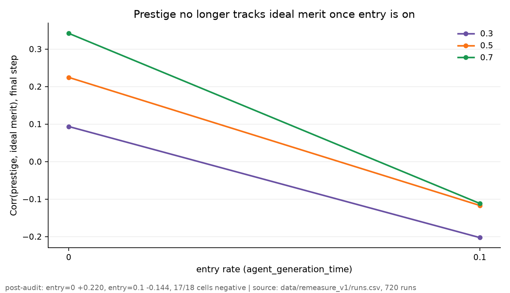
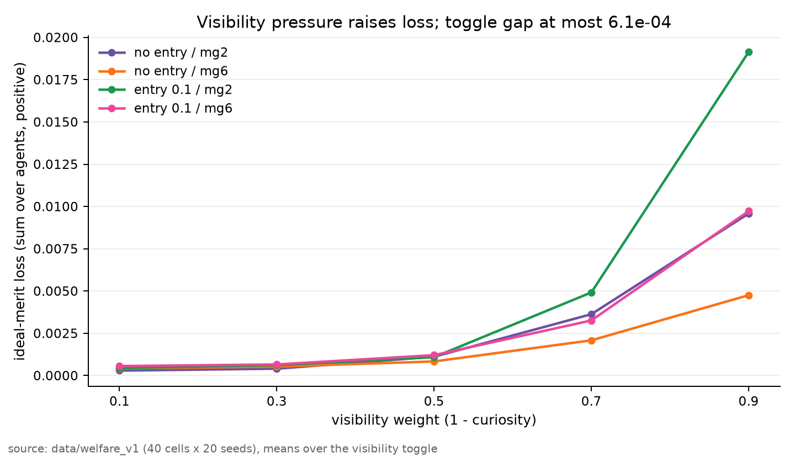

- **Source:** Antigravity inspection & evaluation round (Item 2: Publishable Results & Visual Alignment)
- **Date:** 2026-11-14
- **Related:** `AdmiralsLog/proposals/P-0001-phase1-paper.md`, `docs/related_publications.md`, `docs/connections_niklas.md`, `output/reports/sensitivity_map_v1.md`, `output/reports/career_flows_v1.md`, `output/reports/career_flows_noisy_v1.md`, `output/reports/welfare_probe_v1.md`, `output/reports/prestige_stock_v1.md`, `scripts/report_notebook/round_report_figures.py`
- **Spawned:** Visual alignment map for `P-0001`

# 1. How `CONT1`–`CONT3` Align in `AdmiralsLog/contributions/`

To keep `AdmiralsLog/contributions/` coherent as external/analytical building blocks for the paper effort, the three contribution memos divide cleanly by role:

1. **[CONT3-publishable-results-synthesis.md](file:///Users/joko/Git/sciencemodels/AdmiralsLog/contributions/CONT3-publishable-results-synthesis.md) (this file — What We Have Proven):**
   Synthesizes the four publishable empirical/simulation results already banked in Waves 1–3, positions each against the 34-study literature review (`docs/related_publications.md`), and binds each claim to the house-style figures (`F1`–`F5`) generated by the `report_notebook` design workstream.
2. **[CONT1-depletion-counterforces-refills.md](file:///Users/joko/Git/sciencemodels/AdmiralsLog/contributions/CONT1-depletion-counterforces-refills.md) (Mechanism & Policy Extensions — Path C):**
   Explains the micro-mechanism behind the banked results (birth-tile depletion vs. visibility herding) and specifies the institutional counterforces (lotteries, sabbatical shocks, paradigm refills).
3. **[CONT2-hunting-proxy-patterns-formalization.md](file:///Users/joko/Git/sciencemodels/AdmiralsLog/contributions/CONT2-hunting-proxy-patterns-formalization.md) (Theoretical Typology — Path D):**
   Maps the banked and proposed mechanisms onto the causal DAG typology of Kapeller, Paul, and Braganza (`context/Hunting_Proxy_Patterns.md`: distraction, destruction, and $P \to G$ counterforces).

---

# 2. The Four Publishable Headline Results (and Why They Matter vis-à-vis the Literature)

Against the 34 verified studies in `docs/related_publications.md`, no existing model combines (i) spatial/topical landscape search (Kitcher 1990; Weisberg & Muldoon 2009; Zollman 2007, 2010), (ii) visibility-proxy incentives and prestige recruitment (Smaldino & McElreath 2016; Braganza 2020; John et al. 2023), and (iii) an external omniscient-planner benchmark (`ideal_Merit`, answering Payette 2011's critique that ABMs of science lack reward-independent success criteria).

## Result 1: Endogenous Channel-Specific Proxy Failure ("The Relational Wedge")

- **Simulation Finding (`sensitivity_map_v1`, `remeasure_v1`):**
  Without any conscious metric-gaming action, activating prestige-proportional newcomer entry (`agent_generation_time = 0.1`) flips the quality correlation `Corr_prestige_ideal_merit` from $+0.219$ to $-0.131$ (pre-fix) / $+0.220$ to $-0.144$ (post-fix re-measure across 720 seed-matched runs; 17/18 entry cells negative in both, 0/36 sign flips, mean paired delta $-0.0056 \pm 0.0018$), while the quantity correlation `Corr_prestige_local_merit` remains positive ($+0.038$, untouched at $0.0000$ delta). Prestige concentration (`top10pct_prestige_share`) nearly doubles from $0.135$ to $0.228$.
- **Literature Significance:**
  Demonstrates that Merton's (1968) Matthew effect and John et al.'s (2023) proxy failure emerge relationally from demographic matching on a depletable landscape. It micro-founds the exact empirical wedge observed in the Klann economics co-authorship panel ($\text{corr}(\text{prestige}, \text{future5}) = 0.50$ vs. $\text{corr}(\text{prestige}, \text{citations}) = 0.07$).
- **Visual Anchor:**
  - House-style report figure: `output/report_notebook_v1/F1_sensitivity_entry_curiosity.png` (*"Prestige no longer tracks ideal merit once entry is on"*)
  - Post-audit robustness figure: `output/report_notebook_v1/F5_pairing_audit_paired_delta.png` (*"Pairing audit moved the ideal-side levels; local side untouched"*)

## Result 2: Endogenous Cumulative Advantage & The Slow-Entry Paradox

- **Simulation Finding (`career_flows_v1`, `career_flows_noisy_v1`):**
  Newcomers never close the prestige gap with incumbents at any entry rate $g \in \{0.05, 0.10, 0.20\}$ (final gap ratio $-0.70$ to $-0.72$, late gap ratio $-0.68$ to $-0.64$ on clean terrain, $-0.53$ to $-0.49$ on noisy terrain; 100% of late cell-steps negative). Counterintuitively, **decoupling is strongest when entry is slowest** ($g = 0.05$ yields final ideal correlation $-0.227$ on noisy and $-0.133$ on clean, vs. $-0.112$ and $-0.025$ at $g = 0.20$), because slow entry lets early founder prestige hierarchies harden before advisees arrive. Moreover, the entry-driven sawtooth oscillation survives to horizon $H=400$ in 6/6 cells without mean-reverting.
- **Literature Significance:**
  Qualifies Petersen et al. (2014) and Guimerà et al. (2005): rapid influx of newcomers actually *dilutes* oligarchic lock-in, whereas low-turnover elite recruitment maximizes epistemic misallocation.
- **Visual Anchor:**
  - House-style report figure: `output/report_notebook_v1/F2_career_flows_gap_ratio.png` (*"Newcomer prestige stays below incumbent prestige at every entry rate"*)
  - Clean vs. noisy 4-panel comparison: `data/career_flows_noisy_v1/figures/career_noisy_vs_clean.png`

## Result 3: The Convex Welfare Kink ($\xi^* \in [0.6, 0.8]$) & Weight-vs.-Toggle Asymmetry

- **Simulation Finding (`welfare_probe_v1`):**
  Measured against the omniscient planner's allocation (`ideal_Merit`), welfare loss is gently sloped across low visibility weights ($1-c \le 0.5$) and then kinks sharply upward at $\xi^* \in [0.6, 0.8]$ across all 8 series (F-screen + interior bootstrap 95% CI passed in 24/24 outcome series; total loss rises $10\times\text{–}44\times$, and harvested knowledge drops by $\approx 0.36$ per unit of visibility weight). Crucially, switching `use_visibility_reward` on vs. off moves welfare loss by only $2.6\%$ (toggle gap at most $6.1\times 10^{-4}$), whereas varying the visibility weight $1-c$ moves loss by $31\times$.
- **Literature Significance:**
  Quantifies Kitcher's (1990) division-of-cognitive-labor loss as an explicit phase transition (Smaldino & Epstein 2015). Shows that the primary driver of epistemic loss is how heavily career rewards weight topical visibility/conformity ($1-c$), not whether visibility is weighted by peer eminence.
- **Visual Anchor:**
  - House-style report figure: `output/report_notebook_v1/F3_welfare_loss_vs_visibility_weight.png` (*"Visibility pressure raises loss; toggle gap at most 6.1e-04"*)
  - Multi-outcome curves, phase diagram & breakpoint bootstrap: `data/welfare_v1/figures/welfare_curves.png`, `data/welfare_v1/figures/phase_diagram.png`, `data/welfare_v1/figures/collapse_threshold.png`

## Result 4: Goodhart Geography Invariance Across Prestige Stock Formulas

- **Simulation Finding (`prestige_stock_v1`):**
  Whether the supervisor roulette weights candidates by raw cumulative `prestige`, exponentially decaying `prestige_vanishing`, or peer-perceived `prestige_visibility`, the cross-cell ordering of the terminal wedge ($\text{corr}(\text{local}) - \text{corr}(\text{ideal}) \in [+0.09, +0.26]$ across the 6 entry-on cells) is preserved at Spearman $\rho = 0.965\text{–}0.993$ ($p \le 4\times 10^{-7}$), and 0 of 12 seed-matched terminal-wedge contrasts exclude zero. Changing the prestige formula alters the *speed* of divergence (time-mean correlations and newcomer gap), not *where* the wedge opens.
- **Literature Significance:**
  Provides a formal demonstration of Muller's (2018) and Osterloh & Frey's (2015) critique of indicator tinkering: replacing cumulative publication counts with decaying or visibility-adjusted bibliometric indices does not fix proxy failure when the underlying selection channel remains prestige-proportional.
- **Visual Anchor:**
  - House-style report figure: `output/report_notebook_v1/F4_prestige_stock_wedge_matrix.png` (*"The terminal wedge barely moves with the prestige stock"*)
  - Paired bootstrap forest plot: `data/prestige_stock_v1/figures/stock_effects.png`

---

# 3. Visual Architecture Review (`notebooks/round_results_report_v1.ipynb`)

The completed design workstream (`scripts/report_notebook/` + `notebooks/round_results_report_v1.ipynb` + `output/report_notebook_v1/`) provides a clean, executed 5-figure spine (`F1`–`F5`) with two minor follow-up opportunities for the paper drafting phase:
1. **Optional post-fix overlay on `F1`:** `F1` currently draws from `data/sensitivity_v1/` (pre-fix); since `F5` proves the paired shift on `c_ideal_fin` is only $-0.0056$ (`+0.219 -> +0.220` at `entry=0`, `-0.131 -> -0.144` at `entry=0.1`), switching `F1` to `data/remeasure_v1/` (or overlaying both) is a one-line change in `round_report_data.py`.
2. **Optional noisy-landscape companion for `F2`:** `F2` currently plots the clean landscape (`data/career_flows_v1/`); pairing it with `data/career_flows_noisy_v1/` (where the gap ratio narrows from $-0.71$ to $-0.51$ while remaining 100% negative) and the 2D welfare phase diagram (`data/welfare_v1/figures/phase_diagram.png`) completes the full visual suite for `P-0001`.
