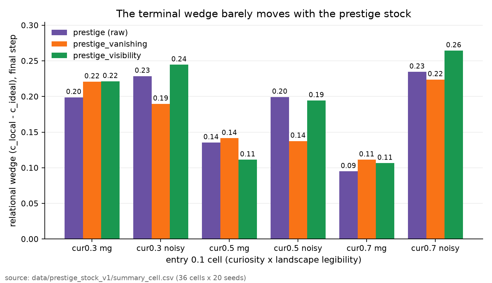
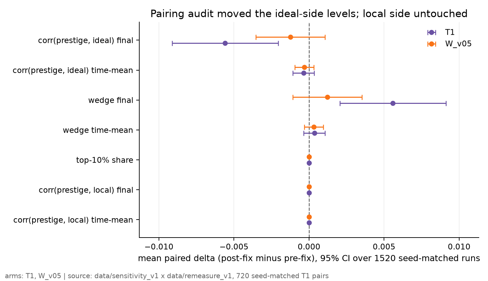

- **Source:** Owner & Antigravity review of `CONT3`, the 106-entry catalogue (`docs/conceptual_degrees_of_freedom.md`), and Wave-4 reports (`interventions_v1`, `typology_v1`, `turnover_v1`, `path_b_probe_v2`)
- **Date:** 2026-11-15 (v3 — updated with `proposals/executed/` links and `CONT6` scale context)
- **Related:** `docs/conceptual_degrees_of_freedom.md`, `AdmiralsLog/contributions/CONT6-canonical-model-specifications-basic-vs-collaborators.md`, `output/reports/prestige_stock_v1.md`, `output/reports/welfare_probe_v1.md`, `output/reports/remeasure_v1.md`, `output/reports/path_b_probe_v1.md`, `output/reports/path_b_probe_v2.md`, `output/reports/interventions_v1.md`, `output/reports/typology_v1.md`, `output/reports/turnover_v1.md`
- **Spawned:** Setup-robustness / dimensionality-reduction section for `P-0001` (`output/reports/paper_phase1_v1.md`); [rejected/IE-0001](file:///Users/joko/Git/sciencemodels/AdmiralsLog/ideas/rejected/IE-0001-birth-tile-starvation-hypothesis.md), [rejected/IE-0002](file:///Users/joko/Git/sciencemodels/AdmiralsLog/ideas/rejected/IE-0002-crowding-perception-noise-as-epistemic-destruction.md), [IE-0003](file:///Users/joko/Git/sciencemodels/AdmiralsLog/ideas/IE-0003-dimensionless-prestige-normalization.md)

# 1. Why a Dedicated Contribution on Setup Invariances and Non-Working Levers?

`docs/conceptual_degrees_of_freedom.md` catalogues **106 distinct modelling assumptions** across the landscape, agent movement, reward function, prestige accounting, demographics, dyadic choice, and measurement benchmarks. In an ABM with that many degrees of freedom, we need a clear separation between:
- **Substantive findings about the world (`CONT3`, `CONT5`, `CONT7`):** How demographic entry (`M1`), generational turnover, visibility pressure ($1-c$), cognitive diversity (`mixed_pop`), sabbatical shocks (`p_reloc`), and paradigm emergence (`refill_mode`) govern epistemic proxy failure.
- **Findings about our model setup (`CONT4`, this file):** Which candidate levers are **invariant or near-inert**, which parameterizations suffer from **numerical scale traps**, and which intuitive mechanism hypotheses **fail or work in reverse** because of how the spatial grid and utility rules are wired.

Collecting all eleven setup-level findings here serves two purposes:
1. **Honest boundary between world-claims and setup-claims:** It prevents model-internal wiring effects (such as raw prestige averaging $0.025$ or candidate perception noise acting as annealing) from being misread as grand empirical claims about science.
2. **Dimensionality reduction against the "arbitrary ABM" critique:** It demonstrates empirically that across thousands of runs, secondary specification choices either wash out or fail cleanly for diagnosed mechanical reasons.

---

# 2. Part A: Seven Levers That Are Invariant or Near-Inert in Our Setup

## 2.1 Which Prestige Stock Weights the Supervisor Roulette (`entry_prestige_stock`)

- **Evidence ([prestige_stock_v1.md](file:///Users/joko/Git/sciencemodels/output/reports/prestige_stock_v1.md), 36 cells / 720 runs):**
  Whether newcomer supervision in `M1` is weighted by raw cumulative `prestige`, exponentially decaying `prestige_vanishing`, or peer-perceived `prestige_visibility`:
  - In `M0` (`agent_generation_time == 0`), all three stocks produce **bit-identical** runs (`0.0` difference on every reporter) because `entry_prestige_stock` is read *only* inside `__generate_new_agents` (`sciencemodels/model.py:395-399`).
  - In `M1` (`agent_generation_time == 0.1`), the cross-cell ordering of the terminal wedge (`corr(local) - corr(ideal)`) is preserved at Spearman $\rho = 0.965\text{–}0.993$ ($p \le 4\times 10^{-7}$), and **0 of 12** seed-matched terminal-wedge contrasts exclude zero.
- **Contextual & setup diagnosis:** On a depletable grid where founding pioneers establish their rank order early, lifetime citations (`prestige`), recent citations (`prestige_vanishing`), and network centrality (`prestige_visibility`) rank the top mentors almost identically by the time doctoral students arrive. Switching the stock formula slightly alters *how fast* the gap opens mid-run, but not *where* the terminal wedge lands.

## 2.2 The Raw-Prestige Scale Trap in Multiplicative Couplings (`use_visibility_reward` & Counterforce $\kappa$)

Two separate rounds independently hit the **same numerical scale trap**: in `sciencemodels`, individual agent `prestige` is a small float averaging **$\bar{P} \approx 0.0254$** (because total initial grid knowledge on `MultG2` is $\approx 2.0$ divided across 20–40 agents). Whenever a mechanism multiplies or divides by $(1 + P_i)$ with an $O(1)$ coefficient, the perturbation is at most $\sim 2.5\%$:

1. **Peer-Prestige Weighting Inside the Visibility Term (`use_visibility_reward`, [welfare_probe_v1.md](file:///Users/joko/Git/sciencemodels/output/reports/welfare_probe_v1.md), 40 cells / 800 runs):**
   In `sciencemodels/agents.py:100-123`, `use_visibility_reward = True` weights inverse distance to each peer by $(1 + \text{peer\_prestige})$. Toggling `use_visibility_reward` moves ideal-merit loss by at most **$6.1 \times 10^{-4}$ ($\approx 2.6\%$)**, whereas varying the Cobb-Douglas visibility exponent $1-c$ moves loss by **$31\times$**. Thus, spatial visibility $V_i$ in the current code measures **raw crowd density** ("how many scientists work on this topic"), not **elite status weighting** ("how famous are the scientists on this topic").
2. **Superstar Counterforce on Newborn Perception Noise ($\kappa$ in [typology_v1.md](file:///Users/joko/Git/sciencemodels/output/reports/typology_v1.md), 24 cells / 480 runs):**
   In [executed/P-0005](file:///Users/joko/Git/sciencemodels/AdmiralsLog/proposals/executed/P-0005-typology-distraction-destruction-counterforce.md), newborn perception noise was divided by supervisor prestige: $\epsilon_i = \epsilon_0 / (1 + \kappa P_{\text{sup}})$ at $\kappa = 1.0$. While the channel bound bit-wise in `114 of 120` seed-paired runs at $g = 0.1$, every main effect across all four outcome measures was **$\le 0.0039$ in absolute value** with 95% CIs spanning zero (`c_ideal` main `-0.0001`, `ideal_loss_cum` main `-0.0006`).
- **Setup fix ([IE-0003](file:///Users/joko/Git/sciencemodels/AdmiralsLog/ideas/IE-0003-dimensionless-prestige-normalization.md)):** Any multiplicative prestige coupling must use **dimensionless normalized prestige** $\tilde{P}_i = P_i / \bar{P}_t$ (which has mean $1.0$ and top-decile values $\sim 2\text{–}4$) rather than raw $P_i \approx 0.025$.

## 2.3 Entry-Lottery Supervisor Exponent on Welfare Loss ($\alpha$ in `interventions_v1`)

- **Evidence ([interventions_v1.md](file:///Users/joko/Git/sciencemodels/output/reports/interventions_v1.md#L94-L127), Arm B, 36 cells / 720 runs):**
  Replacing linear prestige-proportional supervision ($\alpha = 1.0$ in $P(\text{sup}_i) \propto \text{prestige}_i^\alpha$) with concave damping ($\alpha = 0.5$) or a pure placement lottery ($\alpha = 0.0$, random supervisor) changes the high-visibility welfare loss penalty $\text{loss}(0.9) - \text{loss}(0.5)$ by only **$-3.5\%$ ($\alpha = 0.5$) and $-0.9\%$ ($\alpha = 0.0$, $-0.000079$)**, compared to **$-40.0\%$** from sabbatical relocation shocks (`p_reloc = 0.02`).
- **Setup diagnosis:** In our setup, supervisor selection only sets an entrant's initial tile (`sup.pos`). Once on the grid, an entrant governed by high visibility weight ($1-c \in [0.7, 0.9]$) immediately herds into nearby visibility clusters regardless of how their supervisor was chosen.

## 2.4 Prestige Memory / Decay Factor (`vanishing_factor_for_prestige`)

- **Evidence ([sensitivity_map_v1.md](file:///Users/joko/Git/sciencemodels/output/reports/sensitivity_map_v1.md), [remeasure_v1.md](file:///Users/joko/Git/sciencemodels/output/reports/remeasure_v1.md)):**
  Sweeping `vanishing_factor_for_prestige` across $\{0.5, 0.9, 1.0\}$ in `T1` (and comparing `W` at `0.9` against `W_v05` at `0.5` in `remeasure_v1`) leaves both the sign of the entry-induced ideal-merit correlation (17/18 cells negative) and the location of the welfare collapse kink ($\xi^* \in [0.6, 0.8]$) unchanged.

## 2.5 Ideal-Merit Pairing Convention (`N1` Sorted-to-Sorted vs. Static-Head Benchmark)

- **Evidence ([remeasure_v1.md](file:///Users/joko/Git/sciencemodels/output/reports/remeasure_v1.md), 1,520 paired runs across `T1` and `W_v05`):**
  Replacing the pre-audit static-head ideal-merit pairing with the `N1` sorted-to-sorted pairing (`d3503ac`, `sciencemodels/metrics.py:72-90`) leaves all non-ideal reporters at **exact `0.0000` delta** across all 1,520 pairs, shifts mean `c_ideal_fin` by only **$-0.0056 \pm 0.0018$** on `T1` and **$-0.0012 \pm 0.0012$** on `W_v05`, flips **0 of 36** `T1` cell signs, and preserves cell-level wedge rankings at Spearman $\rho = 0.9745$.

## 2.6 Declared Dyadic Links Without Spatial Movement Coupling (`dyadic_mode` in Path B v1)

- **Evidence ([path_b_probe_v1.md](file:///Users/joko/Git/sciencemodels/output/reports/path_b_probe_v1.md), 40 cells / 800 runs):**
  Without `dyadic_move_pull`, sweeping $\lambda \in \{0, 0.25, 0.5, 0.75, 1.0\}$ strongly moves `n_active_links` (8/8 contrasts significant) but produces **exact `0.0000` delta** on `mean_team_size`, `repeated_collab_share`, and the wedge under `structural` credit (`0/8` contrasts significant under `equal_split`), because co-harvesting is defined by spatial tile co-location (`path_b_probe_v2.md` subsequently proved that adding `dyadic_move_pull > 0` couples the two layers).

## 2.7 Structurally Inert or Conditionally Dormant Levers in the Baseline Code

From the 106-entry code audit (`docs/conceptual_degrees_of_freedom.md`):
1. **`agent.age` (`sciencemodels/agents.py:41,185`):** Incremented every step, but read by **zero** baseline rules unless demographic retirement (`turnover_v1`) is enabled.
2. **`agent_generation_function` when `agent_generation_time == 0` (or when passed a constant lambda):** Founders receive `initial_curiosity` directly; `agent_generation_function` only affects newcomers (`M1`), except when `curiosity_swept = False` (`uniform`) is used at setup initialization (`CONT7` Finding L3).
3. **`new_questions = 0` (`sciencemodels/model.py:422-429`):** Dormant unless explicitly activated (`interventions_v1` Arm C).

---

# 3. Part B: Four Falsified Mechanism Parameterizations & Measurement Traps (From Wave 4)

Per owner review (2026-11-15), the two falsified mechanism hypotheses from `F2` (`interventions_v1`) and `F3` (`typology_v1`) are **rejected conceptual ideas** ([rejected/IE-0001](file:///Users/joko/Git/sciencemodels/AdmiralsLog/ideas/rejected/IE-0001-birth-tile-starvation-hypothesis.md), [rejected/IE-0002](file:///Users/joko/Git/sciencemodels/AdmiralsLog/ideas/rejected/IE-0002-crowding-perception-noise-as-epistemic-destruction.md)) that reveal how our spatial-utility setup behaves.

## 3.1 Falsified Mechanism 1: Birth-Tile Starvation as the Driver of the Entry Wedge (`r_spawn` in `interventions_v1`, `IE-0001`)

- **What was hypothesized ([executed/P-0002](file:///Users/joko/Git/sciencemodels/AdmiralsLog/proposals/executed/P-0002-spatial-spawn-dispersal.md)):** Because newcomers spawn directly on `sup.pos`, which the supervisor has already depleted, we hypothesized that dispersing newcomer birth tiles (`r_spawn` $\in \{\text{ring1}, \text{random}\}$) would repair a large share of the negative `Corr_prestige_ideal_merit` and narrow the newcomer-incumbent gap.
- **What happened ([interventions_v1.md](file:///Users/joko/Git/sciencemodels/output/reports/interventions_v1.md#L50-L92), 360 runs):** Dispersal **worsened** the quality correlation at all three curiosities (`starvation share = -5.7%, -21.5%, -53.5%`) and **widened** the newcomer gap by $0.08\%\text{–}12.0\%$.
- **Why our setup behaves this way:** On `mgstd5` and `noisypr5`, high-prestige founders sit on or near Gaussian peaks. Spawning at `sup.pos` at least places newcomers near high-value terrain; spawning them at `random` while keeping prestige-proportional supervisor credit and visibility herding leaves founders with an uncontested monopoly on the peak while advisees herd in low-value rings.

## 3.2 Falsified Mechanism 2: Candidate-Perception Noise ($\epsilon \cdot m^\gamma$) as Epistemic Destruction (`typology_v1`, `IE-0002`)

- **What was hypothesized ([executed/P-0005](file:///Users/joko/Git/sciencemodels/AdmiralsLog/proposals/executed/P-0005-typology-distraction-destruction-counterforce.md)):** Amplifying perception noise on crowded tiles ($\epsilon_{\text{eff}} = \epsilon \cdot m_t(\text{pos})^\gamma$ at $\gamma = 1$) was intended to operationalize destructive crowding-out ($AP_F \dashv G$, "hot fields produce false positives").
- **What happened ([typology_v1.md](file:///Users/joko/Git/sciencemodels/output/reports/typology_v1.md#L119-L210), 480 runs):** Setting $\gamma = 1$ **narrowed the endpoint proxy wedge (`+0.0316`) and cut cumulative ideal-merit welfare loss by `16.3%` (`-0.0783`)**.
- **Why our setup behaves this way (three mechanical quirks):**
  1. *Simulated annealing against strict-improvement inertia:* In `agents.py:166`, an agent moves only if a neighbor's perceived reward strictly exceeds the current tile's noise-free reward. Multiplying neighbor noise by $m^\gamma$ creates upward noise spikes on crowded neighbors that kick trapped agents out of depleted herds.
  2. *Zero-noise frontier reads ($m = 0$):* For unoccupied candidate tiles ($m = 0$), literal $m^1 = 0$ yields $\epsilon_{\text{eff}} = 0$, giving searchers a **perfect noise-free read on empty frontier tiles**.
  3. *Fractional-power `NaN` wall ($m \ge 11$):* When $m \ge 11$ at $\epsilon = 0.1$, $1 + \epsilon_{\text{eff}} \cdot \text{Uniform}(-1, 1)$ can go negative; raising a negative perceived novelty to fractional power $c \in \{0.3, 0.5, 0.7\}$ produces `NaN`, which evaluates `False` in `>` comparisons and acts as a hard cap against extreme pile-ups.

## 3.3 Measurement Setup Trap 1: Permanent `is_newcomer` Flag Under Complete Turnover (`turnover_v1`)

- **Evidence ([turnover_v1.md](file:///Users/joko/Git/sciencemodels/output/reports/turnover_v1.md#L113-L135)):**
  In `sciencemodels/model.py`, `agent.is_newcomer = True` is a permanent birth attribute. Once all 20 founders retire (`fixed_span` or `age_hazard`), 100% of living agents have `is_newcomer == True`, leaving the incumbent comparison set empty and `newcomer_prestige_gap` identically `NaN`. Steady-state turnover therefore requires a tenure-window gap (`gap_recent`: tenure $< 20$ steps vs. tenure $\ge 20$ steps).

## 3.4 Measurement Setup Trap 2: Distance-to-Target Gate Rules on Pre-Aligned Baselines (`path_b_probe_v2`)

- **Evidence ([path_b_probe_v2.md](file:///Users/joko/Git/sciencemodels/output/reports/path_b_probe_v2.md#L195-L223)):**
  Gate 2 required $|\text{team\_size}(\lambda=1) - 2.65| < |\text{team\_size}(\lambda=0) - 2.65|$ in $\ge 6/8$ cells. On `mgstd5`, baseline team size is $6.68$ (distance $4.07$) and `4/4` contrasts pass (`+1.67` closer). On `noisypr5`, however, baseline team size at $\lambda=0$ is *already* $2.67\text{–}2.72$ (distance $0.22$ from $2.65$), so `dyadic_move_pull` reducing team size to $2.32$ overshoots $2.65$ and registers as a mechanical "failure" even though the coupling moved team size in the exact expected direction in `8/8` cells.
