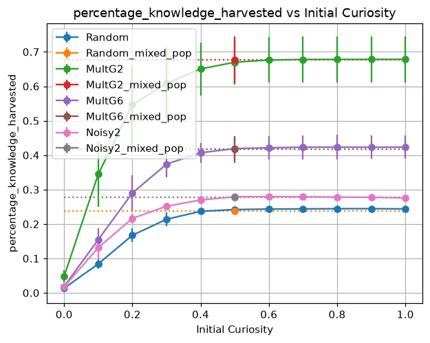
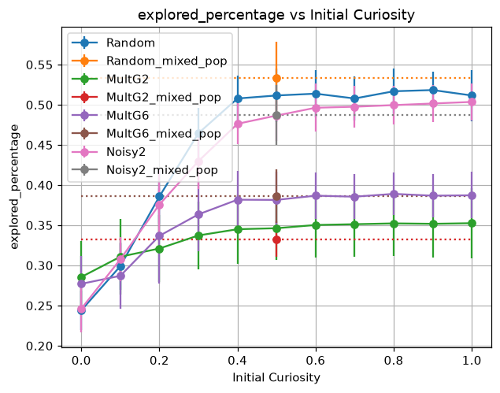
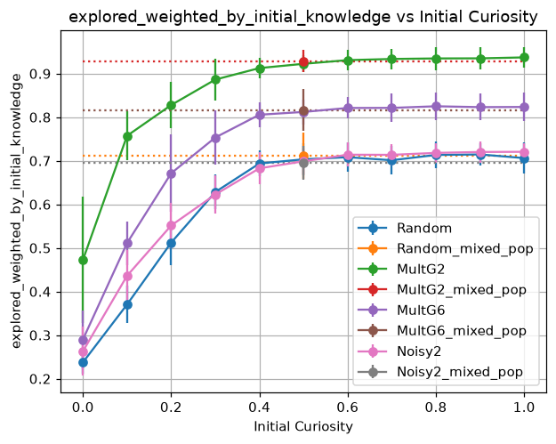
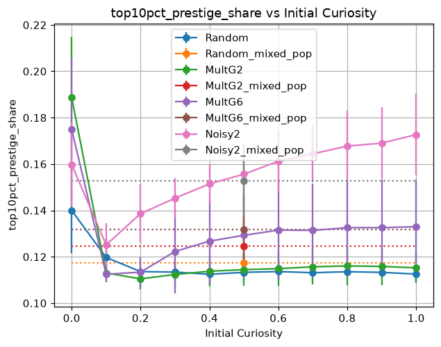
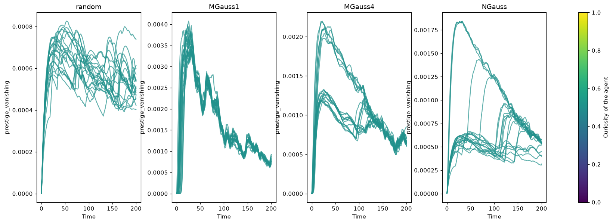
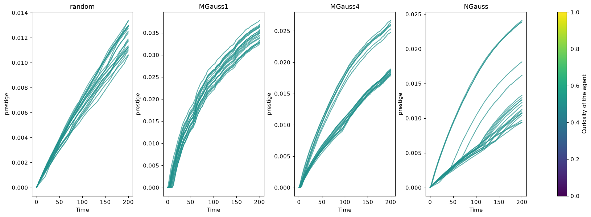

- **Source:** Owner request (2026-11-15, Item 2d: recover and synthesize the preliminary findings from the six notebooks on the old branch `main` and their quarantined/regenerated datasets)
- **Date:** 2026-11-15
- **Related:** `notebooks/analyze_data.ipynb`, `notebooks/compare_landscapes_normalizedknowledge.ipynb`, `notebooks/compare_landscapes_Prestige.ipynb`, `notebooks/compare_landscapes_flexible_search.ipynb`, `notebooks/compare_landscapes_corr-prestige-merit.ipynb`, `notebooks/longitudinalcomparisions.ipynb`, `output/reports/figures_report_v1.md`, `data/legacy_2025_2026/README.md`, `sciencemodels/sweeps.py` (`BULK_SETUPS`)
- **Spawned:** Integration of `M0` baseline findings and mixed-curiosity division-of-labor into the Phase-1 paper narrative

# 1. Why Recover the Old Branch's Notebook Findings?

Before the November 2026 restructure (`ADR-0002`) and the Wave 1–4 sweeps, the original branch (`main`, commits through `875c922`, Nov 2025 – Feb 2026) developed **six exploratory notebooks** backed by 21 CSV files (now preserved in `data/legacy_2025_2026/` and freshly regenerated on the post-Path-0 codebase in `data/figures_v1/` via `BULK_SETUPS` in `sciencemodels/sweeps.py`, documented in [figures_report_v1.md](file:///Users/joko/Git/sciencemodels/output/reports/figures_report_v1.md)).

Because Waves 1–4 focused heavily on what happens when **demographic entry is turned on (`Tier M1`, $g > 0$)**, several foundational insights discovered in the old notebooks — all of which studied the **Basic Closed-Cohort Model (`Tier M0`, $g = 0, N \equiv 20$)** across the full 11-point curiosity grid $c \in \{0.0, 0.1, \dots, 1.0\}$ and across four distinct landscape topologies (`Random`, `MultG2`, `MultG6`, `Noisy2`) — receded into the background.

Even though the pre-restructure runs were preliminary (and helped expose the Path 0 measurement bugs), **five substantive findings from those notebooks hold up on the regenerated `figures_v1` data** and form the indispensable `M0` foundation of our paper.

---

# 2. Inventory of the Six Legacy Notebooks and Their Historical Progression

| Notebook (`notebooks/`) | Legacy Data (`data/legacy_2025_2026/`) | Regenerated Data (`data/figures_v1/`) | Core Question Explored on the Old Branch |
| --- | --- | --- | --- |
| 1. `analyze_data.ipynb` (+ `old_experiments/compare_landscapes_original.ipynb`) | `end_report*.csv` (Nov 2025) | `run_number0.csv` (`randominit`) | Sanity-checking agent knowledge accrual, grid depletion, and unweighted vs. initial-knowledge-weighted exploration across curiosity $c \in [0, 1]$. |
| 2. `compare_landscapes_normalizedknowledge.ipynb` | `testrun_harmonizedKnowledge_*.csv` (2025-11-29, `use_distance=0`, 440 rows/file) | `run_number{0,2,4,6}.csv` (`figures_v1`) | How normalizing tile knowledge by mean landscape knowledge (`k / mean_k`) makes search behavior comparable across `Random`, `MultG2`, `MultG6`, and `Noisy2` (which differ wildly in total initial stock: $204$ vs. $2.0$ vs. $6.0$ vs. $92$). |
| 3. `compare_landscapes_Prestige.ipynb` | `testrun_visibilityReward_*.csv` (2025-12-17, 440 rows/file) | `run_number{0,2,4,6}.csv` (`figures_v1`) | Introducing distance friction (`use_distance=True`), peer-prestige visibility (`use_visibility_reward=True`), and prestige concentration (`top1pct`, `top10pct`) alongside harvest speed milestones (`harvested_50_step`). |
| 4. `compare_landscapes_flexible_search.ipynb` | `testrun_visibilityReward_*.csv` (2025-12-17) | `run_number{0,2,4,6}.csv` (`figures_v1`) | Companion visual comparison of exploration breadth (`explored_percentage`), peak-weighted discovery (`explored_weighted_by_initial_knowledge`), and milestone speeds across the four landscapes. |
| 5. `compare_landscapes_corr-prestige-merit.ipynb` | `testrun_corr-prestige-merit_*.csv` (2025-12-30) & `large_run_with_ideal` (Feb 2026) | `run_number0..7.csv` (all 8 `BULK_SETUPS`) | **The flagship legacy notebook:** (a) compares all 3 prestige stocks against both `local_merit` and `ideal_merit`, and (b) contrasts **homogeneous curiosity cohorts** (setups $0,2,4,6$) against **mixed-curiosity populations** (`*_mixed_pop`, setups $1,3,5,7$, where $c_i \sim U(0,1)$). |
| 6. `longitudinalcomparisions.ipynb` | `agent_long_*.csv` & `model_long_*.csv` (2026-01-12, $H=400$) | `data/figures_v1/agent_long_*.csv` & `longitudinal_random/` | Step-by-step longitudinal trajectories ($t = 0 \dots 400$) of individual scientists' prestige (`prestige`, `vanishing`, `visibility`) and within-run `corr_prestige_localMerit`. |

---

# 3. Five Substantive Findings from the Old Notebooks That We Should Keep

## Finding L1: The Curiosity Step-Function and High-Curiosity Plateau in the Basic Model (`M0`)

Across `compare_landscapes_Prestige.ipynb`, `compare_landscapes_flexible_search.ipynb`, and `compare_landscapes_corr-prestige-merit.ipynb` (both in the Dec 2025 CSVs and the regenerated `figures_v1` sweep), aggregate epistemic performance as a function of curiosity $c \in [0.0, 1.0]$ is **not linear — it is a steep threshold between $c = 0.0$ and $c = 0.3$ followed by a wide plateau across $c \in [0.4, 1.0]$**:

| Curiosity $c$ | `Random` Harvest | `MultG2` Harvest | `MultG6` Harvest | `Noisy2` Harvest | `MultG2` Peak-Weighted Explored | `MultG2` Top-10% Prestige |
| --- | --- | --- | --- | --- | --- | --- |
| **$0.0$** | $1.3\%$ | $4.8\%$ | $1.9\%$ | $1.8\%$ | $47.2\%$ | **$0.189$** |
| **$0.1$** | $8.4\%$ | $34.5\%$ | $15.5\%$ | $13.1\%$ | $75.7\%$ | $0.113$ |
| **$0.3$** | $22.8\%$ | $64.2\%$ | $39.8\%$ | $26.8\%$ | $90.8\%$ | $0.114$ |
| **$0.5$** | $24.2\%$ | **$67.0\%$** | **$41.9\%$** | **$27.9\%$** | **$92.2\%$** | $0.114$ |
| **$0.9$** | $24.5\%$ | **$67.8\%$** | **$42.3\%$** | **$27.8\%$** | **$93.5\%$** | $0.116$ |
| **$1.0$** | $24.4\%$ | **$67.8\%$** | **$42.3\%$** | **$27.6\%$** | **$93.7\%$** | $0.115$ |

*(Source: `data/figures_v1/run_number{0,2,4,6}.csv`, 10 seeds per curiosity value, $H=200$.)*

**Contextual interpretation:** In a closed scientific community (`M0`, no PhD entry), scientists only need **a modest dose of intrinsic curiosity ($c \ge 0.3\text{–}0.4$) to find and harvest almost everything the landscape offers**. Once $c \ge 0.4$, adding more curiosity produces virtually zero extra output ($67.0\%$ vs. $67.8\%$ on `MultG2`) because the 20 scientists have already located the Gaussian peaks (`explored_weighted_by_initial_knowledge` $> 92\%$). Conversely, when curiosity falls below $0.2$ ($1-c \ge 0.8$), the community crosses the visibility collapse cliff (the exact same cliff later formalized as $\xi^* \in [0.6, 0.8]$ in `welfare_probe_v1`).

---

## Finding L2: Unweighted Breadth vs. Peak-Weighted Discovery (`explored_percentage` vs. `explored_weighted_by_initial_knowledge`)

A recurring visual comparison in all four `compare_landscapes_*` notebooks pairs **unweighted share of tiles touched (`explored_percentage`)** against **initial-knowledge-weighted share of tiles touched (`explored_weighted_by_initial_knowledge`)**:

- In the distance-free legacy runs (`testrun_harmonizedKnowledge_*`, `use_distance = 0`), increasing curiosity from $c = 0.0$ to $c = 1.0$ actually **reduced unweighted `explored_percentage` from $99.3\%$ to $81.2\%$** on `MultG2` while **increasing `percentage_knowledge_harvested` from $31.8\%$ to $76.7\%$** and keeping `explored_weighted_by_initial_knowledge` at **$98.3\%\text{–}99.9\%$**!
- Even with distance friction on (`figures_v1`), on `MultG2` at $c = 0.5$, scientists touch only **$34.6\%$ of the 400 grid tiles (`explored_percentage`)**, yet those $34.6\%$ of tiles contain **$92.2\%$ of the landscape's initial knowledge (`explored_weighted_by_initial_knowledge`)**, whereas on flat/noisy `Random` and `Noisy2` they must wander across **$48.7\%\text{–}51.2\%$** of the grid to harvest only **$24.2\%\text{–}27.9\%$** of the stock.

**Contextual interpretation:** In fields with concentrated breakthroughs (`MultG2`, `MultG6` — akin to paradigms with clear core problems), high epistemic performance does **not** mean touching every possible topic on the grid; it means concentrating search on the high-value peaks (`explored_weighted_by_initial_knowledge` $\approx 93\%$) while ignoring barren regions. Unweighted `explored_percentage` alone misreads productive specialization on a Gaussian peak as "low exploration" — which is why pairing `explored_percentage` with `explored_weighted_by_initial_knowledge` (from the old notebooks) is essential.

---

## Finding L3: The "Mixed Population" Advantage — Cognitive Division of Labor (`compare_landscapes_corr-prestige-merit.ipynb`)

The most under-appreciated design in `compare_landscapes_corr-prestige-merit.ipynb` (preserved in `BULK_SETUPS` odd indices `1, 3, 5, 7` vs. even indices `0, 2, 4, 6` in `sciencemodels/sweeps.py`) is the comparison between:
- **Homogeneous curiosity cohorts (`Random`, `MultG2`, `MultG6`, `Noisy2` at $c = 0.5$):** Every scientist has identical curiosity $c_i \equiv 0.5$.
- **Mixed curiosity populations (`Random_mixed_pop`, `MultG2_mixed_pop`, `MultG6_mixed_pop`, `Noisy2_mixed_pop`):** The population mean is $\bar{c} \approx 0.5$, but individual scientists draw heterogeneous curiosities $c_i \sim U(0, 1)$ (mixing high-$c$ maverick explorers with low-$c$ visibility followers in the same community).

Look at the comparison at mean curiosity $0.5$ (`output/reports/figures_report_v1.md`, Table 2, and `data/figures_v1/run_number0..7.csv`):

| Landscape Family | Cohort Composition at $\bar{c} = 0.5$ | Harvested Share | 10%-Harvest Step (Speed) | `Corr(prestige, local_merit)` | `Corr(prestige, ideal_merit)` |
| --- | --- | --- | --- | --- | --- |
| **`Random`** | Homogeneous ($c_i \equiv 0.5$) | $24.2\%$ | $105.3$ steps | $+0.367$ | $+0.450$ |
| **`Random_mixed_pop`** | Heterogeneous ($c_i \sim U(0,1)$) | $23.8\%$ | **$74.8$ steps** | **$+0.387$** | **$+0.496$** |
| **`MultG2`** | Homogeneous ($c_i \equiv 0.5$) | $67.0\%$ | $39.9$ steps | $+0.252$ | $+0.257$ |
| **`MultG2_mixed_pop`** | Heterogeneous ($c_i \sim U(0,1)$) | **$67.7\%$** | **$15.2$ steps ($2.6\times$ faster)** | **$+0.424$** | **$+0.594$ ($2.3\times$ higher)** |
| **`MultG6`** | Homogeneous ($c_i \equiv 0.5$) | $41.9\%$ | $60.3$ steps | $+0.583$ | $+0.599$ |
| **`MultG6_mixed_pop`** | Heterogeneous ($c_i \sim U(0,1)$) | $41.7\%$ | **$31.0$ steps ($1.9\times$ faster)** | **$+0.702$** | **$+0.743$** |
| **`Noisy2`** | Homogeneous ($c_i \equiv 0.5$) | $27.9\%$ | $84.1$ steps | $+0.634$ | $+0.618$ |
| **`Noisy2_mixed_pop`** | Heterogeneous ($c_i \sim U(0,1)$) | $27.8\%$ | **$56.4$ steps ($1.5\times$ faster)** | $+0.613$ | $+0.575$ |

**Contextual interpretation (Weisberg & Muldoon 2009; Kitcher 1990):** This is a classic **cognitive division of labor** result that was sitting right inside `compare_landscapes_corr-prestige-merit.ipynb`! A scientific community composed of **diverse epistemic types** ($c_i \sim U(0,1)$: some pure mavericks with $c_i \approx 0.9$ who locate the Gaussian peaks quickly, and some visibility followers with $c_i \approx 0.2$ who are pulled onto those discovered peaks by the pioneers' visibility) reaches the $10\%$ harvest milestone **$1.5\times$ to $2.6\times$ faster** than a homogeneous community where everyone has $c_i = 0.5$, and achieves a **$2.3\times$ higher correlation between prestige and ideal merit on `MultG2` ($+0.594$ vs. $+0.257$)** because the high-$c$ pioneers arrive at the peaks first and capture the initial prestige before followers arrive!

---

## Finding L4: In the Basic Model (`M0`), Prestige Tracks Merit Positively and Inequality Remains Flat

Across all four landscapes in `M0` ($g = 0$), once $c \ge 0.2$:
1. **`Corr(prestige, local_merit)` and `Corr(prestige, ideal_merit)` are both positive and rise monotonically with curiosity:** reaching $+0.33/+0.36$ on `MultG2`, $+0.74/+0.79$ on `MultG6`, and $+0.80/+0.80$ on `Noisy2` at $c = 1.0$.
2. **`top10pct_prestige_share` stays flat near equality ($0.113\text{–}0.133$ on `Random`, `MultG2`, `MultG6` for all $c \ge 0.1$):** only spiking to $0.140\text{–}0.189$ at $c = 0.0$ when everyone freezes on their starting tiles.

**Why this matters for the whole project:** Finding L4 is the essential **control benchmark** for Waves 1–4. It proves that in our setup, **spatial visibility incentives alone (`M0`, $g = 0$) do NOT generate severe prestige inequality (`top10` $> 0.20$) or negative terminal quality correlations (`c_ideal < 0`) at moderate curiosity ($c \in [0.3, 0.7]$)**. Both the surge in prestige concentration ($0.12 \to 0.23\text{–}0.41$) and the sign flip of `Corr_prestige_ideal_merit` ($+0.35 \to -0.14\text{ to }-0.57$) require **Tier `M1` (prestige-proportional demographic entry and generational turnover)**.

---

## Finding L5: Longitudinal Rise-and-Fall of Within-Run Alignment (`longitudinalcomparisions.ipynb`)

The sixth legacy notebook (`longitudinalcomparisions.ipynb`, reading `agent_long_*.csv` and `model_long_*.csv` over 400 steps) plotted individual scientist prestige trajectories (`prestige`, `prestige_vanishing`, `prestige_visibility`) and the within-run time path of `corr_prestige_localMerit`:
- In `data/legacy_2025_2026/model_long_MGauss1.csv` and `model_long_NGauss.csv`, `corr_prestige_localMerit` **jumped to $+0.851$ (`MGauss1`) and $+0.974$ (`NGauss`) at step 10** as founders standing on the Gaussian peak accumulated prestige, stayed high through step 50–100, and **then decayed to $-0.179$ (`MGauss1`) and $-0.261$ (`NGauss`) by step 400** once the peak was exhausted while early discoverers retained their historical `prestige` stock!
- Meanwhile, the three agent-trajectory panels (`longitudinalcomparisions_fig00..02`) showed that cumulative `prestige` ratchets monotonically into stratified horizontal bands, `prestige_vanishing` rises and then decays smoothly as the landscape depletes (letting late peak-finders overtake early ones), and `prestige_visibility` fluctuates with spatial cluster formation.

**Continuity with Wave 4 (`turnover_v1`):** This preliminary longitudinal observation from January 2026 directly anticipated the **Discovery-Phase vs. Depletion-Phase sign split** formalized across 1,080 runs in `turnover_v1.md` (`CONT5` / `IE-0004`), where whole-run time-mean $c_{\text{ideal}}$ is positive ($+0.11$) because of steps 1–100 while terminal $c_{\text{ideal}}$ is negative ($-0.09$ to $-0.57$) because of late-run depletion.

---

# 4. Two Historical Quirks in the Legacy Data Worth Recording

1. **The Dec 2025 Landscape-Parameter Bug Fixed in Commit `875c922` (Feb 5, 2026):**
   In `data/legacy_2025_2026/testrun_visibilityReward_*.csv` (Dec 17, 2025) and `testrun_corr-prestige-merit_*.csv` (Dec 30, 2025), all four landscape files (`seed4`, `number_gaussians2`, `number_gaussians6`, `prop_random5`) accidentally recorded nearly identical numbers (`harv = 0.415` at $c=0.5$) because landscape generation parameters were overwritten before the sweep call. Paul fixed this in commit `875c922` (*"merge between Franz version and ideal prestige, bugfix on the landscape generation"*), after which the regenerated `data/figures_v1/` runs cleanly separated the four landscapes (`harv = 0.242, 0.670, 0.419, 0.279`).
2. **CamelCase vs. Snake_Case Schema Drift on Correlation Columns (`figures_report_v1.md`):**
   When Franz renamed model functions to `snake_case` in commit `897f588` (Jan 21, 2026), `Mean_of_Corr_prestige_localMerit` became `Mean_of_Corr_prestige_local_merit`. Because `compare_landscapes_corr-prestige-merit.ipynb` (cells 10–11) and `longitudinalcomparisions.ipynb` (cell 2) still requested the old camelCase names, those three cells threw `KeyError` during the strict no-code-edit run of `figures_report_v1.md` (and were subsequently replaced by the clean house-style figures `F1`–`F5` in `notebooks/round_results_report_v1.ipynb`).
