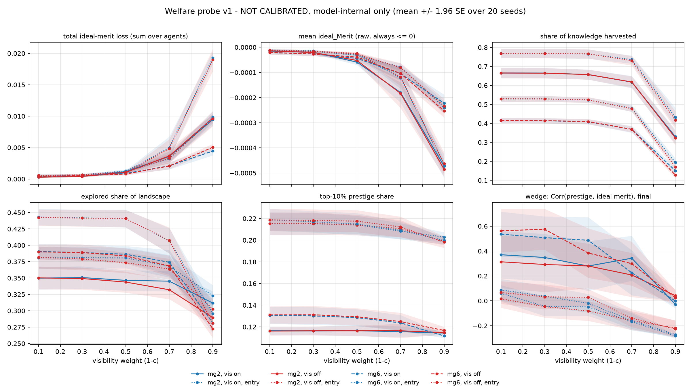
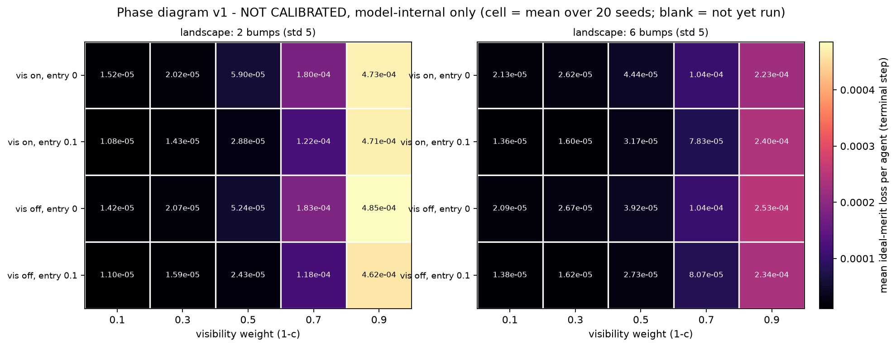
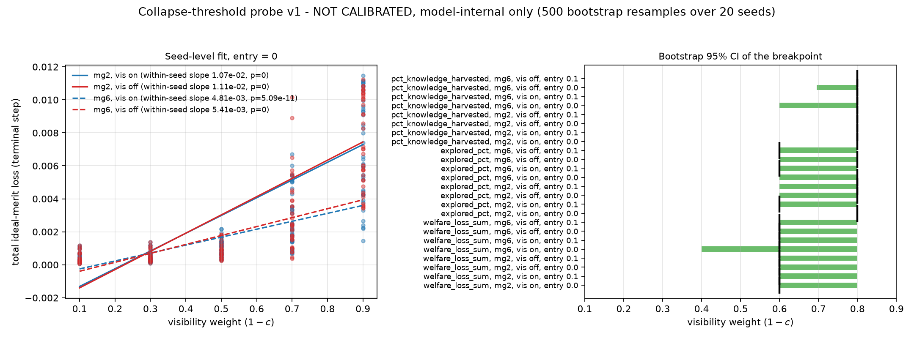

**Version 1** (November 2026)

**NOT CALIBRATED.** This is model-internal exploration only (owner ruling,
2026-11-13). No parameter is fitted to any empirical moment; the Klann
moment menu stays a documented option. Every number below was computed by
`scripts/welfare/run_welfare_sweep.py` and `scripts/welfare/analyse_welfare.py`
from the run-tagged CSVs under `data/welfare_v1/`, and is reproducible with
the commands quoted at the end.

# Purpose and scope

`docs/way_forward.md` Path C asks two questions of the existing model: how
much ideal merit is destroyed per unit of visibility weight, and where
exploration collapses. This probe is the first pass at both, with no model
extension and no intervention layer: the reward's visibility weight
$(1-c)$ is varied through `initial_curiosity`, the social term is switched
on and off through `use_visibility_reward`, and entry is switched on through
`agent_generation_time`.

The normative yardstick is the model's own `ideal_Merit`: per agent, the gap
between what it harvested and what a greedy omniscient allocation would have
harvested from the same knowledge field.

# Design

Sweep: 40 cells $=5\times2\times2\times2$, 20 seeds per cell, 800 runs.

| Dimension | Values | Parameter |
| --- | --- | --- |
| visibility weight | 0.1, 0.3, 0.5, 0.7, 0.9 | `initial_curiosity` $\{0.9,0.7,0.5,0.3,0.1\}$, weight $=1-c$ |
| social reward | on, off | `use_visibility_reward` |
| entry | 0, 0.1 per step | `agent_generation_time` |
| landscape leg | 2 bumps, 6 bumps (std 5) | `generation_params.number_gaussians` |
| seeds | 0-19 | `agent_seed`; the model derives the landscape seed from it, so each seed draws one landscape and one agent stream per cell |

Fixed for every cell (pinned, not swept): `step_limit=200`, `grid_size=20`,
`n_agents=20`, `epsilon=0.1`, `harvest=0.02`, `use_distance=True`,
`new_questions=0`, `knowledge_normalization="share"`,
`prestige_accrual="harvested"`, `vanishing_factor_for_prestige=0.5`,
`cell_init_function=multipleGaussians`, `std=5`, and an identity
`agent_generation_function`, so every agent keeps `initial_curiosity`
exactly. The vanishing factor stays at the seeded-canary value for
comparability with `tests/test_smoke.py` and belongs to the `sensitivity_v1`
sweep's territory, not to this probe. `data/welfare_v1/design.json` records
the same constants machine-readably next to the run outputs.

Sweep interface: `generate_data_parametric_exploration` (ADR-0002), one CSV
per cell named `cell_cur<cc>_vis<v>_gen<ee>_mg<n>.csv`, `intention="w"`,
checkpointed per cell in `data/welfare_v1/state/<tag>.json` and restart-safe.

# Measurement

## A superseded first pass

The first execution of this design pinned the seeded canary's curiosity
generator, `landscapes.uniform`. That function ignores its `mu` argument by
construction --- it redraws every agent from $U(0,1)$ --- so
`initial_curiosity` never entered the dynamics. The giveaway was mechanical:
all five curiosity cells returned identical means to five significant digits
in every outcome, and a two-run check returned the same agent-curiosity
triple $(0.0015,\ 0.9563,\ \bar c = 0.5657)$ for $c=0.1$ and for $c=0.9$.
Under the identity generator the same check moves the total loss from
$-1.03\times10^{-2}$ at $c=0.1$ to $-6.31\times10^{-4}$ at $c=0.9$: the axis
binds.

`scripts/bulk_runner.py` already switches to an identity function whenever it
sweeps curiosity, so the convention exists in the repository; this probe now
follows it. The inert run is not deleted: `data/welfare_v1/superseded_uniform/`
holds its 40 cell CSVs, its checkpoints, its log and a byte-exact snapshot of
the driver that produced it. Everything reported below comes from the
corrected run.

The model-side trap behind it: `initial_curiosity` binds only through an
`agent_generation_function` that uses its first argument. Under `uniform` the
parameter is echoed into the report and nothing else.

The model's own report carries most of the required outcomes
(`percentage_knowledge_harvested`, `explored_percentage`,
`top10pct_prestige_share`, `Mean_of_Corr_prestige_*`), but not ideal merit
and not the *final* wedge correlations. The driver therefore installs a
report wrapper **inside its own process** (a module-attribute patch on
`sciencemodels.io.build_report`; no repository file is modified, and the
wrapper is installed per worker process because joblib ships the task body
by value) that appends four keys to every row:

| Key | Meaning |
| --- | --- |
| `ideal_merit_sum` | $\sum_i \mathrm{ideal\_Merit}_i$ over the agents alive at the terminal step |
| `ideal_merit_mean` | $\overline{\mathrm{ideal\_Merit}}$ over those agents |
| `corr_prestige_ideal_merit_final` | Corr(prestige, ideal merit) at the terminal step |
| `corr_prestige_local_merit_final` | Corr(prestige, local merit) at the terminal step |

Three measurement facts govern the interpretation:

- **Sign.** `ideal_Merit` is actual minus greedy-ideal harvest, so it is
  $\le 0$ in every run (verified: all 20 and all 41 agents negative in the
  probe). The welfare *loss* reported here is therefore
  $-\mathrm{ideal\_Merit}$, positive by construction.
- **Timing.** `ideal_Merit` is a per-step flow recomputed at every
  `end_loop_update`; no cumulative accumulator exists in the model. The sum
  reported here is the **terminal-step cross-section**, not a path integral.
  A cumulative ideal-merit reporter would be a model-side addition; see
  Needs.
- **Population.** With `agent_generation_time=0.1` the run ends with 41
  agents, not 20, so the *sum* is not comparable across entry levels. The
  per-agent mean is the comparable quantity and carries the phase diagram.

# Welfare curves



The table prices visibility pressure directly: the within-seed slope of each
of the eight series, per unit of $1-c$, for three of the six outcomes drawn
above, with bootstrap 95% intervals over the 20 seeds
(`data/welfare_v1/threshold_estimate.csv`).

| Series | total loss (sum) | explored share | harvested share |
| --- | --- | --- | --- |
| mg2, reward on, entry 0 | +1.08e-02 \[+9.63e-03, +1.15e-02] | -4.09e-02 \[-5.36e-02, -2.77e-02] | -0.359 \[-0.378, -0.343] |
| mg2, reward on, entry 0.1 | +2.11e-02 \[+2.01e-02, +2.18e-02] | -6.46e-02 \[-7.68e-02, -5.23e-02] | -0.352 \[-0.375, -0.325] |
| mg2, reward off, entry 0 | +1.11e-02 \[+1.01e-02, +1.18e-02] | -6.93e-02 \[-8.24e-02, -5.60e-02] | -0.365 \[-0.378, -0.349] |
| mg2, reward off, entry 0.1 | +2.06e-02 \[+1.87e-02, +2.21e-02] | -8.66e-02 \[-9.81e-02, -7.56e-02] | -0.370 \[-0.391, -0.346] |
| mg6, reward on, entry 0 | +4.81e-03 \[+3.87e-03, +5.46e-03] | -0.117 \[-0.133, -0.104] | -0.287 \[-0.303, -0.272] |
| mg6, reward on, entry 0.1 | +1.06e-02 \[+9.54e-03, +1.15e-02] | -0.165 \[-0.178, -0.149] | -0.360 \[-0.380, -0.345] |
| mg6, reward off, entry 0 | +5.41e-03 \[+4.74e-03, +6.13e-03] | -0.128 \[-0.141, -0.114] | -0.310 \[-0.329, -0.292] |
| mg6, reward off, entry 0.1 | +1.04e-02 \[+9.17e-03, +1.17e-02] | -0.178 \[-0.191, -0.165] | -0.385 \[-0.403, -0.367] |

Readings, all of them model-internal:

- The price of visibility pressure on total ideal-merit loss is **positive in
  all eight series** (no interval touches zero): about +1.1e-02 per unit of
  visibility weight on the two-bump landscape, +5.0e-03 on the six-bump one,
  and roughly **twice** either with entry on.
- End to end the effect is large rather than marginal: from $c=0.9$ (weight
  0.1) to $c=0.1$ (weight 0.9) the total loss rises **34x** (mg2, reward off,
  entry 0), **31x** (mg2, reward on, entry 0), **44x** (mg2, reward on,
  entry 0.1), **10x** (mg6, reward on, entry 0) and **18x** (mg6, reward on,
  entry 0.1).
- Every curve is flat over the lower half of the axis and convex above it:
  the loss, the exploration share and the harvested share all bend in the
  same upper region, which is what the breakpoint section quantifies.
- **Entry doubles the total loss but barely moves the per-agent loss** at the
  high end (4.73e-04 against 4.71e-04 per agent on mg2, reward on): the
  extra loss is mostly the extra population. This is why the phase diagram
  below is drawn per agent.
- The top-10% prestige share is the one outcome that does **not** respond:
  0.116 to 0.115 on mg2 without entry, 0.215 to 0.199 with entry. Concentration
  is set by the entry regime, not by visibility pressure.
- The wedge pair moves the way the proxy-failure story predicts. Final
  Corr(prestige, ideal merit) falls from +0.370 to -0.029 (mg2, reward on,
  entry 0) and from +0.536 to -0.001 (mg6), and with entry it is already
  near zero at low pressure and turns clearly negative at high pressure
  (+0.060 to -0.281 on mg2, +0.088 to -0.271 on mg6). The local-merit
  correlation falls with it and ends near zero (0.000 to 0.014).

# Collapse threshold

Collapse is defined operationally before looking at the result: within the
sampled range $x\in[0.1,0.9]$ a series collapses when a continuous two-piece
fit

$$y_{s,x}=\alpha_s+\beta_1 x+\beta_2\max(0,x-\xi)+\varepsilon_{s,x}$$

(with seed fixed effects $\alpha_s$) beats the single-slope fit at the 5%
level (F test, one restriction) **and** the bootstrap-over-seeds 95% interval
for $\xi$ lies inside the sampled range **and** at least half of the
bootstrap resamples reject the single slope. Breakpoint candidates are the
four interior midpoints $\{0.2,0.4,0.6,0.8\}$, so the resolution of any
threshold is $\pm 0.1$ at best. Uncertainty comes from 500 resamples of the
20 seeds within each series.

The F test is a *screen*, not a calibrated 5% test: $\xi$ is chosen by grid
search before the test, so the nominal distribution is wrong in the
rejecting direction. The two synthetic checks below (100 observations, 20
seed effects, 5 visibility weights, same code path) show what the composite
rule does with that fact:

| Data-generating process | $\xi^*$ | F test | bootstrap 95% CI for $\xi$ | share of resamples rejecting | rule says |
| --- | --- | --- | --- | --- | --- |
| linear $+3\max(0,x-0.5)$, noise 0.15 | 0.6 | F=187.7, $p<10^{-6}$ | [0.40, 0.60] | 1.00 | collapse |
| linear only, noise 0.15 | 0.6 | F=2.0, $p=0.16$ | [0.20, 0.80] | 0.21 | no collapse |

The second row is the calibration fact that matters: under a pure linear
response the F screen alone rejects in 21% of resamples, so the screen alone
would manufacture breaks. The CI-interior condition is what separates the
two cases, and the estimated slope recovers the truth in both (2.05 against
a true average of 2.00; 0.49 against 0.50).

All **24 series** (3 outcomes x 2 landscapes x 2 reward settings x 2 entry
rates) pass the composite rule, so the honest statement is *not* "no collapse
in range":

| Outcome | $\xi^*$ across the 8 series | bootstrap 95% CI | resamples rejecting | reading |
| --- | --- | --- | --- | --- |
| total ideal-merit loss | 0.6 in 8 of 8 | [0.60, 0.80] in 7, [0.40, 0.80] in 1 | 1.00 in all | kink between 0.6 and 0.8 |
| explored share | 0.6 or 0.8 | [0.60, 0.80] or [0.80, 0.80] | 1.00 in all | kink between 0.6 and 0.9 |
| harvested share | 0.8 in 8 of 8 | [0.60, 0.80] or [0.80, 0.80] | 1.00 in all | kink in the last interval |

**Verdict: welfare loss, exploration and depletion all degrade gently over
the lower half of the visibility-weight range and then accelerate, with the
welfare-loss kink identified at $\xi \in [0.6, 0.8]$ in every series.**
Beyond that point the model stops being a mild redistribution machine and
starts destroying harvestable knowledge: the harvested share loses about
0.36 per unit of visibility weight against a base of roughly 0.66.

Two limits on how hard to read the location. The grid midpoints cap the
resolution at $\pm 0.1$, so these are intervals and never points. And for
the harvested share the winning breakpoint is the *last* candidate, whose
post-break segment contains the single point $x=0.9$; there the defensible
claim is "the drop steepens in the top interval", not a located threshold.
The welfare-loss result, whose winner sits in the middle of the grid with a
5.3%-of-SSE margin over the runner-up in every series, is the robust one.

The invariant check that guards this section is worth recording: an OLS
design that spans a constant cannot fit worse than the total sum of squares.
An earlier coding of the seed fixed effects used $n-1$ dummies **without** an
intercept, which violated that and produced a whole table of wrong
breakpoints (all pinned at the lowest candidate). `hinge_stats` now asserts
SSE $\le$ SST, the check passes on all 24 series (worst excess 0.000e+00),
and every number above was recomputed after the fix.

# Phase diagram



The surface is drawn per agent, for the reason given above: entry changes
the population, so the total is not comparable across the entry rows.

- The surface is monotone in visibility weight and its rise is concentrated
  in the upper half: per-agent loss goes from 1.52e-05 to 4.73e-04 on mg2
  with the reward on and no entry (31x), from 1.08e-05 to 4.71e-04 with
  entry (44x), from 2.13e-05 to 2.23e-04 on mg6 without entry (10x) and from
  1.36e-05 to 2.40e-04 with entry (18x).
- **The toggle barely matters, the weight does.** At weight 0.9 on mg2 with
  no entry the total loss is 9.71e-03 with the visibility reward *off* and
  9.46e-03 with it *on* --- a 2.6% difference, against a 31x difference
  across the curiosity axis at fixed reward setting. The reward only shows in
  exploration at the high end (0.290 without, 0.312 with), where the social
  term cushions the loss of explored area slightly. What prices welfare in
  this model is how hard the visibility weight presses, not whether the
  peer-prestige term is switched on.
- The two-bump landscape carries roughly twice the per-agent loss of the
  six-bump one at high pressure (4.73e-04 against 2.23e-04 with the reward on
  and no entry), and the six-bump landscape loses a larger share of its
  harvest (0.415 down to 0.151 against 0.665 down to 0.330).
- No cell is blank: all 40 combinations of weight, entry, reward and leg are
  present, each averaged over 20 seeds.



# Gross versus net

The gate was run twice, before the first edit and after the last one, and
returned the same result:

```{.text}
canary run OK: 40 report keys, harvested_10_step=37.5, harvested_25_step=37.5
same-seed rerun bit-identical OK
newcomer run OK: 6 scientists after 20 steps
4-arg Gaussian OK: np.float64(0.00550470835249002) (float64)
append-mode header check OK: 3 lines = 1 header + 2 data rows
ALL SMOKE TESTS PASSED
```

| Unit | Attempted | Verified |
| --- | --- | --- |
| reported sweep cells | 40 | 40 (40 state files, all `ok`) |
| reported sweep runs | 800 | 800 (40 CSVs, exactly 20 rows each, none off) |
| superseded sweep cells / runs | 40 / 800 | 40 / 800, archived, axis inert |
| probe runs outside the grid | 6 (three 2-seed probes) | 6 |
| binding-test runs (2 generators x 2 extremes) | 4 | 4 |
| timing runs | 3 | 3 |
| baseline canary model run | 1 | 1 |
| smoke-test invocations | 2 (opening, closing) | 2 pass |

The driver's own closing line for the reported sweep, pasted verbatim:

```{.text}
GROSS cells=40 runs=800 | NET ok=40 skipped=0 failed=0 rows_net=800/800
EXIT=0
```

An independent recount agreed: 40 cell CSVs, 800 data rows, no cell whose row
count differs from 20, 40 state files all carrying `status: ok`.

Wall time: the reported grid ran 22:33:03 to 22:50:15 UTC on 2026-11-13 ---
**17 minutes 12 seconds** for 40 cells at `n_jobs=3`, per-cell wall time
35.7 s (median 68.1 s, maximum 134.6 s). The pre-flight process snapshot
written into the run folder recorded 0 other heavy processes, so this number
is uncontended; the superseded pass took 76 minutes for the same grid while
two other sweeps shared the machine.

Two defects were found and fixed in this round, both mine, both verified
after the fix: a report wrapper that joblib never installed in its workers
(schema proof: the four extra columns appear in a worker-written CSV), and
the missing intercept in the seed fixed-effect design (invariant proof: SSE
no longer exceeds SST on any series). Nothing was left unresolved, and the
one invalidated run was archived rather than overwritten.

# Reproduction

```{.bash}
MPLBACKEND=Agg /opt/hermes/.venv/bin/python tests/test_smoke.py
MPLBACKEND=Agg /opt/hermes/.venv/bin/python scripts/welfare/run_welfare_sweep.py
MPLBACKEND=Agg /opt/hermes/.venv/bin/python scripts/welfare/analyse_welfare.py
```

Outputs: `data/welfare_v1/cell_*.csv`, `data/welfare_v1/summary_cell.csv`,
`data/welfare_v1/threshold_estimate.csv`, `data/welfare_v1/figures/*.png`.
`data/` is gitignored, so the figures are working-tree artifacts; the source
of truth for every number is the CSV set plus the two scripts.

# Needs reported rather than changed

- `initial_curiosity` is inert under any `agent_generation_function` that
  ignores its first argument (`landscapes.uniform` does, deliberately). The
  parameter's name implies it sets the starting curiosity of the population;
  whether it does is the generator's decision. A guard --- or a rename --- is
  a model edit and was not made.
- No cumulative ideal-merit accumulator exists: the loss can only be read as
  a terminal-step cross-section. Adding a running sum would be a model edit
  and was not made.
- The report carries no seed column; seed identity is the row order inside a
  cell (guaranteed by the sweep's `for repeat in range(...)` loop). Exposing
  `agent_seed` in the report would make the CSVs self-describing.
- `metrics.update_ideal_merit` pairs sorted actual harvests against a
  greedily ordered ideal list that only advances when the loss is exactly
  zero; the pairing is therefore not the sorted-to-sorted match one would
  expect. The sign of the quantity is unaffected (actual is always at most
  the greedy ideal), but the magnitudes are model-defined, not an allocation
  benchmark. Not changed here.

# Revision Log

- **Version 1** (November 2026) --- Initial Path C welfare probe: 40 cells,
  800 seeded runs, welfare curves, hinge-breakpoint collapse test with
  bootstrap intervals, phase diagram. Model-internal, not calibrated.
