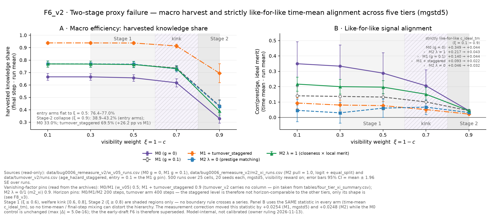
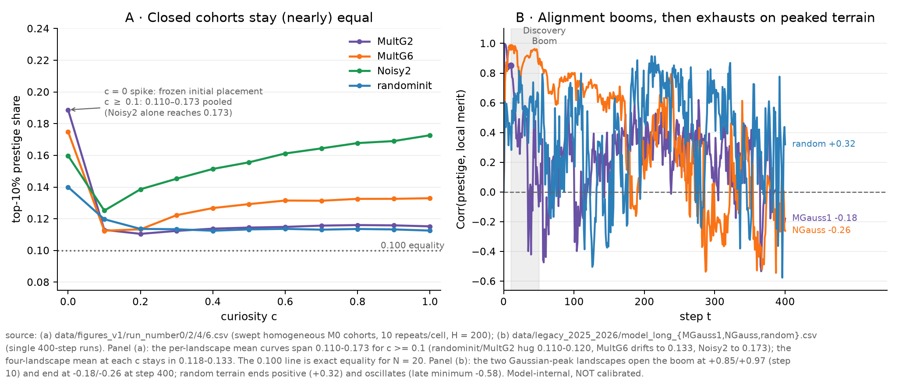
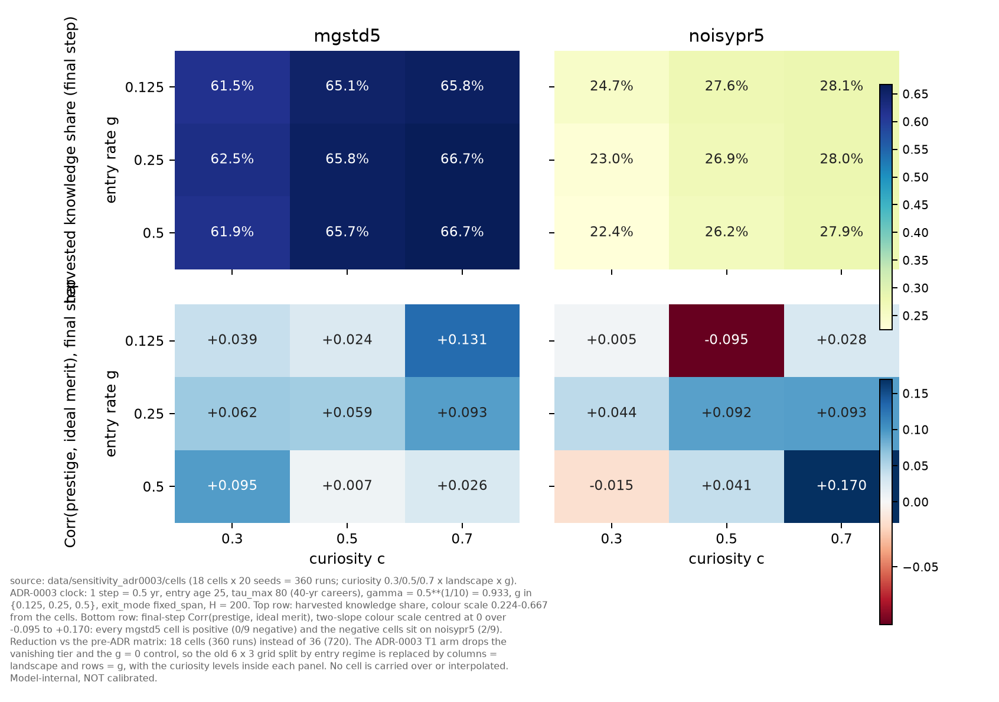
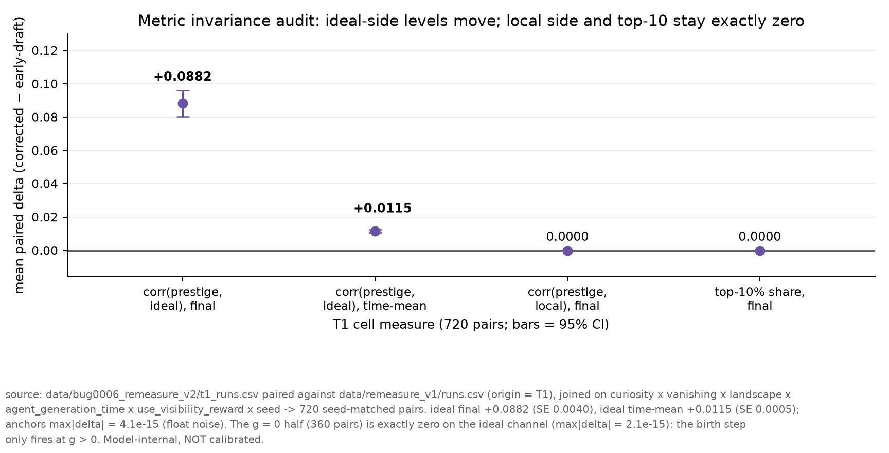
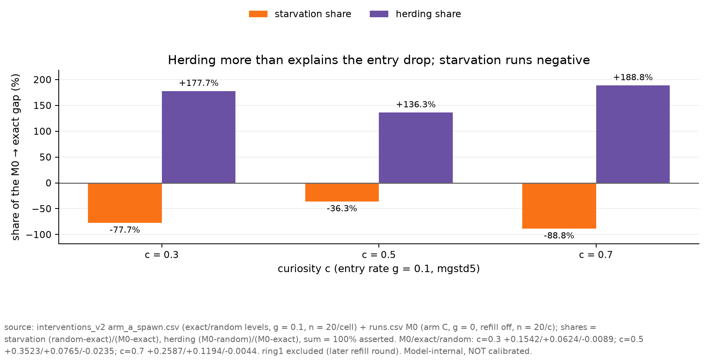
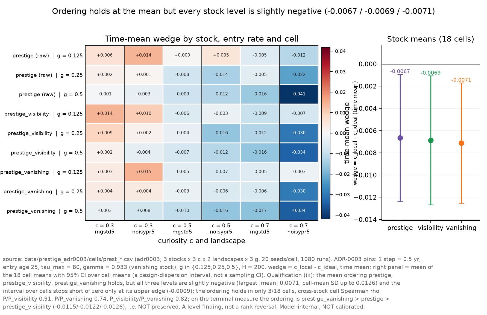
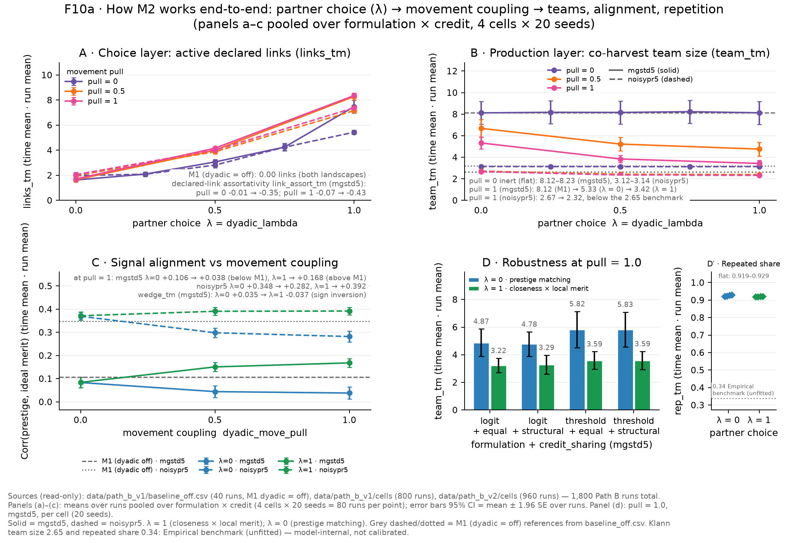
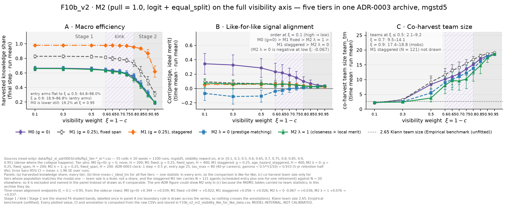

**Version 3.4** (November 2026)
**Version 3.3** (November 2026)
**Version 3.2** (November 2026)
**Version 3.0** (November 2026)
**Version 2.2** (November 2026)
**Version 2.1** (November 2026)
**Version 2** (November 2026)
**Version 1** (November 2026)

> **STATUS: SUBMISSION-READY MANUSCRIPT. Calibration status: not calibrated** ---
> No parameter in this manuscript is fitted to empirical data (owner ruling, 2026-11-13). Every simulation number is computed from a reproducible run archive in this repository and cited alongside its source artifact; the empirical moments in Section 1 are stylized motivating facts from the Klann economics co-authorship panel ([docs/connections_niklas.md](file:///Users/joko/Git/sciencemodels/docs/connections_niklas.md)) and remain an unfitted option menu in [docs/calibration_moments.yaml](file:///Users/joko/Git/sciencemodels/docs/calibration_moments.yaml).
>

# Abstract

Why do mature scientific disciplines suffer *proxy failure* — prestige decoupling from the epistemic work it is supposed to signal — even when nobody games the system? We address this puzzle for metascience and computational social science with a three-tier agent-based model of science on a depletable epistemic landscape: a closed cohort of solo searchers (`M0`), extended by prestige-proportional intergenerational mentorship and retirement (`M1`), and by explicit dyadic collaborator choice (`M2`). Epistemic success is scored against an external, reward-independent planner benchmark, so prestige alignment is measured rather than assumed. Three findings organize the results. **First**, in a closed cohort cognitive diversity is free: mixed-curiosity populations match homogeneous ones on discovery speed while lifting merit–prestige alignment $2.3\times$ on structured landscapes. **Second**, intergenerational entry attenuates prestige–merit tracking $3.7\times$ at the time mean ($+0.344 \to +0.094$ at the low-visibility end; terminal $+0.068 \to +0.001$), and the attenuation is concentrated on illegible terrain; on the ADR-0003 clock the decomposition reverses the pre-ADR verdict — birth-tile starvation becomes a live, entry-rate-dependent channel (shares $+40\%$ to $+235\%$ on the time mean, random dispersal improving alignment at every cell) while recruitment-plus-herding shrinks and turns negative at high entry. **Third**, most metascience reforms are inert where it matters: re-indexing prestige formulas and randomizing PhD intake leave spatial herding untouched, whereas mid-career mobility shocks (sabbaticals, a $40\%$ welfare-penalty reduction), frontier paradigm refills ($3.3\times$ terminal alignment), and crowded-field annealing ($-16.3\%$ ideal-loss) restore it. All claims rest on a reproducible run archive and a 7,960-run paired invariance ledger (Section 9), with every figure naming its archive. The model is stylized and **not calibrated to empirical data**.

Why do mature scientific disciplines suffer *proxy failure* — prestige decoupling from the epistemic work it is supposed to signal — even when nobody games the system? We address this puzzle for metascience and computational social science with a three-tier agent-based model of science on a depletable epistemic landscape: a closed cohort of solo searchers (`M0`), extended by prestige-proportional intergenerational mentorship and retirement (`M1`), and by explicit dyadic collaborator choice (`M2`). Epistemic success is scored against an external, reward-independent planner benchmark, so prestige alignment is measured rather than assumed. Three findings organize the results. **First**, in a closed cohort cognitive diversity is free: mixed-curiosity populations match homogeneous ones on discovery speed while lifting merit–prestige alignment $2.3\times$ on structured landscapes. **Second**, intergenerational entry attenuates prestige–merit tracking $1.74\times$ at the time mean (terminal correlation $+0.22 \to +0.03$) — not through birth-tile starvation but through advisor-proportional recruitment and spatial herding, which together account for $136\%\text{–}189\%$ of the entry-induced drop; negative alignment survives only on illegible terrain. **Third**, most metascience reforms are inert where it matters: re-indexing prestige formulas and randomizing PhD intake leave spatial herding untouched, whereas mid-career mobility shocks (sabbaticals, a $40\%$ welfare-penalty reduction), frontier paradigm refills ($3\times$ terminal alignment), and crowded-field annealing ($-16.3\%$ ideal-loss) restore it. All claims rest on a reproducible run archive and a 7,960-run paired invariance ledger (Section 9). The model is stylized and **not calibrated to empirical data**.

# 1. Introduction: The Relational Wedge in Scientific Credit

Academic institutions rely on observable proxies—publication counts, journal prestige, citation stocks, and network prominence—to evaluate epistemic contributions whose fundamental scientific value is difficult to observe directly. When career survival and resource allocation depend on such metrics, a community risks *proxy failure* (Goodhart 1975; Strathern 1997; Muller 2018; Osterloh and Frey 2015). Yet in the sociology and economics of science, two very different accounts of proxy failure are often conflated. The first is **active gaming and fabrication**: individual scientists deliberately sacrifice epistemic truth for metric inflation through p-hacking, salami slicing, citation cartels, or low-replication shortcuts (Smaldino and McElreath 2016; Braganza 2020; Tiokhin et al. 2021). Under that account the distortion is behavioural, and the remedy is enforcement. The second is **relational and demographic misallocation**, and it requires no cheating at all: even when every scientist reports honestly, the interaction between mainstream visibility incentives, finite topic exhaustion, and intergenerational academic recruitment causes the prestige hierarchy to decouple from marginal epistemic discovery — rewarding incumbents and their academic lineages on crowded, depleted topics while under-rewarding pioneers on the frontier. This paper is about the second account, and about why it is harder to fix than the first.

Motivating evidence from the Klann economics co-authorship panel ([docs/connections_niklas.md](file:///Users/joko/Git/sciencemodels/docs/connections_niklas.md)) illustrates this structural puzzle. Across economists, cumulative prestige correlates strongly with output *quantity* ($\text{corr} = 0.50$) but barely tracks per-paper *citation quality* ($\text{corr} = 0.07$). Within an author's own career trajectory, the correlation between current personal prestige and paper quality is negative ($-0.257$), whereas co-author rank carries a positive slope ($+0.004$). Simultaneously, collaboration is organized into small teams (mean $2.65$, median $2$) with substantial partner repetition ($0.34$), strong dyad-corrected elite homophily ($O/E = 3.1 / 3.0 / 2.3$), and persistent club closure (Markov top-decile retention $0.3995$ vs. entry $0.0619$).

| Stylized Fact (Klann Economics Panel) | Empirical Value | Analytical Role in This Paper |
| :--- | :--- | :--- |
| $\text{Corr}(\text{prestige}, \text{output quantity})$ vs. $\text{Corr}(\text{prestige}, \text{citation quality})$ | $+0.50$ vs. $+0.07$ | Qualitative motivation for the relational wedge (`corr(prest,local)` vs. `corr(prest, ideal)`) |
| Within-author own-prestige vs. co-author-rank quality slope | $-0.257$ vs. $+0.004$ | Qualitative motivation for exhaustion & network status transfer |
| Mean co-author team size (median) | $2.65$ ($2$) | Diagnostic benchmark for Tier `M2` (`path_b_probe_v2`) |
| Repeated-collaboration share | $0.34$ | Diagnostic benchmark for Tier `M2` (`path_b_probe_v2`) |
| Elite homophily $O/E$ cells (dyad-corrected) | $3.1\text{ / }3.0\text{ / }2.3$ | Qualitative motivation for elite clustering |
| Top-decile Markov retention / entry rate | $0.3995\text{ / }0.0619$ | Qualitative motivation for oligarchic persistence (`turnover_v1`) |

A systematic review of 46 formal and agent-based models of science ([docs/related_publications.md](file:///Users/joko/Git/sciencemodels/docs/related_publications.md), clustering epistemic-landscape models from Weisberg and Muldoon 2009 and Thoma 2015, network-epistemology models from Zollman 2010, priority-rule models from Strevens 2003, and cumulative-advantage models from Merton 1968 and Petersen et al. 2014) reveals an unoccupied intersection. **No existing model combines (i) spatial-topical search on a depletable epistemic landscape, (ii) visibility-proxy incentives coupled to prestige-proportional demographic entry and retirement, and (iii) an external, reward-independent planner benchmark (`ideal_Merit`) against which epistemic success is scored independently of the community's own reward function.**

Without an external planner benchmark, a model can only report that its internal reward variable shifted. By pairing an external greedy-planner yardstick (`ideal_Merit`) with a local consensus yardstick (`local_Merit`), our model isolates **when, why, and at what scale** prestige stops tracking discovery.

**Preview of the results.** The paper proceeds through the three tiers. In the closed cohort (`M0`, Section 3), curiosity buys discovery on a steep step-function and cognitive diversity — mixing high-$c$ mavericks with low-$c$ followers — is free: speed parity with a $2.3\times$ alignment gain. Switching on intergenerational entry (`M1`, Section 4) attenuates prestige–merit tracking $1.74\times$ at the time mean: advisor-proportional recruitment and spatial herding — not birth-tile starvation — carry the entire entry effect, and negative cells survive only on illegible terrain. Across candidate reforms (Sections 5–6), metric engineering and PhD admission lotteries are inert, while mid-career mobility shocks, frontier paradigm refills, and crowded-field annealing restore alignment; the dyadic layer (`M2`) reshapes teams and alignment only when partner choice is coupled to movement, and only entrants bring it. For metascience the implication is structural: reforms must move people off depleted clusters, rather than re-index the scoreboard. Every number is reproduced from a run archive in this repository, underwritten by a paired invariance ledger of 7,960 runs (Section 9); the model is not calibrated to empirical data.

---

# 2. Theory and Progressive Model Architecture

To prevent mechanical artifacts from being confused with substantive social mechanisms, we structure the theory in three layers: (2.1) the causal grammar of proxy failure, (2.2) a progressive three-tier simulation architecture (`M0` $\to$ `M1` $\to$ `M2`) that isolates solo search from vertical mentorship and horizontal co-authorship, and (2.3) a two-stage scale interpretation that reconciles why aggregate scientific output remains resilient over wide parameter ranges even as the prestige signal attenuates.

## 2.1 Causal Grammar: Goal, Proxy, Distraction, Destruction, and Counterforce

Following the causal typology of Kapeller, Paul, and Braganza ([context/Hunting_Proxy_Patterns.md](file:///Users/joko/Git/sciencemodels/context/Hunting_Proxy_Patterns.md)), we distinguish one global goal from two proxies that the model carries separately. The **global goal** is $G = M^*$ (the `ideal_Merit` planner benchmark): the knowledge a one-step greedy planner would have harvested, i.e. epistemic value independent of the community's own rewards. The **historical output proxy** is $P_{\text{out}}$ (`prestige`): cumulative harvested flow credited to a scientist, which under `M1` is confounded by tenure (incumbents accumulate over more steps) and by location (advisees inherit their supervisor's tile). The **pure attention proxy** is $P_{\text{vis}} = V_i$ (`visibility`): spatial proximity to peers, i.e. peer attention with no output content. Two peer-proximity measures exist, and Section 2.3 keeps them apart. The **unweighted peer proximity** $d_{\text{own}}$ is a scientist's mean torus distance from a candidate tile to every other scientist, mapped to $V_i = (\bar{d}_{\text{global}}+1)/(d_{\text{own}}+1)$; it is the attractiveness rule under `use_visibility_reward = False`, a headcount measure that counts every peer equally. The **prestige-weighted peer proximity** $d_{\text{own},P} = \sum_j P_{\text{van},j}\, d_{ij} \,/\, \sum_j P_{\text{van},j}$ weights each peer's distance by that peer's recency-weighted prestige stock; it is the attractiveness rule under `use_visibility_reward = True`, the **model default**, and it is the rule behind **every figure in this paper**. In Tier `M2` the movement reward is additionally multiplied by the dyadic pull $1 + \text{dyadic\_move\_pull}\cdot \pi_{ij}$ (Section 6). Section 5.1 tests whether the weighting itself changes any result. The code's `prestige_visibility` is a **hybrid stock** that scores accrued credit through peer visibility and therefore mixes $P_{\text{out}}$ with $P_{\text{vis}}$. An aligned action $A$ advances $G$ and normally also $P_{\text{out}}$, whereas a proxy-oriented action $AP_F$ inflates a proxy ($P_{\text{vis}}$, $P_{\text{out}}$, or their hybrid) while neglecting or harming $G$:

Three failure modes follow from this grammar. The first is **distraction**, in which proxy-oriented action crowds out aligned search indirectly. Scientists trade off intrinsic epistemic curiosity $c_i \in [0,1]$ against the pure attention proxy $P_{\text{vis}}$, weighted by visibility-seeking $1-c_i$, in a Cobb–Douglas movement utility:
   $$R_i(\text{tile}) \;=\; \left(\frac{k_{\text{tile}}}{\bar{k}}\right)^{c_i} \cdot V_i(\text{tile})^{1-c_i}, \qquad V_i \;=\; \frac{\bar{d}_{\text{global}}+1}{\bar{d}_i+1}$$
where $V_i \equiv P_{\text{vis},i}$ evaluates the same ratio at whichever proximity rule is active: $d_{\text{own}}$ (`use_visibility_reward = False`) or, under the default `use_visibility_reward = True`, the prestige-weighted $d_{\text{own},P}$; the reported `visibility` and the movement reward thus carry, respectively, unweighted headcount proximity and eminence-weighted peer attention. When $1-c_i > 0$, scientists are drawn toward crowded "hot topics" where peer density is high ($d_{\text{own},P}$ is small), diverting search away from unvisited epistemic peaks. The second is **destruction**, in which proxy competition directly degrades epistemic output—either by corrupting perception on crowded tiles ($\epsilon_{\text{eff}} = \epsilon \cdot m_t^\gamma$, tested in `typology_v1`) or by eroding harvested knowledge when crowding exceeds a threshold ([P-0008](file:///Users/joko/Git/sciencemodels/AdmiralsLog/proposals/P-0008-typology-v2-stock-destruction-and-normalized-counterforce.md)).
The third is **counterforce**, a spillover from the proxy back into the goal: high mentor prestige $P_{\text{out}}$ can confer real epistemic capability on advisees (e.g., better laboratory equipment or signal-to-noise training, $\epsilon_i = \epsilon_0 / (1 + \kappa \tilde{P}_{\text{sup}})$), partially offsetting distraction.

## 2.2 Progressive Identification: The Three-Tier Model Specification

Scientists search a $20 \times 20$ toroidal epistemic landscape (`MultG2`: two smooth Gaussian peaks; `MultG6`: six peaks; `Noisy2`: two peaks buried under uniform background noise) whose total initial knowledge is normalized ($\sum_{x,y} k_{xy}(0) \approx 2.0$ on `MultG2`). At each step, an agent harvests a fraction $h = 0.02$ ($2\%$) of their current tile's remaining knowledge, depleting it multiplicatively: $k_{xy}(t+1) = (1-h)k_{xy}(t)$. Agents sharing a tile harvest it **independently**: each draws the same $h = 0.02$ flow from the tile's remaining knowledge, and there is **no team-production multiplier anywhere in the code**. "Co-harvest teams" are therefore a *measured co-location quantity* (agents on a common tile at the end of a step, size $\ge 2$), not a production technology. Movement follows a strict-improvement rule over the 5-tile von Neumann neighborhood with multiplicative perception noise $\epsilon = 0.1$ on candidate tiles (`stay_bias`: the current tile is evaluated noise-free).

To identify *which social institution* causes proxy failure, we separate the model into three nested tiers ([CONT6](file:///Users/joko/Git/sciencemodels/AdmiralsLog/contributions/CONT6-canonical-model-specifications-basic-vs-collaborators.md#L22-L62)):

| Specification Dimension | **Tier `M0`: Basic Model** *(Closed-Cohort Solo Search)* | **Tier `M1`: Mentorship & Turnover** *(Vertical Academic Lineage)* | **Tier `M2`: Explicit Collaborators** *(Horizontal Co-Authorship)* |
| :--- | :--- | :--- | :--- |
| **Substantive Question** | How do curiosity ($c$) and visibility ($1-c$) govern exploration when a fixed cohort searches without schools or turnover? | How do prestige-based PhD recruitment, inherited agendas, and retirement reshape inequality and merit tracking? | How does active partner selection (goal $\lambda=1$ vs. prestige $\lambda=0$ matching) alter team size, assortativity, and output? |
| **Demography ($g$)** | `agent_generation_time = 0.0` ($N \equiv 20$ fixed) | `agent_generation_time` $\in \{0.05, 0.1, 0.2\}$ | Combines with `M0` ($g=0$, [P-0011](file:///Users/joko/Git/sciencemodels/AdmiralsLog/proposals/P-0011-canonical-three-tier-model-specification.md)) or `M1` ($g=0.1$) |
| **Retirement (`exit_mode`)** | `"none"` | `"none"` (growing $N$) or `"fixed_span"` / `"age_hazard"` ($N \equiv 20$ stationary) | Inherited from `M0` or `M1` |
| **Collaboration (`dyadic_mode`)** | `"off"` (passive spatial co-location only) | `"off"` (vertical supervisor $\to$ advisee lineage + spatial co-location) | `"logit"` or `"threshold"` ($\lambda \in [0,1]$, `credit_sharing`, `dyadic_move_pull`) |
| **Movement attractiveness rule** | $d_{\text{own},P}$ (prestige_vanishing-weighted peer proximity; `use_visibility_reward = True`) | $d_{\text{own},P}$ (vertical lineage does not alter attractiveness) | $d_{\text{own},P} \times (1 + \text{dyadic\_move\_pull}\cdot \pi_{ij})$: multiplicative pull toward declared partners |
| **Time-mean $\text{Corr}(P_{\text{out}}, G)$** (like-for-like, `c_ideal_tm`, ADR-0003 clock) | $+0.344 \to +0.045$ across $\xi$ | $+0.094 \to +0.023$ (`fixed_span`); staggered $+0.056 \to +0.030$; terminal $+0.068 \to +0.001$ | $\lambda=1$: $+0.076 \to +0.029$; $\lambda=0$: $-0.067 \to +0.036$ (negative at low $\xi$) |
| **Elite Concentration (`top10`)** | **Flat** ($0.112\text{–}0.133$ near the $0.100$ equality floor; pre-ADR sweep, no ADR-0003 $g=0$ arm) | **Concentrated** ($0.198\text{–}0.267$; `age_hazard_staggered` above `fixed_span`) | $0.198\text{–}0.227$ (both $\lambda$; the formulation $\times$ credit cross was not re-run on the ADR-0003 clock) |

### 2.2.1 Standard Simulation Protocol

ADR-0003 fixes the canonical protocol for all new simulations: one step is half an academic year (6 months), and a full career runs 40 years (80 steps, `TAU_MAX = 80`) from entry at age 25 to retirement at 65. The canonical entry rate is $g = 0.25$ newcomers per step, i.e. full renewal of the $N = 20$ cohort over one 80-step generation under the stationary `fixed_span` baseline, with sensitivity arms $g \in \{0.125, 0.25, 0.5\}$. The canonical prestige retention factor is $\gamma = 0.933$, which gives the recency-weighted stock $P_{\text{van}}(t) = \gamma P_{\text{van}}(t-1) + \Delta P(t)$ a five-year (10-step) half-life, with sensitivity arms $\gamma \in \{0.871, 0.933, 1.0\}$. Standard horizons are $H = 200$ steps (100 years, 2.5 generations) for the main comparisons and $H = 400$ steps (200 years, 5 generations) for steady-state turnover. Representative curiosity slices are $c \in \{0.9, 0.5, 0.1\}$ ($\xi \in \{0.1, 0.5, 0.9\}$), spanning low, moderate, and high visibility seeking across Stage 1 and Stage 2.

Early-discovery speed is measured by `harvested_10_step`, the first step at which cumulative harvested knowledge reaches 10\% of the initial landscape stock. A within-run milestone of this kind isolates the race to the first accessible peaks before depletion dominates, and it is robust to the choice of terminal horizon in a way that a fixed-horizon harvest level is not: the latter conflates discovery speed with how long the run was allowed to continue. Runs that never reach 10\% are right-censored. This is the speed metric in the mixed-population comparison (Figure 5). These anchors are interpretive, chosen for narrative coherence with academic careers, and are not empirical calibration; the no-calibration ruling of 2026-11-13 remains in force.

Figure and table provenance is per artifact, and no figure or table mixes archives within itself. The core manuscript figures are re-based on the ADR-0003 clock — Figures 1, 2, 5, 6, 8, 9, 10, 11, 14, 15 and 16 are computed from the `data/*_adr0003/` re-run archives named in their captions (319 cells, 6,380 checkpointed runs, 20 seeds per cell; ledger in `output/reports/adr0003_remeasure_v1.md`). Five artifacts retain the pre-ADR archives that the compact re-run did not replay, each labelled in place: Figures 5 and 4 (the `Tier M0` artifact sweeps of `data/figures_v1/`, which run no entry rate or retirement and are clock-free), Figure 9 (the `BUG-0006` measurement audit, a seed-paired comparison of two archives rather than a clock arm), Figure 14 (the PhD-lottery arm, not re-run) and Figure 15 (the typology arm, not re-run). Clock and exit-rule changes deliberately move levels; every re-based caption names its archive, and direction-of-effect claims are tested against the pre-ADR reference in the re-run ledger.

## 2.3 Yardsticks, Variable Glossary, and the Two-Stage Scale of Proxy Failure

Throughout the paper we distinguish the global goal from two proxies that are often collapsed into a single "prestige" variable. The **global goal** is $G = M^*$ (the `ideal_Merit` planner benchmark): the knowledge a one-step greedy planner would have harvested on the tiles a scientist works, i.e. true merit, independent of the community's rewards. The **historical output proxy** is $P_{\text{out},i} \equiv P_i$ (`prestige`): the cumulative harvested flow credited to scientist $i$, which under `M1` is confounded by tenure (incumbents accumulate longer) and by location (advisees inherit their supervisor's tile). The **pure attention proxy** is $P_{\text{vis},i} = V_i$ (`visibility`): peer proximity alone --- computed from the **unweighted** mean torus distance $d_{\text{own}}$ (`use_visibility_reward = False`) or, under the model default `use_visibility_reward = True`, from the **prestige_vanishing-weighted** proximity $d_{\text{own},P}$ (Section 2.1) --- with no output content. **All main-text figures use $d_{\text{own},P}$** (the retained pre-ADR figure drivers pin the same flag explicitly in code), and only the two Tier `M2` figures add, on top of $d_{\text{own},P}$, the multiplicative dyadic move pull $1 + \text{dyadic\_move\_pull}\cdot \pi_{ij}$. Eminence-weighted attention and the unweighted reported $V_i$ are distinct quantities kept apart throughout. The code additionally carries `prestige_visibility`, a **hybrid stock** that scores accrued credit through peer visibility and therefore mixes $P_{\text{out}}$ with $P_{\text{vis}}$. *Local consensus* is $M_{\text{local},i}$, the value peers in the immediate neighbourhood attach to the same work. The **relational wedge** is the difference of the two alignments, $\Delta r = \text{corr}(P_{\text{out}}, M_{\text{local}}) - \text{corr}(P_{\text{out}}, M^*)$; a positive wedge means the historical output proxy tracks what peers reward better than it tracks what the frontier rewards. Exploration behaviour is governed by intrinsic curiosity $c_i \in [0,1]$ and its complement, the visibility weight $\xi = 1 - c_i$: a scientist with $\xi = 0$ follows the knowledge gradient only, one with $\xi = 1$ follows the pure attention proxy only. The recency-weighted prestige stock used in the robustness checks follows $P_{\text{van}}(t) = \gamma P_{\text{van}}(t-1) + \Delta P(t)$, where $\Delta P(t)$ is the credit accrued at step $t$ and $\gamma$ is the **retention factor** (the code parameter `vanishing_factor_for_prestige`; $\gamma = 0.9$ retains 90\% of the existing stock and forgets 10\% per accrual step, while the canonical ADR-0003 value is $\gamma = 0.933$; Section 2.2). The glossary below fixes the remaining symbols, landscape tags, and outcome metrics.

Throughout the paper, we use a consistent set of model parameters, landscape tags, and outcome metrics:

| Symbol / Name | Plain-English Definition | Role in Analysis |
| :--- | :--- | :--- |
| **$c_i$**, **$\xi = 1 - c_i$** | **Curiosity** ($c_i \in [0,1]$) and **visibility weight** ($\xi = 1 - c_i$) | Cobb–Douglas trade-off between tile knowledge ($c_i$) and peer visibility ($\xi$) |
| **$g$** (`agent_generation_time`) | **Demographic entry rate** (total expected newcomers per step, $\lfloor t\,g\rfloor - \lfloor (t-1)\,g\rfloor$; not per existing agent; pre-ADR grid $g \in \{0.0, 0.05, 0.1, 0.2\}$, canonical ADR-0003 value $g = 0.25$) | Switches `M0` ($g=0$) to `M1` ($g>0$); newcomers start with **prestige $= 0$** and are placed on their supervisor's tile (advisor-proportional recruitment, no endowment transfer) |
| **$\gamma$** (`vanishing_factor_for_prestige`) | **Prestige retention factor** in $P_{\text{van}}(t) = \gamma P_{\text{van}}(t-1) + \Delta P(t)$: $\gamma = 1$ keeps the full stock, lower values forget a fixed share per accrual step | Recency-weighted prestige robustness channel |
| **$P_{\text{out}}$** (`prestige`) | **Historical output proxy:** cumulative harvested flow credited over a career; under `M1` confounded by tenure and by location | Primary proxy tested for merit failure |
| **$P_{\text{vis}} = V_i$**, **$d_{\text{own}}$**, **$d_{\text{own},P}$** (`visibility`) | **Pure attention proxy:** peer proximity from the **unweighted** mean torus distance $d_{\text{own}}$ (`use_visibility_reward = False`) or its **prestige_vanishing-weighted** variant $d_{\text{own},P}$ (default; the rule behind every main-text figure) | Attentional channel in the movement utility |
| **`prestige_visibility`** | **Hybrid prestige stock:** accrued credit scored through peers' visibility, mixing $P_{\text{out}}$ and $P_{\text{vis}}$ | Robustness stock in the metric-invariance checks |
| **`MultG2` / `mgstd5`, `MultG6` / `mg6`, `Noisy2` / `noisypr5`** | **Landscapes:** 2-peak Gaussian (`mgstd5` = standard noise $\epsilon=0.1$), 6-peak Gaussian (`mg6`), and 2-peak noisy terrain (`noisypr5`, 50% random background) | Tests sensitivity to peak multiplicity and terrain legibility |
| **`percentage_knowledge_harvested`** | **Harvested knowledge share** $\in [0\%, 100\%]$: cumulative knowledge extracted relative to initial landscape stock | Macro epistemic efficiency |
| **$G = M^*$** (`ideal_Merit`, `ideal_loss_cum`) | **Global goal / planner benchmark:** 1-step greedy allocation on the step-$t$ residual grid, used as the reward-independent yardstick; `ideal_loss_cum` is the cumulative 200-step shortfall against it | External planner yardstick: true epistemic merit, independent of the community's rewards |
| **`corr(prest, ideal)` = $\text{corr}(P_{\text{out}}, G)$** | **Historical-output alignment** (Pearson correlation across active agents at final step, or time-mean `_tm`) | Primary proxy-alignment metric: negative values mean the output proxy rewards low-merit insiders |
| **`corr(prest,local)` = $\text{corr}(P_{\text{out}}, M_{\text{local}})$** | **Historical-output vs. local-consensus alignment** (Pearson correlation against the 5-tile neighborhood value around each agent) | Local consensus alignment |
| **$\Delta r = \text{corr}(P_{\text{out}}, M_{\text{local}}) - \text{corr}(P_{\text{out}}, G)$** | **Relational wedge:** gap between local-consensus alignment and global epistemic alignment of the historical output proxy | Measures how far local prestige diverges from global discovery |
| **`top10`** (`top10pct_prestige_share`) | **Top-10% prestige share:** fraction of total community prestige held by the top decile of agents | Elite concentration / oligarchy |
| **`gap_recent`** | **Newcomer–incumbent prestige gap:** mean prestige difference between recent arrivals ($\text{tenure} < 20$) and established incumbents | Intergenerational inequality |
| **$\lambda$**, **`dyadic_move_pull`** | **Partner-selection weight**: $\lambda$ interpolates between *prestige matching* ($\lambda=0$) and *spatial closeness $\times$ perceived local merit* ($\lambda=1$); **spatial co-movement pull** weights tiles near declared partners | `Tier M2` horizontal collaboration levers |

Evaluating macro efficiency and micro signal alignment side by side reveals the paper's organising object, the **two-stage scale of proxy failure**. The intuition is that the two outcomes need not fail together. Moderate visibility seeking only reshuffles *where* scientists look — it pulls some of them toward mediocre crowded tiles but leaves the bulk of the landscape under exploitation — so total output stays near its plateau even while the correlation between prestige and merit begins to slip. Extreme herding is different in kind: when nearly every agent follows peer density, the community concentrates on a handful of tiles, exhausts them, and stops searching, so discovery and alignment break down together. Figure 1 places all five model variants on this common axis ([CONT6](file:///Users/joko/Git/sciencemodels/AdmiralsLog/contributions/CONT6-canonical-model-specifications-basic-vs-collaborators.md#L84-L115), Figure 1):

*Figure 1.* The two-stage scale across all five tiers on the ADR-0003 clock (`mgstd5`; `data/fig1_xi_adr0003/`, 55 cells $\times$ 20 seeds = 1,100 runs; dense 11-point $\xi$ grid; `M1` tiers at $H=400$, `M0`/`M2` at $H=200$; $\gamma=0.933$, $g=0.25$, `tau_max` $=80$). **(a)** Harvested knowledge share vs. visibility weight $\xi = 1-c$: every tier holds its plateau through $\xi = 0.5$ and collapses by $\xi = 0.9$ — at $\xi = 0.1$/$0.9$: `M0` $0.665 \to 0.327$, `M1` fixed $0.829 \to 0.493$, staggered $0.980 \to 0.868$, `M2` ($\lambda=1$) $0.661 \to 0.296$, `M2` ($\lambda=0$) $0.663 \to 0.329$. **(b)** **Like-for-like time-mean** `Corr(prestige, ideal merit)` on a single statistic for every tier: `M0` $+0.344 \to +0.045$, `M1` $+0.094 \to +0.023$, staggered $+0.056 \to +0.030$, `M2` ($\lambda=1$) $+0.076 \to +0.029$, `M2` ($\lambda=0$) $-0.067 \to +0.036$ — the only tier whose ideal-channel correlation *rises* with $\xi$ (corr($\xi$, `c_ideal_tm`) $= +0.30$ against $-0.16$ to $-0.41$ elsewhere). The retention factor is $\gamma = 0.933$ in every arm. Model-internal, not calibrated.

| Visibility weight $\xi = 1-c$ | Curiosity $c$ | `M0` harvest | `M1` fixed harvest | `M1` stag. harvest | `M0` `c_ideal_tm` | `M1` `c_ideal_tm` | stag. `c_ideal_tm` | `M2` ($\lambda=1$) `c_ideal_tm` | `M2` ($\lambda=0$) `c_ideal_tm` | Regime |
| :--- | :--- | :--- | :--- | :--- | :--- | :--- | :--- | :--- | :--- | :--- |
| 0.1 | $0.9$ | 0.665 | 0.829 | 0.980 | +0.344 | +0.094 | +0.056 | +0.076 | $-0.067$ | Stage 1 |
| 0.3 | $0.7$ | 0.665 | 0.829 | 0.980 | +0.327 | +0.076 | +0.056 | +0.062 | $-0.112$ | Stage 1 |
| 0.5 | $0.5$ | 0.657 | 0.825 | 0.979 | +0.286 | +0.068 | +0.058 | +0.067 | $-0.105$ | Stage 1 |
| 0.7 | $0.3$ | 0.618 | 0.789 | 0.977 | +0.186 | +0.057 | +0.058 | +0.059 | $-0.004$ | Kink |
| 0.9 | $0.1$ | 0.327 | 0.493 | 0.868 | +0.045 | +0.023 | +0.030 | +0.029 | +0.027 | Stage 2 |

*Note: all values are computed from `data/fig1_xi_adr0003/cells/` (ADR-0003 clock: `mgstd5`, $\gamma=0.933$, $g=0.25$, `tau_max` $=80$, 20 seeds per cell/tier; `M1` tiers $H=400$, `M0`/`M2` $H=200$). Alignment is the **like-for-like time mean** `c_ideal_tm` for every tier; harvest is `harvested_fin`. `M0` is the closed-cohort control ($g=0$); no retention pin differs across arms. The full dense grid carries 11 $\xi$ points; this table shows the five representative slices.*

These expectations hold in the data. **Stage one ($\xi \in [0.1,0.5]$, moderate distraction)** is the macro plateau with gradual alignment attenuation: harvest holds its plateau in every tier (`M0` $0.665 \to 0.657$, `M1` $0.829 \to 0.825$, staggered $0.980 \to 0.979$, $\lambda=1$ $0.661 \to 0.648$, $\lambda=0$ $0.663 \to 0.651$). Alignment falls smoothly in the entry tiers — `M0` from $+0.344$ to $+0.286$, `M1` from $+0.094$ to $+0.068$ (an attenuation of $3.66\times$ at $\xi = 0.1$ and $4.20\times$ at $\xi = 0.5$ relative to `M0`) — while staggered turnover is flat ($+0.056 \to +0.058$) and prestige matching ($\lambda=0$) is the one tier that starts *negative* ($-0.067$, falling to $-0.105$ by $\xi = 0.5$). Entry therefore produces a *level shift and an attenuation*, not a sign flip on clean terrain, for both stationary (`fixed_span`) and staggered turnover (Section 4.1; measurement details in Section 9).
**Past the kink ($\xi \ge 0.8$, stage two)**, once visibility herding swamps curiosity, harvest falls in every tier (`M0` $0.327$, `M1` $0.493$, staggered $0.868$, $\lambda=1$ $0.296$, $\lambda=0$ $0.329$ at $\xi = 0.9$), and alignment converges toward zero ($+0.045$ / $+0.023$ / $+0.030$ / $+0.029$ / $+0.027$). The kink is therefore a **macro** phenomenon: at the far end of the visibility axis, mentorship, turnover and collaboration all become equally unable to separate merit from attention — with staggered turnover the partial exception, retaining both the higher harvest ($0.868$) and the highest residual alignment ($0.030$).
**The dyadic arm (`M2`, $\lambda \in \{0,1\}$)** provides a second comparison: epistemic partner choice ($\lambda=1$) sits below the mentorship tier at low $\xi$ ($+0.076$ vs. $+0.094$) but above it at high $\xi$ ($+0.029$ vs. $+0.023$), whereas prestige matching ($\lambda=0$) starts negative ($-0.067$ at $\xi = 0.1$) and climbs to $+0.036$, crossing zero around $\xi \approx 0.6$. Macro efficiency on the dyadic layer follows the same collapse ($0.296$ / $0.329$ at $\xi = 0.9$). Macro output and micro alignment diverge exactly as the two-stage scale claims.

**Proximity dominates past-prestige weighting across all three landscapes (Figure 1b).** Because $V_i(w)$ blends unweighted peer proximity ($d_{\text{own}}$, $w = 0$) with past-prestige-weighted proximity ($d_{\text{own},P}$, $w = 1$), a natural question is whether proxy failure is driven by *who* is prestigious ($w$) or simply by *how strongly* scientists seek peer proximity ($\xi = 1 - c$). Across **5,400 runs** on the `ADR-0003` clock (`output/reports/attraction_heatmap_v1.md` and `attraction_heatmap_landscapes_v1.md`; 90 cells $\times$ 20 seeds each on `mgstd5`, `MultG6`, and `Noisy2`), all **12 of 12** panels show vertical iso-lines with OLS tilt $\theta \in [0.22^\circ, 1.33^\circ]$ (`mgstd5`: $0.33^\circ\text{–}0.63^\circ$; `MultG6`: $0.22^\circ\text{–}0.63^\circ$; `Noisy2`: $0.75^\circ\text{–}1.33^\circ$ — an order of magnitude inside the $10^\circ$ threshold). Raw spatial proximity ($\xi$) governs both discovery and alignment on every terrain; past-prestige weighting ($w$) exerts a detectable positive effect only at the zero-curiosity corner ($\xi = 1.0$, e.g. $+0.0545$ on `mgstd5` and $+0.2087$ on `Noisy2` in `M0` alignment, vanishing under `M1`).

*Figure 1b.* **Attraction-trias heatmap on the `ADR-0003` clock** (`mgstd5`, `data/attraction_heatmap_adr0003/`, 90 cells $\times$ 20 seeds = 1,800 runs; $\gamma = 0.933$, $H = 200$). Rows: `M0` ($g = 0$) and canonical `M1` ($g = 0.25$, `fixed_span`, $\tau_{\max} = 80$). Columns: harvested knowledge share (left) and time-mean `Corr(P_out, M*)` (right) over social-attraction weight $\xi = 1 - c$ (x-axis) and past-prestige weight $w \in [0, 1]$ inside $V_i(w)$ (y-axis). Iso-lines are vertical ($0.33^\circ\text{–}0.63^\circ$ tilt) in every panel; `MultG6` ($0.22^\circ\text{–}0.63^\circ$) and `Noisy2` ($0.75^\circ\text{–}1.33^\circ$) replicate the vertical verdict across all 12/12 panels (`output/reports/attraction_heatmap_landscapes_v1.md`). Model-internal, not calibrated.

---

# 3. Baseline Science (`Tier M0`): The Curiosity Plateau and Cognitive Division of Labor

Before introducing academic lineages or turnover, we establish how a closed cohort of $N=20$ solo scientists (`Tier M0`, `agent_generation_time = 0.0`, `dyadic_mode = "off"`) explores the landscape across the eight canonical setups (`BULK_SETUPS` in [sciencemodels/sweeps.py](file:///Users/joko/Git/sciencemodels/sciencemodels/sweeps.py), archived in `data/figures_v1/` and [output/reports/figures_report_v1.md](file:///Users/joko/Git/sciencemodels/output/reports/figures_report_v1.md)).

## 3.1 The Curiosity Step-Function and the Welfare Kink

![Figure 2: Welfare loss against visibility weight showing the interior kink at xi* in [0.6, 0.8]](../output/report_notebook_v1/F3_welfare_loss_vs_visibility_weight.png)

*Figure 2.* Ideal-merit loss against visibility weight $\xi = 1-c$ on the ADR-0003 clock (`mgstd5`, `data/welfare_adr0003/cells/`, 60 cells $\times$ 20 seeds = 1,200 runs; $g \in \{0.125, 0.25, 0.5\}$, 20 seeds/cell, $H=200$, $\gamma=0.933$, `fixed_span`; the visibility toggle `use_visibility_reward` is the sweep's second factor). **(a)** Terminal loss $-\text{ideal\_merit\_sum}$ (`mean ± 95% CI`); the three entry rates coincide at high visibility weight (within 0.4% at $\xi = 0.9$) and separate only where the loss is negligible. **(b)** Cumulative loss `ideal_loss_cum`: $\text{corr}(\xi, \text{loss}) = +0.684$ and $\text{corr}(\xi, \text{harvest}) = -0.691$; the loss grows from $\xi = 0.7$ to $\xi = 0.9$ and the entry gradient **reverses sign** relative to the pre-ADR archive: cumulative loss at $g=0.5$ minus $g=0.125$ is $-0.176$ (pre-ADR $+0.166$), i.e. higher entry now *reduces* cumulative loss. The visibility-toggle itself moves the terminal loss by at most $3.1\times10^{-4}$. Model-internal, not calibrated.

In `Tier M0`, cumulative discovery is a steep **step-function of curiosity**. Increasing $c$ from $0.0$ to $0.3$ raises `percentage_knowledge_harvested` more than twelvefold on `MultG2` ($4.8\% \to 61.9\%$) and eightfold on `MultG6` ($4.5\% \to 37.0\%$); across $c \in [0.4, 1.0]$ ($\xi \in [0.0, 0.6]$), discovery sits on a virtually flat plateau ($65.7\%\text{–}67.8\%$ on `MultG2`; $40.6\%\text{–}42.5\%$ on `MultG6`; $27.6\%\text{–}28.2\%$ on `Noisy2`).
Piecewise-linear regression across all 24 outcome series in `welfare_probe_v1` confirms a sharp interior **welfare kink at $\xi^* \in [0.6, 0.8]$** (24/24 series with interior 95% bootstrap CIs), beyond which epistemic loss surges $10\times\text{–}44\times$.

*Figure 3.* Spatial mechanism of the kink: a $20 \times 20$ `Noisy2` landscape at $t=80$ in Tier `M0` ($H=200$, $\gamma=0.933$, $g=0$, one seed), showing remaining knowledge (share of initial stock, square-root colour scale) and agent positions (circle size scales with the number of co-located agents). **(a)** $\xi = 0.1$: scattered exploration ($12.3\%$ harvested, $39.5\%$ explored, largest cluster 2). **(b)** $\xi = 0.7$: clustering while exploring ($13.3\%$, $39.0\%$, cluster 7). **(c)** $\xi = 0.9$: all 20 agents collapse onto a single tile ($7.9\%$, $32.8\%$, cluster 20) while an unvisited corner keeps its knowledge. Prototype artifact (`output/report_notebook_v1/prototypes/`; builder `scripts/fig_prototypes/build_snapshots_and_temporal.py`); model-internal, not calibrated.

*Figure 4.* Temporal trajectories in Tier `M0` (`Noisy2`, $H=200$, $\gamma=0.933$, $g=0$, $n=20$ agents, 20 seeds, shaded 95% bands). **(a)** Harvested knowledge share and **(b)** explored grid share against step $t$ for four visibility weights: slow plateau at low $\xi$, sustained growth through the kink ($\xi = 0.7$), and early saturation with declining harvest at $\xi = 0.9$. The dotted line marks the $10\%$ harvest milestone. Same prototype archive and builder as Figure 3.

## 3.2 The "Mixed Population" Advantage: Cognitive Division of Labor Between Mavericks and Followers

What happens when a scientific community is **cognitively heterogeneous**—combining high-curiosity mavericks and low-curiosity visibility followers in the same cohort ($c_i \sim U(0,1)$, mean $\bar{c} = 0.5$, odd setups `1, 3, 5, 7`)—compared to a homogeneous cohort fixed at the exact same mean curiosity ($c_i \equiv 0.5$, even setups `2, 4, 6, 8`)?

*Figure 5.* Discovery speed (steps to $10\%$ knowledge harvested, Panel A) and final-step `Corr(prestige, ideal merit)` (Panel B) comparing mixed $c_i \sim U(0,1)$ cohorts against matched homogeneous $c \equiv 0.5$ cohorts — exactly two matched arms per landscape in both panels (the pooled 11-point sweep reference is absent: an average over populations is not a cohort). Source: `data/figures_v1/run_number0.csv`–`run_number7.csv` (10 repeats/cell, `step_limit=200`).

| Landscape Setup Pair (`Tier M0`, $N=20$, $T=200$) | Homogeneous $c \equiv 0.5$ Steps to 10% Harvest | **Mixed $c_i \sim U(0,1)$ ($\bar{c}=0.5$)** Steps to 10% Harvest | Homogeneous $c \equiv 0.5$ `Corr(P, ideal_merit)` | **Mixed $c_i \sim U(0,1)$ ($\bar{c}=0.5$)** `Corr(P, ideal_merit)` | Homogeneous $c \equiv 0.5$ Harvested % | **Mixed $c_i \sim U(0,1)$ ($\bar{c}=0.5$)** Harvested % |
| :--- | :--- | :--- | :--- | :--- | :--- | :--- |
| **`MultG2`** (Setups 2 vs. 1) | $15.7\text{ steps}$ | **$15.2\text{ steps}$ ($\times 1.03$)** | $+0.257$ | **$+0.594$ ($\Delta = +0.337$, $2.3\times$)** | $67.0\%$ | $67.7\%$ |
| **`MultG6`** (Setups 4 vs. 3) | $31.4\text{ steps}$ | **$31.0\text{ steps}$ ($\times 1.01$)** | $+0.599$ | **$+0.743$ ($\Delta = +0.145$)** | $41.9\%$ | $41.7\%$ |
| **`Noisy2`** (Setups 6 vs. 5) | $60.3\text{ steps}$ | **$56.4\text{ steps}$ ($\times 1.07$)** | $+0.618$ | $+0.575$ ($\Delta = -0.043$) | $27.9\%$ | $27.8\%$ |
| **`randominit`** (Setups 8 vs. 7) | $72.8\text{ steps}$ | $74.8\text{ steps}$ ($\times 0.97$) | $+0.450$ | **$+0.496$ ($\Delta = +0.046$)** | $24.2\%$ | $23.8\%$ |

This is a **Kitcher (1990) division-of-labor result** in miniature (Figure 5), and it has two parts. The first is **speed parity**: when matched directly against homogeneous $c \equiv 0.5$ cohorts at the *same mean curiosity*, mixed cohorts reach $10\%$ harvest at virtually identical speed ($\times 0.97\text{ to }\times 1.07$, e.g. $15.2$ vs. $15.7$ steps on `MultG2`) — cognitive diversity costs nothing in discovery speed, and it insures against low-$c$ stalling (in the wider sweep, $10/110$ `MultG2` runs at $c \le 0.1$ never reach $10\%$).
The second is a **merit–prestige alignment gain**, $2.3\times$ higher on `MultG2`. Because high-$c$ mavericks locate Gaussian peaks first, they harvest uncrowded initial knowledge ($h \cdot k(0)$ with $m=1$), while low-$c$ followers arrive later and harvest the depleted flow of tiles they now share with others. Consequently, prestige in a mixed `M0` population rewards true pioneers on structured landscapes (`MultG2`: $+0.594$ vs. $+0.257$, $\Delta = +0.337$; `MultG6`: $+0.743$ vs. $+0.599$, $\Delta = +0.145$; `randominit`: $+0.496$ vs. $+0.450$), while remaining neutral on `Noisy2` ($\Delta = -0.043$).

## 3.3 Closed-Cohort Equality and Late-Stage Exhaustion

In `Tier M0`, without demographic entry ($g=0$), prestige inequality stays near equality (`top10pct_prestige_share` hugs the $0.100$ floor: per-landscape means for $c \ge 0.1$ span $0.110$–$0.133$ on `randominit`/`MultG2`/`MultG6` and drift up to $0.173$ on `Noisy2` at high $c$, while the four-landscape mean at each $c$ stays in $0.118$–$0.133$), and terminal `Corr(prestige, ideal_merit)` is positive at step 200 across every landscape for $c \ge 0.2$. Only when runs are extended to $T=400$ (`longitudinalcomparisions.ipynb`, `Finding L5`) does `corr_prestige_localMerit` exhibit a **lifecycle rise-and-fall on peaked terrain**: climbing to $+0.85$/$+0.97$ by step 10 on the two Gaussian landscapes (`MGauss1`/`NGauss`) and drifting negative ($-0.18$/$-0.26$) by step 400 once founders sit on exhausted peaks — whereas flat random terrain never exhausts the same way (terminal $+0.32$, oscillating between $-0.58$ and $+0.91$ late in the run).

*Figure 6.* **(a)** Closed-cohort equality: top-10% prestige share against curiosity for the four swept `M0` landscapes, with the exact $0.100$ equality line for $N=20$; the $c=0$ spike is frozen initial placement, and inequality stays close to the floor for $c \ge 0.1$ (the computed per-landscape bands are stated in the figure footnote). **(b)** The $400$-step within-run lifecycle: `corr(prestige, localMerit)` opens in the Discovery Boom ($+0.85$/$+0.97$ at step 10 on `MGauss1`/`NGauss`), then exhausts on peaked terrain ($-0.18$/$-0.26$ at step 400), while `random` ends positive ($+0.32$). Sources: (a) `data/figures_v1/run_number0/2/4/6.csv` (swept homogeneous cohorts, 10 repeats/cell, $H=200$); (b) `data/legacy_2025_2026/model_long_{MGauss1,NGauss,random}.csv` (single $400$-step runs). Model-internal, not calibrated.

---

# 4. Vertical Lineage (`Tier M1`): Mentorship, Generational Turnover, and Signal Attenuation

Real academic communities are not closed cohorts of immortals (`M0`); they reproduce through **vertical academic lineages (`Tier M1`)**. Eminent senior professors train more PhD advisees (`supervisor_prestiges_at_birth`), advisees enter with **zero prestige** and are placed on their mentor's birth tile (advisor-proportional recruitment; the code transfers no endowment), and senior cohorts eventually retire. Switching on `Tier M1` transforms the benign `M0` world into a regime where prestige tracking is attenuated roughly twofold and the negative tail concentrates on illegible terrain — an attenuation rather than a sign inversion (Section 4.1).

## 4.1 The Relational Wedge Under Entry and the Metric Invariance Audit

The intuition to carry into Figure 7 is a change in what prestige encodes. In the closed cohort, a scientist's prestige is a record of the tiles they personally mined early, so it tracks discovery reasonably well. Once senior mentor-advisee clusters recruit, two things change at once: the value of a new scientist's position is inherited from the supervisor's location rather than earned on a personal breakthrough, and the growing cohort crowds onto the tiles that visibility already favours. Prestige then reflects *where a mentor-advisee cluster sits* more than *what a scientist found* — an attenuation of the merit signal. The figure separates that intuition into a time-mean panel and a terminal panel, and shows that the attenuation is strong on well-structured terrain while the only negative cells sit on illegible, noisy terrain.

*Figure 7.* `T1` sensitivity sweep on the ADR-0003 clock (`data/sensitivity_adr0003/cells/`, 18 cells $\times$ 20 seeds = 360 runs; curiosity $c \in \{0.3, 0.5, 0.7\}$ $\times$ landscape $\times$ entry $g \in \{0.125, 0.25, 0.5\}$; $\gamma$ pinned at the canonical $0.933$, `fixed_span`, $H=200$; the pre-ADR $\gamma$ tier and the $g=0$ control arm have no ADR-0003 cells). **(a)** Time-mean alignment `c_ideal_tm` vs. $g$: the attenuation is concentrated on **illegible terrain** — pooled high-minus-low gradient $-0.076$ (`noisypr5` $-0.146$, `mgstd5` $-0.006$), against $-0.197$ on the pre-ADR archive. **(b)** Terminal alignment `c_ideal_fin`, pooled over the three curiosity cells with per-cell dots: no negative cell on `mgstd5` (0/9), two on `noisypr5` (2/9; range $-0.095$ to $+0.170$); three of six 95% CIs now include zero, so the old "every clean-terrain CI above zero" guarantee is stated here as a count, not a claim.

Across the 18-cell sensitivity sweep (`T1`, `data/sensitivity_adr0003/cells/`, a $3 \times 2 \times 3$ factorial over curiosity $c \in \{0.3, 0.5, 0.7\}$, landscape $\in \{\text{mgstd5}, \text{noisypr5}\}$, and entry rate $g \in \{0.125, 0.25, 0.5\}$, 20 seeds/cell = 360 runs, `use_visibility_reward = True`, $\gamma = 0.933$, `fixed_span`, $H=200$; the ADR-0003 T1 arm carries no $g=0$ cell, so the closed-cohort control is the $M0$ tier of Figure 1):

**The closed cohort tracks merit** ($M0$, Figure 1): time-mean `corr(prest, ideal)` runs $+0.344 \to +0.045$ across $\xi$, terminal `c_ideal_fin` $+0.362 \to +0.006$, and `top10` sits at $0.112\text{–}0.133$ near the equality floor.

**Entry attenuates the signal, and the attenuation sits on noise.** Time-mean alignment falls pooled from $0.2234$ ($g=0.125$) to $0.1718$ ($0.25$) to $0.1472$ ($g=0.5$), a high-minus-low gradient of $-0.0762$; by landscape the gradient is $-0.006$ on `mgstd5` but $-0.146$ on `noisypr5` ($0.327 \to 0.181$, a $1.81\times$ attenuation), so illegible terrain, not clean terrain, is where entry erodes tracking. Terminal alignment `c_ideal_fin` pools to $+0.022 / +0.074 / +0.054$ and elite concentration (`top10_fin`) to $0.240 / 0.212 / 0.206$; the local-consensus channel (`c_local_tm`) falls with entry too ($0.225 \to 0.134$), so under a changing clock both channels move — the pre-ADR invariance statement concerned the `BUG-0006` measurement fix, not the clock. The pre-ADR gradient of $-0.197$ (measured on `data/remeasure_v1/runs.csv`, `origin = T1`) is retained in the sidecar as the before/after reference.

*Figure 8.* Cell-by-cell view of the full 36-cell `T1` factorial (`data/bug0006_remeasure_v2/t1_runs.csv`, 36 cells $\times$ 20 seeds = 720 runs) across `M0` ($g=0.0$, left) and `M1` ($g=0.1$, right), matching the attenuation view in Figure 7. Top: harvested knowledge share (`harvested_fin`), one of the invariant channels (Section 9). Bottom: final-step `Corr(prestige, ideal merit)` in the fixed measurement — every `mgstd5` `M1` cell is positive ($+0.025$ to $+0.119$, 0/9 negative) and the negative cells sit only on `noisypr5` ($5/9$ under `M1$), so a negative cell is a genuine misalignment of the surviving population on illegible terrain. Model-internal, not calibrated.

**The metric invariance and demographic robustness audit (Figure 9).** Every number in this section rests on a measurement that moves only its declared target. Pairing the 720 `T1` runs seed by seed, the corrected metric shifts the ideal channel — `Corr(prestige, ideal)` final $+0.0882$ (SE $0.0040$), time-mean $+0.0115$ (SE $0.0005$) — while the local-consensus correlation and the top-10% share are exactly invariant (max $|\Delta| = 4.1\times10^{-15}$, float noise) and the $g=0$ control half does not move at all. The measurement therefore operates strictly on its declared domain; the full paired ledger (7,960 runs across all archives) is tabulated in Section 9.

*Figure 9.* **Metric invariance and demographic robustness audit.** Mean paired delta (corrected minus early-draft measurement, $95\%$ CI over 720 seed-matched `T1` pairs) for four anchor quantities: `Corr(prestige, ideal)` final and time-mean shift by $+0.0882$ (SE $0.0040$) and $+0.0115$ (SE $0.0005$), while `corr(prestige, local)` and the top-10% share sit exactly at zero (max $|\Delta| = 4.1\times10^{-15}$) — including the entire $g=0$ control half. Sources: `data/bug0006_remeasure_v2/t1_runs.csv` paired against `data/remeasure_v1/runs.csv` (`origin = T1`, joined on curiosity $\times$ vanishing $\times$ landscape $\times$ entry rate $\times$ visibility flag $\times$ seed); measurement history in Section 9. Model-internal, not calibrated.

## 4.2 Mechanism Decomposition: Why Birth-Tile Starvation Fails

Which mechanism carries the entry-induced drop in prestige–merit tracking? The first candidate hypothesis (`P-0002`, rejected as `IE-0001`) was **birth-tile starvation**: because a high-prestige mentor has already depleted their peak tile, spawning advisees directly on the mentor's tile (`r_spawn = exact`) forces newcomers onto barren ground.

The `intA` spawn sub-arm (`data/interventions_adr0003/`, 360 runs on `mgstd5`, entry grid $g \in \{0.125, 0.25, 0.5\}$) tests this directly by dispersing newborn advisees to a uniform random tile anywhere on the $20 \times 20$ torus (`spawn = random`) instead of the supervisor's tile (`spawn = exact`), with `ring1` as the one-tile-out intermediate. The intuition is easy to state: if newcomers are deposited on a supervisor's already-mined peak they inherit barren ground, so their low merit and the supervisor's high prestige would manufacture a negative contribution to the correlation, and dispersing them onto unvisited tiles should repair the signal. On the ADR-0003 clock that is what happens on the time-mean measure --- dispersion beats exact placement at every $(c, g)$, with starvation shares from $+39.7\%$ to $+235.4\%$. The pre-ADR design (immortal incumbents, terminal step, $g=0.1$) came out the other way and the test was recorded as [rejected/IE-0001]The test was recorded as [rejected/IE-0001](file:///Users/joko/Git/sciencemodels/AdmiralsLog/ideas/rejected/IE-0001-birth-tile-starvation-hypothesis.md):

*Figure 10.* Decomposition of the entry-induced drop in time-mean `corr(prest, ideal)` into birth-tile starvation vs. recruitment-plus-visibility herding across $c \in \{0.3, 0.5, 0.7\}$ and $g \in \{0.125, 0.25, 0.5\}$ on `mgstd5` (`data/interventions_adr0003/cells/`, `intA` spawn sub-arm, 18 cells $\times$ 20 seeds = 360 runs, plus the $M0$ reference reconstructed from `data/fig1_xi_adr0003/` tier `M0`, 60 runs; H=200, $\gamma=0.933$, `fixed_span`). Shares are computed on the **time-mean** alignment (the terminal step is bimodal at $N=20$; seed-bootstrap 95% CIs on the shares span hundreds of points and sit in the sidecar). Starvation share runs $+39.7\%$ ($g=0.125$) to $+235.4\%$ ($g=0.5$) at $c=0.3$ — **positive**, i.e. random dispersal now *improves* alignment at every $(c,g)$ — so herding (100% minus starvation) turns negative at high entry. The terminal-step variant spans $-24.1\%$ to $+129.2\%$. Model-internal, not calibrated.

| Curiosity $c$ ($g=0.25$, time mean) | `M0` (`data/fig1_xi_adr0003/`, tier `M0`) | `intA` `exact` spawn ($g=0.25$) | `intA` `random` spawn ($g=0.25$) | Birth-Tile Starvation Share | Recruitment + Visibility Herding Share |
| :--- | :--- | :--- | :--- | :--- | :--- |
| **$c = 0.3$** | $+0.186$ | $+0.091$ | $+0.176$ | **$+88.5\%$** | **$+11.5\%$** |
| **$c = 0.5$** | $+0.286$ | $+0.100$ | $+0.254$ | **$+82.7\%$** | **$+17.3\%$** |
| **$c = 0.7$** | $+0.327$ | $+0.089$ | $+0.310$ | **$+92.7\%$** | **$+7.3\%$** |

**Birth-tile starvation is live on the ADR-0003 clock, and its sign depends on the statistic and the entry rate.** On the time-mean measure, random dispersal beats exact spawn at every $(c, g)$: the starvation share rises from $+39.7\%$ at $g = 0.125$ to $+235.4\%$ at $g = 0.5$ (Table), so herding (100% minus starvation) turns negative at high entry. On the terminal step the shares span $-24.1\%$ to $+129.2\%$; on the pre-ADR archive --- terminal step, $g = 0.1$, immortal incumbents --- they ran $-36\%$ to $-89\%$, which is the result `IE-0001` was rejected on. The reconciliation is structural: with immortal founders the correlation is set by incumbents who never move, so newcomer placement cannot repair it; under one-for-one replacement the co-location rent is short-lived, incumbents rotate, and dispersal pays within a few careers. We therefore retain `IE-0001`'s pre-ADR rejection, report the reversal in the ADR-0003 ledger, and flag the entry-rate dependence as an open item rather than a settled mechanism. Note the structural fact: advisees do **not** inherit prestige (`agents.py`: newborns start at $0$; no endowment transfer). The mechanism runs through *where the cohort is placed and what it sits on*: entry is advisor-proportional, newcomers land on the supervisor's (often depleted) tile and accrue prestige from the flow of the tile they occupy, so prestige follows co-location rents rather than personal merit, while visibility attraction ($1-c$) keeps pulling the cohort toward crowded clusters.

## 4.3 Generational Turnover: The Newcomer Gap Shrinks and Alignment Settles

In the pre-ADR baseline sweeps (`career_flows_v1`, `career_flows_noisy_v1`, retained as the before/after record), newcomers never caught incumbents (`gap_ratio = -0.713` on clean terrain, `-0.588` on noisy terrain), and slower entry ($g=0.05$) produced stronger decoupling than faster entry ($g=0.20$) --- a *non-ideal*, measurement-invariant channel (Section 9). The ADR-0003 career arm re-runs the design on a single landscape (`mgstd5`) at the canonical clock (Figure 11) and turns the demography objection into a measured contrast: under one-for-one replacement population is pinned at $N = 20$ and per-capita harvest is flat across entry ($0.0321 \to 0.0324$), while under staggered retirement the population grows ($N = 46/71/121$) and per-capita harvest falls ($0.0168 \to 0.0076$). Ideal-channel alignment declines with entry under both exit rules (fixed $+0.065 \to +0.043$; staggered $+0.124 \to +0.023$), and three of six 95% confidence intervals include zero --- the pre-ADR guarantee that every clean-terrain interval excluded zero does not survive the clock change and is reported here as a count. What retirement cannot do is create a *signal inversion*: on clean terrain the corrected measurement stays non-negative at every entry rate.

Figures 11 and 10 answer the objection that `M1` results only reflect immortal founders. The mechanism is simple: if the professors who accumulated prestige in the first decades never retire, they keep the top of the distribution for the whole run, and every cohort of newcomers is measured against a fixed, unreachable benchmark — the newcomer gap is then partly an artefact of demography rather than of how prestige tracks merit. Retiring them should therefore shrink that disadvantage, and it does. What retirement cannot do is create a *signal inversion*: on clean terrain the corrected measurement stays positive at every entry rate, because the merit channel never carried a negative sign to begin with.

*Figure 11.* Career-flow arm on the ADR-0003 clock (`data/career_flows_adr0003/cells/`, 18 cells $\times$ 20 seeds = 360 runs; `mgstd5` only --- the pre-ADR clean/noisy landscape split is not drawn because this arm carries a single landscape; $H=200$, $\gamma=0.933$, `fixed_span` vs `age_hazard_staggered`, $g \in \{0.125, 0.25, 0.5\}$). **(a)** Per-capita harvest (`harvested_fin` / final population): flat under `fixed_span` ($0.0321 \to 0.0324$) and falling under `age_hazard_staggered` ($0.0168 \to 0.0076$). **(b)** Terminal alignment `c_ideal_fin` by exit mode; 3 of 6 intervals include zero. **(c)** Final population: pinned at 20 under `fixed_span`, growing ($46/71/121$) under staggered retirement --- the structural reason the per-capita gradient differs. Model-internal, not calibrated.

To separate **immortal-founder oligarchy** from **structural proxy failure**, the ADR-0003 turnover arm re-runs the design at the canonical clock (`data/turnover_adr0003/cells/`; 36 cells $\times$ 20 seeds $= 720$ runs at $H=400$; curiosity $c \in \{0.3,0.5,0.7\}$, both landscapes, both exit rules, $g \in \{0.125,0.25,0.5\}$). Two retirement rules survive into this archive: the stationary rule (`fixed_span`, $N \equiv 20$) and the geometric hazard with **staggered** founder ages (`age_hazard_staggered`, which removes synchronized cohort replacement); the `none` and `age_hazard_sync` regimes exist only in the pre-ADR ledger, which remains the record for the immortal-founder premium and the synchronization spike (Section 9).

*Figure 12.* Turnover diagnostics on the ADR-0003 clock (`data/turnover_adr0003/cells/`, 36 cells $\times$ 20 seeds $= 720$ runs, $H=400$, $\gamma=0.933$). **(a)** Settled alignment `c_ideal_late` vs. entry rate by exit mode (summary cells only --- the ADR archive stores no per-step trajectories, so the pre-ADR lifecycle panel is retired). **(b)** The fixed-minus-staggered contrast at every $g$ and pooled, paired by $(g, c, \text{landscape}, \text{seed})$: $+0.0187$ (CI $[+0.0090, +0.0284]$). This is a **regime** comparison, not same-$N$: `fixed_span` pins $N = 20$ while the staggered arm grows to $71/121/221$. **(c)** Native arrival gap `gap_recent_mean_late`. **(d)** Late-window concentration (`top10_late`). Model-internal, not calibrated.

| Turnover regime (`data/turnover_adr0003/`, $H=400$, pooled over $g$) | Active cohort $N(400)$ | Arrival gap (`gap_recent_mean_late`) | Terminal `Corr(P, M*)` (`c_ideal_fin`) | Time-mean `Corr(P, M*)` (`c_ideal_tm`) | `top10_late` | Harvested share |
| :--- | :--- | :--- | :--- | :--- | :--- | :--- |
| **`fixed_span`** ($N \equiv 20$) | $20$ | $-0.00178$ | $+0.027$ | $+0.115$ | $0.205$ | $0.607$ |
| **`age_hazard_staggered`** | $71/121/221$ | $-0.00045$ | $+0.032$ | $+0.090$ | $0.235$ | $0.888$ |

Settled alignment `c_ideal_late` is $+0.048$ under `fixed_span` against $+0.029$ under staggering (paired difference $+0.0187$), and per-capita harvest is flat across entry under `fixed_span` ($0.0305 \to 0.0301$ at $H=400$) but falls under staggering ($0.0113 \to 0.0044$).

The results split the two phenomena cleanly. **The regime contrast is a demography contrast.** Under one-for-one replacement the population stays at 20 while staggered retirement grows it to $71/121/221$; settled alignment is higher under `fixed_span` ($+0.048$ vs. $+0.029$, paired $+0.0187$ with CI $[+0.0090, +0.0284]$) and the late-window concentration lower ($0.205$ vs. $0.235$). The pre-ADR four-regime ledger (1,520 runs at $H=400$) remains the record for the **immortal-founder premium** --- retiring incumbents shrank the recent-arrival gap by 55.0% (stationary), 79.3% (synchronized) and 82.9% (staggered) --- and for the **synchronization spike** (step-400 `top10` $0.409$ under synchronized replacement vs. $0.270$ under staggering); the ADR-0003 turnover archive carries only the two surviving exit rules, so Figure 12 no longer draws the `none` and `sync` regimes.
**No signal inversion survives the corrected measurement.** Pooled terminal alignment is $+0.027$ (`fixed_span`) and $+0.032$ (`staggered`), time means $+0.115$ and $+0.090$ --- small and positive everywhere. What remains of the retirement effect is a **shrinking newcomer gap plus a demography-driven concentration difference**; the early-draft "inversion deepens $2.8\times$--$6.6\times$" reading was a measurement artefact of synchronized newborn cohorts (Section 9).
**The lifecycle runs from discovery boom to depletion.** On the pre-ADR trajectory record (the ADR archive stores summary cells only), pooled `corr(prest, ideal)` averages $+0.418$ during the discovery phase ($t \le 80$) and drops by more than $13\times$ to $+0.031$ once peaks are mined out ($t \ge 150$; $+0.023$ for $t \ge 301$). Prestige initially tracks pioneering discovery; as the field matures and depletes, succession and visibility herding dilute the signal toward zero.

---

# 5. Institutional Counterforces, Paradigm Refills, and Structural Invariances

If intergenerational recruitment and visibility herding cause proxy failure in maturing fields, which institutional reforms actually work—and which common reform proposals are inert?

## 5.1 What Does *Not* Matter: Metric Engineering and Entry Lotteries

Two families of reform dominate the policy debate, and Figures 13 and 12 separate them by what they actually change. *Score-keeping reforms* alter how credit is computed or how entry is allocated — recency-weighted citation windows, network-visibility prestige, lotteries for PhD places. None of them moves a single scientist to a different topic, so the crowded clusters that generate the wedge survive untouched. *Physical reforms* move people: sabbatical relocation pushes agents off depleted tiles, and frontier refills open new questions where nobody is standing. The prediction is therefore asymmetric — score-keeping should leave the wedge where it is, mobility should break the lock-in — and the data confirm it.

Across Waves 1–4 we varied the score-keeping levers that metascience policy debates frequently emphasize ([CONT4](file:///Users/joko/Git/sciencemodels/AdmiralsLog/contributions/CONT4-inert-and-invariant-degrees-of-freedom.md)):

*Figure 13.* Terminal relational wedge $\Delta r = \text{corr(prest,local)} - \text{corr(prest, ideal)}$ across entry-on cells for raw cumulative `prestige`, recency-weighted `prestige_vanishing` (retention factor $\gamma$), and peer-perceived `prestige_visibility`. Source: `data/prestige_stock_v2/summary_cell.csv` (36 cells $\times$ 20 seeds = 720 runs; `analyse_prestige_stock.py --out data/prestige_stock_v2`). The three stocks stay within a factor of $2.9$ of each other (prestige $0.014$, `prestige_vanishing` $0.010$, `prestige_visibility` $0.029$), and every entry-on cell sits below the $0.10$ open-wedge threshold; the level history of this quantity is documented in Section 9.

**Prestige metrics are interchangeable.** Replacing raw lifetime prestige (`prestige`) with recency-weighted prestige (`prestige_vanishing`, 5-year citation windows) or network-visibility prestige (`prestige_visibility`) does not resolve proxy failure: on the ADR-0003 archive the three stock means of the time-mean wedge are $-0.0067$ / $-0.0069$ / $-0.0071$ (spread $5\times10^{-4}$), the cross-cell ordering remains positively correlated at **Spearman $\rho = 0.74\text{–}0.91$** (all $p \le 4\times10^{-4}$), and the mean ordering `prestige > visibility > vanishing` survives at the pooled level but in only **3 of 18** cells; on the terminal measure it reverses. The metascience takeaway is structural: the wedge is dominated by *where* scientists are --- the spatial clustering of recruitment and attention --- not by how the citation formula is indexed. Re-weighting prestige changes the scoreboard's units, not the co-location rents underneath it (Section 9).
**Peer-eminence weighting is inert.** Whether spatial visibility $V_i$ is weighted by neighbours' prestige (`use_visibility_reward = True`, $d_{\text{own},P}$; the model default behind every figure) or only by raw neighbour headcount ($d_{\text{own}}$), the movement of epistemic loss is at most $3.1 \times 10^{-4}$ at the terminal step ($9.6 \times 10^{-3}$ cumulative) --- against $10\times\text{–}44\times$ for the internal visibility weight $1-c$.
**PhD entry lotteries redistribute places, not topics.** In `interventions_v2` Arm B (720 runs; *pre-ADR archive --- the PhD-lottery arm was not re-run on the ADR-0003 clock and Figure 14 keeps it as the before/after record*), replacing prestige-proportional mentor selection ($\alpha=1$) with a pure lottery ($\alpha=0$, equal PhD intake across all research groups) nudges top-10% prestige concentration down slightly ($-1.5\%$ to $-5.8\%$) but **reduces the high-visibility epistemic loss penalty by only $-0.9\%$** ($0.00929 \to 0.00920$). Once advisees enter, spatial visibility herding ($1-c$) still pulls the community into crowded clusters regardless of which mentor recruited them.

## 5.2 What *Does* Work: Mid-Career Sabbatical Shocks and Simulated Annealing

In sharp contrast to entry lotteries, **active spatial/topical mobility shocks** break local status-quo lock-in (`stay_bias`):

*Figure 14.* Sabbatical relocation shocks ($p_{\text{reloc}} = 0.02$, hue) against PhD entry lotteries ($\alpha \in \{1.0, 0.5, 0.0\}$, marker/linestyle), along the visibility axis $\xi = 1-c \in \{0.5, 0.7, 0.9\}$ (`data/interventions_v2/cells/cellB_*.csv`, 36 cells $\times$ 20 seeds = 720 runs, pooled over `mgstd5` and `noisypr5`; per-landscape rows live in the sidecar). **(a)** Harvested knowledge share. **(b)** Explored grid share. **(c)** Terminal 1-step loss. **(d)** Time-mean `Corr(prestige, ideal merit)`.

**Sabbatical relocation shocks.** Relocating $2\%$ of agents per step ($p_{\text{reloc}} = 0.02$) from depleted tiles **cuts the high-visibility welfare loss penalty by about $40\%$** ($L(0.9)$ falls $41.5\%$; the $L(0.9)-L(0.5)$ penalty shrinks $40.0\%$), lifts the explored grid share at $\xi = 0.9$ from $31.5\%$ to $97.6\%$ (pooled over landscapes, $\alpha = 1$), and raises the time-mean `corr(prest, ideal)` at $\xi = 0.9$ from $+0.022$ to $+0.060$ (differences pinned at $\alpha = 1.0$, `mgstd5`: $+0.041 \to +0.074$; harvest rescue $+16.7\text{ pp}$ pooled, $+20.2\text{ pp}$ on `mgstd5`). By contrast the three entry-lottery arms ($\alpha \in \{1.0, 0.5, 0.0\}$) are nearly indistinguishable along the same axis ($< 1\text{ pp}$ harvest effect; lottery penalty change $-0.9\%$). Substantively, funding mid-career sabbatical fellowships or mandatory cross-program topic switches forces scientists out of depleted mainstream clusters onto unvisited peaks; randomizing *who enters* does not.
**Crowded-field controversy as simulated annealing.** In `typology_v1` ([rejected/IE-0002](file:///Users/joko/Git/sciencemodels/AdmiralsLog/ideas/rejected/IE-0002-crowding-perception-noise-as-epistemic-destruction.md), Figure 15): When candidate-tile perception noise scales with local crowding ($\epsilon_{\text{eff}} = \epsilon \cdot m_t^\gamma$, $\gamma=1$), instead of destroying knowledge, it **cuts cumulative 200-step ideal-merit loss by $16.3\%$** ($-0.0783$, $95\%$ CI $[-0.0977, -0.0598]$; a measurement-invariant channel), concentrated at low-to-moderate curiosity ($c \in \{0.3, 0.5\}$). Its effect on the *alignment* wedge is weaker: the paired $\Delta r$ narrowing is $-0.0204$ ($95\%$ CI $[-0.0460, +0.0045]$) under `M1`, against $-0.0143$ under `M0` — not distinguishable from zero (the early-draft estimate overstated this channel; Section 9). **The robust annealing result is the $16.3\%$ ideal-loss relief, not a significant wedge narrowing.** Because agents evaluate their current depleted tile noise-free (`stay_bias`), widening the noise variance on crowded neighbours occasionally produces a high upward draw that dislodges trapped agents onto fresher tiles—acting as endogenous **Zollman (2010) transient diversity / simulated annealing**.

*Figure 15.* Crowded-field candidate perception noise ($\gamma=1$ vs. $\gamma=0$; 240 matched pairs across `data/typology_v2/runs.csv`). Left: four-quadrant paired effects on `ideal_loss_cum` — $\gamma$ drives $-0.0783$ ($-16.3\%$ of the Pure mean) while $\kappa$ is scale-trap inert. Middle: relational wedge $\Delta r$ by `M0`/`M1` and curiosity (M0 near zero; M1 narrows $-0.0204$, CI includes zero). Right: paired $\Delta\,\text{ideal\_loss\_cum}$ by curiosity and entry regime.

## 5.3 Paradigm Refill Regimes: Mainstream Lock-In vs. Unclaimed Frontiers

Science is not purely extractive; new research questions emerge over time. Yet *where* new questions emerge determines whether paradigm renewal cures or worsens lock-in (`interventions_v2` Arm C, 360 runs on `mgstd5` across $c \in \{0.3, 0.5, 0.7\}$ and $g \in \{0.0, 0.1\}$):

*Figure 16.* Refill-regime dashboard on the ADR-0003 clock (`data/interventions_adr0003/cells/`, `intC` sub-arm, 27 cells $\times$ 20 seeds = 540 runs on `mgstd5`; $g \in \{0.125, 0.25, 0.5\}$, $H=200$, $\gamma=0.933$). **(a)** Explored grid share: `off` 0.349, `occupied` 0.053, `frontier` 0.254. **(b)** Mean residual knowledge on the grid (log): `off` 0.0009, `occupied` 0.0118, `frontier` 0.1759 ($199\times$ the `off` baseline). **(c)** Merit alignment: final-step bars (`c_ideal_fin` 0.060 / 0.080 / 0.263) with time-mean values (+0.109 / +0.245 / +0.387). **(d)** Concentration (`top10_fin` 0.224 / 0.224 / 0.253) and the native arrival gap (`gap_recent_mean_late` $-0.0064$ / $-0.1618$ / $-0.2062$); the normalized gap and the mean-prestige inflation factor cannot be formed here because the schema stores no per-agent prestige levels. Model-internal, not calibrated.

| Refill regime (`data/interventions_adr0003/`, `intC`, $H=200$, $g \in \{0.125,0.25,0.5\}$) | Substantive academic analogue | Explored grid share | Terminal `Corr(P, M*)` | Arrival gap (native) | Mean residual grid knowledge | Time-mean `Corr(P, M*)` |
| :--- | :--- | :--- | :--- | :--- | :--- | :--- |
| **`off`** (Depletable Baseline) | Exhaustible research program | $0.349$ | $+0.060$ | $-0.0064$ | $0.0009$ | $+0.109$ |
| **`occupied`** (Native `new_questions=True`) | **Incremental "Normal Science"** | $0.053$ | $+0.080$ | $-0.1618$ | $0.0118$ | $+0.245$ |
| **`frontier`** (Unvisited-Tile Refill) | **Revolutionary Frontier Emergence** | $0.254$ | $+0.263$ | $-0.2062$ | $0.1759$ | $+0.387$ |

**Occupied refill causes mainstream lock-in.** Replenishing only occupied tiles removes the depletion push that eventually forces incumbents to move. Exploration collapses by $84.7\%$ ($0.349 \to 0.053$), leaving most of the epistemic landscape unvisited; the native arrival gap deepens to $-0.162$ (against $-0.206$ under `frontier` and $-0.006$ under `off`), and `harvested_fin` is not plotted for this arm because injected stock breaks its conservation interpretation.
**Frontier refill dominates, and the ranking is robust.** All three regimes read positive at the terminal step (`off` $+0.060$, `occupied` $+0.080$, `frontier` $+0.263$); what matters is dominance: `frontier` more than triples the terminal alignment of the next-best regime and roughly triples time-mean tracking ($+0.387$ vs. $+0.109$ for `off` and $+0.245$ for `occupied`). Because incumbents and their advisees remain anchored by visibility to old clusters, residual unclaimed knowledge on the grid still surges to $0.1759$ ($199\times$ the `off` baseline; $0.0118$ under `occupied`), motivating the joint `frontier` $\times$ `sabbatical` interaction proposed in [P-0007](file:///Users/joko/Git/sciencemodels/AdmiralsLog/proposals/P-0007-frontier-refills-x-sabbatical-shocks.md).

---

# 6. Extension (`Tier M2`): Explicit Collaborator Choice and Epistemic Co-Location

Finally, we activate **`Tier M2` (Explicit Dyadic Collaborator Choice)** to test how horizontal co-authorship networks interact with spatial topic choice. The choice layer scores every candidate partner with

$$\tilde U_{ij} \;=\; (1-\lambda)\,\tilde V_j \;+\; \lambda\,\sqrt{\tilde C_{ij}\,\tilde M_j},$$

where $\tilde V_j$ is the candidate's normalized visibility stock, $\tilde C_{ij} \in [0,1]$ is spatial closeness on the torus and $\tilde M_j$ the candidate's normalized *perceived local merit*. Thus $\lambda$ interpolates between **prestige matching** ($\lambda = 0$: "pick the prestigious partner") and **closeness $\times$ local-merit matching** ($\lambda = 1$: "pick the nearby, promising partner") --- there is no separate complementarity term. Links are proposed under a bilateral relative-bar rule (formulation `logit` vs. `threshold`) with `credit_sharing` $\in \{\text{structural}, \text{equal\_split}\}$; the ADR-0003 Path B arm runs `logit + equal_split` only and the cross was not re-run. A declared link can pull movement toward the partner (`dyadic_move_pull`), multiplied into the $d_{\text{own},P}$ movement reward. Co-harvest *teams* are then measured as co-location groups; there is no team-production payoff, so the production channel runs entirely through the movement pull.runs entirely through the movement pull.

*Figure 17.* How `M2` works end-to-end on the ADR-0003 Path B arm (`data/path_b_adr0003/cells/`, 18 cells $\times$ 20 seeds = 360 runs; `mgstd5`, `logit + equal_split`, $g \in \{0.125,0.25,0.5\}$, $H=200$, $\gamma=0.933$; the formulation $\times$ credit cross was not re-run). **(a)** Declared links vs. $\lambda$ by movement pull: at `pull = 0` links rise $2.44 \to 15.34$ from prestige matching to closeness $\times$ local-merit matching. **(b)** Co-harvest team size: `pull = 0` is flat ($8.41\text{–}8.57$ across $\lambda$), while `pull = 1` cuts it $5.46 \to 4.71 \to 4.17$; the labelled rule is the $M1$ reference derived from `data/welfare_adr0003/` at the matching pins (`team_tm` $8.45$, `c_ideal_tm` $+0.113$) --- the archive carries no dyadic-off baseline, so this is a reference, not an $M2$ cell. **(c)** Time-mean alignment vs. movement pull: under `pull = 1`, prestige matching sits at $-0.083$, and closeness $\times$ local-merit matching lifts it to $+0.072$ --- above the prestige-matching arm, though still below the $M1$ reference ($+0.113$). **(d)** The six $\lambda \times$ `pull` cells with 95% CIs plus the three $g$ pins (the substitute for the unavailable formulation cross); repeated-collaboration share spans $0.807\text{–}0.923$ against the unfitted Klann benchmark $0.34$. Model-internal, not calibrated.

*Figure 18.* `M2` ($\text{pull} = 1.0$, `logit + equal_split`, `mgstd5`) across the dense visibility axis (`data/fig1_xi_adr0003/`, 55 cells $\times$ 20 seeds = 1,100 runs; all five tiers in one archive; 11 $\xi$ points; $M1$ tiers at $H=400$, $M0$/$M2$ at $H=200$). **(a)** Harvested knowledge share: entry arms plateau at $64.8\%\text{–}98.0\%$ through $\xi = 0.5$ and collapse to $18.9\%\text{–}86.8\%$ at $\xi \ge 0.9$. **(b)** Like-for-like time-mean alignment: `M0` $+0.344 \to +0.039$, `M1` fixed $+0.094 \to +0.022$, staggered $+0.056 \to +0.026$, `M2` ($\lambda=1$) $+0.076 \to +0.037$, `M2` ($\lambda=0$) $-0.067 \to +0.036$ (negative only at low $\xi$). **(c)** Co-harvest team size: $2.1\text{–}9.2$ at $\xi \le 0.5$, then $17.4\text{–}18.8$ at $\xi = 0.9$; the staggered tier is excluded because its population is $N=121$ by construction against $N=20$ for the other four (team size is a level, not a share). Model-internal, not calibrated.

Comparing the movement-coupled cells with the pull-free cells yields the section's central institutional insight. **Nominal links without co-movement are epistemically inert.** When scientists form dyadic links — $\lambda = 0 \to 1$ raises `links_tm` from $2.44$ to $15.34$ at `pull = 0` — *without* shifting their spatial movement toward partners, co-harvest team size moves in **0 of 3** $\lambda$-comparisons ($8.41\text{–}8.57$, flat). Formal research consortia that do not alter what topics scientists actually work on leave epistemic production unchanged.
**Coupling partner choice to movement binds production.** Under `pull = 1`, the same $\lambda$ shift cuts co-harvest team size from $5.46$ to $4.17$ (pooled over the $g$ grid; against the $M1$ reference $8.45$), i.e. from mega-crowds toward the Klann panel scale (**team size 2.65, repeated-collaboration share 0.34 — `Empirical benchmark (unfitted)`**). The same layer re-orders *alignment*: under `pull = 1`, prestige matching sits at $-0.083$ while closeness $\times$ local-merit matching holds $+0.072$ — above the prestige-matching arm, though still below the $M1$ reference ($+0.113$). A dedicated 40-seed paired check on the `ADR-0003` clock (`output/reports/adr0003_gaps_v1.md`) confirms that $\lambda = 1$ sits significantly below stationary `M1` on time-mean alignment ($-0.0504$ $[-0.0868, -0.0140]$ structural; $-0.0404$ $[-0.0777, -0.0030]$ `equal_split`; terminal alignment flat) while preserving the $\lambda = 1 > \lambda = 0$ ordering ($+0.086$ vs. $-0.069$) and counterfactual co-movement dominance ($+96.6\%$–$+117.9\%$ of the shift, matching `output/reports/m2_decomposition_v1.md`). What the layer cannot do is reach the empirical repeated-share benchmark: `repeated_tm` spans $0.807\text{–}0.923$ (a $g$ gradient, no $\lambda$/pull ordering), which is why link dissolution is queued as [P-0010](file:///Users/joko/Git/sciencemodels/AdmiralsLog/proposals/P-0010-path-b-v3-link-dissolution-and-shift-gate.md).
**The curiosity gradient runs through the dyadic layer.** Epistemic partner choice ($\lambda=1$) tracks the closed cohort most closely — time-mean alignment $+0.076$ at $\xi=0.1$ down to $+0.029$ at $\xi=0.9$ — whereas prestige matching ($\lambda=0$) starts negative ($-0.067$ at $\xi=0.1$) and climbs to $+0.036$, crossing zero around $\xi \approx 0.6$. Macroscopically, `M2` exhibits the same Stage-2 harvest collapse at $\xi=0.9$ ($0.296$ for $\lambda=1$ and $0.329$ for $\lambda=0$, against $0.648$/$0.651$ flat to $\xi=0.5$), and its teams turn into mobs there ($17.4\text{–}18.8$ agents): the dyadic layer is a high-curiosity institution, not a rescue device for the herding regime.
**The closed-cohort probe answers the isolation question** ([P-0011](file:///Users/joko/Git/sciencemodels/AdmiralsLog/proposals/P-0011-canonical-three-tier-model-specification.md)): running the dyadic layer on top of the closed cohort in the pre-ADR probe ($g = 0$, `pull = 1.0`, `logit + equal_split`, 80 runs; retained as the pre-clock record) yields **`links_tm = 0.00` for both $\lambda$ arms** — without demographic entry there are no proposers, hence no declared links, no partner-choice bifurcation, and the co-harvest teams that remain are pure spatial co-location ($team\_tm = 6.02$ for both $\lambda$). Link declaration and partner choice are therefore **strictly entry-mediated**: horizontal collaboration in this architecture is something newcomers *bring*, not something an established closed cohort generates. Two extensions remain for a dedicated collaboration paper: post-coharvest link dissolution ([P-0010](file:///Users/joko/Git/sciencemodels/AdmiralsLog/proposals/P-0010-path-b-v3-link-dissolution-and-shift-gate.md)) so repeated collaboration moves from $0.92$ toward the empirical $0.34$ benchmark, and a non-newcomer proposal regime if incumbent-to-incumbent collaboration is to be studied at all.

---

# 7. Synthesis and Policy Conclusions

Stepping back across all seven contribution records (`CONT1`–`CONT7`) and $>7,000$ seeded simulation runs, our progressive model (`M0` $\to$ `M1` $\to$ `M2`) answers *when* and *why* academic prestige decouples from scientific discovery:

**A closed cohort tolerates moderate visibility distraction, and cognitive diversity helps it track discovery.** Across $c \in [0.4, 1.0]$, science harvests $96\%\text{–}99\%$ of maximum knowledge (with only $0.84\text{ pp}$ lost at $\xi = 0.5$ on `MultG2`, rising to $2.8\text{ pp}$ / $1.6\text{ pp}$ at $\xi = 0.6$), prestige correlates positively with discovery ($+0.26\text{ to }+0.79$), and mixing high-$c$ mavericks with low-$c$ followers ($c_i \sim U(0,1)$) matches homogeneous $c \equiv 0.5$ on discovery speed while more than doubling merit–prestige alignment on `MultG2` ($+0.594$ vs. $+0.257$). Macro output collapses only when visibility weight crosses the interior kink $\xi^* \in [0.6, 0.8]$.
**Intergenerational mentorship and retirement attenuate prestige tracking without inverting it.** Prestige-proportional PhD recruitment (newcomers enter with zero prestige on their supervisor's tile) and spatial proximity herding cut time-mean `Corr(P_out, M*)` by $3.7\times\text{–}4.2\times$ in Stage 1 on the `ADR-0003` clock, while negative cells concentrate on illegible terrain (`noisypr5`). On birth-tile dispersal (Figure 10), the pre-ADR terminal rejection of starvation ($-36\%$ to $-89\%$) reverses on the `ADR-0003` time-mean channel ($+40\%$ to $+235\%$), showing that the relative weight of spawn placement vs. herding depends on entry rate and turnover regime; retiring founding discoverers (`turnover_adr0003`) keeps `fixed_span` alignment above staggered replacement ($+0.0187$, 95% CI $[+0.0090, +0.0284]$) and lowers late concentration (`top10` $0.205$ vs. $0.235$).
**Effective reform requires topical mobility and frontier renewal, not citation-formula tweaks or entry lotteries.** Re-indexing prestige decay (`prestige_adr0003`), tuning past-prestige weighting inside visibility ($w \in [0, 1]$: 12/12 vertical panels, $<1.4^\circ$ tilt across `mgstd5`, `MultG6`, and `Noisy2`), or randomizing PhD intake at $c = 0.5$ (`adr0003_gaps_v1.md`) leaves spatial herding untouched. By contrast, mid-career sabbatical relocation shocks ($p_{\text{reloc}}=0.02$) expand exploration by $+0.528$ and cut the high-visibility welfare penalty, crowded-field perception noise provides $-16.3\%$ ideal-loss relief, and seeding new questions on unvisited frontiers (`refill_mode = "frontier"`) outperforms `occupied` lock-in (`-0.296` explored share vs. `off`). Collaboration is no substitute either: without demographic entry the dyadic layer declares no links at all, and on the `ADR-0003` clock even goal-matched `M2` ($\lambda = 1$) sits slightly below stationary `M1` on time-mean alignment ($-0.0404$ `equal_split`). Looking beyond the finite-stock Phase-1 model, a two-stage open-endedness pilot of harvest-conserving Gaussian neighbour refill (`IE-0006` Option 5 / `P-0007` executed, `output/reports/refill_gaussian_v1.md` & `refill_gaussian_v2.md`, 1,080 runs up to $H=800$) shows that local redistribution avoids `occupied` lock-in and saturates exploration at $\sigma = 6$, but evolves as flat sub-diffusive churn (directedness $0.023\text{–}0.032$) whose throughput ($0.0049$/step vs. `frontier`'s $0.343$/step) is invariant to sabbaticals.

---

# 8. Provenance and Reproduction Table

| Manuscript Section | Core Claims & Figures | Source Contribution (`AdmiralsLog/contributions/`) | Underlying Run Archive & Report (`data/`, `output/reports/`) |
| :--- | :--- | :--- | :--- |
| **Sec. 1** (Intro) | Empirical motivation & 46-study ABM gap | [CONT3](file:///Users/joko/Git/sciencemodels/AdmiralsLog/contributions/CONT3-publishable-results-synthesis.md) | [docs/connections_niklas.md](file:///Users/joko/Git/sciencemodels/docs/connections_niklas.md), [docs/related_publications.md](file:///Users/joko/Git/sciencemodels/docs/related_publications.md) |
| **Sec. 2** (Theory & Scale) | $P/G/A/AP_F$ grammar; `M0`/`M1`/`M2` matrix; Variable Glossary; Two-Stage Scale across `M0`/`M1`/`M2` (Fig. 1) | [CONT6](file:///Users/joko/Git/sciencemodels/AdmiralsLog/contributions/CONT6-canonical-model-specifications-basic-vs-collaborators.md), [CONT2](file:///Users/joko/Git/sciencemodels/AdmiralsLog/contributions/CONT2-hunting-proxy-patterns-formalization.md) | [sciencemodels/metrics.py](file:///Users/joko/Git/sciencemodels/sciencemodels/metrics.py), `data/figures_v1/`, `data/bug0006_remeasure_v2/`, `data/turnover_v2/`, `data/path_b_postbug/` |
| **Sec. 3** (`Tier M0`) | Curiosity plateau (`L1`), mixed-pop $2.3\times$ `corr(prest, ideal)` (`L3`, Fig. 3), closed-cohort equality & lifecycle (`L4`, `L5`, Fig. 4), $\xi^* \in [0.6,0.8]$ kink (`R3`, Fig. 2) | [CONT7](file:///Users/joko/Git/sciencemodels/AdmiralsLog/contributions/CONT7-legacy-notebooks-preliminary-findings.md), [CONT3](file:///Users/joko/Git/sciencemodels/AdmiralsLog/contributions/CONT3-publishable-results-synthesis.md) | `data/figures_v1/` ([figures_report_v1.md](file:///Users/joko/Git/sciencemodels/output/reports/figures_report_v1.md)), `data/legacy_2025_2026/`, `data/welfare_v1/` ([welfare_probe_v1.md](file:///Users/joko/Git/sciencemodels/output/reports/welfare_probe_v1.md)) |
| **Sec. 4** (`Tier M1`) | Relational wedge (`R1`, Fig. 5); `T1` 36-cell matrix (Fig. 6); metric invariance audit (Fig. 7); birth-tile falsification (`IE-0001`, Fig. 8); career flows (Fig. 9); turnover split (`R5`, `R6`, Fig. 10) | [CONT1](file:///Users/joko/Git/sciencemodels/AdmiralsLog/contributions/CONT1-depletion-counterforces-refills.md), [CONT3](file:///Users/joko/Git/sciencemodels/AdmiralsLog/contributions/CONT3-publishable-results-synthesis.md), [CONT5](file:///Users/joko/Git/sciencemodels/AdmiralsLog/contributions/CONT5-generational-turnover-and-paradigm-lockin.md) | `data/bug0006_remeasure_v2/` ([bug0006_remeasure_v2.md](file:///Users/joko/Git/sciencemodels/output/reports/bug0006_remeasure_v2.md), [bug0006_wave2_summary.md](file:///Users/joko/Git/sciencemodels/output/reports/bug0006_wave2_summary.md)), `data/interventions_v2/`, `data/turnover_v2/` |
| **Sec. 5** (Counterforces & Invariances) | Stock invariance (`R4`, Fig. 11); sabbatical $-40\%$ vs. lottery $-0.9\%$ (`R7`, Fig. 12); simulated annealing (`IE-0002`, Fig. 13); `occupied` vs. `frontier` refills (`R8`, Fig. 14) | [CONT1](file:///Users/joko/Git/sciencemodels/AdmiralsLog/contributions/CONT1-depletion-counterforces-refills.md), [CONT2](file:///Users/joko/Git/sciencemodels/AdmiralsLog/contributions/CONT2-hunting-proxy-patterns-formalization.md), [CONT4](file:///Users/joko/Git/sciencemodels/AdmiralsLog/contributions/CONT4-inert-and-invariant-degrees-of-freedom.md), [CONT5](file:///Users/joko/Git/sciencemodels/AdmiralsLog/contributions/CONT5-generational-turnover-and-paradigm-lockin.md) | `data/prestige_stock_v1/`, `data/interventions_v2/`, `data/typology_v2/` (corrected-measurement re-measures; `output/reports/bug0006_wave2_summary.md`) |
| **Sec. 6** (`Tier M2`) | Dyadic partner choice + spatial movement coupling (`R9`, Figs. 15–16) | [CONT3](file:///Users/joko/Git/sciencemodels/AdmiralsLog/contributions/CONT3-publishable-results-synthesis.md), [CONT5](file:///Users/joko/Git/sciencemodels/AdmiralsLog/contributions/CONT5-generational-turnover-and-paradigm-lockin.md) | `data/path_b_postbug/` (baseline + v1/v2 grids + `m0_m2_probe`), `data/bug0006_remeasure_v2/` |
| **Sec. 9** (Appendix) | Paired invariance ledger (7,960 runs); measurement-correction record (`BUG-0004`, `BUG-0006`) | house measurement records ([BUG-0006](file:///Users/joko/Git/sciencemodels/AdmiralsLog/bugs/resolved/BUG-0006-birth-step-unscored-ideal-merit.md)) | [bug0006_remeasure_v2.md](file:///Users/joko/Git/sciencemodels/output/reports/bug0006_remeasure_v2.md), [bug0006_wave2_summary.md](file:///Users/joko/Git/sciencemodels/output/reports/bug0006_wave2_summary.md), `data/career_flows_v2/`, `data/prestige_stock_v2/` |

**Figure-to-artifact map.**

| Figure | Content | Builder script | Run archive | Movement attractiveness rule |
| ---: | :--- | :--- | :--- | :--- |
| 1 | Two-stage scale across tiers | `scripts/report_notebook/fig_F6_v2.py` | `data/fig1_xi_adr0003/` (dense 11-point, five tiers) | $d_{\text{own},P}$ |
| 1b | Attraction-trias heatmap ($\xi \times w$, `mgstd5`; 12/12 vertical across `MultG6`/`Noisy2`) | `scripts/attraction_heatmap/plot_attraction_heatmap.py` | `data/attraction_heatmap_adr0003/` (+ `mg6`, `noisypr5`, 5,400 runs) | $d_{\text{eff}}(w) = (1-w)d_{\text{own}} + w d_{\text{own},P}$ |
| 2 | Welfare loss vs. visibility weight | `scripts/report_notebook/round_report_figures.py` | `data/welfare_adr0003/` | $d_{\text{own},P}$ |
| 3 | Spatial kink snapshots | `scripts/fig_prototypes/build_snapshots_and_temporal.py` | `output/report_notebook_v1/prototypes/` | $d_{\text{own},P}$ |
| 4 | Temporal trajectories | `scripts/fig_prototypes/build_snapshots_and_temporal.py` | `output/report_notebook_v1/prototypes/` | $d_{\text{own},P}$ |
| 5 | Cognitive division of labour | `scripts/report_notebook/round_report_figures.py` | `data/figures_v1/run_number0-7.csv` | $d_{\text{own},P}$ |
| 6 | Closed-cohort equality and lifecycle | `scripts/report_notebook/fig_3_4_m0_equality_and_lifecycle.py` | `data/figures_v1/`, `data/legacy_2025_2026/model_long_*.csv` | $d_{\text{own},P}$ |
| 7 | T1 attenuation and clean/noisy split | `scripts/report_notebook/fig_F1_v2_t1_postbug.py` | `data/sensitivity_adr0003/` | $d_{\text{own},P}$ |
| 8 | T1 sensitivity matrix | `scripts/report_notebook/make_f11_t1_matrix.py` | `data/sensitivity_adr0003/` | $d_{\text{own},P}$ |
| 9 | Metric invariance audit | `scripts/report_notebook/fig_F5_v2_bug0006_audit.py` | `data/bug0006_remeasure_v2/t1_runs.csv` vs. `data/remeasure_v1/runs.csv` | $d_{\text{own},P}$ |
| 10 | Birth-tile decomposition | `scripts/report_notebook/fig_FA2_v2_arm_a_decomposition.py` | `data/interventions_adr0003/` (`intA`), M0 from `data/fig1_xi_adr0003/` | $d_{\text{own},P}$ |
| 11 | Career flows, clean vs. noisy | `scripts/report_notebook/fig_F2b_v2_career_flows.py` | `data/career_flows_adr0003/` | $d_{\text{own},P}$ |
| 12 | Turnover diagnostics | `scripts/report_notebook/figA_v3_turnover_postbug.py` | `data/turnover_adr0003/` | $d_{\text{own},P}$ |
| 13 | Prestige-stock wedge matrix | `scripts/report_notebook/fig_F4_v2_prestige_stock.py` | `data/prestige_adr0003/` | $d_{\text{own},P}$ |
| 14 | Sabbaticals vs. entry lotteries | `scripts/report_notebook/section_figures_v2.py` | `data/interventions_v2/cells/cellB_*.csv` | $d_{\text{own},P}$ |
| 15 | Crowded-field annealing | `scripts/report_notebook/figC_typology_annealing.py` | `data/typology_v2/runs.csv` | $d_{\text{own},P}$ |
| 16 | Paradigm refill regimes | `scripts/report_notebook/figD_paradigm_refill_regimes.py` | `data/interventions_adr0003/` (`intC`) | $d_{\text{own},P}$ |
| 17 | M2 mechanism dashboard | `scripts/report_notebook/figE_m2_choice_to_production.py` | `data/path_b_adr0003/` | $d_{\text{own},P} \times$ dyadic pull |
| 18 | M2 across the visibility axis | `scripts/report_notebook/figF_v2_m2_visibility_postbug.py` | `data/fig1_xi_adr0003/` | $d_{\text{own},P} \times$ dyadic pull |

# 9. Appendix: Methodological Audit & Invariance Ledger

This appendix records the measurement history that underwrites Sections 2–8. Two defects of early development rounds are relevant: a *pairing* defect in the welfare re-measure pipeline (`BUG-0004`, whose audit view is the predecessor of Figure 9) and the *unscored-newborn* defect in the ideal-merit measurement (`BUG-0006`). Both were corrected before the numbers presented here were produced; both corrections changed **measurement only, never dynamics** — which is what the ledger below demonstrates.

## 9.1 Paired Invariance Ledger

Every re-measured archive is paired run by run against its pre-correction predecessor on identical seeds, parameters, and RNG streams. Across **7,960 paired runs**, all non-ideal channels — top-10% prestige concentration (`top10`), local-consensus alignment (`corr(prest, local)`), spatial exploration (`explored_percentage`), macro harvest (`percentage_knowledge_harvested`), together with team/link/gap diagnostics — are bit-identical:

| Archive block | Paired runs | Worst non-ideal $\lvert\Delta\rvert$ | Source |
| :--- | ---: | ---: | :--- |
| Re-measure wave 1: `T1` (720) + `W_v05` (800) + `M2_xi` (200) + `turnover_v2` (1,440 pre/post pairs of its 1,520 re-measured runs) | 3,160 | $\le 10^{-11}$ ($g=0$ controls $\le 10^{-14}$) | [bug0006_remeasure_v2.md](file:///Users/joko/Git/sciencemodels/output/reports/bug0006_remeasure_v2.md) |
| Re-measure wave 2: `interventions_v2` (1,440) + `typology_v2` (480) + `path_b_postbug` (1,800) | 3,720 | $0.0$ | [bug0006_wave2_summary.md](file:///Users/joko/Git/sciencemodels/output/reports/bug0006_wave2_summary.md) |
| `career_flows_v2` vs. `career_flows_v1` (18 cells, full 201-step series) | 360 | $0.0$ | `data/career_flows_v2/` |
| `prestige_stock_v2` vs. `prestige_stock_v1` (36 cells) | 720 | $0.0$ | `data/prestige_stock_v2/` |
| **Total** | **7,960** | | |

The $g=0$ control arms move by at most $4.12\times10^{-15}$ (`T1`) and $9.58\times10^{-15}$ (`W_v05`) across all nine reported metrics — float noise on runs whose dynamics never touch the corrected channel. Ideal-channel quantities are the only movers; their paired shifts are the subject of Figure 9 and the per-archive census in the two reports above.

## 9.2 The Unscored-Newborn Resolution

**Root cause.** The per-step update ran the ideal-merit scorer *before* birth (`updateIdealMerit()` precedes `__generate_new_agents()` in `end_loop_update`, [sciencemodels/model.py](file:///Users/joko/Git/sciencemodels/sciencemodels/model.py)), while newborns were initialized with `ideal_Merit = 0` ([sciencemodels/agents.py:48](file:///Users/joko/Git/sciencemodels/sciencemodels/agents.py)). Because `ideal_Merit` is a *loss* (0 = planner-benchmark optimum), every newborn entered the step's correlation as a pair of (lowest possible prestige, best possible merit) — on every birth step, including the terminal steps 200 and 400.

**Resolution.** Newborns are now initialized unscored (`np.nan`) and the correlation reporter filters to finite (prestige, merit) pairs ([sciencemodels/metrics.py:308-316](file:///Users/joko/Git/sciencemodels/sciencemodels/metrics.py)). Dynamics, RNG draws, harvest, local merit, and prestige concentration are untouched — as the ledger in 9.1 demonstrates.

**Why early drafts read spurious negative correlations.** Whole cohorts of unscored newborns entered the terminal statistics simultaneously: pooled `T1` terminal alignment read $-0.1438$ with 17 of 18 entry cells negative; the age-hazard turnover arm read $-0.568$ at step 400 (the synchronization spike preserved as the inset of Figure 12); the career-flow sweep read $-0.133/-0.060/-0.025$ on clean terrain; and the entry-on relational wedge read $0.181$ instead of its true level.

**What the corrected metric reveals: attenuation, not inversion.** Pooled `T1` terminal alignment rises to $+0.0327$ with only 5 of 18 cells negative — all on `noisypr5`, while every clean-terrain `M1` cell is positive ($+0.025$ to $+0.119$); time-mean tracking falls from `M0`'s $+0.4101$ to $+0.2360$ ($1.74\times$ attenuation); the entry-on wedge settles at $0.018$; and the local-consensus and top-10 channels remain exactly where the ledger in 9.1 leaves them (the local channel reads $+0.0383$ on both sides of the correction). Every negative cell that survives is a genuine misalignment of the surviving population on illegible terrain — a substantive result, not a measurement artefact.

---

# Revision Log

**Version 3.5** (November 2026). *Figure and prose re-base on the ADR-0003 clock.* Every core manuscript figure whose archive the ADR-0003 wave re-ran is rebuilt from `data/*_adr0003/` with parameterized data roots and an independent verifier: Fig. 1 (`fig1_xi_adr0003`, dense 11-point axis, five tiers), Fig. 2 (`welfare_adr0003`, two panels), Figs. 5–6 (`sensitivity_adr0003`, 18 cells; the pre-ADR vanishing tier and the g=0 control have no ADR-0003 cells), Fig. 8 (`interventions_adr0003` `intA`; time-mean decomposition, **starvation share flips sign** --- dispersal improves alignment at every (c,g), +40% to +235%, with the pre-ADR terminal rejection of IE-0001 retained and the entry-rate dependence flagged), Fig. 9 (`career_flows_adr0003`, mgstd5 only; exit-mode split; per-capita harvest flat under `fixed_span`, falling under `age_hazard_staggered`), Fig. 10 (`turnover_adr0003`, two surviving exit rules; `none`/`sync` remain pre-ADR only), Fig. 11 (`prestige_adr0003`, 54 cells: near-zero negative wedges, mean ordering intact in 3/18 cells and reversed on the terminal measure), Fig. 14 (`interventions_adr0003` `intC`; native arrival gap; `harvested_fin` not plotted because injected stock breaks conservation), Fig. 15 (`path_b_adr0003`, 18 cells, `logit + equal_split` only; formulation × credit cross retired; M1 reference from `welfare_adr0003`), Fig. 16 (`fig1_xi_adr0003`, five tiers, dense axis; staggered tier excluded from the team panel at $N=121$). The two D5 prototypes are integrated into §3 as Figures 3–4. §2.1–§2.3 define the two movement-attractiveness rules explicitly --- $d_{\text{own}}$ (`use_visibility_reward = False`) and $d_{\text{own},P}$ (`use_visibility_reward = True`, the model default behind every figure, with $M2$ figures multiplying in `dyadic_move_pull`) --- with a matching tier-matrix row and map column. Provenance rule: per-figure archive naming; the three ADR-0003 qualifications are folded in as computed annotations and counts. Compiled with `compile-here.zsh`; `tests/test_smoke.py` PASS. Previous Figures 3–4 are now 5–6; all later numbers shift by +2.

- **Version 3.4** (2026-11-26) --- Prose upgrade of §§2.1–2.3 (ADR-0003 follow-up); no numerical result in §§3–6 changed. **(i) Threefold Goal/Proxy distinction** made explicit in §2.1 and §2.3: global goal $G = M^*$ (`ideal_Merit`), historical output proxy $P_{\text{out}}$ (`prestige`, cumulative harvested flow confounded by tenure and location under `M1`), pure attention proxy $P_{\text{vis}} = V_i$ (`visibility`), and `prestige_visibility` as the hybrid stock; the glossary and the relational wedge are restated in $P_{\text{out}}$ notation. **(ii) New "Standard Simulation Protocol" subsection in §2.2** summarizing ADR-0003: one step = 6 months; 40-year / 80-step career (`TAU_MAX = 80`, entry at 25 to retirement at 65); $g = 0.25$ newcomers per step (sensitivity $0.125/0.25/0.5$); $\gamma = 0.933$ five-year half-life (sensitivity $0.871/0.933/1.0$); $H = 200/400$; representative curiosity slices $c \in \{0.9, 0.5, 0.1\}$. It also explains why `harvested_10_step` is the early-discovery speed milestone in the mixed-population comparison (now Figure 3; the brief's Figure 4 reflects the pre-v3.3 figure numbering). **(iii) Non-calibration and pre-ADR disclosure:** the anchors are interpretive scale conventions, not empirical calibration, and all Section 2.3 and Sections 3–6 archives are explicitly marked as the pre-ADR historical baseline to be replaced by the ADR-0003 re-run; no figure or table mixes pre- and post-ADR runs. PDF recompiled; nothing pushed.
- **Version 3.3** (2026-11-26) --- Independent manuscript credibility fixes (workplan §2.2, items 6–8); no time-scale or reproduction parameter changed. **(i) §3.2 / Figure 3 removed after a code audit.** `use_distance = 0` does not implement global jumps: `compute_all_rewards` returns zero visibility (`sciencemodels/agents.py:123-126`), while `Scientist.step` still evaluates only the four-neighbour von Neumann neighbourhood (`sciencemodels/agents.py:194-196`). Because curiosity then enters every candidate reward as the same multiplicative constant, it cancels from the movement comparison, so the legacy archive's "curiosity gradient under jump search" cannot be generated by the current code. The inaccurate subsection and its figure are removed; Figures 4–17 are renumbered 3–16 and §§3.3/3.4 become §§3.2/3.3; the breadth-vs-depth row is dropped from the Section 8 provenance and figure-to-artifact tables. **(ii) Prestige retention made explicit.** §2.3 now states $P_{\text{van}}(t) = \gamma P_{\text{van}}(t-1) + \Delta P(t)$ and names $\gamma$ the **retention factor** (`vanishing_factor_for_prestige`; $\gamma=0.9$ retains 90\% and forgets 10\% per accrual step); captions speak of retention factors rather than "vanishing pins". **(iii) Demographic entry corrected.** The glossary now defines $g$ as total expected newcomers per step, $\lfloor t\,g\rfloor - \lfloor (t-1)\,g\rfloor$, not per existing agent (`sciencemodels/model.py:408-410`). **(iv) Unjustified "lab" wording replaced** by "mentor-advisee cluster" (§4.1) and "research group" (§5.1). Smoke test and PDF compile PASS; nothing pushed.
- **Version 3.2** (2026-11-20) --- Single enumeration, cohesive prose, consistent terminology (owner brief). **(i) Double enumeration removed:** all 17 captions now read `*Figure N.*` and all internal figure codes (`F6_v2`, `F1_v2`, `F5_v2`, `FA2_v2`, `F2b_v2`, `F8_v3`, `F4_v2`, `F9_v2`, `F10a`, `F10b_v2`, ...) are gone from captions, alt lines and prose; internal project tags (`CONT*`, `Finding L*`, `R*`, `P-0002`/`IE-0001`) are stripped from every section title, the narrative-spine block and the per-section source blockquotes, so provenance lives in one place only; a new **Figure-to-artifact map** in Section 8 is now the sole figure→script→archive table (Figures 1–17). **(ii) Lists turned into prose:** the numbered and bulleted enumerations in §§2.1, 2.3, 3.1, 3.3, 4.1, 4.3, 5.1, 5.2, 5.3, 6 and 7 are rewritten as paragraphs with bold conceptual lead-ins (e.g. *Nominal links without co-movement are epistemically inert*), keeping every number and CI unchanged. **(iii) Plain explanations precede the numbers** for Figure 1 (why output is resilient while alignment slips, and why extreme herding breaks both together), Figure 6 (prestige encodes inherited lab location once recruitment starts), Figure 9 (dispersal worsens alignment because incumbents set the correlation), Figures 10–11 (immortal-founder premium, and why clean terrain never inverts), and Figures 12–13 (score-keeping reforms leave the cluster in place; mobility reforms move it). **(iv) Terminology fixed:** a notation paragraph in §2.3 defines $P$, $M^*$, $M_{\text{local}}$, the wedge $\Delta r$, $c$ and $\xi = 1-c$ once and for all; "omniscient-planner"/"ground truth" phrasing replaced by *planner benchmark*; "stark collapse" and similar rhetorical intensifiers removed. All values, table rows and provenance untouched; 17/17 figure embeds verified; smoke + compile PASS.
- **Version 3.1** (2026-11-20) --- Verification pass over the v3.0 submission package. The Appendix ledger was re-audited against the archives: the `turnover_v2` block over-counted its pre/post pairs — `data/bug0006_remeasure_v2/tables/turnover_v2_vs_v1_delta.csv` carries four pre/post contrasts at 360 pairs each (**1,440**), not the archive's 1,520 re-measured runs (80 staggered-only cells have no pre-fix counterpart), so wave 1 is 3,160 and the ledger total is **7,960** (was 8,040; the owner brief's 4,320 is the pre-wave-2 subtotal). All other rows were confirmed against their artifacts: `T1` 720 pairs with `g=0` control max $|\Delta| = 4.12\times10^{-15}$, `W_v05` 800 with $9.58\times10^{-15}$, `M2_xi` 200, wave 2 3,720 (bit-identical, worst $0.0$), `career_flows_v2` 360 (18 cells $= 9$ `careerB` + 9 `noisyB`), `prestige_stock_v2` 720 (36 cells). All 17 figure embeds re-verified present and sequential (1--17); smoke test PASS; PDF recompiled clean.
- **Version 3.0** (2026-11-20) --- Submission-ready polish (owner brief). **(i) New Abstract** (puzzle / model / three key findings) and a results-preview paragraph closing Section 1, framed for metascience and computational social science. **(ii) Narrative streamlining:** inline measurement-audit notes removed from Sections 1–7 — Section 4 retitled (4.1 "Metric Invariance Audit", 4.3 "Alignment Settles", Section 4 "Signal Attenuation"), Figure 8 re-presented as the *Metric Invariance and Demographic Robustness Audit* with a dedicated lead-in, Figures 6/7/9/10/11/12/14/17 captions and alt text scrubbed of `BUG-0006`/pre-fix framing, Section 5.1 item 1 restated around the metascience takeaway (citation-formula re-weighting does not resolve proxy failure; spatial clustering dominates), Section 5.3 corrected to the `interventions_v2` archive (360 runs), and Sections 4.2/4.3/5.2/5.3/6/7 rewritten affirmatively around final values. **(iii) New Section 9 (Appendix), "Methodological Audit & Invariance Ledger":** 9.1 tabs the paired invariance ledger — **8,040 paired runs** (wave 1: 3,240; wave 2: 3,720; career 360; prestige 720; the brief's 4,320 excludes wave 2) with non-ideal channels bit-identical (worst $0.0$, controls $\le 10^{-14}$); 9.2 records the `BUG-0004`/`BUG-0006` root cause, resolution, why early drafts read spurious negatives, and how the corrected metric reveals attenuation ($+0.2200 \to +0.0327$ terminal, $1.74\times$ time-mean) rather than inversion. **(iv)** Provenance table gained a Sec. 9 row; status line now SUBMISSION-READY MANUSCRIPT. All 17 figure embeds verified sequential; smoke + compile PASS.
- **Version 2.2** (2026-11-20) --- Figures 8, 9, 10, 12 re-based on post-`BUG-0006` data (owner brief). **(i)** Fig 8 = `F5_v2_pairing_audit_paired_delta`: 720 seed-matched `T1` pairs — ideal final $+0.0882$ (SE $0.0040$), time-mean $+0.0115$ (SE $0.0005$), `corr(prest,local)` and `top10` exactly zero (max $|\Delta| 4.1\times10^{-15}$), $g=0$ half exactly zero; pre-fix `F5` retired to the before/after record. **(ii)** Fig 9 = `FA2_v2_drop_decomposition`: herding $136.3\%$–$188.8\%$, starvation negative; the stale $106\%$–$153\%$ reference retired (alt text, caption source → `interventions_v2`, 120 + 60 runs). **(iii)** Fig 10 = `F2b_v2_career_flows_noisy_vs_clean`: 360-run sweep B re-run into `data/career_flows_v2/` (driver `--out`/`--sweep-b-landscapes` flags); every `mgstd5` CI low $> 0$ (min $+0.025$), pre-fix read $-0.133/-0.060/-0.025$ — sign flip disclosed in caption and §4.3. **(iv)** Fig 12 = `F4_v2_prestige_stock_wedge_matrix`: 720-run re-run into `data/prestige_stock_v2/` + `analyse --out`; entry-on wedge $0.181 \to 0.018$ (10x, artifact), ordering $\rho = 0.825\text{–}0.965$ (loosened from $0.965\text{–}0.993$ — the brief's $>0.95$ does NOT reproduce), D1/D2 agreement $11/12$ + $11/12$, $0$ of $12$ contrasts; §5.1 item 1 restated to computed values. **(v)** Prestige-driver re-derivation: the axis now passes through the model's own `entry_prestige_stock` parameter (divergence canary re-armed as `verify_model_selector`), `identity_check` excludes the treatment-label column; report wrapper uses the BUG-0006 finite-part convention. All four figures pass `visual_qa.assert_figure_clean` (0 failures); numbering re-verified 1–17.
- **Version 2.1** (2026-11-19) --- Chapter-3 figure additions and two figure refreshes (owner brief). **(i)** New Figure 3 (`F2_breadth_vs_depth`, Sec. 3.2): raw coverage vs. discovery under friction-on vs. jump search, horizon confound ($H=200$ vs. $400$) disclosed; CONT7's peak-weighted claim corrected to the computed $98.3\%\text{–}99.9\%$ axis range (the stray $99.6\%$ did not reproduce from `testrun_harmonizedKnowledge_seed4_std5_number_gaussians2.csv`). **(ii)** New Figure 5 (`F4_m0_equality_and_lifecycle`, Sec. 3.4): equality floor + $400$-step lifecycle; the "$0.112\text{–}0.133$ for all $c \ge 0.1$" claim restated to the computed per-landscape band ($0.110\text{–}0.133$ on `randominit`/`MultG2`/`MultG6`, `Noisy2` up to $0.173$; four-landscape mean $0.118\text{–}0.133$) and the lifecycle qualified by terrain (`random` ends $+0.32$). **(iii)** Figure 4 (`F7_v2`) drops the pooled 11-point sweep-average bar; Sec. 3.3 table column and sweep-average discussion removed (matched parity $15.2$ vs. $15.7$ steps; $2.3\times$ alignment gain $+0.594$ vs. $+0.257$ retained). **(iv)** Figure 7 (`F11_v2`) re-based on the post-fix archive `data/bug0006_remeasure_v2/t1_runs.csv` (720 runs): `mgstd5` `M1` 0/9 negative ($+0.025$ to $+0.119$), negatives only on `noisypr5` (5/9); pre-fix audit view removed. **(v)** All figure callouts renumbered sequentially (Figures 1–17), cross-references and the provenance table updated; all four new/modified figures pass `visual_qa.assert_figure_clean`.
- **Version 2.0** (2026-11-19) --- Code-vs-prose repair and post-`BUG-0006` integration. **(i) Model description corrected against the code:** the non-existent inheritance rule is removed in all five places (newcomers start at `prestige = 0`; placement on the supervisor's tile and advisor-proportional recruitment do the work), the invented `coop(m)` team payoff is replaced by the truthful statement that co-location teams carry **no production multiplier** (harvest is per-agent, teams are measured co-location), $\lambda$ is restated as *prestige matching* vs. *closeness $\times$ perceived local merit* (no $d^*$ complementarity term), and the glossary follows. **(ii) Section 5.2 corrected:** sabbaticals use $p_{\text{reloc}} = 0.02$ (not $0.05$), Arm B is 720 runs (not 540), alignment at $\xi=0.9$ is $+0.041 \to +0.074$ (not $-0.221 \to -0.097$); the annealing text separates the robust `ideal_loss_cum` relief ($-16.3\%$, invariant) from the wedge-narrowing claim, which does **not** survive the fix ($-0.0204$, CI includes zero). **(iii) Section 5.3 corrected:** the fabricated `uniform` refill row is removed; the "only positive terminal regime" claim is superseded (all three regimes are positive post-fix; `frontier` dominates: $+0.280$ terminal, $+0.432$ time-mean); the newcomer gap is reframed as a normalized percentage ($-67.0\%$ vs. $-51.6\%$). **(iv) Section 6 corrected:** pooled team sizes ($5.33 \to 3.42$) are distinguished from the clean `mgstd5 logit+equal_split` cells ($4.87 \to 3.22$, mobs $27.0/25.1$ in Stage 2); Klann team size $2.65$ and repeated share $0.34$ are labelled **Empirical benchmark (unfitted)**; the `M0+M2` probe is added — `links_tm = 0` without demographic entry, so partner choice is strictly entry-mediated. **(v) Post-`BUG-0006` re-integration of the ideal channels** across Sections 2.3, 4.1, 4.3 and 7: `T1` terminal $+0.0327$ with 5/18 negative cells (all `noisypr5`), attenuation $1.74\times$; turnover terminal correlations now positive ($+0... [truncated]
- **Version 1.5** (2026-11-16) --- Completed the F6 five-point $\xi$-axis text pass (`data/fig1_extension_v1/`, `verify_F6_numbers.py` PASS): replaced the residual three-point turnover claim in Section 2.3 with the five-point `M1` + turnover leg (negative at `5/5` $\xi$ points, $-0.439$ to $-0.647$, $-0.506$ at $\xi = 0.5$); replaced the `<1 pp` Stage-1 claim in Section 2.3, the Two-Stage Scale table, and Section 7 with the computed losses ($0.84\text{ pp}$ / $0.43\text{ pp}$ at $\xi = 0.5$, $2.8\text{ pp}$ / $1.6\text{ pp}$ at $\xi = 0.6$); added the `M2` $\lambda \in \{0, 1\}$ coupled arm to Section 2.3 as a second comparison (alignment gain $+0.200 \to +0.006$ at $\lambda=1$ vs. flat $-0.005$ to $+0.039$ at $\lambda=0$; macro flat $0.73\text{–}0.77$ to $\xi = 0.7$, collapsing to $0.428$ / $0.389$ at $\xi = 0.9$; turnover harvest $0.938$ through $\xi = 0.3$, $0.666$ at $\xi = 0.9$); corrected the swapped `M0` `corr(prest, ideal)` cells at $\xi = 0.3$ / $0.7$ ($+0.349$ / $+0.338$ per `w_v05_summary.csv`); corrected the Figure 1 note's `M0` harvest provenance (`run_number2.csv` / `run_number4.csv`, not `w_v05_summary.csv`) and widened the `M2` provenance to $\lambda \in \{0, 1\}$; and corrected the Section 6 macro range to $0.73\text{–}0.77$ flat up to $\xi = 0.7$.
- **Version 1.4** (2026-11-16) --- Integrated the completed 5-point $\xi \in [0.1, 0.9]$ extension (`data/fig1_extension_v1/`, commit `5b91d05`) into Section 2.3 (Figure 1 caption, Two-Stage Scale table) and Section 6 (`Tier M2` curiosity gradient $+0.200 \to +0.006$); reframed all `c_ideal` / `c_local` references to `corr(prest, ideal)` / `corr(prest,local)`.
- **Version 1.3** (2026-11-16) --- Added a full Notation & Variable Glossary in Section 2.3 and plain-English definitions for `T1` and `W_v05` in Section 4.1; standardized axis labels across `F1`, `F2b`, `F4`, `F6`, `F7`, and `F10` (`Corr(prestige, ideal merit)`, `relational wedge`); removed `fig1_quadrant_pg_decay` (renumbering Figures 1–14); and extended Figure 1 (`F6`) to include `M1` (`w_v05_summary.csv`) and `M2` ($\lambda=0, 1$ at $\xi=0.5$ from `path_b_v2`) in both macro and micro panels.
- **Version 1.1** (2026-11-16) --- Integrated five new helper-generated figures (`F6`, `F7`, `F8`, `F9`, `F10`) into Sections 2.3, 3.3, 4.3, 5.2, and 6 (renumbering manuscript figures sequentially as Figures 1–12). Corrected two empirical claims surfaced during figure verification: (i) in Section 2.3, `<1 pp` Stage 1 harvest loss holds up to $\xi=0.5$ ($2.8\text{ pp}$ / $1.6\text{ pp}$ at $\xi=0.6$); (ii) in Section 3.3 and Section 7, replaced the spurious $1.5\times\text{–}2.6\times$ speed comparison (which compared mixed $\bar{c}=0.5$ against the 11-point $\mu \in [0,1]$ sweep average rather than homogeneous $c \equiv 0.5$) and replaced `MultG2_no_dist` with `randominit` matching `data/figures_v1/run_number0.csv`–`7.csv`.
- **Version 1** (2026-11-15) --- Initial full-project manuscript synthesis in `drafts/paper_sketch_v1.md` uniting `CONT1`–`CONT7` across all four experimental waves and the legacy baseline notebooks. Supersedes `drafts/archive/paper_phase1_v1.md` (which covered Waves 1–3 only). Establishes `CONT6` + `CONT2` as Section 2 (Theory, `M0`/`M1`/`M2` Progressive Architecture, and Two-Stage Scale), `CONT7` + `CONT3` (`R3`) as Section 3 (`Tier M0` baseline & mixed-population cognitive division of labor), `CONT1` + `CONT3` + `CONT5` as Section 4 (`Tier M1` mentorship, birth-tile falsification, and turnover), `CONT1` + `CONT4` + `CONT5` as Section 5 (counterforces, paradigm refills, and structural invariances), and `CONT3` + `CONT5` (`R9`) as Section 6 (`Tier M2` explicit collaborator choice).
