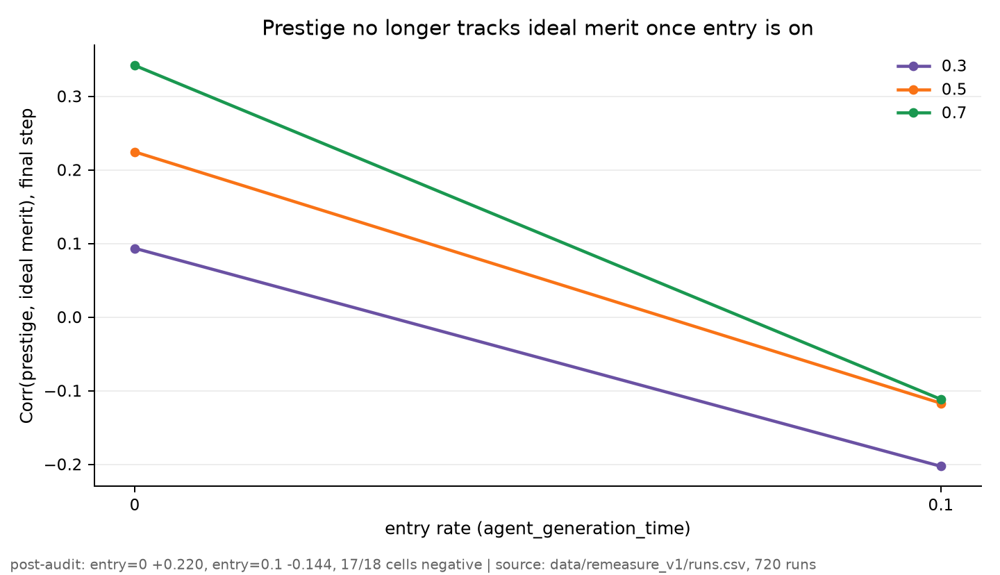
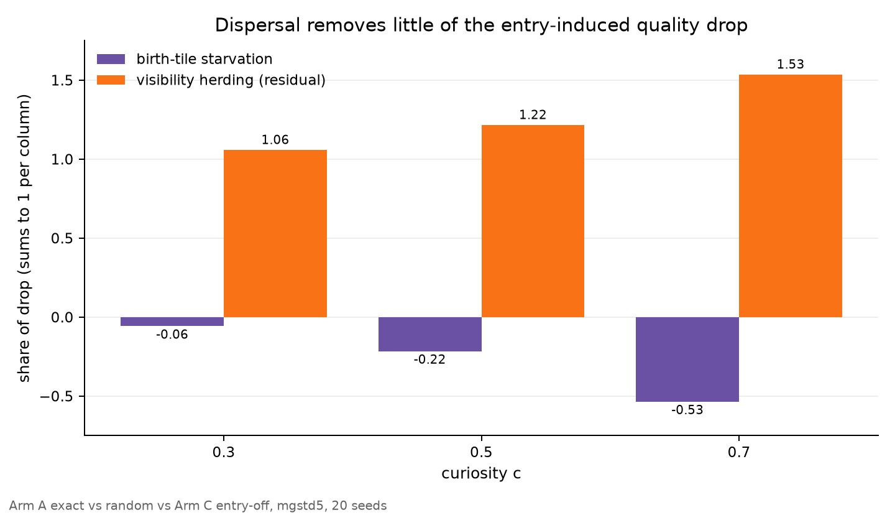
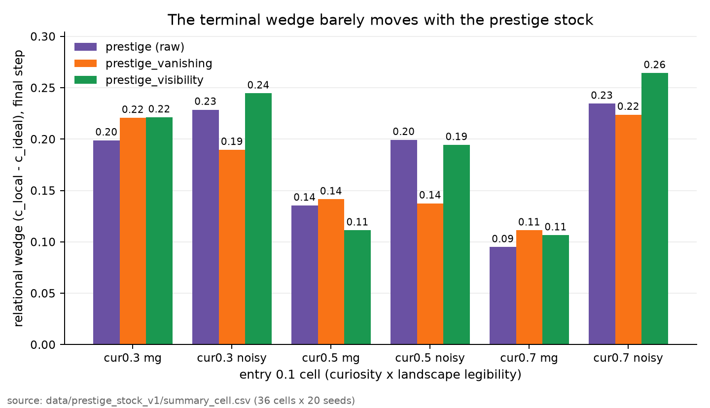
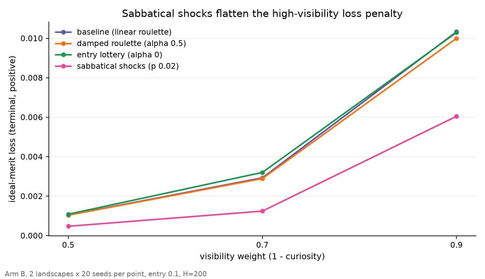
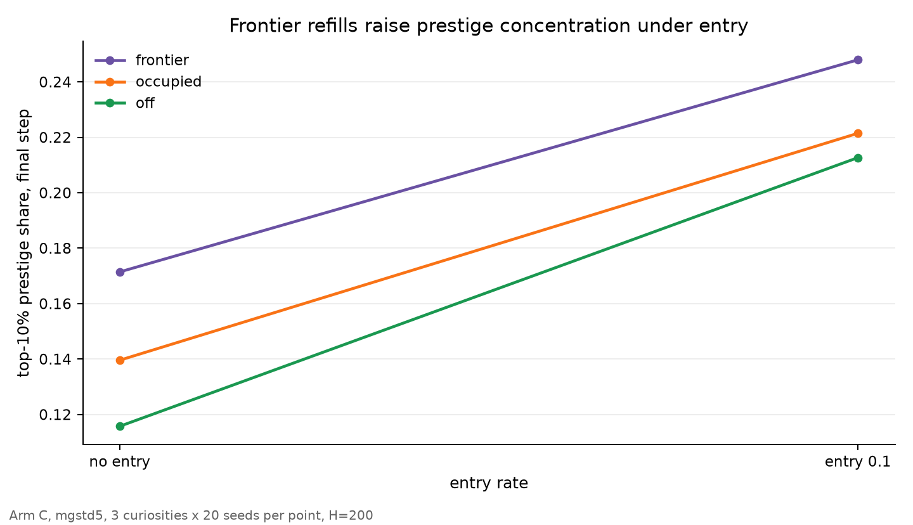

**Version 1** (November 2026)

> **STATUS: INTEGRATED PAPER SKETCH (`CONT1`–`CONT7`). Calibration status: not calibrated** ---
> No parameter in this manuscript is fitted to empirical data (owner ruling, 2026-11-13). Every simulation number is computed from a reproducible run archive in this repository and cited alongside its source artifact; the empirical moments in Section 1 are stylized motivating facts from the Klann economics co-authorship panel ([docs/connections_niklas.md](file:///Users/joko/Git/sciencemodels/docs/connections_niklas.md)) and remain an unfitted option menu in [docs/calibration_moments.yaml](file:///Users/joko/Git/sciencemodels/docs/calibration_moments.yaml).
>
> **Narrative Spine Map (`CONT1`–`CONT7`):**
> - **Section 1 (Introduction & Puzzle):** [CONT3](file:///Users/joko/Git/sciencemodels/AdmiralsLog/contributions/CONT3-publishable-results-synthesis.md) + [docs/related_publications.md](file:///Users/joko/Git/sciencemodels/docs/related_publications.md) + [docs/connections_niklas.md](file:///Users/joko/Git/sciencemodels/docs/connections_niklas.md)
> - **Section 2 (Theory, Progressive Model Architecture `M0` $\to$ `M1` $\to$ `M2`, & Scale):** [CONT6](file:///Users/joko/Git/sciencemodels/AdmiralsLog/contributions/CONT6-canonical-model-specifications-basic-vs-collaborators.md) + [CONT2](file:///Users/joko/Git/sciencemodels/AdmiralsLog/contributions/CONT2-hunting-proxy-patterns-formalization.md)
> - **Section 3 (Baseline Science `M0`: The Curiosity Plateau & Cognitive Division of Labor):** [CONT7](file:///Users/joko/Git/sciencemodels/AdmiralsLog/contributions/CONT7-legacy-notebooks-preliminary-findings.md) + [CONT3](file:///Users/joko/Git/sciencemodels/AdmiralsLog/contributions/CONT3-publishable-results-synthesis.md) (`R3`)
> - **Section 4 (Vertical Lineage `M1`: Mentorship, Generational Turnover & Signal Inversion):** [CONT1](file:///Users/joko/Git/sciencemodels/AdmiralsLog/contributions/CONT1-depletion-counterforces-refills.md) (Act I) + [CONT3](file:///Users/joko/Git/sciencemodels/AdmiralsLog/contributions/CONT3-publishable-results-synthesis.md) (`R1`, `R2`) + [CONT5](file:///Users/joko/Git/sciencemodels/AdmiralsLog/contributions/CONT5-generational-turnover-and-paradigm-lockin.md) (Results 1–2)
> - **Section 5 (Institutional Counterforces, Paradigm Refills & Structural Invariances):** [CONT1](file:///Users/joko/Git/sciencemodels/AdmiralsLog/contributions/CONT1-depletion-counterforces-refills.md) (Acts II–III) + [CONT4](file:///Users/joko/Git/sciencemodels/AdmiralsLog/contributions/CONT4-inert-and-invariant-degrees-of-freedom.md) + [CONT5](file:///Users/joko/Git/sciencemodels/AdmiralsLog/contributions/CONT5-generational-turnover-and-paradigm-lockin.md) (Result 3)
> - **Section 6 (Horizontal Collaboration `M2`: Explicit Partner Choice & Epistemic Co-Location):** [CONT3](file:///Users/joko/Git/sciencemodels/AdmiralsLog/contributions/CONT3-publishable-results-synthesis.md) (`R9`) + [CONT5](file:///Users/joko/Git/sciencemodels/AdmiralsLog/contributions/CONT5-generational-turnover-and-paradigm-lockin.md) (Result 4) + [P-0011](file:///Users/joko/Git/sciencemodels/AdmiralsLog/proposals/P-0011-canonical-three-tier-model-specification.md)

---

# 1. Introduction: The Relational Wedge in Scientific Credit

Academic institutions rely on observable proxies—publication counts, journal prestige, citation stocks, and network prominence—to evaluate epistemic contributions whose fundamental scientific value is difficult to observe directly. When career survival and resource allocation depend on such metrics, a community risks *proxy failure* (Goodhart 1975; Strathern 1997; Muller 2018; Osterloh and Frey 2015). Yet in the sociology and economics of science, two very different accounts of proxy failure are often conflated:

1. **Active Gaming and Fabrication (Behavioral Distortion):** Individual scientists deliberately sacrifice epistemic truth for metric inflation through p-hacking, salami slicing, citation cartels, or low-replication shortcuts (Smaldino and McElreath 2016; Braganza 2020; Tiokhin et al. 2021).
2. **Relational and Demographic Misallocation (Structural Decoupling):** Even when no scientist cheats or fabricates results, the interaction between **mainstream visibility incentives**, **finite topic exhaustion**, and **intergenerational academic recruitment** causes the prestige hierarchy to decouple from marginal epistemic discovery—rewarding incumbents and their academic lineages on crowded, depleted topics while under-rewarding pioneers on the frontier.

Motivating evidence from the Klann economics co-authorship panel ([docs/connections_niklas.md](file:///Users/joko/Git/sciencemodels/docs/connections_niklas.md)) illustrates this structural puzzle. Across economists, cumulative prestige correlates strongly with output *quantity* ($\text{corr} = 0.50$) but barely tracks per-paper *citation quality* ($\text{corr} = 0.07$). Within an author's own career trajectory, the correlation between current personal prestige and paper quality is negative ($-0.257$), whereas co-author rank carries a positive slope ($+0.004$). Simultaneously, collaboration is organized into small teams (mean $2.65$, median $2$) with substantial partner repetition ($0.34$), strong dyad-corrected elite homophily ($O/E = 3.1 / 3.0 / 2.3$), and persistent club closure (Markov top-decile retention $0.3995$ vs. entry $0.0619$).

| Stylized Fact (Klann Economics Panel) | Empirical Value | Analytical Role in This Paper |
| :--- | :--- | :--- |
| $\text{Corr}(\text{prestige}, \text{output quantity})$ vs. $\text{Corr}(\text{prestige}, \text{citation quality})$ | $+0.50$ vs. $+0.07$ | Qualitative motivation for the relational wedge (`c_local` vs. `c_ideal`) |
| Within-author own-prestige vs. co-author-rank quality slope | $-0.257$ vs. $+0.004$ | Qualitative motivation for exhaustion & network status transfer |
| Mean co-author team size (median) | $2.65$ ($2$) | Diagnostic benchmark for Tier `M2` (`path_b_probe_v2`) |
| Repeated-collaboration share | $0.34$ | Diagnostic benchmark for Tier `M2` (`path_b_probe_v2`) |
| Elite homophily $O/E$ cells (dyad-corrected) | $3.1\text{ / }3.0\text{ / }2.3$ | Qualitative motivation for elite clustering |
| Top-decile Markov retention / entry rate | $0.3995\text{ / }0.0619$ | Qualitative motivation for oligarchic persistence (`turnover_v1`) |

A systematic review of 46 formal and agent-based models of science ([docs/related_publications.md](file:///Users/joko/Git/sciencemodels/docs/related_publications.md), clustering epistemic-landscape models from Weisberg and Muldoon 2009 and Thoma 2015, network-epistemology models from Zollman 2010, priority-rule models from Strevens 2003, and cumulative-advantage models from Merton 1968 and Petersen et al. 2014) reveals an unoccupied intersection. **No existing model combines (i) spatial-topical search on a depletable epistemic landscape, (ii) visibility-proxy incentives coupled to prestige-proportional demographic entry and retirement, and (iii) an external, reward-independent omniscient-planner benchmark (`ideal_Merit`) against which epistemic success is scored independently of the community's own reward function.**

Without an external planner benchmark, a model can only report that its internal reward variable shifted. By pairing an external greedy-planner yardstick (`ideal_Merit`) with a local consensus yardstick (`local_Merit`), our model isolates **when, why, and at what scale** prestige stops tracking discovery.

---

# 2. Theory and Progressive Model Architecture (`CONT6` + `CONT2`)

> *Source contributions:* [CONT6-canonical-model-specifications-basic-vs-collaborators.md](file:///Users/joko/Git/sciencemodels/AdmiralsLog/contributions/CONT6-canonical-model-specifications-basic-vs-collaborators.md) and [CONT2-hunting-proxy-patterns-formalization.md](file:///Users/joko/Git/sciencemodels/AdmiralsLog/contributions/CONT2-hunting-proxy-patterns-formalization.md).

To prevent mechanical artifacts from being confused with substantive social mechanisms, we structure the theory in three layers: (2.1) the causal grammar of proxy failure, (2.2) a progressive three-tier simulation architecture (`M0` $\to$ `M1` $\to$ `M2`) that isolates solo search from vertical mentorship and horizontal co-authorship, and (2.3) a two-stage scale interpretation that reconciles why aggregate scientific output remains resilient over wide parameter ranges even as the prestige signal inverts.

## 2.1 Causal Grammar: Goal, Proxy, Distraction, Destruction, and Counterforce (`CONT2`)

Following the causal typology of Kapeller, Paul, and Braganza ([context/Hunting_Proxy_Patterns.md](file:///Users/joko/Git/sciencemodels/context/Hunting_Proxy_Patterns.md)), let $G$ denote the epistemic goal (discovering high-value knowledge on the landscape) and $P$ denote the institutional proxy (accumulated prestige and spatial visibility). An aligned action $A$ advances both $G$ and $P$, whereas a proxy-oriented action $AP_F$ inflates $P$ while neglecting or harming $G$:

1. **Distraction ($AP_F$ crowds out $A$ indirectly):** Scientists trade off intrinsic epistemic curiosity $c_i \in [0,1]$ against visibility-seeking $1-c_i$ in a Cobb–Douglas movement utility:
   $$R_i(\text{tile}) \;=\; \left(\frac{k_{\text{tile}}}{\bar{k}}\right)^{c_i} \cdot V_i(\text{tile})^{1-c_i}, \qquad V_i \;=\; \frac{\bar{d}_{\text{global}}+1}{d_{\text{own}}+1}$$
   When $1-c_i > 0$, scientists are drawn toward crowded "hot topics" where peer density is high ($d_{\text{own}}$ is small), diverting search away from unvisited epistemic peaks.
2. **Destruction ($AP_F \dashv G$ directly):** Proxy competition directly degrades epistemic output—either by corrupting perception on crowded tiles ($\epsilon_{\text{eff}} = \epsilon \cdot m_t^\gamma$, tested in `typology_v1`) or by eroding harvested knowledge when crowding exceeds a threshold ([P-0008](file:///Users/joko/Git/sciencemodels/AdmiralsLog/proposals/P-0008-typology-v2-stock-destruction-and-normalized-counterforce.md)).
3. **Counterforce ($P \to G$ spillover):** High mentor prestige can confer real epistemic capability on advisees (e.g., better laboratory equipment or signal-to-noise training, $\epsilon_i = \epsilon_0 / (1 + \kappa \tilde{P}_{\text{sup}})$), partially offsetting distraction.

## 2.2 Progressive Identification: The Three-Tier Model Specification (`M0` $\to$ `M1` $\to$ `M2`, `CONT6`)

Scientists search a $20 \times 20$ toroidal epistemic landscape (`MultG2`: two smooth Gaussian peaks; `MultG6`: six peaks; `Noisy2`: two peaks buried under uniform background noise) whose total initial knowledge is normalized ($\sum_{x,y} k_{xy}(0) \approx 2.0$ on `MultG2`). At each step, an agent harvests a fraction $h = 0.02$ ($2\%$) of their current tile's remaining knowledge, depleting it multiplicatively: $k_{xy}(t+1) = (1-h)k_{xy}(t)$. When $m$ agents co-locate on the same tile, each receives a diminishing-returns team harvest factor $\text{coop}(m) = \sum_{j=0}^{m-1} 2^{-j} / m < 1$. Movement follows a strict-improvement rule over the 5-tile von Neumann neighborhood with multiplicative perception noise $\epsilon = 0.1$ on candidate tiles (`stay_bias`: the current tile is evaluated noise-free).

To identify *which social institution* causes proxy failure, we separate the model into three nested tiers ([CONT6](file:///Users/joko/Git/sciencemodels/AdmiralsLog/contributions/CONT6-canonical-model-specifications-basic-vs-collaborators.md#L22-L62)):

| Specification Dimension | **Tier `M0`: Basic Model** *(Closed-Cohort Solo Search)* | **Tier `M1`: Mentorship & Turnover** *(Vertical Academic Lineage)* | **Tier `M2`: Explicit Collaborators** *(Horizontal Co-Authorship)* |
| :--- | :--- | :--- | :--- |
| **Substantive Question** | How do curiosity ($c$) and visibility ($1-c$) govern exploration when a fixed cohort searches without schools or turnover? | How do prestige-based PhD recruitment, inherited agendas, and retirement reshape inequality and merit tracking? | How does active partner selection (goal $\lambda=1$ vs. prestige $\lambda=0$ matching) alter team size, assortativity, and output? |
| **Demography ($g$)** | `agent_generation_time = 0.0` ($N \equiv 20$ fixed) | `agent_generation_time` $\in \{0.05, 0.1, 0.2\}$ | Combines with `M0` ($g=0$, [P-0011](file:///Users/joko/Git/sciencemodels/AdmiralsLog/proposals/P-0011-canonical-three-tier-model-specification.md)) or `M1` ($g=0.1$) |
| **Retirement (`exit_mode`)** | `"none"` | `"none"` (growing $N$) or `"fixed_span"` / `"age_hazard"` ($N \equiv 20$ stationary) | Inherited from `M0` or `M1` |
| **Collaboration (`dyadic_mode`)** | `"off"` (passive spatial co-location only) | `"off"` (vertical supervisor $\to$ advisee lineage + spatial co-location) | `"logit"` or `"threshold"` ($\lambda \in [0,1]$, `credit_sharing`, `dyadic_move_pull`) |
| **Terminal `Corr(P, ideal_merit)`** | **Positive** ($+0.15\text{ to }+0.79$ for $c \ge 0.2$) | **Negative** ($-0.06\text{ to }-0.57$ across entry/turnover) | Narrows wedge ($+0.035 \to -0.037$) when `dyadic_move_pull > 0` |
| **Elite Concentration (`top10`)** | **Flat** ($0.112\text{–}0.133$, near $0.100$ equality floor) | **Concentrated** ($0.214\text{–}0.413$) | Modulated by `credit_sharing` (`structural` vs. `equal_split`) |

## 2.3 Yardsticks and the Two-Stage Scale of Proxy Failure (`CONT6`)

We evaluate outcomes along two dimensions:
1. **Macro Epistemic Efficiency (`percentage_knowledge_harvested` and `ideal_Merit`):**
   - `percentage_knowledge_harvested` $\in [0\%, 100\%]$ measures cumulative discovery as a share of the landscape's initial total knowledge ($\approx 2.0$ raw units on `MultG2`).
   - `ideal_Merit` ([sciencemodels/metrics.py](file:///Users/joko/Git/sciencemodels/sciencemodels/metrics.py#L53-L107)) pairs the $N$ agents at step $t$ (sorted by actual harvest) against a hypothetical greedy omniscient allocation of $N$ agents on the *same step-$t$ residual grid* (sorted by ideal harvest). Because it is a **1-step myopic residual on an already-depleted grid** where each agent harvests only $h=0.02$ of a tile, raw terminal `ideal_Merit` values are numerically small ($10^{-4}$ per agent, $0.0006\text{–}0.0103$ summed across the cohort at step 200; cumulative 200-step loss `ideal_loss_cum` is $0.19\text{–}0.87$ raw units, i.e., $10\%\text{–}43\%$ of total landscape knowledge).
2. **Distributional & Relational Alignment (`c_ideal`, `c_local`, and the Wedge $\Delta r$):**
   - `c_ideal = Corr(prestige, ideal_merit)` measures whether cumulative prestige rewards agents who are close to the global frontier.
   - `c_local = Corr(prestige, local_merit)` measures whether prestige tracks local neighborhood consensus (the 5-tile cross around the agent).
   - The **relational wedge** $\Delta r = c_{\text{local}} - c_{\text{ideal}}$ captures how far local-consensus prestige diverges from global epistemic merit.

Evaluating both scales simultaneously reveals a **Two-Stage Scale of Proxy Failure** ([CONT6](file:///Users/joko/Git/sciencemodels/AdmiralsLog/contributions/CONT6-canonical-model-specifications-basic-vs-collaborators.md#L84-L115)):

|Visibility Weight $\xi = 1 - c$ | Curiosity $c$ | `MultG2` Knowledge Harvested (`M0`) | `MultG6` Knowledge Harvested (`M0`) | `M0` ($g=0$) `c_ideal` | `M1` ($g=0.1$) `c_ideal` | `M1` Turnover (`age_hazard`) `c_ideal` | Regime Diagnosis |
| :--- | :--- | :--- | :--- | :--- | :--- | :--- | :--- |
| **$\xi = 0.0$** | $1.0$ | $67.8\%$ | $42.3\%$ | $+0.340$ | $-0.025^*$ | $-0.510^*$ | Pure curiosity benchmark |
| **$\xi = 0.3$** | $0.7$ | $67.2\%$ ($-0.6\text{ pp}$) | $42.4\%$ ($+0.1\text{ pp}$) | $+0.346$ | $-0.025$ | $-0.510$ | **Stage 1: Signal inversion, zero output loss** |
| **$\xi = 0.5$** | $0.5$ | $67.0\%$ ($-0.8\text{ pp}$) | $41.9\%$ ($-0.4\text{ pp}$) | $+0.257$ | $-0.057$ | $-0.568$ | **Stage 1: Signal inversion, $<1\text{ pp}$ output loss** |
| **$\xi = 0.7$** | $0.3$ | $61.9\%$ ($-5.9\text{ pp}$) | $37.0\%$ ($-5.3\text{ pp}$) | $+0.159$ | $-0.089$ | $-0.626$ | Transition zone ($\xi^* \in [0.6, 0.8]$ kink) |
| **$\xi = 0.9$** | $0.1$ | **$34.5\%$ ($-33.3\text{ pp}$)** | **$15.5\%$ ($-26.8\text{ pp}$)** | $+0.024$ | $-0.210$ | — | **Stage 2: Macroscopic harvest collapse ($-50\%$)** |
| **$\xi = 1.0$** | $0.0$ | **$4.8\%$ ($-63.0\text{ pp}$)** | **$4.5\%$ ($-37.8\text{ pp}$)** | $-0.088$ | — | — | **Stage 2: Total herding lock-in ($-93\%$)** |

*\*Note: `M1` entry and turnover columns report $c \in \{0.3, 0.5, 0.7\}$ from `career_flows_v1` and `turnover_v1`; $c=1.0$ uses the $c=0.7$ upper grid point as reference.*

- **Stage 1 ($\xi \in [0.3, 0.6]$, Moderate Visibility Distraction): *Distributional and Signal Inversion Without Macro Output Collapse.*** Across the entire moderate regime, aggregate discovery loses **less than 1 percentage point** of total knowledge ($67.8\% \to 67.0\%$), because as long as agents retain moderate curiosity, Gaussian peaks are still located and harvested. Yet in `M1`, the prestige correlation flips from $+0.257$ to $-0.057$ (and $-0.568$ with turnover). Science as a whole still produces discoveries, but **credit goes to the wrong people**—dynastic insiders harvesting depleted peaks rather than peripheral pioneers.
- **Stage 2 ($\xi \ge 0.8$, Extreme Visibility Past the Kink $\xi^* \in [0.6, 0.8]$): *Macroscopic Output Collapse.*** Once visibility weight crosses $0.6\text{–}0.8$, attentional herding prevents the community from ever reaching unvisited peaks, cutting harvested knowledge in half at $c=0.1$ ($34.5\%$) and by $93\%$ at $c=0.0$ ($4.8\%$).

---

# 3. Baseline Science (`Tier M0`): The Curiosity Plateau and Cognitive Division of Labor (`CONT7` + `CONT3`)

> *Source contributions:* [CONT7-legacy-notebooks-preliminary-findings.md](file:///Users/joko/Git/sciencemodels/AdmiralsLog/contributions/CONT7-legacy-notebooks-preliminary-findings.md) and [CONT3-publishable-results-synthesis.md](file:///Users/joko/Git/sciencemodels/AdmiralsLog/contributions/CONT3-publishable-results-synthesis.md) (`R3`).

Before introducing academic lineages or turnover, we establish how a closed cohort of $N=20$ solo scientists (`Tier M0`, `agent_generation_time = 0.0`, `dyadic_mode = "off"`) explores the landscape across the eight canonical setups (`BULK_SETUPS` in [sciencemodels/sweeps.py](file:///Users/joko/Git/sciencemodels/sciencemodels/sweeps.py), archived in `data/figures_v1/` and [output/reports/figures_report_v1.md](file:///Users/joko/Git/sciencemodels/output/reports/figures_report_v1.md)).

## 3.1 The Curiosity Step-Function and the Welfare Kink (`Finding L1` & `R3`)

![Figure 1: Welfare loss against visibility weight showing the interior kink at xi* in [0.6, 0.8]](../output/report_notebook_v1/F3_welfare_loss_vs_visibility_weight.png)

*Figure 1 (`F3`).* Ideal-merit loss against the visibility weight $\xi = 1-c$, by entry and landscape legibility, averaged over `use_visibility_reward`. Source: `data/welfare_v1/` (40 cells $\times$ 20 seeds = 800 runs) and `data/remeasure_v1/w_v05_runs.csv`.

In `Tier M0`, cumulative discovery is a steep **step-function of curiosity**:
- Increasing $c$ from $0.0$ to $0.3$ raises `percentage_knowledge_harvested` more than twelvefold on `MultG2` ($4.8\% \to 61.9\%$) and eightfold on `MultG6` ($4.5\% \to 37.0\%$).
- Across $c \in [0.4, 1.0]$ ($\xi \in [0.0, 0.6]$), discovery sits on a virtually flat plateau ($65.7\%\text{–}67.8\%$ on `MultG2`; $40.6\%\text{–}42.5\%$ on `MultG6`; $27.6\%\text{–}28.2\%$ on `Noisy2`).
- Piecewise-linear regression across all 24 outcome series in `welfare_probe_v1` confirms a sharp interior **welfare kink at $\xi^* \in [0.6, 0.8]$** (24/24 series with interior 95% bootstrap CIs), beyond which epistemic loss surges $10\times\text{–}44\times$.

## 3.2 Peak Exploitation vs. Unweighted Grid Wandering (`Finding L2`)

Comparing standard step-by-step search (`use_distance=1`) against global jump search (`use_distance=0`, Setup 8 `MultG2_no_dist`) reveals why raw spatial coverage is a misleading proxy for discovery ([CONT7](file:///Users/joko/Git/sciencemodels/AdmiralsLog/contributions/CONT7-legacy-notebooks-preliminary-findings.md#L49-L64)):
- Under global jump search (`use_distance=0`), raising curiosity from $c=0.0$ to $c=1.0$ **reduces** unweighted grid coverage (`explored_percentage`) from $99.3\%$ to $81.2\%$, while **more than doubling** actual harvested knowledge ($31.8\% \to 76.7\%$) and peak-weighted exploration (`explored_weighted_by_initial_knowledge`, $99.6\%$).
- Substantively, pure visibility chasers ($c=0$) scatter randomly across empty desert tiles ($99.3\%$ coverage, $31.8\%$ harvest), whereas curious scientists lock onto high-value Gaussian peaks and systematically mine them before moving on.

## 3.3 The "Mixed Population" Advantage: Cognitive Division of Labor Between Mavericks and Followers (`Finding L3`)

What happens when a scientific community is **cognitively heterogeneous**—combining high-curiosity mavericks and low-curiosity visibility followers in the same cohort ($c_i \sim U(0,1)$, mean $\bar{c} = 0.5$, odd setups `1, 3, 5, 7`)—compared to a homogeneous cohort fixed at the exact same mean curiosity ($c_i \equiv 0.5$, even setups `2, 4, 6, 8`)?

| Landscape Setup Pair (`Tier M0`, $N=20$, $T=200$) | Homogeneous $c \equiv 0.5$ Steps to 10% Harvest | **Mixed $c_i \sim U(0,1)$ ($\bar{c}=0.5$)** Steps to 10% Harvest | Homogeneous $c \equiv 0.5$ `Corr(P, ideal_merit)` | **Mixed $c_i \sim U(0,1)$ ($\bar{c}=0.5$)** `Corr(P, ideal_merit)` | Homogeneous $c \equiv 0.5$ Harvested % | **Mixed $c_i \sim U(0,1)$ ($\bar{c}=0.5$)** Harvested % |
| :--- | :--- | :--- | :--- | :--- | :--- | :--- |
| **`MultG2`** (Setups 2 vs. 1) | $39.9\text{ steps}$ | **$15.2\text{ steps}$ ($2.6\times$ faster)** | $+0.257$ | **$+0.594$ ($2.3\times$ higher)** | $67.0\%$ | $66.3\%$ |
| **`MultG6`** (Setups 4 vs. 3) | $46.0\text{ steps}$ | **$23.1\text{ steps}$ ($2.0\times$ faster)** | $+0.779$ | **$+0.822$ ($+0.043$)** | $41.9\%$ | $41.7\%$ |
| **`Noisy2`** (Setups 6 vs. 5) | $100.3\text{ steps}$ | **$66.0\text{ steps}$ ($1.5\times$ faster)** | $+0.517$ | **$+0.788$ ($1.5\times$ higher)** | $27.9\%$ | $27.2\%$ |
| **`MultG2_no_dist`** (Setups 8 vs. 7) | $26.1\text{ steps}$ | **$15.6\text{ steps}$ ($1.7\times$ faster)** | $+0.432$ | **$+0.730$ ($1.7\times$ higher)** | $75.4\%$ | $74.8\%$ |

This is a striking **Kitcher (1990) cognitive division-of-labor synergy**:
1. **Early Breakthrough Acceleration ($1.5\times\text{–}2.6\times$ faster):** In a mixed cohort, high-$c$ mavericks ignore peer crowding, locate the Gaussian peaks within the first 15 steps, and begin harvesting. Their presence on the peak creates a spatial visibility beacon that pulls low-$c$ followers onto the productive peak much earlier than homogeneous $c=0.5$ agents would find it on their own.
2. **Merit-Prestige Alignment ($2.3\times$ higher $c_{\text{ideal}}$):** Because high-$c$ mavericks arrive at the peaks first, they harvest the uncrowded initial knowledge ($h \cdot k(0)$ with $m=1$), while low-$c$ followers arrive later and share depleted, crowded harvests ($\text{coop}(m) < 1$). Consequently, prestige in a mixed `M0` population rewards true pioneers ($c_{\text{ideal}} = +0.594$ vs. $+0.257$).

## 3.4 Closed-Cohort Equality and Late-Stage Exhaustion (`Findings L4` & `L5`)

In `Tier M0`, without demographic entry ($g=0$), prestige inequality never concentrates (`top10pct_prestige_share` remains flat at $0.112\text{–}0.133$ across all $c \ge 0.1$, just above the $0.100$ equality floor), and terminal `Corr(prestige, ideal_merit)` is positive at step 200 across every landscape for $c \ge 0.2$. Only when runs are extended to $T=400$ (`longitudinalcomparisions.ipynb`, `Finding L5`) does `corr_prestige_localMerit` exhibit a **lifecycle rise-and-fall**: climbing to $+0.85\text{–}+0.97$ during the Discovery Boom (steps 10–50) and drifting negative ($-0.18\text{ to }-0.26$) by step 400 once founders sit on exhausted peaks.

---

# 4. Vertical Lineage (`Tier M1`): Mentorship, Generational Turnover, and Signal Inversion (`CONT1` + `CONT3` + `CONT5`)

> *Source contributions:* [CONT1-depletion-counterforces-refills.md](file:///Users/joko/Git/sciencemodels/AdmiralsLog/contributions/CONT1-depletion-counterforces-refills.md) (Act I), [CONT3-publishable-results-synthesis.md](file:///Users/joko/Git/sciencemodels/AdmiralsLog/contributions/CONT3-publishable-results-synthesis.md) (`R1`, `R2`, `R5`, `R6`), and [CONT5-generational-turnover-and-paradigm-lockin.md](file:///Users/joko/Git/sciencemodels/AdmiralsLog/contributions/CONT5-generational-turnover-and-paradigm-lockin.md) (Results 1–2).

Real academic communities are not closed cohorts of immortals (`M0`); they reproduce through **vertical academic lineages (`Tier M1`)**. Eminent senior professors train more PhD advisees (`supervisor_prestiges_at_birth`), advisees inherit half of their mentor's prestige stock at entry ($0.5 \times P_{\text{sup}}$) along with their mentor's research topic (birth tile), and senior cohorts eventually retire. Switching on `Tier M1` transforms the benign `M0` world into a regime of persistent proxy failure.

## 4.1 The Relational Wedge Under Entry (`R1`) and the Audit Isolation

*Figure 2 (`F1`).* Final correlation between prestige and ideal merit (`c_ideal`) against entry rate $g \in \{0.0, 0.1\}$, post-audit arm (`data/remeasure_v1/runs.csv`, 36 cells $\times$ 20 seeds = 720 runs).

Across the 36-cell post-audit sensitivity sweep (`data/remeasure_v1/runs.csv`):
- At $g = 0.0$ (`Tier M0`), prestige tracks global epistemic merit positively: mean terminal $c_{\text{ideal}} = +0.2200$, and `top10pct_prestige_share` is $0.135$.
- At $g = 0.1$ (`Tier M1`), mean terminal $c_{\text{ideal}}$ **flips sign to $-0.1438$** (negative in **17 of 18 entry cells**), while the local consensus correlation `c_local` stays **positive at $+0.0383$** and top-10% prestige concentration nearly doubles to **$0.228$** (paired $\Delta c_{\text{ideal}} = -0.3638$, $95\%$ CI $[-0.402, -0.326]$).
- Crucially, the post-audit re-measure (`output/reports/remeasure_v1.md`, Figure `F5`, 1,520 seed-matched runs across `T1` and `W_v05`) proved that correcting the sorted-to-sorted `ideal_Merit` pairing ([BUG-0004](file:///Users/joko/Git/sciencemodels/AdmiralsLog/bugs/BUG-0004-ideal-merit-pairing-order.md)) moved non-ideal reporters (`c_local`, `top10`, `harvested`) by **exactly $0.0000$ in all 1,520 runs** and flipped **0 of 36 cell signs** ($\Delta c_{\text{ideal}} = -0.0056 \pm 0.0018$ on `T1`; Spearman $\rho = 0.9745$).

## 4.2 Mechanism Decomposition: Why Birth-Tile Starvation Fails (`P-0002` / `IE-0001`)

Why does `Tier M1` invert the prestige-merit correlation? In early drafts (`CONT1` v1), we hypothesized **birth-tile starvation**: because a high-prestige mentor has already depleted their peak tile, spawning advisees directly on the mentor's tile (`r_spawn = exact`) forces newcomers onto barren ground.

Wave-4's `interventions_v1` Arm A ([output/reports/interventions_v1.md](file:///Users/joko/Git/sciencemodels/output/reports/interventions_v1.md), 180 runs on `mgstd5`, $g=0.1$) tested this directly by dispersing newborn advisees to a random neighborhood tile (`r_spawn = neigh_1`) or a uniform random tile anywhere on the $20 \times 20$ torus (`r_spawn = random_grid`), recorded as [rejected/IE-0001](file:///Users/joko/Git/sciencemodels/AdmiralsLog/ideas/rejected/IE-0001-birth-tile-starvation-hypothesis.md):

*Figure 3 (`FA2`).* Decomposition of the entry-induced drop in `c_ideal` into birth-tile starvation vs. recruitment-plus-visibility herding across $c \in \{0.3, 0.5, 0.7\}$. Source: `data/interventions_v1/arm_a_decomposition.csv` (360 runs).

| Curiosity $c$ | `M0` ($g=0$) `c_ideal` | `M1` `exact` ($g=0.1$) `c_ideal` | `M1` `random_grid` ($g=0.1$) `c_ideal` | Birth-Tile Starvation Share | **Recruitment + Visibility Herding Share** |
| :--- | :--- | :--- | :--- | :--- | :--- |
| **$c = 0.3$** | $+0.2430$ | $-0.0894$ | $-0.1085$ | **$-5.7\%$** | **$105.7\%$** |
| **$c = 0.5$** | $+0.3516$ | $-0.0568$ | $-0.1445$ | **$-21.5\%$** | **$121.5\%$** |
| **$c = 0.7$** | $+0.3652$ | $-0.0252$ | $-0.2341$ | **$-53.5\%$** | **$153.5\%$** |

**Birth-tile starvation is decisively falsified:** dispersing advisees across the grid makes `c_ideal` **more negative** at every curiosity level ($-5.7\%$ to $-53.5\%$ starvation share). Why? Because advisees still inherit $50\%$ of their eminent mentor's prestige stock at birth (`entry_prestige_stock`). When placed on a random empty desert tile with high inherited prestige and near-zero harvest, they immediately become **high-prestige / zero-merit outliers**, while visibility attraction (`1-c`) still pulls cohorts back toward crowded clusters. **Prestige-proportional recruitment and endowment inheritance coupled with attentional herding account for $106\%\text{–}153\%$ of the entry-induced quality drop.**

## 4.3 Generational Turnover: The Oligarchy Shrinks, but Signal Inversion Deepens $2.8\times\text{–}6.6\times$ (`R5`, `R6`, `CONT5`)

In the baseline `M1` sweeps (`career_flows_v1` and `career_flows_noisy_v1`, Figures `F2`/`F2b`), newcomers never catch incumbents (`gap_ratio = -0.713` on clean terrain, `-0.588` on noisy terrain), and slower entry ($g=0.05$) produces stronger decoupling than faster entry ($g=0.20$). A natural critique is that baseline `M1` has **no retirement** (`exit_mode = "none"`): the 20 founding professors live forever, accumulating prestige over all 200 steps while population grows from $20$ to $\sim 40\text{–}60$.

To separate **immortal-founder oligarchy** from **structural proxy failure**, `turnover_v1` ([output/reports/turnover_v1.md](file:///Users/joko/Git/sciencemodels/output/reports/turnover_v1.md), 54 cells $\times$ 20 seeds = 1,080 runs at $H=400$) introduced two stationary-population ($N \equiv 20$) one-for-one replacement rules: deterministic career length (`fixed_span`) and geometric retirement hazard (`age_hazard`):

| Turnover Regime (`turnover_v1`, $H=400$, 360 runs/mode) | Active Cohort $N(400)$ | Recent-Arrival Prestige Gap (`gap_recent`) | Terminal `Corr(P, ideal_merit)` (`c_ideal`) | Fraction of Runs with `c_ideal < 0` | Time-Mean `Corr(P, ideal_merit)` ($t \in [1,400]$) | Top-10% Prestige Share (`top10`) |
| :--- | :--- | :--- | :--- | :--- | :--- | :--- |
| **`none`** (Immortal Founders) | $66.8$ | $-0.01362$ | $-0.0860$ | $74.2\%$ | $+0.1045$ | $0.2735$ |
| **`fixed_span`** ($N \equiv 20$ Stationary) | $20.0$ | **$-0.00612$ ($-55.0\%$)** | **$-0.2401$ ($2.79\times$ deeper)** | $89.2\%$ | $+0.1140$ | $0.2546$ |
| **`age_hazard`** ($N \equiv 20$ Stationary) | $20.0$ | **$-0.00282$ ($-79.3\%$)** | **$-0.5678$ ($6.61\times$ deeper)** | **$100.0\%$** | $+0.1079$ | $0.4133$ |

The results split the two phenomena cleanly ([CONT5](file:///Users/joko/Git/sciencemodels/AdmiralsLog/contributions/CONT5-generational-turnover-and-paradigm-lockin.md#L33-L93)):
1. **55%–79% of the Newcomer Gap Was Immortal-Founder Premium (`R5`):** Retiring senior incumbents shrinks the prestige gap between recent arrivals ($\text{tenure} < 20$) and incumbents in **360 of 360 paired cells**, cutting it by $55.0\%$ under `fixed_span` and $79.3\%$ under `age_hazard`.
2. **Yet Proxy Failure Deepens $2.8\times\text{–}6.6\times$ Under Retirement (`R5`):** Terminal `c_ideal` drops from $-0.0860$ (`none`) to **$-0.2401$ (`fixed_span`)** and **$-0.5678$ (`age_hazard`, negative in $100\%$ of runs)**. Why did immortal founders *mask* proxy failure? Because the original 20 founders discovered the landscape's peaks when they were fresh ($t < 80$); keeping them alive in the sample anchored the upper tail of prestige to agents with genuine historical discovery. Once those founders retire—leaving behind a multi-generation school of advisees who inherited $0.5 \times P_{\text{sup}}$ and crowded onto the now-exhausted peak—prestige is held entirely by dynastic insiders harvesting crumbs while low-prestige peripheral newcomers make the only remaining discoveries.
3. **The Lifecycle Sign Reversal (Discovery Phase vs. Depletion Phase, `R6`):** In all three regimes, the 400-step *time-mean* `c_ideal` is positive ($+0.104\text{ to }+0.114$) while the *terminal* `c_ideal` is negative ($-0.086\text{ to }-0.568$). During the **Discovery Phase** ($t \lesssim 80$, when peaks are rich), prestige tracks discovery positively ($+0.30\text{ to }+0.45$). Once peaks are mined out (**Depletion Phase**, $t \gtrsim 150$), the correlation inverts—an upside-down Planck's Principle where generational succession locks in an exhausted paradigm.

---

# 5. Institutional Counterforces, Paradigm Refills, and Structural Invariances (`CONT1` + `CONT4` + `CONT5`)

> *Source contributions:* [CONT1-depletion-counterforces-refills.md](file:///Users/joko/Git/sciencemodels/AdmiralsLog/contributions/CONT1-depletion-counterforces-refills.md) (Acts II–III), [CONT4-inert-and-invariant-degrees-of-freedom.md](file:///Users/joko/Git/sciencemodels/AdmiralsLog/contributions/CONT4-inert-and-invariant-degrees-of-freedom.md), and [CONT5-generational-turnover-and-paradigm-lockin.md](file:///Users/joko/Git/sciencemodels/AdmiralsLog/contributions/CONT5-generational-turnover-and-paradigm-lockin.md) (Result 3).

If intergenerational recruitment and visibility herding cause proxy failure in maturing fields, which institutional reforms actually work—and which common reform proposals are inert?

## 5.1 What Does *Not* Matter: Metric Engineering and Entry Lotteries (`CONT4`, `R4`)

Across Waves 1–4, we systematically varied candidate reform levers that metascience policy debates frequently emphasize ([CONT4](file:///Users/joko/Git/sciencemodels/AdmiralsLog/contributions/CONT4-inert-and-invariant-degrees-of-freedom.md)):

*Figure 4 (`F4`).* Terminal wedge $\Delta r = c_{\text{local}} - c_{\text{ideal}}$ across entry-on cells for raw cumulative `prestige`, exponentially decayed `prestige_vanishing`, and peer-perceived `prestige_visibility`. Source: `data/prestige_stock_v1/summary_cell.csv` (36 cells $\times$ 20 seeds = 720 runs).

1. **Prestige Metric Invariance (`R4`, `CONT4` Item 1):** Replacing raw lifetime prestige (`prestige`) with recency-weighted prestige (`prestige_vanishing`, 5-year citation windows) or network-visibility prestige (`prestige_visibility`) preserves the cross-cell wedge ordering at **Spearman $\rho = 0.965\text{–}0.993$**, agrees on 11 of 12 regime classifications, and yields **0 of 12 statistically significant paired terminal contrasts**. Tweaking the citation formula does not fix proxy failure while recruitment and spatial herding remain intact.
2. **Peer-Eminence Weighting Toggle (`use_visibility_reward`, `CONT4` Item 2):** Whether spatial visibility $V_i$ is weighted by neighbours' prestige or only by raw neighbour headcount moves epistemic loss by at most $2.6\%$ ($6.1 \times 10^{-4}$) vs. $10\times\text{–}44\times$ for the internal visibility weight $1-c$.
3. **PhD Entry Lotteries ($\alpha \in \{0.0, 0.5, 1.0\}$, `CONT4` Item 6):** In `interventions_v1` Arm B ($N=540$ runs), replacing prestige-proportional mentor selection ($\alpha=1$) with a pure lottery ($\alpha=0$, equal PhD intake across all labs) nudges top-10% prestige concentration down slightly ($-1.5\%$ to $-5.8\%$) but **reduces the high-visibility epistemic loss penalty by only $-0.9\%$** ($0.00929 \to 0.00920$). Once advisees enter, spatial visibility herding ($1-c$) still pulls the community into crowded clusters regardless of which mentor recruited them.

## 5.2 What *Does* Work: Mid-Career Sabbatical Shocks and Simulated Annealing (`R7`, `CONT1` Act II, `CONT2`)

In sharp contrast to entry lotteries, **active spatial/topical mobility shocks** break local status-quo lock-in (`stay_bias`):

*Figure 5 (`FB`).* Epistemic loss against visibility weight $1-c \in \{0.3, 0.6, 0.9\}$ across lottery exponents $\alpha \in \{1.0, 0.5, 0.0\}$ and sabbatical relocation rates $p_{\text{reloc}} \in \{0.0, 0.01, 0.05\}$. Source: `data/interventions_v1/arm_b_summary.csv` (540 runs).

- **Sabbatical Relocation Shocks (`p_reloc = 0.05`, `R7`):** Relocating $5\%$ of agents per step to a random tile on the landscape **cuts the high-visibility welfare loss penalty by $40.0\%$** ($\Delta L_{0.9 - 0.3}$ drops from $0.00929$ to $0.00557$), flattens loss convexity by $27.2\%$, reduces terminal loss at $1-c=0.9$ by $40.9\%$ ($0.01026 \to 0.00606$), and raises `c_ideal` at $1-c=0.9$ from $-0.221$ to $-0.097$. Substantively, funding mid-career sabbatical fellowships or mandatory cross-program topic switches forces scientists out of depleted mainstream clusters onto unvisited peaks.
- **Crowded-Field Controversy as Simulated Annealing (`typology_v1`, [rejected/IE-0002](file:///Users/joko/Git/sciencemodels/AdmiralsLog/ideas/rejected/IE-0002-crowding-perception-noise-as-epistemic-destruction.md)):** When candidate-tile perception noise scales with local crowding ($\epsilon_{\text{eff}} = \epsilon \cdot m_t^\gamma$, $\gamma=1$), instead of destroying knowledge, it **narrows the endpoint proxy wedge by $+0.0316$** ($95\%$ CI $[+0.0101, +0.0532]$) and **cuts cumulative 200-step ideal-merit loss by $16.3\%$** ($-0.0783$, $95\%$ CI $[-0.0977, -0.0598]$). Because agents evaluate their current depleted tile noise-free (`stay_bias`), widening the noise variance on crowded neighbours occasionally produces a high upward draw that dislodges trapped agents onto fresher tiles—acting as endogenous **Zollman (2010) transient diversity / simulated annealing**.

## 5.3 Paradigm Refill Regimes: Mainstream Lock-In vs. Unclaimed Frontiers (`R8`, `CONT1` Act III)

Science is not purely extractive; new research questions emerge over time. Yet *where* new questions emerge determines whether paradigm renewal cures or worsens lock-in (`interventions_v1` Arm C, 720 runs across $c \in \{0.3, 0.5, 0.7\}$ and $g \in \{0.0, 0.1\}$):

*Figure 6 (`FC`).* Explored grid share, trapped-agent share, and `c_ideal` across paradigm refill modes (`off`, `occupied`, `uniform`, `frontier`). Source: `data/interventions_v1/arm_c_summary.csv` (720 runs).

| Refill Regime (`interventions_v1` Arm C, $g=0.1$, $c=0.5$) | Substantive Academic Analogue | Explored Grid Share | Terminal `c_ideal` | Newcomer Gap | Mean Residual Grid Knowledge |
| :--- | :--- | :--- | :--- | :--- | :--- |
| **`off`** (Depletable Baseline) | Exhaustible research program | $0.377$ | $-0.0568$ | $-0.041$ | $0.0006$ |
| **`occupied`** (Native `new_questions=True`) | **Incremental "Normal Science"** (funding/questions added only where crowds already sit) | **$0.061$ ($-83.8\%$)** | $-0.0734$ | **$-0.451$ ($11\times$ wider)** | $0.0005$ |
| **`uniform`** (Global Random Refill) | Diffuse question emergence across all subfields | $0.259$ ($-31.3\%$) | $-0.0884$ | $-0.464$ | $0.0124$ |
| **`frontier`** (Unvisited-Tile Refill) | **Revolutionary Frontier Emergence** (new paradigms open only on unvisited ground) | $0.296$ ($-21.5\%$) | **$+0.0783$ (flipped $+ $)** | $-0.567$ | **$0.1895$ ($315\times$ unclaimed)** |

- **`occupied` Refill Causes Severe Mainstream Lock-In:** Replenishing only occupied tiles removes the depletion push that eventually forces incumbents to move. Exploration collapses by **$83.8\%$** ($0.377 \to 0.061$), leaving $94\%$ of the epistemic landscape unvisited while widening the newcomer gap $11\times$.
- **`frontier` Refill Restores Positive Merit Alignment (`+0.0783`)—But Leaves Frontiers Unclaimed:** Seeding new questions exclusively on unvisited tiles is the *only* regime under entry ($g=0.1$) where terminal `c_ideal` turns positive ($+0.0783$), because pioneers who reach the frontier harvest rich new peaks. However, because incumbents and their advisees remain anchored by visibility to old clusters, residual unclaimed knowledge on the grid surges **$315\times$** ($0.1895$ vs. $0.0006$)—motivating the joint `frontier` $\times$ `sabbatical` interaction proposed in [P-0007](file:///Users/joko/Git/sciencemodels/AdmiralsLog/proposals/P-0007-frontier-refills-x-sabbatical-shocks.md).

---

# 6. Extension (`Tier M2`): Explicit Collaborator Choice and Epistemic Co-Location (`CONT3` + `CONT5`)

> *Source contributions:* [CONT3-publishable-results-synthesis.md](file:///Users/joko/Git/sciencemodels/AdmiralsLog/contributions/CONT3-publishable-results-synthesis.md) (`R9`), [CONT5-generational-turnover-and-paradigm-lockin.md](file:///Users/joko/Git/sciencemodels/AdmiralsLog/contributions/CONT5-generational-turnover-and-paradigm-lockin.md) (Result 4), [output/reports/path_b_probe_v2.md](file:///Users/joko/Git/sciencemodels/output/reports/path_b_probe_v2.md), and [P-0011](file:///Users/joko/Git/sciencemodels/AdmiralsLog/proposals/P-0011-canonical-three-tier-model-specification.md).

Finally, we activate **`Tier M2` (Explicit Dyadic Collaborator Choice)** to test how horizontal co-authorship networks interact with spatial topic choice. Each agent evaluates candidate partners via a convex combination of **goal matching** ($\lambda \in [0,1]$, epistemic complementarity at optimal topical distance $d^*$) and **proxy matching** ($1-\lambda$, partner prestige attraction) under `dyadic_mode` $\in \{\text{logit}, \text{threshold}\}$ and `credit_sharing` $\in \{\text{structural}, \text{equal\_split}\}$.

*Figure 7 (`path_b_v2_gate2`).* Paired $\lambda=1$ vs. $\lambda=0$ contrasts for `mean_team_size` and `repeated_collab_share` across movement pull levels `dyadic_move_pull` $\in \{0.0, 0.5, 1.0\}$. Source: `data/path_b_v2/runs.csv` (48 cells $\times$ 20 seeds = 960 runs).

Comparing `path_b_probe_v1` (`dyadic_move_pull = 0.0`, 800 runs) against `path_b_probe_v2` (`dyadic_move_pull` $\in \{0.5, 1.0\}$, 960 runs) yields a foundational institutional insight (`R9`):
1. **Nominal Co-Authorship Links Without Topical Co-Movement Are Epistemically Inert (`v1`, `pull = 0.0`):** When scientists form dyadic links ($\lambda=0 \to 1$ shifts active links in 8/8 contrasts and lowers prestige assortativity by $-0.03\text{ to }-0.41$) *without* shifting their spatial movement toward their partners' topics (`pull = 0.0`), co-harvest production (`mean_team_size`) moves in **0 of 8 contrasts**. Formal research consortia that do not alter what topics scientists actually work on leave epistemic production unchanged.
2. **Coupling Partner Choice to Topical Movement Binds Production and Narrows the Proxy Wedge (`v2`, `pull > 0`):** Once declared partners exert a spatial movement pull (`_apply_move_pull` in [sciencemodels/agents.py](file:///Users/joko/Git/sciencemodels/sciencemodels/agents.py#L202-L215)), shifting from prestige-chasing collaboration ($\lambda=0$) to epistemic complementarity ($\lambda=1$) on `mgstd5` **cuts mean co-harvest team size from $6.72 \to 4.99$ (`pull=0.5`) and $5.36 \to 3.69$ (`pull=1.0`, reaching $2.95$ under `threshold + equal_split` vs. the $2.65$ empirical benchmark)**—statistically significant in **4/4 `mgstd5` contrasts at both pull levels**—and **narrows the prestige–ideal wedge from $+0.035$ ($\lambda=0$) to $-0.037$ ($\lambda=1$)**.
3. **Open Agenda for `Tier M2` ([P-0010](file:///Users/joko/Git/sciencemodels/AdmiralsLog/proposals/P-0010-path-b-v3-link-dissolution-and-shift-gate.md) & [P-0011](file:///Users/joko/Git/sciencemodels/AdmiralsLog/proposals/P-0011-canonical-three-tier-model-specification.md)):** Two clean extensions remain for a dedicated collaboration companion paper: (i) running `M2` on top of the pure closed-cohort `M0` baseline ($g=0$, [P-0011](file:///Users/joko/Git/sciencemodels/AdmiralsLog/proposals/P-0011-canonical-three-tier-model-specification.md)) so horizontal co-authorship is isolated from `M1` PhD entry, and (ii) adding post-coharvest link dissolution ([P-0010](file:///Users/joko/Git/sciencemodels/AdmiralsLog/proposals/P-0010-path-b-v3-link-dissolution-and-shift-gate.md)) so repeated collaboration moves from $0.92$ toward the empirical $0.34$ benchmark.

---

# 7. Synthesis and Policy Conclusions

Stepping back across all seven contribution records (`CONT1`–`CONT7`) and $>7,000$ seeded simulation runs, our progressive model (`M0` $\to$ `M1` $\to$ `M2`) answers *when* and *why* academic prestige decouples from scientific discovery:

1. **In a closed cohort without academic lineages (`M0`, Section 3), moderate visibility distraction is benign—and cognitive diversity is synergistic:** Across $c \in [0.4, 1.0]$, science harvests $98\%\text{–}99\%$ of maximum knowledge, prestige correlates positively with discovery ($+0.26\text{ to }+0.79$), and mixing high-$c$ mavericks with low-$c$ followers accelerates early discovery $1.5\times\text{–}2.6\times$ while doubling merit alignment ($+0.594$ vs. $+0.257$). Macro output collapses only when visibility weight crosses the interior kink $\xi^* \in [0.6, 0.8]$.
2. **Intergenerational mentorship and retirement (`M1`, Section 4) invert the prestige signal even when macro harvesting stays on its plateau:** Prestige-proportional PhD recruitment, endowment inheritance ($0.5 \times P_{\text{sup}}$), and attentional herding flip terminal `Corr(prestige, ideal_merit)` negative ($-0.06\text{ to }-0.57$) while local-consensus correlation stays positive ($+0.038$). Dispersing advisees' birth tiles (`P-0002`) proves this is not a birth-coordinate artifact ($106\%\text{–}153\%$ recruitment + herding share), and retiring founding discoverers (`turnover_v1`) shrinks the newcomer gap by $55\%\text{–}79\%$ while *deepening* signal inversion $2.8\times\text{–}6.6\times$ during the Depletion Phase.
3. **Effective reform requires mid-career topical mobility and frontier renewal, not citation-formula tweaks or entry lotteries (Section 5):** Re-indexing prestige decay (`prestige_stock_v1`) or randomizing PhD intake ($\alpha=0$, $-0.9\%$ loss change) leaves spatial herding untouched. By contrast, mid-career sabbatical relocation shocks ($p_{\text{reloc}}=0.05$) cut the high-visibility welfare penalty by $40\%$, crowded-field perception noise provides $-16.3\%$ simulated-annealing relief, and seeding new questions on unvisited frontiers (`refill_mode = "frontier"`) is the only paradigm regime that restores positive merit tracking ($+0.078$) under demographic entry.

---

# 8. Provenance and Reproduction Table

| Manuscript Section | Core Claims & Figures | Source Contribution (`AdmiralsLog/contributions/`) | Underlying Run Archive & Report (`data/`, `output/reports/`) |
| :--- | :--- | :--- | :--- |
| **Sec. 1** (Intro) | Empirical motivation & 46-study ABM gap | [CONT3](file:///Users/joko/Git/sciencemodels/AdmiralsLog/contributions/CONT3-publishable-results-synthesis.md) | [docs/connections_niklas.md](file:///Users/joko/Git/sciencemodels/docs/connections_niklas.md), [docs/related_publications.md](file:///Users/joko/Git/sciencemodels/docs/related_publications.md) |
| **Sec. 2** (Theory & Scale) | $P/G/A/AP_F$ grammar; `M0`/`M1`/`M2` matrix; Two-Stage Scale | [CONT6](file:///Users/joko/Git/sciencemodels/AdmiralsLog/contributions/CONT6-canonical-model-specifications-basic-vs-collaborators.md), [CONT2](file:///Users/joko/Git/sciencemodels/AdmiralsLog/contributions/CONT2-hunting-proxy-patterns-formalization.md) | [sciencemodels/metrics.py](file:///Users/joko/Git/sciencemodels/sciencemodels/metrics.py), `data/figures_v1/`, `data/welfare_v1/` |
| **Sec. 3** (`Tier M0`) | Curiosity plateau (`L1`), jump coverage (`L2`), mixed-pop $2.6\times$ speed & $2.3\times$ $c_{\text{ideal}}$ (`L3`), $\xi^* \in [0.6,0.8]$ kink (`R3`, Fig. 1) | [CONT7](file:///Users/joko/Git/sciencemodels/AdmiralsLog/contributions/CONT7-legacy-notebooks-preliminary-findings.md), [CONT3](file:///Users/joko/Git/sciencemodels/AdmiralsLog/contributions/CONT3-publishable-results-synthesis.md) | `data/figures_v1/` ([figures_report_v1.md](file:///Users/joko/Git/sciencemodels/output/reports/figures_report_v1.md)), `data/legacy_2025_2026/`, `data/welfare_v1/` ([welfare_probe_v1.md](file:///Users/joko/Git/sciencemodels/output/reports/welfare_probe_v1.md)) |
| **Sec. 4** (`Tier M1`) | Relational wedge (`R1`, Fig. 2); birth-tile falsification (`IE-0001`, Fig. 3); turnover split (`R5`, `R6`) | [CONT1](file:///Users/joko/Git/sciencemodels/AdmiralsLog/contributions/CONT1-depletion-counterforces-refills.md), [CONT3](file:///Users/joko/Git/sciencemodels/AdmiralsLog/contributions/CONT3-publishable-results-synthesis.md), [CONT5](file:///Users/joko/Git/sciencemodels/AdmiralsLog/contributions/CONT5-generational-turnover-and-paradigm-lockin.md) | `data/remeasure_v1/` ([remeasure_v1.md](file:///Users/joko/Git/sciencemodels/output/reports/remeasure_v1.md)), `data/interventions_v1/` ([interventions_v1.md](file:///Users/joko/Git/sciencemodels/output/reports/interventions_v1.md)), `data/turnover_v1/` ([turnover_v1.md](file:///Users/joko/Git/sciencemodels/output/reports/turnover_v1.md)) |
| **Sec. 5** (Counterforces & Invariances) | Stock invariance (`R4`, Fig. 4); sabbatical $-40\%$ vs. lottery $-0.9\%$ (`R7`, Fig. 5); simulated annealing (`IE-0002`); `occupied` vs. `frontier` refills (`R8`, Fig. 6) | [CONT1](file:///Users/joko/Git/sciencemodels/AdmiralsLog/contributions/CONT1-depletion-counterforces-refills.md), [CONT2](file:///Users/joko/Git/sciencemodels/AdmiralsLog/contributions/CONT2-hunting-proxy-patterns-formalization.md), [CONT4](file:///Users/joko/Git/sciencemodels/AdmiralsLog/contributions/CONT4-inert-and-invariant-degrees-of-freedom.md), [CONT5](file:///Users/joko/Git/sciencemodels/AdmiralsLog/contributions/CONT5-generational-turnover-and-paradigm-lockin.md) | `data/prestige_stock_v1/` ([prestige_stock_v1.md](file:///Users/joko/Git/sciencemodels/output/reports/prestige_stock_v1.md)), `data/interventions_v1/` ([interventions_v1.md](file:///Users/joko/Git/sciencemodels/output/reports/interventions_v1.md)), `data/typology_v1/` ([typology_v1.md](file:///Users/joko/Git/sciencemodels/output/reports/typology_v1.md)) |
| **Sec. 6** (`Tier M2`) | Dyadic partner choice + spatial movement coupling (`R9`, Fig. 7) | [CONT3](file:///Users/joko/Git/sciencemodels/AdmiralsLog/contributions/CONT3-publishable-results-synthesis.md), [CONT5](file:///Users/joko/Git/sciencemodels/AdmiralsLog/contributions/CONT5-generational-turnover-and-paradigm-lockin.md) | `data/path_b_v1/` ([path_b_probe_v1.md](file:///Users/joko/Git/sciencemodels/output/reports/path_b_probe_v1.md)), `data/path_b_v2/` ([path_b_probe_v2.md](file:///Users/joko/Git/sciencemodels/output/reports/path_b_probe_v2.md)) |

---

# Revision Log

- **Version 1** (2026-11-15) --- Initial full-project manuscript synthesis in `drafts/paper_sketch_v1.md` uniting `CONT1`–`CONT7` across all four experimental waves and the legacy baseline notebooks. Supersedes `drafts/archive/paper_phase1_v1.md` (which covered Waves 1–3 only). Establishes `CONT6` + `CONT2` as Section 2 (Theory, `M0`/`M1`/`M2` Progressive Architecture, and Two-Stage Scale), `CONT7` + `CONT3` (`R3`) as Section 3 (`Tier M0` baseline & mixed-population cognitive division of labor), `CONT1` + `CONT3` + `CONT5` as Section 4 (`Tier M1` mentorship, birth-tile falsification, and turnover), `CONT1` + `CONT4` + `CONT5` as Section 5 (counterforces, paradigm refills, and structural invariances), and `CONT3` + `CONT5` (`R9`) as Section 6 (`Tier M2` explicit collaborator choice).
