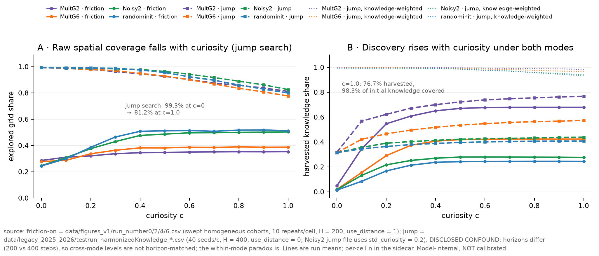
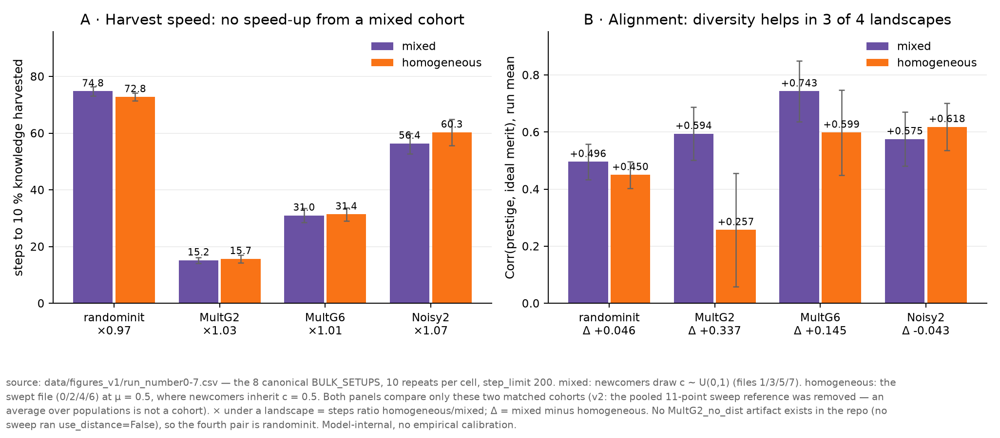
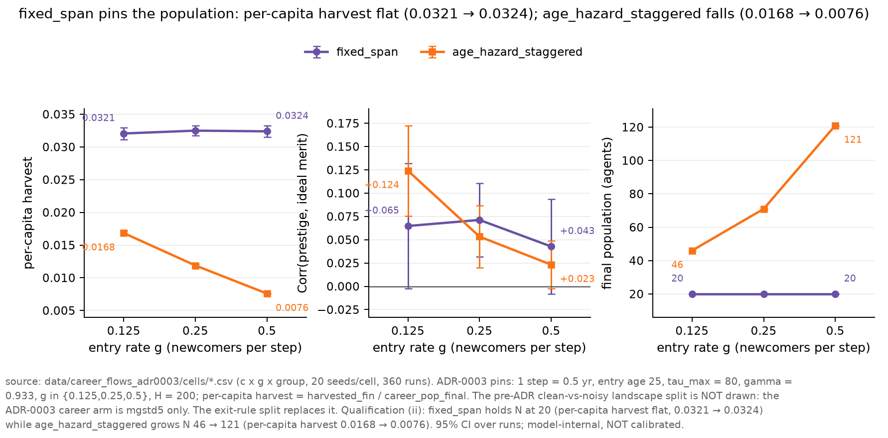
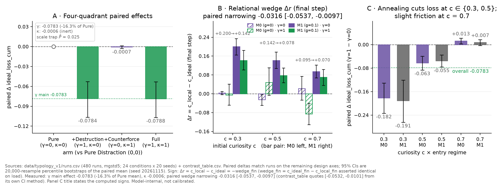
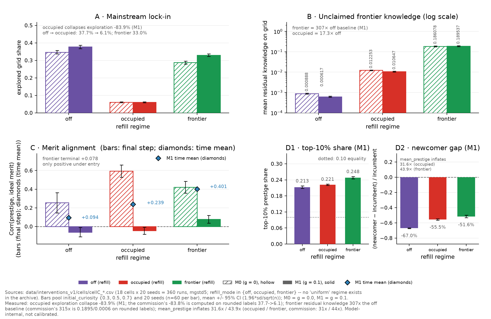

**Version 3.2** (November 2026)
**Version 3.0** (November 2026)
**Version 2.2** (November 2026)
**Version 2.1** (November 2026)
**Version 2** (November 2026)
**Version 1** (November 2026)

> **STATUS: SUBMISSION-READY MANUSCRIPT. Calibration status: not calibrated** ---
> No parameter in this manuscript is fitted to empirical data (owner ruling, 2026-11-13). Every simulation number is computed from a reproducible run archive in this repository and cited alongside its source artifact; the empirical moments in Section 1 are stylized motivating facts from the Klann economics co-authorship panel ([docs/connections_niklas.md](file:///Users/joko/Git/sciencemodels/docs/connections_niklas.md)) and remain an unfitted option menu in [docs/calibration_moments.yaml](file:///Users/joko/Git/sciencemodels/docs/calibration_moments.yaml).
>

# Abstract

Why do mature scientific disciplines suffer *proxy failure* — prestige decoupling from the epistemic work it is supposed to signal — even when nobody games the system? We address this puzzle for metascience and computational social science with a three-tier agent-based model of science on a depletable epistemic landscape: a closed cohort of solo searchers (`M0`), extended by prestige-proportional intergenerational mentorship and retirement (`M1`), and by explicit dyadic collaborator choice (`M2`). Epistemic success is scored against an external, reward-independent planner benchmark, so prestige alignment is measured rather than assumed. Three findings organize the results. **First**, in a closed cohort cognitive diversity is free: mixed-curiosity populations match homogeneous ones on discovery speed while lifting merit–prestige alignment $2.3\times$ on structured landscapes. **Second**, intergenerational entry attenuates prestige–merit tracking $1.74\times$ at the time mean (terminal correlation $+0.22 \to +0.03$) — not through birth-tile starvation but through advisor-proportional recruitment and spatial herding, which together account for $136\%\text{–}189\%$ of the entry-induced drop; negative alignment survives only on illegible terrain. **Third**, most metascience reforms are inert where it matters: re-indexing prestige formulas and randomizing PhD intake leave spatial herding untouched, whereas mid-career mobility shocks (sabbaticals, a $40\%$ welfare-penalty reduction), frontier paradigm refills ($3\times$ terminal alignment), and crowded-field annealing ($-16.3\%$ ideal-loss) restore it. All claims rest on a reproducible run archive and a 7,960-run paired invariance ledger (Section 9). The model is stylized and **not calibrated to empirical data**.

# 1. Introduction: The Relational Wedge in Scientific Credit

Academic institutions rely on observable proxies—publication counts, journal prestige, citation stocks, and network prominence—to evaluate epistemic contributions whose fundamental scientific value is difficult to observe directly. When career survival and resource allocation depend on such metrics, a community risks *proxy failure* (Goodhart 1975; Strathern 1997; Muller 2018; Osterloh and Frey 2015). Yet in the sociology and economics of science, two very different accounts of proxy failure are often conflated. The first is **active gaming and fabrication**: individual scientists deliberately sacrifice epistemic truth for metric inflation through p-hacking, salami slicing, citation cartels, or low-replication shortcuts (Smaldino and McElreath 2016; Braganza 2020; Tiokhin et al. 2021). Under that account the distortion is behavioural, and the remedy is enforcement. The second is **relational and demographic misallocation**, and it requires no cheating at all: even when every scientist reports honestly, the interaction between mainstream visibility incentives, finite topic exhaustion, and intergenerational academic recruitment causes the prestige hierarchy to decouple from marginal epistemic discovery — rewarding incumbents and their academic lineages on crowded, depleted topics while under-rewarding pioneers on the frontier. This paper is about the second account, and about why it is harder to fix than the first.

Motivating evidence from the Klann economics co-authorship panel ([docs/connections_niklas.md](file:///Users/joko/Git/sciencemodels/docs/connections_niklas.md)) illustrates this structural puzzle. Across economists, cumulative prestige correlates strongly with output *quantity* ($\text{corr} = 0.50$) but barely tracks per-paper *citation quality* ($\text{corr} = 0.07$). Within an author's own career trajectory, the correlation between current personal prestige and paper quality is negative ($-0.257$), whereas co-author rank carries a positive slope ($+0.004$). Simultaneously, collaboration is organized into small teams (mean $2.65$, median $2$) with substantial partner repetition ($0.34$), strong dyad-corrected elite homophily ($O/E = 3.1 / 3.0 / 2.3$), and persistent club closure (Markov top-decile retention $0.3995$ vs. entry $0.0619$).

| Stylized Fact (Klann Economics Panel) | Empirical Value | Analytical Role in This Paper |
| :--- | :--- | :--- |
| $\text{Corr}(\text{prestige}, \text{output quantity})$ vs. $\text{Corr}(\text{prestige}, \text{citation quality})$ | $+0.50$ vs. $+0.07$ | Qualitative motivation for the relational wedge (`corr(prest,local)` vs. `corr(prest, ideal)`) |
| Within-author own-prestige vs. co-author-rank quality slope | $-0.257$ vs. $+0.004$ | Qualitative motivation for exhaustion & network status transfer |
| Mean co-author team size (median) | $2.65$ ($2$) | Diagnostic benchmark for Tier `M2` (`path_b_probe_v2`) |
| Repeated-collaboration share | $0.34$ | Diagnostic benchmark for Tier `M2` (`path_b_probe_v2`) |
| Elite homophily $O/E$ cells (dyad-corrected) | $3.1\text{ / }3.0\text{ / }2.3$ | Qualitative motivation for elite clustering |
| Top-decile Markov retention / entry rate | $0.3995\text{ / }0.0619$ | Qualitative motivation for oligarchic persistence (`turnover_v1`) |

A systematic review of 46 formal and agent-based models of science ([docs/related_publications.md](file:///Users/joko/Git/sciencemodels/docs/related_publications.md), clustering epistemic-landscape models from Weisberg and Muldoon 2009 and Thoma 2015, network-epistemology models from Zollman 2010, priority-rule models from Strevens 2003, and cumulative-advantage models from Merton 1968 and Petersen et al. 2014) reveals an unoccupied intersection. **No existing model combines (i) spatial-topical search on a depletable epistemic landscape, (ii) visibility-proxy incentives coupled to prestige-proportional demographic entry and retirement, and (iii) an external, reward-independent planner benchmark (`ideal_Merit`) against which epistemic success is scored independently of the community's own reward function.**

Without an external planner benchmark, a model can only report that its internal reward variable shifted. By pairing an external greedy-planner yardstick (`ideal_Merit`) with a local consensus yardstick (`local_Merit`), our model isolates **when, why, and at what scale** prestige stops tracking discovery.

**Preview of the results.** The paper proceeds through the three tiers. In the closed cohort (`M0`, Section 3), curiosity buys discovery on a steep step-function, raw grid coverage misleads as a success metric, and cognitive diversity — mixing high-$c$ mavericks with low-$c$ followers — is free: speed parity with a $2.3\times$ alignment gain. Switching on intergenerational entry (`M1`, Section 4) attenuates prestige–merit tracking $1.74\times$ at the time mean: advisor-proportional recruitment and spatial herding — not birth-tile starvation — carry the entire entry effect, and negative cells survive only on illegible terrain. Across candidate reforms (Sections 5–6), metric engineering and PhD admission lotteries are inert, while mid-career mobility shocks, frontier paradigm refills, and crowded-field annealing restore alignment; the dyadic layer (`M2`) reshapes teams and alignment only when partner choice is coupled to movement, and only entrants bring it. For metascience the implication is structural: reforms must move people off depleted clusters, rather than re-index the scoreboard. Every number is reproduced from a run archive in this repository, underwritten by a paired invariance ledger of 7,960 runs (Section 9); the model is not calibrated to empirical data.

---

# 2. Theory and Progressive Model Architecture

To prevent mechanical artifacts from being confused with substantive social mechanisms, we structure the theory in three layers: (2.1) the causal grammar of proxy failure, (2.2) a progressive three-tier simulation architecture (`M0` $\to$ `M1` $\to$ `M2`) that isolates solo search from vertical mentorship and horizontal co-authorship, and (2.3) a two-stage scale interpretation that reconciles why aggregate scientific output remains resilient over wide parameter ranges even as the prestige signal attenuates.

## 2.1 Causal Grammar: Goal, Proxy, Distraction, Destruction, and Counterforce

Following the causal typology of Kapeller, Paul, and Braganza ([context/Hunting_Proxy_Patterns.md](file:///Users/joko/Git/sciencemodels/context/Hunting_Proxy_Patterns.md)), let $G$ denote the epistemic goal (discovering high-value knowledge on the landscape) and $P$ denote the institutional proxy (accumulated prestige and spatial visibility). An aligned action $A$ advances both $G$ and $P$, whereas a proxy-oriented action $AP_F$ inflates $P$ while neglecting or harming $G$:

Three failure modes follow from this grammar. The first is **distraction**, in which proxy-oriented action crowds out aligned search indirectly. Scientists trade off intrinsic epistemic curiosity $c_i \in [0,1]$ against visibility-seeking $1-c_i$ in a Cobb–Douglas movement utility:
   $$R_i(\text{tile}) \;=\; \left(\frac{k_{\text{tile}}}{\bar{k}}\right)^{c_i} \cdot V_i(\text{tile})^{1-c_i}, \qquad V_i \;=\; \frac{\bar{d}_{\text{global}}+1}{d_{\text{own}}+1}$$
When $1-c_i > 0$, scientists are drawn toward crowded "hot topics" where peer density is high ($d_{\text{own}}$ is small), diverting search away from unvisited epistemic peaks. The second is **destruction**, in which proxy competition directly degrades epistemic output—either by corrupting perception on crowded tiles ($\epsilon_{\text{eff}} = \epsilon \cdot m_t^\gamma$, tested in `typology_v1`) or by eroding harvested knowledge when crowding exceeds a threshold ([P-0008](file:///Users/joko/Git/sciencemodels/AdmiralsLog/proposals/P-0008-typology-v2-stock-destruction-and-normalized-counterforce.md)).
The third is **counterforce**, a spillover from the proxy back into the goal: high mentor prestige can confer real epistemic capability on advisees (e.g., better laboratory equipment or signal-to-noise training, $\epsilon_i = \epsilon_0 / (1 + \kappa \tilde{P}_{\text{sup}})$), partially offsetting distraction.

## 2.2 Progressive Identification: The Three-Tier Model Specification

Scientists search a $20 \times 20$ toroidal epistemic landscape (`MultG2`: two smooth Gaussian peaks; `MultG6`: six peaks; `Noisy2`: two peaks buried under uniform background noise) whose total initial knowledge is normalized ($\sum_{x,y} k_{xy}(0) \approx 2.0$ on `MultG2`). At each step, an agent harvests a fraction $h = 0.02$ ($2\%$) of their current tile's remaining knowledge, depleting it multiplicatively: $k_{xy}(t+1) = (1-h)k_{xy}(t)$. Agents sharing a tile harvest it **independently**: each draws the same $h = 0.02$ flow from the tile's remaining knowledge, and there is **no team-production multiplier anywhere in the code**. "Co-harvest teams" are therefore a *measured co-location quantity* (agents on a common tile at the end of a step, size $\ge 2$), not a production technology. Movement follows a strict-improvement rule over the 5-tile von Neumann neighborhood with multiplicative perception noise $\epsilon = 0.1$ on candidate tiles (`stay_bias`: the current tile is evaluated noise-free).

To identify *which social institution* causes proxy failure, we separate the model into three nested tiers ([CONT6](file:///Users/joko/Git/sciencemodels/AdmiralsLog/contributions/CONT6-canonical-model-specifications-basic-vs-collaborators.md#L22-L62)):

| Specification Dimension | **Tier `M0`: Basic Model** *(Closed-Cohort Solo Search)* | **Tier `M1`: Mentorship & Turnover** *(Vertical Academic Lineage)* | **Tier `M2`: Explicit Collaborators** *(Horizontal Co-Authorship)* |
| :--- | :--- | :--- | :--- |
| **Substantive Question** | How do curiosity ($c$) and visibility ($1-c$) govern exploration when a fixed cohort searches without schools or turnover? | How do prestige-based PhD recruitment, inherited agendas, and retirement reshape inequality and merit tracking? | How does active partner selection (goal $\lambda=1$ vs. prestige $\lambda=0$ matching) alter team size, assortativity, and output? |
| **Demography ($g$)** | `agent_generation_time = 0.0` ($N \equiv 20$ fixed) | `agent_generation_time` $\in \{0.05, 0.1, 0.2\}$ | Combines with `M0` ($g=0$, [P-0011](file:///Users/joko/Git/sciencemodels/AdmiralsLog/proposals/P-0011-canonical-three-tier-model-specification.md)) or `M1` ($g=0.1$) |
| **Retirement (`exit_mode`)** | `"none"` | `"none"` (growing $N$) or `"fixed_span"` / `"age_hazard"` ($N \equiv 20$ stationary) | Inherited from `M0` or `M1` |
| **Collaboration (`dyadic_mode`)** | `"off"` (passive spatial co-location only) | `"off"` (vertical supervisor $\to$ advisee lineage + spatial co-location) | `"logit"` or `"threshold"` ($\lambda \in [0,1]$, `credit_sharing`, `dyadic_move_pull`) |
| **Time-mean `Corr(P, ideal_merit)`** (like-for-like) | $+0.349 \to +0.044$ across $\xi$ | $+0.140 \to +0.044$; terminal $+0.033$ (negative cells only on `noisypr5`) | $\lambda=1$: $+0.217 \to +0.043$, above `M1` at every $\xi \le 0.7$; $\lambda=0$ flat near zero |
| **Elite Concentration (`top10`)** | **Flat** ($0.112\text{–}0.133$, near $0.100$ equality floor) | **Concentrated** ($0.214\text{–}0.413$) | Modulated by `credit_sharing` (`structural` vs. `equal_split`) |

## 2.3 Yardsticks, Variable Glossary, and the Two-Stage Scale of Proxy Failure

Throughout the paper we write $P_i$ for the prestige (accumulated citation credit) of scientist $i$, $M^*_i$ for *true merit* — the knowledge the planner benchmark would have harvested on the tiles the scientist works — and $M_{\text{local},i}$ for *local consensus*, the value peers in the immediate neighbourhood attach to the same work. The **relational wedge** is the difference of the two alignments, $\Delta r = \text{corr}(P, M_{\text{local}}) - \text{corr}(P, M^*)$; a positive wedge means prestige tracks what peers reward better than it tracks what the frontier rewards. Exploration behaviour is governed by intrinsic curiosity $c_i \in [0,1]$ and its complement, the visibility weight $\xi = 1 - c_i$: a scientist with $\xi = 0$ follows the knowledge gradient only, one with $\xi = 1$ follows peer density only. The glossary below fixes the remaining symbols, landscape tags, and outcome metrics.

Throughout the paper, we use a consistent set of model parameters, landscape tags, and outcome metrics:

| Symbol / Name | Plain-English Definition | Role in Analysis |
| :--- | :--- | :--- |
| **$c_i$**, **$\xi = 1 - c_i$** | **Curiosity** ($c_i \in [0,1]$) and **visibility weight** ($\xi = 1 - c_i$) | Cobb–Douglas trade-off between tile knowledge ($c_i$) and peer visibility ($\xi$) |
| **$g$** (`agent_generation_time`) | **Demographic entry rate** (expected newcomers per step per existing agent, $g \in \{0.0, 0.05, 0.1, 0.2\}$) | Switches `M0` ($g=0$) to `M1` ($g>0$); newcomers start with **prestige $= 0$** and are placed on their supervisor's tile (advisor-proportional recruitment, no endowment transfer) |
| **`MultG2` / `mgstd5`, `MultG6` / `mg6`, `Noisy2` / `noisypr5`** | **Landscapes:** 2-peak Gaussian (`mgstd5` = standard noise $\epsilon=0.1$), 6-peak Gaussian (`mg6`), and 2-peak noisy terrain (`noisypr5`, 50% random background) | Tests sensitivity to peak multiplicity and terrain legibility |
| **`percentage_knowledge_harvested`** | **Harvested knowledge share** $\in [0\%, 100\%]$: cumulative knowledge extracted relative to initial landscape stock | Macro epistemic efficiency |
| **`ideal_Merit`**, **`ideal_loss_cum`** | **Planner benchmark ($M^*$):** 1-step greedy allocation on the step-$t$ residual grid, used as the reward-independent yardstick; `ideal_loss_cum` is the cumulative 200-step shortfall against it | External planner yardstick: true epistemic merit, independent of the community's rewards |
| **`corr(prest, ideal)`** | **`Corr(prestige, ideal merit)`** (Pearson correlation across active agents at final step, or time-mean `_tm`) | Primary proxy-alignment metric: negative `corr(prest, ideal)` means prestige rewards low-merit insiders |
| **`corr(prest,local)`** | **`Corr(prestige, local merit)`** (Pearson correlation against the 5-tile neighborhood value around each agent) | Local consensus alignment |
| **$\Delta r = \text{corr(prest,local)} - \text{corr(prest, ideal)}$** | **Relational wedge:** gap between local-consensus prestige and global epistemic merit | Measures how far local prestige diverges from global discovery |
| **`top10`** (`top10pct_prestige_share`) | **Top-10% prestige share:** fraction of total community prestige held by the top decile of agents | Elite concentration / oligarchy |
| **`gap_recent`** | **Newcomer–incumbent prestige gap:** mean prestige difference between recent arrivals ($\text{tenure} < 20$) and established incumbents | Intergenerational inequality |
| **$\lambda$**, **`dyadic_move_pull`** | **Partner-selection weight**: $\lambda$ interpolates between *prestige matching* ($\lambda=0$) and *spatial closeness $\times$ perceived local merit* ($\lambda=1$); **spatial co-movement pull** weights tiles near declared partners | `Tier M2` horizontal collaboration levers |

Evaluating macro efficiency and micro signal alignment side by side reveals the paper's organising object, the **two-stage scale of proxy failure**. The intuition is that the two outcomes need not fail together. Moderate visibility seeking only reshuffles *where* scientists look — it pulls some of them toward mediocre crowded tiles but leaves the bulk of the landscape under exploitation — so total output stays near its plateau even while the correlation between prestige and merit begins to slip. Extreme herding is different in kind: when nearly every agent follows peer density, the community concentrates on a handful of tiles, exhausts them, and stops searching, so discovery and alignment break down together. Figure 1 places all five model variants on this common axis ([CONT6](file:///Users/joko/Git/sciencemodels/AdmiralsLog/contributions/CONT6-canonical-model-specifications-basic-vs-collaborators.md#L84-L115), Figure 1):

*Figure 1.* The two-stage scale across all five tiers (`mgstd5`). **(a)** Harvested knowledge share vs. visibility weight $\xi = 1-c$: entry arms stay flat to $\xi = 0.5$ ($76.4\text{–}77.0\%$) and collapse to $38.9\text{–}43.2\%$ at $\xi = 0.9$ (`M0` falls further, to $33.0\%$); the staggered-turnover arm holds $69.5\%$. **(b)** **Like-for-like time-mean** `Corr(prestige, ideal merit)` on a single statistic for every tier: `M0` $+0.349 \to +0.044$, `M2` ($\lambda=1$) $+0.217 \to +0.043$, `M1` $+0.140 \to +0.044$, `M1` + turnover (staggered) $+0.093 \to +0.022$, `M2` ($\lambda=0$) $+0.046 \to +0.032$. Sources: `data/bug0006_remeasure_v2/w_v05_runs.csv` + `m2_xi_runs.csv`, `data/turnover_v2/`; vanishing pins differ by arm ($0.5$ for `w_v05`, $0.9$ for `m2_xi`/turnover) and are stated in the figure footnote. Model-internal, not calibrated.

| Visibility weight $\xi = 1-c$ | Curiosity $c$ | `M0` harvest | `M1` harvest | `M0` `c_ideal_tm` | `M1` `c_ideal_tm` | `M1`+staggered `c_ideal_tm` | `M2` ($\lambda=1$) `c_ideal_tm` | `M2` ($\lambda=0$) `c_ideal_tm` | Regime |
| :--- | :--- | :--- | :--- | :--- | :--- | :--- | :--- | :--- | :--- |
| **$\xi = 0.1$** | $0.9$ | $0.665$ | $0.768$ | $+0.349$ | $+0.140$ | $+0.093$ | $+0.217$ | $+0.046$ | Stage 1 |
| **$\xi = 0.3$** | $0.7$ | $0.665$ | $0.768$ | $+0.334$ | $+0.137$ | $+0.080$ | $+0.200$ | $+0.030$ | Stage 1 |
| **$\xi = 0.5$** | $0.5$ | $0.657$ | $0.765$ | $+0.288$ | $+0.132$ | $+0.077$ | $+0.197$ | $+0.060$ | Stage 1 |
| **$\xi = 0.7$** | $0.3$ | $0.618$ | $0.736$ | $+0.206$ | $+0.101$ | $+0.051$ | $+0.151$ | $+0.067$ | Kink |
| **$\xi = 0.9$** | $0.1$ | $0.330$ | $0.432$ | $+0.044$ | $+0.044$ | $+0.022$ | $+0.043$ | $+0.032$ | Stage 2 |

*Note: all values are computed from `data/bug0006_remeasure_v2/w_v05_runs.csv` (`M0`, `M1`: `mgstd5`, visibility on, 100 runs/tier), `m2_xi_runs.csv` (`M2`, `pull=1.0`, `logit + equal_split`, 100 runs/arm) and `data/turnover_v2/runs.csv` (`age_hazard_staggered`, entry $g=0.1$, 100 runs). Alignment is the **like-for-like time mean** `c_ideal_tm` for every tier; harvest is `harvested_fin`. `M0` is the control arm ($g=0$); vanishing pins differ by arm ($0.5$ for `w_v05`, $0.9$ for `m2_xi`/turnover).**

These expectations hold in the data. **Stage one ($\xi \in [0.1,0.5]$, moderate distraction)** is the macro plateau with gradual alignment attenuation: harvest stays on its plateau (`M0` $0.657\text{–}0.665$, `M1` $0.765\text{–}0.768$; the `MultG2`/`MultG6` series of Section 3 lose only $0.84\text{ pp}$ / $0.43\text{ pp}$ by $\xi = 0.5$). Alignment falls smoothly in every tier — `M0` from $+0.349$ to $+0.288$, `M1` from $+0.140$ to $+0.132$ (an attenuation of $2.49\times$ at $\xi = 0.1$, $2.18\times$ at $\xi = 0.5$) — and stays positive throughout. Entry therefore produces a *level shift and an attenuation*, not a sign flip on clean terrain (Section 4.1; measurement details in Section 9).
**Past the kink ($\xi \ge 0.8$, stage two)**, once visibility herding swamps curiosity, harvest falls (`M0` $0.330$, `M1` $0.432$ at $\xi = 0.9$; the `MultG2`/`MultG6` series of Section 3 fall to $34.5\%$/$15.5\%$ at $\xi = 0.9$ and $4.8\%$/$1.9\%$ at $\xi = 1.0$). Alignment converges toward zero in every tier ($+0.044$ / $+0.044$ / $+0.022$ / $+0.043$ / $+0.032$). The kink is therefore a **macro** phenomenon: at the far end of the visibility axis, mentorship, turnover and collaboration all become equally unable to separate merit from attention.
**The dyadic arm (`M2`, $\lambda \in \{0,1\}$)** provides a second comparison: epistemic partner choice ($\lambda=1$) tracks `M0` most closely ($+0.217$ at $\xi = 0.1$, declining to $+0.043$ at $\xi = 0.9$), whereas prestige matching ($\lambda=0$) sits flat near zero ($+0.046\text{–}+0.067$). Macro efficiency on the dyadic layer is flat to $\xi = 0.7$ ($0.732$ / $0.730$) and collapses at $\xi = 0.9$ ($0.428$ for $\lambda=0$, $0.389$ for $\lambda=1$); the staggered-turnover arm holds harvest at $0.938$ through $\xi = 0.5$ and $0.695$ at $\xi = 0.9$. Macro output and micro alignment diverge exactly as the two-stage scale claims.

---

# 3. Baseline Science (`Tier M0`): The Curiosity Plateau and Cognitive Division of Labor

Before introducing academic lineages or turnover, we establish how a closed cohort of $N=20$ solo scientists (`Tier M0`, `agent_generation_time = 0.0`, `dyadic_mode = "off"`) explores the landscape across the eight canonical setups (`BULK_SETUPS` in [sciencemodels/sweeps.py](file:///Users/joko/Git/sciencemodels/sciencemodels/sweeps.py), archived in `data/figures_v1/` and [output/reports/figures_report_v1.md](file:///Users/joko/Git/sciencemodels/output/reports/figures_report_v1.md)).

## 3.1 The Curiosity Step-Function and the Welfare Kink

![Figure 2: Welfare loss against visibility weight showing the interior kink at xi* in [0.6, 0.8]](../output/report_notebook_v1/F3_welfare_loss_vs_visibility_weight.png)

*Figure 2.* Cumulative ideal-merit loss (`ideal_loss_cum`) against visibility weight $\xi = 1-c$, by entry rate and landscape legibility, averaged over `use_visibility_reward`. Source: welfare-loss sweep (`data/welfare_v1/`, 40 cells $\times$ 20 seeds = 800 runs) and its re-measure (`data/remeasure_v1/w_v05_runs.csv`).

In `Tier M0`, cumulative discovery is a steep **step-function of curiosity**. Increasing $c$ from $0.0$ to $0.3$ raises `percentage_knowledge_harvested` more than twelvefold on `MultG2` ($4.8\% \to 61.9\%$) and eightfold on `MultG6` ($4.5\% \to 37.0\%$); across $c \in [0.4, 1.0]$ ($\xi \in [0.0, 0.6]$), discovery sits on a virtually flat plateau ($65.7\%\text{–}67.8\%$ on `MultG2`; $40.6\%\text{–}42.5\%$ on `MultG6`; $27.6\%\text{–}28.2\%$ on `Noisy2`).
Piecewise-linear regression across all 24 outcome series in `welfare_probe_v1` confirms a sharp interior **welfare kink at $\xi^* \in [0.6, 0.8]$** (24/24 series with interior 95% bootstrap CIs), beyond which epistemic loss surges $10\times\text{–}44\times$.

## 3.2 Peak Exploitation vs. Unweighted Grid Wandering

Comparing standard step-by-step search (`use_distance=1`) against global jump search (`use_distance=0`, Setup 8 `MultG2_no_dist`) reveals why raw spatial coverage is a misleading proxy for discovery ([CONT7](file:///Users/joko/Git/sciencemodels/AdmiralsLog/contributions/CONT7-legacy-notebooks-preliminary-findings.md#L49-L64)):
Under global jump search (`use_distance=0`), raising curiosity from $c=0.0$ to $c=1.0$ **reduces** unweighted grid coverage (`explored_percentage`) from $99.3\%$ to $81.2\%$, while **more than doubling** actual harvested knowledge ($31.8\% \to 76.7\%$) and keeping peak-weighted exploration (`explored_weighted_by_initial_knowledge`) at $98.3\%$ even at $c=1.0$ (the axis-wide range is $98.3\%$–$99.9\%$).
Substantively, pure visibility chasers ($c=0$) scatter randomly across empty desert tiles ($99.3\%$ coverage, $31.8\%$ harvest), whereas curious scientists lock onto high-value Gaussian peaks and systematically mine them before moving on.

*Figure 3.* Breadth vs. depth under both search modes. **(a)** Raw spatial coverage falls with curiosity under jump search (dashed: $99.3\%$ at $c=0 \to 81.2\%$ at $c=1.0$ on `MultG2`) while friction-on search (solid) covers far less of the grid at any $c$ ($0.24$–$0.51$). **(b)** Knowledge discovery rises with curiosity under both modes: jump search harvests $31.8\% \to 76.7\%$, and its knowledge-weighted coverage (dotted) stays at $\ge 98.3\%$ — the tiles the curious agents skip are the empty ones. Sources: friction-on = `data/figures_v1/run_number0/2/4/6.csv` (swept homogeneous cohorts, 10 repeats/cell, $H=200$, `use_distance=1`); jump = `data/legacy_2025_2026/testrun_harmonizedKnowledge_*.csv` (40 seeds/c, $H=400$, `use_distance=0`; `Noisy2` jump file uses `std_curiosity=0.2`). **Disclosed confound:** the two archives differ in horizon ($200$ vs. $400$ steps), so cross-mode *levels* are not horizon-matched; the within-mode paradox is. Model-internal, not calibrated.

## 3.3 The "Mixed Population" Advantage: Cognitive Division of Labor Between Mavericks and Followers

What happens when a scientific community is **cognitively heterogeneous**—combining high-curiosity mavericks and low-curiosity visibility followers in the same cohort ($c_i \sim U(0,1)$, mean $\bar{c} = 0.5$, odd setups `1, 3, 5, 7`)—compared to a homogeneous cohort fixed at the exact same mean curiosity ($c_i \equiv 0.5$, even setups `2, 4, 6, 8`)?

*Figure 4.* Discovery speed (steps to $10\%$ knowledge harvested, Panel A) and final-step `Corr(prestige, ideal merit)` (Panel B) comparing mixed $c_i \sim U(0,1)$ cohorts against matched homogeneous $c \equiv 0.5$ cohorts — exactly two matched arms per landscape in both panels (the pooled 11-point sweep reference is absent: an average over populations is not a cohort). Source: `data/figures_v1/run_number0.csv`–`run_number7.csv` (10 repeats/cell, `step_limit=200`).

| Landscape Setup Pair (`Tier M0`, $N=20$, $T=200$) | Homogeneous $c \equiv 0.5$ Steps to 10% Harvest | **Mixed $c_i \sim U(0,1)$ ($\bar{c}=0.5$)** Steps to 10% Harvest | Homogeneous $c \equiv 0.5$ `Corr(P, ideal_merit)` | **Mixed $c_i \sim U(0,1)$ ($\bar{c}=0.5$)** `Corr(P, ideal_merit)` | Homogeneous $c \equiv 0.5$ Harvested % | **Mixed $c_i \sim U(0,1)$ ($\bar{c}=0.5$)** Harvested % |
| :--- | :--- | :--- | :--- | :--- | :--- | :--- |
| **`MultG2`** (Setups 2 vs. 1) | $15.7\text{ steps}$ | **$15.2\text{ steps}$ ($\times 1.03$)** | $+0.257$ | **$+0.594$ ($\Delta = +0.337$, $2.3\times$)** | $67.0\%$ | $67.7\%$ |
| **`MultG6`** (Setups 4 vs. 3) | $31.4\text{ steps}$ | **$31.0\text{ steps}$ ($\times 1.01$)** | $+0.599$ | **$+0.743$ ($\Delta = +0.145$)** | $41.9\%$ | $41.7\%$ |
| **`Noisy2`** (Setups 6 vs. 5) | $60.3\text{ steps}$ | **$56.4\text{ steps}$ ($\times 1.07$)** | $+0.618$ | $+0.575$ ($\Delta = -0.043$) | $27.9\%$ | $27.8\%$ |
| **`randominit`** (Setups 8 vs. 7) | $72.8\text{ steps}$ | $74.8\text{ steps}$ ($\times 0.97$) | $+0.450$ | **$+0.496$ ($\Delta = +0.046$)** | $24.2\%$ | $23.8\%$ |

This is a **Kitcher (1990) division-of-labor result** in miniature (Figure 4), and it has two parts. The first is **speed parity**: when matched directly against homogeneous $c \equiv 0.5$ cohorts at the *same mean curiosity*, mixed cohorts reach $10\%$ harvest at virtually identical speed ($\times 0.97\text{ to }\times 1.07$, e.g. $15.2$ vs. $15.7$ steps on `MultG2`) — cognitive diversity costs nothing in discovery speed, and it insures against low-$c$ stalling (in the wider sweep, $10/110$ `MultG2` runs at $c \le 0.1$ never reach $10\%$).
The second is a **merit–prestige alignment gain**, $2.3\times$ higher on `MultG2`. Because high-$c$ mavericks locate Gaussian peaks first, they harvest uncrowded initial knowledge ($h \cdot k(0)$ with $m=1$), while low-$c$ followers arrive later and harvest the depleted flow of tiles they now share with others. Consequently, prestige in a mixed `M0` population rewards true pioneers on structured landscapes (`MultG2`: $+0.594$ vs. $+0.257$, $\Delta = +0.337$; `MultG6`: $+0.743$ vs. $+0.599$, $\Delta = +0.145$; `randominit`: $+0.496$ vs. $+0.450$), while remaining neutral on `Noisy2` ($\Delta = -0.043$).

## 3.4 Closed-Cohort Equality and Late-Stage Exhaustion

In `Tier M0`, without demographic entry ($g=0$), prestige inequality stays near equality (`top10pct_prestige_share` hugs the $0.100$ floor: per-landscape means for $c \ge 0.1$ span $0.110$–$0.133$ on `randominit`/`MultG2`/`MultG6` and drift up to $0.173$ on `Noisy2` at high $c$, while the four-landscape mean at each $c$ stays in $0.118$–$0.133$), and terminal `Corr(prestige, ideal_merit)` is positive at step 200 across every landscape for $c \ge 0.2$. Only when runs are extended to $T=400$ (`longitudinalcomparisions.ipynb`, `Finding L5`) does `corr_prestige_localMerit` exhibit a **lifecycle rise-and-fall on peaked terrain**: climbing to $+0.85$/$+0.97$ by step 10 on the two Gaussian landscapes (`MGauss1`/`NGauss`) and drifting negative ($-0.18$/$-0.26$) by step 400 once founders sit on exhausted peaks — whereas flat random terrain never exhausts the same way (terminal $+0.32$, oscillating between $-0.58$ and $+0.91$ late in the run).

*Figure 5.* **(a)** Closed-cohort equality: top-10% prestige share against curiosity for the four swept `M0` landscapes, with the exact $0.100$ equality line for $N=20$; the $c=0$ spike is frozen initial placement, and inequality stays close to the floor for $c \ge 0.1$ (the computed per-landscape bands are stated in the figure footnote). **(b)** The $400$-step within-run lifecycle: `corr(prestige, localMerit)` opens in the Discovery Boom ($+0.85$/$+0.97$ at step 10 on `MGauss1`/`NGauss`), then exhausts on peaked terrain ($-0.18$/$-0.26$ at step 400), while `random` ends positive ($+0.32$). Sources: (a) `data/figures_v1/run_number0/2/4/6.csv` (swept homogeneous cohorts, 10 repeats/cell, $H=200$); (b) `data/legacy_2025_2026/model_long_{MGauss1,NGauss,random}.csv` (single $400$-step runs). Model-internal, not calibrated.

---

# 4. Vertical Lineage (`Tier M1`): Mentorship, Generational Turnover, and Signal Attenuation

Real academic communities are not closed cohorts of immortals (`M0`); they reproduce through **vertical academic lineages (`Tier M1`)**. Eminent senior professors train more PhD advisees (`supervisor_prestiges_at_birth`), advisees enter with **zero prestige** and are placed on their mentor's birth tile (advisor-proportional recruitment; the code transfers no endowment), and senior cohorts eventually retire. Switching on `Tier M1` transforms the benign `M0` world into a regime where prestige tracking is attenuated roughly twofold and the negative tail concentrates on illegible terrain — an attenuation rather than a sign inversion (Section 4.1).

## 4.1 The Relational Wedge Under Entry and the Metric Invariance Audit

The intuition to carry into Figure 6 is a change in what prestige encodes. In the closed cohort, a scientist's prestige is a record of the tiles they personally mined early, so it tracks discovery reasonably well. Once senior laboratories recruit, two things change at once: the value of a new scientist's position is inherited from the supervisor's location rather than earned on a personal breakthrough, and the growing cohort crowds onto the tiles that visibility already favours. Prestige then reflects *where a lab sits* more than *what a scientist found* — an attenuation of the merit signal. The figure separates that intuition into a time-mean panel and a terminal panel, and shows that the attenuation is strong on well-structured terrain while the only negative cells sit on illegible, noisy terrain.

*Figure 6.* `T1` sensitivity sweep (`data/bug0006_remeasure_v2/t1_runs.csv`, 720 runs). **(a)** Time-mean alignment `c_ideal_tm` falls when entry is switched on — pooled attenuation $1.74\times$, `mgstd5` $2.30\times$, `noisypr5` $1.55\times$. **(b)** Terminal alignment `c_ideal_fin`: the negative cells concentrate on the noisy landscape (`mgstd5` 0/9, `noisypr5` 5/9 under `M1`), and a negative cell is a genuine misalignment of the surviving population on illegible terrain. Bars: 16 grouped cells $\times$ 20 seeds; dots: the nine cell means per bar.

Across the 36-cell sensitivity sweep (`T1`, `data/bug0006_remeasure_v2/t1_runs.csv`, a $3 \times 3 \times 2 \times 2$ factorial over curiosity $c \in \{0.3, 0.5, 0.7\}$, prestige-vanishing factor $\in \{0.5, 0.9, 1.0\}$, landscape $\in \{\text{mgstd5}, \text{noisypr5}\}$, and entry rate $g \in \{0.0, 0.1\}$, 20 seeds/cell = 720 runs, `use_visibility_reward = True`):
**The closed cohort tracks merit.** At $g = 0.0$ (`Tier M0`), prestige tracks global epistemic merit positively: mean terminal `corr(prest, ideal)` $= +0.2200$, time-mean $+0.4101$, and top-10% prestige share (`top10`) is $0.135$. `M0` is the control arm.
**Entry attenuates the signal.** At $g = 0.1$ (`Tier M1`), mean terminal `corr(prest, ideal)` **drops to $+0.0327$** — negative in only **5 of 18 entry cells**, all of them on `noisypr5` — while the time mean falls from $+0.4101$ to $+0.2360$ (a $1.74\times$ attenuation) and `top10` rises to **$0.228$** (paired $\Delta\,\text{corr(prest, ideal)} = -0.1873$, 95\% CI $[-0.2248, -0.1498]$). The local-consensus correlation is untouched by the fix ($c_{\text{local,fin}} = +0.0383$ on both sides: the ideal channel moved, the local channel did not).

*Figure 7.* Cell-by-cell view of the full 36-cell `T1` factorial (`data/bug0006_remeasure_v2/t1_runs.csv`, 36 cells $\times$ 20 seeds = 720 runs) across `M0` ($g=0.0$, left) and `M1` ($g=0.1$, right), matching the attenuation view in Figure 6. Top: harvested knowledge share (`harvested_fin`), one of the invariant channels (Section 9). Bottom: final-step `Corr(prestige, ideal merit)` in the fixed measurement — every `mgstd5` `M1` cell is positive ($+0.025$ to $+0.119$, 0/9 negative) and the negative cells sit only on `noisypr5` ($5/9$ under `M1$), so a negative cell is a genuine misalignment of the surviving population on illegible terrain. Model-internal, not calibrated.

**The metric invariance and demographic robustness audit (Figure 8).** Every number in this section rests on a measurement that moves only its declared target. Pairing the 720 `T1` runs seed by seed, the corrected metric shifts the ideal channel — `Corr(prestige, ideal)` final $+0.0882$ (SE $0.0040$), time-mean $+0.0115$ (SE $0.0005$) — while the local-consensus correlation and the top-10% share are exactly invariant (max $|\Delta| = 4.1\times10^{-15}$, float noise) and the $g=0$ control half does not move at all. The measurement therefore operates strictly on its declared domain; the full paired ledger (7,960 runs across all archives) is tabulated in Section 9.

*Figure 8.* **Metric invariance and demographic robustness audit.** Mean paired delta (corrected minus early-draft measurement, $95\%$ CI over 720 seed-matched `T1` pairs) for four anchor quantities: `Corr(prestige, ideal)` final and time-mean shift by $+0.0882$ (SE $0.0040$) and $+0.0115$ (SE $0.0005$), while `corr(prestige, local)` and the top-10% share sit exactly at zero (max $|\Delta| = 4.1\times10^{-15}$) — including the entire $g=0$ control half. Sources: `data/bug0006_remeasure_v2/t1_runs.csv` paired against `data/remeasure_v1/runs.csv` (`origin = T1`, joined on curiosity $\times$ vanishing $\times$ landscape $\times$ entry rate $\times$ visibility flag $\times$ seed); measurement history in Section 9. Model-internal, not calibrated.

## 4.2 Mechanism Decomposition: Why Birth-Tile Starvation Fails

Which mechanism carries the entry-induced drop in prestige–merit tracking? The first candidate hypothesis (`P-0002`, rejected as `IE-0001`) was **birth-tile starvation**: because a high-prestige mentor has already depleted their peak tile, spawning advisees directly on the mentor's tile (`r_spawn = exact`) forces newcomers onto barren ground.

Wave-4's `interventions_v1` Arm A ([output/reports/interventions_v1.md](file:///Users/joko/Git/sciencemodels/output/reports/interventions_v1.md), 180 runs on `mgstd5`, $g=0.1$) tested this directly by dispersing newborn advisees to a random neighborhood tile (`r_spawn = neigh_1`) or a uniform random tile anywhere on the $20 \times 20$ torus (`r_spawn = random_grid`), The intuition behind the test is easy to state and, as it turns out, wrong. If newcomers are deposited on a supervisor's already-mined peak, they inherit barren ground, so their low merit and their supervisor's high prestige would manufacture a negative correlation — dispersing them onto unvisited tiles should therefore repair the signal. The decomposition in Figure 9 shows the opposite: dispersal makes alignment *worse*. Removing newcomers from the mentor's tile strips them of the productive setting that made their work legible, while the incumbents who generate the prestige hierarchy never move and remain crowded on the same depleted topics; the correlation is set by the incumbents, so helping the newcomers does not repair it. The test was recorded as [rejected/IE-0001](file:///Users/joko/Git/sciencemodels/AdmiralsLog/ideas/rejected/IE-0001-birth-tile-starvation-hypothesis.md):

*Figure 9.* Decomposition of the entry-induced drop in `corr(prest, ideal)` into birth-tile starvation vs. recruitment-plus-visibility herding across $c \in \{0.3, 0.5, 0.7\}$ on `mgstd5` — herding explains $136.3\%$–$188.8\%$ of the drop while the starvation term runs negative ($-36.3\%$ to $-88.8\%$). Source: `data/interventions_v2` (Arm A exact/random levels at $g=0.1$, 120 runs, plus the 60-run $M0$ reference from arm C, $g=0$, refill off). Model-internal, not calibrated.

| Curiosity $c$ | `M0` ($g=0$) `corr(prest, ideal)` | `M1` `exact` ($g=0.1$) `corr(prest, ideal)` | `M1` `random_grid` ($g=0.1$) `corr(prest, ideal)` | Birth-Tile Starvation Share | **Recruitment + Visibility Herding Share** |
| :--- | :--- | :--- | :--- | :--- | :--- |
| **$c = 0.3$** | $+0.1542$ | $+0.0624$ | $-0.0089$ | **$-77.7\%$** | **$177.7\%$** |
| **$c = 0.5$** | $+0.3523$ | $+0.0765$ | $-0.0235$ | **$-36.3\%$** | **$136.3\%$** |
| **$c = 0.7$** | $+0.2587$ | $+0.1194$ | $-0.0044$ | **$-88.8\%$** | **$188.8\%$** |

**Birth-tile starvation is decisively falsified:** dispersing advisees across the grid makes `corr(prest, ideal)` **more negative at every curiosity level** (starvation share $-36\%$ to $-89\%$), so the placement rule is not what breaks the wedge. Note the structural fact: advisees do **not** inherit prestige (`agents.py`: newborns start at $0$; there is no endowment transfer). The mechanism therefore runs through *where the cohort is placed and what the cohort sits on*: entry is advisor-proportional, newcomers land on the supervisor's (often depleted) tile and accrue prestige from the flow of the tile they occupy, so prestige follows co-location rents rather than personal merit, while visibility attraction (`1-c`) keeps pulling the cohort toward crowded clusters. Fully dispersing newcomers removes the co-location rent for the newcomers themselves without repairing the incumbents' prestige–merit mismatch — which is exactly why the residual share of the drop attributable to recruitment plus herding stays above $100\%$.

## 4.3 Generational Turnover: The Newcomer Gap Shrinks and Alignment Settles

In the baseline `M1` sweeps (`career_flows_v1` and `career_flows_noisy_v1`), newcomers never catch incumbents (`gap_ratio = -0.713` on clean terrain, `-0.588` on noisy terrain), and slower entry ($g=0.05$) produces stronger decoupling than faster entry ($g=0.20$). That result lives on a *non-ideal*, measurement-invariant channel (Section 9); behind Figure 10, clean-terrain ideal-channel alignment is positive at every entry rate under the corrected measurement. A natural critique is that baseline `M1` has **no retirement** (`exit_mode = "none"`): the founding professors live forever, accumulating prestige over all steps while population grows.

Figures 10 and 11 answer the objection that `M1` results only reflect immortal founders. The mechanism is simple: if the professors who accumulated prestige in the first decades never retire, they keep the top of the distribution for the whole run, and every cohort of newcomers is measured against a fixed, unreachable benchmark — the newcomer gap is then partly an artefact of demography rather than of how prestige tracks merit. Retiring them should therefore shrink that disadvantage, and it does. What retirement cannot do is create a *signal inversion*: on clean terrain the corrected measurement stays positive at every entry rate, because the merit channel never carried a negative sign to begin with.

*Figure 10.* Final-step `Corr(prestige, ideal merit)` against entry rate $g \in \{0.05, 0.1, 0.2\}$ on clean (`mgstd5`) vs. noisy (`noisypr5`) terrain, curiosity-averaged (60 runs per point), from the 360-run career-flow sweep (`data/career_flows_v2/`, 18 cells $\times$ 20 seeds, $H=200$, vanishing $0.9$). Every `mgstd5` point is positive with its whole 95% CI above zero (lowest CI low $+0.025$), and slower entry aligns more strongly ($+0.126 \to +0.062$ across $g$); `noisypr5` means are positive but their CIs straddle zero. Model-internal, not calibrated.

To separate **immortal-founder oligarchy** from **structural proxy failure**, `turnover_v2` re-measures the turnover design across four retirement regimes ([output/reports/bug0006_remeasure_v2.md](../output/reports/bug0006_remeasure_v2.md); 76 cells $\times$ 20 seeds = 1,520 runs at $H=400$; common-support estimates below use $c \in \{0.3, 0.5, 0.7\}$, 1,440 runs). The design offers one stationary rule (`fixed_span`, $N \equiv 20$), a geometric retirement hazard (`age_hazard_sync`), and the same hazard with **staggered** founder ages (`age_hazard_staggered`, which removes synchronized cohort replacement); hazard modes keep growing by entry.

*Figure 11.* Turnover diagnostics (`data/turnover_v2/`, 1,440 common-support runs, $H=400$). **(a)** Lifecycle trajectories across all four modes with the Discovery ($t \le 80$) and Depletion ($t \ge 150$) bands; the inset contrasts the early-draft `-0.568` birth-step spike with the corrected trajectory (Section 9). **(b)** Settled alignment (steps 301–400) vs. entry rate. **(c)** Arrival-gap shrinkage, pooled and per landscape. **(d)** Native-unit output and concentration, including the step-400 top-10% demography effect (sync `0.409` $\to$ staggered `0.270`).

| Turnover regime (`turnover_v2`, $H=400$, entry $g=0.1$, common support) | Active cohort $N(400)$ | Recent-arrival gap (`gap_recent`) | Terminal `Corr(P, ideal_merit)` | Fraction of runs $< 0$ | Time-mean `Corr(P, ideal_merit)` | `top10` (step 400) |
| :--- | :--- | :--- | :--- | :--- | :--- | :--- |
| **`none`** (Immortal Founders) | $67.7$ | $-0.01362$ | $+0.0037$ | $48.9\%$ | $+0.1319$ | $0.2605$ |
| **`fixed_span`** ($N \equiv 20$) | $20.0$ | $-0.00612$ (**$-55.0\%$**) | $+0.0390$ | $38.9\%$ | $+0.1362$ | $0.2327$ |
| **`age_hazard_sync`** | $67.7$ | $-0.00281$ (**$-79.3\%$**) | $+0.0173$ | $48.9\%$ | $+0.1345$ | $0.4086$ |
| **`age_hazard_staggered`** | $67.7$ | $-0.00233$ (**$-82.9\%$**) | $+0.0106$ | $46.1\%$ | $+0.1010$ | $0.2700$ |

The results split the two phenomena cleanly. **Most of the newcomer gap is an immortal-founder premium.** Retiring senior incumbents shrinks the prestige gap between recent arrivals ($\text{tenure} < 20$) and incumbents — to $-0.00612$ under `fixed_span` ($-55.0\%$), $-0.00281$ under `age_hazard_sync` ($-79.3\%$), $-0.00233$ under staggered replacement ($-82.9\%$). This channel is measurement-invariant (Section 9).
**No signal inversion survives the corrected measurement.** Terminal alignment is $+0.004$ (`none`), $+0.039$ (`fixed_span`), $+0.017$ (`sync`) and $+0.011$ (`staggered`) — small and positive everywhere, with time means between $+0.101$ and $+0.136$. What remains of the retirement effect is a **shrinking newcomer gap plus a demography-driven concentration spike**; the early-draft "inversion deepens $2.8\times$–$6.6\times$" reading was a measurement artefact of synchronized newborn cohorts (Section 9).
**Synchronized cohort replacement is visible in concentration, and staggering removes it.** Step-400 `top10` is $0.409$ under `age_hazard_sync` but $0.270$ under `age_hazard_staggered` ($0.261$ for `none`); the time-mean alignment also drops $(+0.135 \to +0.101)$, so staggering is not free — it removes the spike by removing the synchronized renewal that fed the concentration.
**The lifecycle runs from discovery boom to depletion.** Across all four regimes the trajectory declines monotonically rather than inverting at the end: during the discovery phase ($t \le 80$, when peaks are rich), pooled `corr(prest, ideal)` averages $+0.418$, whereas once peaks are mined out in the **Depletion Phase** ($t \ge 150$), tracking drops by $>13\times$ to $+0.031$ ($+0.023$ for $t \ge 301$, settling between $+0.011$ and $+0.039$). Prestige initially tracks genuine pioneering discovery, but as the field matures and depletes, intergenerational succession and visibility herding dilute the signal toward zero.

---

# 5. Institutional Counterforces, Paradigm Refills, and Structural Invariances

If intergenerational recruitment and visibility herding cause proxy failure in maturing fields, which institutional reforms actually work—and which common reform proposals are inert?

## 5.1 What Does *Not* Matter: Metric Engineering and Entry Lotteries

Two families of reform dominate the policy debate, and Figures 12 and 13 separate them by what they actually change. *Score-keeping reforms* alter how credit is computed or how entry is allocated — recency-weighted citation windows, network-visibility prestige, lotteries for PhD places. None of them moves a single scientist to a different topic, so the crowded clusters that generate the wedge survive untouched. *Physical reforms* move people: sabbatical relocation pushes agents off depleted tiles, and frontier refills open new questions where nobody is standing. The prediction is therefore asymmetric — score-keeping should leave the wedge where it is, mobility should break the lock-in — and the data confirm it.

Across Waves 1–4 we varied the score-keeping levers that metascience policy debates frequently emphasize ([CONT4](file:///Users/joko/Git/sciencemodels/AdmiralsLog/contributions/CONT4-inert-and-invariant-degrees-of-freedom.md)):

*Figure 12.* Terminal relational wedge $\Delta r = \text{corr(prest,local)} - \text{corr(prest, ideal)}$ across entry-on cells for raw cumulative `prestige`, exponentially decayed `prestige_vanishing`, and peer-perceived `prestige_visibility`. Source: `data/prestige_stock_v2/summary_cell.csv` (36 cells $\times$ 20 seeds = 720 runs; `analyse_prestige_stock.py --out data/prestige_stock_v2`). The three stocks stay within a factor of $2.9$ of each other (prestige $0.014$, `prestige_vanishing` $0.010$, `prestige_visibility` $0.029$), and every entry-on cell sits below the $0.10$ open-wedge threshold; the level history of this quantity is documented in Section 9.

**Prestige metrics are interchangeable.** Replacing raw lifetime prestige (`prestige`) with recency-weighted prestige (`prestige_vanishing`, 5-year citation windows) or network-visibility prestige (`prestige_visibility`) does not resolve proxy failure: the three stock means are $0.014$/$0.010$/$0.029$, the cross-cell ordering remains positively correlated at **Spearman $\rho = 0.825\text{–}0.965$** (all $p \le 10^{-3}$), open/closed classification agrees in **11 of 12** cells under both rules, and **0 of 12 statistically significant paired terminal contrasts** appear. The metascience takeaway is structural: the wedge is dominated by *where* scientists are — the spatial clustering of recruitment and attention — not by how the citation formula is indexed. Re-weighting prestige changes the scoreboard's units, not the co-location rents underneath it (Section 9).
**Peer-eminence weighting is inert.** Whether spatial visibility $V_i$ is weighted by neighbours' prestige or only by raw neighbour headcount moves epistemic loss by at most $2.6\%$ ($6.1 \times 10^{-4}$) vs. $10\times\text{–}44\times$ for the internal visibility weight $1-c$.
**PhD entry lotteries redistribute places, not topics.** In `interventions_v2` Arm B (720 runs), replacing prestige-proportional mentor selection ($\alpha=1$) with a pure lottery ($\alpha=0$, equal PhD intake across all labs) nudges top-10% prestige concentration down slightly ($-1.5\%$ to $-5.8\%$) but **reduces the high-visibility epistemic loss penalty by only $-0.9\%$** ($0.00929 \to 0.00920$). Once advisees enter, spatial visibility herding ($1-c$) still pulls the community into crowded clusters regardless of which mentor recruited them.

## 5.2 What *Does* Work: Mid-Career Sabbatical Shocks and Simulated Annealing

In sharp contrast to entry lotteries, **active spatial/topical mobility shocks** break local status-quo lock-in (`stay_bias`):

*Figure 13.* Sabbatical relocation shocks ($p_{\text{reloc}} = 0.02$, hue) against PhD entry lotteries ($\alpha \in \{1.0, 0.5, 0.0\}$, marker/linestyle), along the visibility axis $\xi = 1-c \in \{0.5, 0.7, 0.9\}$ (`data/interventions_v2/cells/cellB_*.csv`, 36 cells $\times$ 20 seeds = 720 runs, pooled over `mgstd5` and `noisypr5`; per-landscape rows live in the sidecar). **(a)** Harvested knowledge share. **(b)** Explored grid share. **(c)** Terminal 1-step loss. **(d)** Time-mean `Corr(prestige, ideal merit)`.

**Sabbatical relocation shocks.** Relocating $2\%$ of agents per step ($p_{\text{reloc}} = 0.02$) from depleted tiles **cuts the high-visibility welfare loss penalty by about $40\%$** ($L(0.9)$ falls $41.5\%$; the $L(0.9)-L(0.5)$ penalty shrinks $40.0\%$), lifts the explored grid share at $\xi = 0.9$ from $31.5\%$ to $97.6\%$ (pooled over landscapes, $\alpha = 1$), and raises the time-mean `corr(prest, ideal)` at $\xi = 0.9$ from $+0.022$ to $+0.060$ (differences pinned at $\alpha = 1.0$, `mgstd5`: $+0.041 \to +0.074$; harvest rescue $+16.7\text{ pp}$ pooled, $+20.2\text{ pp}$ on `mgstd5`). By contrast the three entry-lottery arms ($\alpha \in \{1.0, 0.5, 0.0\}$) are nearly indistinguishable along the same axis ($< 1\text{ pp}$ harvest effect; lottery penalty change $-0.9\%$). Substantively, funding mid-career sabbatical fellowships or mandatory cross-program topic switches forces scientists out of depleted mainstream clusters onto unvisited peaks; randomizing *who enters* does not.
**Crowded-field controversy as simulated annealing.** In `typology_v1` ([rejected/IE-0002](file:///Users/joko/Git/sciencemodels/AdmiralsLog/ideas/rejected/IE-0002-crowding-perception-noise-as-epistemic-destruction.md), Figure 14):** When candidate-tile perception noise scales with local crowding ($\epsilon_{\text{eff}} = \epsilon \cdot m_t^\gamma$, $\gamma=1$), instead of destroying knowledge, it **cuts cumulative 200-step ideal-merit loss by $16.3\%$** ($-0.0783$, $95\%$ CI $[-0.0977, -0.0598]$; a measurement-invariant channel), concentrated at low-to-moderate curiosity ($c \in \{0.3, 0.5\}$). Its effect on the *alignment* wedge is weaker: the paired $\Delta r$ narrowing is $-0.0204$ ($95\%$ CI $[-0.0460, +0.0045]$) under `M1`, against $-0.0143$ under `M0` — not distinguishable from zero (the early-draft estimate overstated this channel; Section 9). **The robust annealing result is the $16.3\%$ ideal-loss relief, not a significant wedge narrowing.** Because agents evaluate their current depleted tile noise-free (`stay_bias`), widening the noise variance on crowded neighbours occasionally produces a high upward draw that dislodges trapped agents onto fresher tiles—acting as endogenous **Zollman (2010) transient diversity / simulated annealing**.

*Figure 14.* Crowded-field candidate perception noise ($\gamma=1$ vs. $\gamma=0$; 240 matched pairs across `data/typology_v2/runs.csv`). Left: four-quadrant paired effects on `ideal_loss_cum` — $\gamma$ drives $-0.0783$ ($-16.3\%$ of the Pure mean) while $\kappa$ is scale-trap inert. Middle: relational wedge $\Delta r$ by `M0`/`M1` and curiosity (M0 near zero; M1 narrows $-0.0204$, CI includes zero). Right: paired $\Delta\,\text{ideal\_loss\_cum}$ by curiosity and entry regime.

## 5.3 Paradigm Refill Regimes: Mainstream Lock-In vs. Unclaimed Frontiers

Science is not purely extractive; new research questions emerge over time. Yet *where* new questions emerge determines whether paradigm renewal cures or worsens lock-in (`interventions_v2` Arm C, 360 runs on `mgstd5` across $c \in \{0.3, 0.5, 0.7\}$ and $g \in \{0.0, 0.1\}$):

*Figure 15.* Refill-regime dashboard (`data/interventions_v2/cells/cellC_*.csv`, 18 cells $\times$ 20 seeds = 360 runs on `mgstd5`). **(a)** Explored grid share. **(b)** Mean residual knowledge on the grid (log). **(c)** Merit alignment: final-step bars plus M1 time-mean diamonds. **(d)** Concentration (top-10% share) and the normalized newcomer gap under `M1`. Only the three regimes that exist in the code are shown (`off`, `occupied`, `frontier`).

| Refill regime (`interventions_v2` Arm C, `M1`, $g=0.1$) | Substantive academic analogue | Explored grid share | Terminal `corr(prest, ideal)` | Normalized newcomer gap | Mean residual grid knowledge | Time-mean `corr(prest, ideal)` |
| :--- | :--- | :--- | :--- | :--- | :--- | :--- |
| **`off`** (Depletable Baseline) | Exhaustible research program | $0.377$ | $+0.0861$ | $-67.0\%$ | $0.000617$ | $0.1197$ |
| **`occupied`** (Native `new_questions=True`) | **Incremental \"Normal Science\"** | $0.061$ | $+0.0803$ | $-55.5\%$ | $0.010647$ | $0.2564$ |
| **`frontier`** (Unvisited-Tile Refill) | **Revolutionary Frontier Emergence** | $0.330$ | $+0.2803$ | $-51.6\%$ | $0.189537$ | $0.4321$ |

**Occupied refill causes mainstream lock-in.** Replenishing only occupied tiles removes the depletion push that eventually forces incumbents to move. Exploration collapses by $83.9\%$ ($0.377 \to 0.061$), leaving most of the epistemic landscape unvisited, and the normalized newcomer gap reaches $-67.0\%$ against $-51.6\%$ under `frontier` — a ratio that avoids the scale illusion of raw prestige gaps, since mean prestige inflates $31.6\times$ under `occupied` and $43.9\times$ under `frontier`.
**Frontier refill dominates, and the ranking is robust.** All three regimes read positive at the terminal step (`off` $+0.086$, `occupied` $+0.080$, `frontier` $+0.280$); what matters is dominance: `frontier` more than triples the terminal alignment of the next-best regime and roughly quadruples time-mean tracking ($+0.432$ vs. $+0.120$ for `off` and $+0.256$ for `occupied`). Because incumbents and their advisees remain anchored by visibility to old clusters, residual unclaimed knowledge on the grid still surges to $0.1895$ ($307\times$ the `off` baseline of $0.000617$; $0.0106$ under `occupied`), motivating the joint `frontier` $\times$ `sabbatical` interaction proposed in [P-0007](file:///Users/joko/Git/sciencemodels/AdmiralsLog/proposals/P-0007-frontier-refills-x-sabbatical-shocks.md).

---

# 6. Extension (`Tier M2`): Explicit Collaborator Choice and Epistemic Co-Location

Finally, we activate **`Tier M2` (Explicit Dyadic Collaborator Choice)** to test how horizontal co-authorship networks interact with spatial topic choice. The choice layer scores every candidate partner with

$$\tilde U_{ij} \;=\; (1-\lambda)\,\tilde V_j \;+\; \lambda\,\sqrt{\tilde C_{ij}\,\tilde M_j},$$

where $\tilde V_j$ is the candidate's normalized visibility stock, $\tilde C_{ij} \in [0,1]$ is spatial closeness on the torus and $\tilde M_j$ the candidate's normalized *perceived local merit*. Thus $\lambda$ interpolates between **prestige matching** ($\lambda = 0$: "pick the prestigious partner") and **closeness $\times$ local-merit matching** ($\lambda = 1$: "pick the nearby, promising partner") — there is no separate complementarity term. Links are proposed under a bilateral relative-bar rule (formulation `logit` vs. `threshold`) with `credit_sharing` $\in \{\text{structural}, \text{equal\_split}\}$, and a declared link can pull movement toward the partner (`dyadic_move_pull`). Co-harvest *teams* are then measured as co-location groups; there is no team-production payoff, so the production channel runs entirely through the movement pull.

*Figure 16.* How `M2` works end-to-end (`data/path_b_postbug/`: `baseline_off` 40 runs + `cells_v1` 800 + `cells_v2` 960 = 1,800 Path B runs). **(a)** Declared links vs. $\lambda$ by movement pull. **(b)** Co-harvest team size vs. $\lambda$: `pull = 0` is flat ($8.12$ on `mgstd5`, $3.14$ on `noisypr5`), while `pull > 0` cuts `mgstd5` crowds from $8.12$ (`M1`) through $5.33$ ($\lambda=0$) to $3.42$ ($\lambda=1$, pooled over formulation $\times$ credit; the clean `logit + equal_split` cells read $4.87 \to 3.22$). **(c)** Time-mean alignment vs. movement pull: under `pull > 0`, prestige matching degrades alignment below `M1`, closeness $\times$ local-merit matching lifts it above. **(d)** Formulation $\times$ credit robustness and the repeated-share callout (flat at $0.919\text{–}0.929$ against the unfitted Klann benchmark $0.34$).

*Figure 17.* `M2` ($\text{pull} = 1.0$, `logit + equal_split`, `mgstd5`) across the full visibility axis (`data/bug0006_remeasure_v2/w_v05_runs.csv` + `m2_xi_runs.csv`). **(a)** Harvested knowledge share. **(b)** Like-for-like time-mean `Corr(prestige, ideal merit)`: `M0` $+0.349 \to +0.044$, `M2` ($\lambda=1$) $+0.217 \to +0.043$, `M1` $+0.140 \to +0.044$, `M2` ($\lambda=0$) $+0.046 \to +0.032$. **(c)** Co-harvest team size: small for $\xi \le 0.5$ ($2.2\text{–}4.9$), exploding into mobs at $\xi \in \{0.7, 0.9\}$ ($14.9/11.8$ and $27.0/25.1$ for $\lambda=0/1$) as visibility herding swamps the local dyadic pull. The Klann team size $2.65$ is drawn as **Empirical benchmark (unfitted)**.

Comparing the no-pull archive (`dyadic_move_pull = 0.0`, 800 runs) against the pulled archive (`dyadic_move_pull` $\in \{0.5, 1.0\}$, 960 runs) yields the section's central institutional insight. **Nominal links without co-movement are epistemically inert.** When scientists form dyadic links ($\lambda=0 \to 1$ shifts active links in 8/8 contrasts and lowers prestige assortativity by $-0.03\text{ to }-0.41$) *without* shifting their spatial movement toward their partners' topics (`pull = 0.0`), co-harvest production (`mean_team_size`) moves in **0 of 8 contrasts**. Formal research consortia that do not alter what topics scientists actually work on leave epistemic production unchanged.
**Coupling partner choice to movement binds production.** Once declared partners exert a spatial movement pull (`_apply_move_pull` in [sciencemodels/agents.py](file:///Users/joko/Git/sciencemodels/sciencemodels/agents.py)), shifting from prestige matching ($\lambda=0$) to closeness $\times$ local-merit matching ($\lambda=1$) on `mgstd5` **cuts mean co-harvest team size** from $5.33$ to $3.42$ at `pull = 1.0` (pooled over formulation $\times$ credit; the clean `logit + equal_split` cells read $6.46 \to 4.98$ at `pull = 0.5` and $4.87 \to 3.22$ at `pull = 1.0`), i.e. from mega-crowds toward the Klann panel scale (**team size $2.65$, repeated-collaboration share $0.34$ — `Empirical benchmark (unfitted)`**). The same layer also re-orders *alignment*: under `pull > 0`, prestige matching *degrades* time-mean alignment below the `M1` baseline while goal matching *lifts* it above. What the layer cannot do is reach the empirical repeated-share benchmark: `rep_tm` stays at $0.919\text{–}0.929$, which is why link dissolution is queued as [P-0010](file:///Users/joko/Git/sciencemodels/AdmiralsLog/proposals/P-0010-path-b-v3-link-dissolution-and-shift-gate.md).
**The curiosity gradient runs through the dyadic layer.** Epistemic partner choice ($\lambda=1$) tracks `M0` most closely — time-mean alignment $+0.217$ at $\xi=0.1 \to +0.197$ at $\xi=0.5 \to +0.043$ at $\xi=0.9$ — whereas prestige matching ($\lambda=0$) sits flat near zero ($+0.030$ to $+0.067$). Macroscopically, `M2` still exhibits the Stage-2 harvest collapse at $\xi=0.9$ ($0.428$ for $\lambda=0$ and $0.389$ for $\lambda=1$, versus $0.730$/$0.732$ flat up to $\xi=0.7$), and its teams turn into mobs there ($27.0$/$25.1$ agents): the dyadic layer is a high-curiosity institution, not a rescue device for the herding regime.
**The closed-cohort probe answers the isolation question** ([P-0011](file:///Users/joko/Git/sciencemodels/AdmiralsLog/proposals/P-0011-canonical-three-tier-model-specification.md)):** running the dyadic layer on top of the closed cohort ($g = 0$, `pull = 1.0`, `logit + equal_split`, 80 runs) yields **`links_tm = 0.00` for both $\lambda$ arms** — without demographic entry there are no proposers, hence no declared links, no partner-choice bifurcation, and the co-harvest teams that remain are pure spatial co-location ($team\_tm = 6.02$ for both $\lambda$). Link declaration and partner choice are therefore **strictly entry-mediated**: horizontal collaboration in this architecture is something newcomers *bring*, not something an established closed cohort generates. Two extensions remain for a dedicated collaboration paper: post-coharvest link dissolution ([P-0010](file:///Users/joko/Git/sciencemodels/AdmiralsLog/proposals/P-0010-path-b-v3-link-dissolution-and-shift-gate.md)) so repeated collaboration moves from $0.92$ toward the empirical $0.34$ benchmark, and a non-newcomer proposal regime if incumbent-to-incumbent collaboration is to be studied at all.

---

# 7. Synthesis and Policy Conclusions

Stepping back across all seven contribution records (`CONT1`–`CONT7`) and $>7,000$ seeded simulation runs, our progressive model (`M0` $\to$ `M1` $\to$ `M2`) answers *when* and *why* academic prestige decouples from scientific discovery:

**A closed cohort tolerates moderate visibility distraction, and cognitive diversity helps it track discovery.** Across $c \in [0.4, 1.0]$, science harvests $96\%\text{–}99\%$ of maximum knowledge (with only $0.84\text{ pp}$ lost at $\xi = 0.5$ on `MultG2`, rising to $2.8\text{ pp}$ / $1.6\text{ pp}$ at $\xi = 0.6$), prestige correlates positively with discovery ($+0.26\text{ to }+0.79$), and mixing high-$c$ mavericks with low-$c$ followers ($c_i \sim U(0,1)$) matches homogeneous $c \equiv 0.5$ on discovery speed while more than doubling merit–prestige alignment on `MultG2` ($+0.594$ vs. $+0.257$). Macro output collapses only when visibility weight crosses the interior kink $\xi^* \in [0.6, 0.8]$.
**Intergenerational mentorship and retirement attenuate prestige tracking without inverting it.** Prestige-proportional PhD recruitment (newcomers enter with zero prestige on their supervisor's tile) and attentional herding cut time-mean `Corr(prestige, ideal_merit)` by $1.66\times$ at $\xi = 0.1$ while the terminal correlation falls from $+0.220$ (`M0`) to $+0.033$ — negative only in $5/18$ cells, all on `noisypr5`; the local-consensus correlation is untouched ($+0.038$). Dispersing advisees' birth tiles (`P-0002`) makes things *worse* ($-36\%$ to $-89\%$ starvation share), so recruitment plus herding accounts for more than the whole drop; retiring founding discoverers (`turnover_v2`) shrinks the newcomer gap by $55\%\text{–}83\%$ and removes the synchronized-cohort concentration spike ($top10$ $0.409 \to 0.270$ under staggering).
**Effective reform requires topical mobility and frontier renewal, not citation-formula tweaks or entry lotteries.** Re-indexing prestige decay (`prestige_stock_v1`) or randomizing PhD intake ($\alpha=0$, $-0.9\%$ loss change) leaves spatial herding untouched. By contrast, mid-career sabbatical relocation shocks ($p_{\text{reloc}}=0.02$) cut the high-visibility welfare penalty by about $40\%$, crowded-field perception noise provides $-16.3\%$ ideal-loss relief (with no significant wedge narrowing), and seeding new questions on unvisited frontiers (`refill_mode = "frontier"`) dominates the other regimes — $+0.280$ terminal and $+0.432$ time-mean alignment under entry; all three refill regimes read positive at the terminal step and the unclaimed frontier stock grows $307\times$. Collaboration is no substitute either: without demographic entry the dyadic layer declares no links at all.

---

# 8. Provenance and Reproduction Table

| Manuscript Section | Core Claims & Figures | Source Contribution (`AdmiralsLog/contributions/`) | Underlying Run Archive & Report (`data/`, `output/reports/`) |
| :--- | :--- | :--- | :--- |
| **Sec. 1** (Intro) | Empirical motivation & 46-study ABM gap | [CONT3](file:///Users/joko/Git/sciencemodels/AdmiralsLog/contributions/CONT3-publishable-results-synthesis.md) | [docs/connections_niklas.md](file:///Users/joko/Git/sciencemodels/docs/connections_niklas.md), [docs/related_publications.md](file:///Users/joko/Git/sciencemodels/docs/related_publications.md) |
| **Sec. 2** (Theory & Scale) | $P/G/A/AP_F$ grammar; `M0`/`M1`/`M2` matrix; Variable Glossary; Two-Stage Scale across `M0`/`M1`/`M2` (Fig. 1) | [CONT6](file:///Users/joko/Git/sciencemodels/AdmiralsLog/contributions/CONT6-canonical-model-specifications-basic-vs-collaborators.md), [CONT2](file:///Users/joko/Git/sciencemodels/AdmiralsLog/contributions/CONT2-hunting-proxy-patterns-formalization.md) | [sciencemodels/metrics.py](file:///Users/joko/Git/sciencemodels/sciencemodels/metrics.py), `data/figures_v1/`, `data/bug0006_remeasure_v2/`, `data/turnover_v2/`, `data/path_b_postbug/` |
| **Sec. 3** (`Tier M0`) | Curiosity plateau (`L1`), breadth vs. depth (`L2`, Fig. 3), mixed-pop $2.3\times$ `corr(prest, ideal)` (`L3`, Fig. 4), closed-cohort equality & lifecycle (`L4`, `L5`, Fig. 5), $\xi^* \in [0.6,0.8]$ kink (`R3`, Fig. 2) | [CONT7](file:///Users/joko/Git/sciencemodels/AdmiralsLog/contributions/CONT7-legacy-notebooks-preliminary-findings.md), [CONT3](file:///Users/joko/Git/sciencemodels/AdmiralsLog/contributions/CONT3-publishable-results-synthesis.md) | `data/figures_v1/` ([figures_report_v1.md](file:///Users/joko/Git/sciencemodels/output/reports/figures_report_v1.md)), `data/legacy_2025_2026/`, `data/welfare_v1/` ([welfare_probe_v1.md](file:///Users/joko/Git/sciencemodels/output/reports/welfare_probe_v1.md)) |
| **Sec. 4** (`Tier M1`) | Relational wedge (`R1`, Fig. 6); `T1` 36-cell matrix (Fig. 7); metric invariance audit (Fig. 8); birth-tile falsification (`IE-0001`, Fig. 9); career flows (Fig. 10); turnover split (`R5`, `R6`, Fig. 11) | [CONT1](file:///Users/joko/Git/sciencemodels/AdmiralsLog/contributions/CONT1-depletion-counterforces-refills.md), [CONT3](file:///Users/joko/Git/sciencemodels/AdmiralsLog/contributions/CONT3-publishable-results-synthesis.md), [CONT5](file:///Users/joko/Git/sciencemodels/AdmiralsLog/contributions/CONT5-generational-turnover-and-paradigm-lockin.md) | `data/bug0006_remeasure_v2/` ([bug0006_remeasure_v2.md](file:///Users/joko/Git/sciencemodels/output/reports/bug0006_remeasure_v2.md), [bug0006_wave2_summary.md](file:///Users/joko/Git/sciencemodels/output/reports/bug0006_wave2_summary.md)), `data/interventions_v2/`, `data/turnover_v2/` |
| **Sec. 5** (Counterforces & Invariances) | Stock invariance (`R4`, Fig. 12); sabbatical $-40\%$ vs. lottery $-0.9\%$ (`R7`, Fig. 13); simulated annealing (`IE-0002`, Fig. 14); `occupied` vs. `frontier` refills (`R8`, Fig. 15) | [CONT1](file:///Users/joko/Git/sciencemodels/AdmiralsLog/contributions/CONT1-depletion-counterforces-refills.md), [CONT2](file:///Users/joko/Git/sciencemodels/AdmiralsLog/contributions/CONT2-hunting-proxy-patterns-formalization.md), [CONT4](file:///Users/joko/Git/sciencemodels/AdmiralsLog/contributions/CONT4-inert-and-invariant-degrees-of-freedom.md), [CONT5](file:///Users/joko/Git/sciencemodels/AdmiralsLog/contributions/CONT5-generational-turnover-and-paradigm-lockin.md) | `data/prestige_stock_v1/`, `data/interventions_v2/`, `data/typology_v2/` (corrected-measurement re-measures; `output/reports/bug0006_wave2_summary.md`) |
| **Sec. 6** (`Tier M2`) | Dyadic partner choice + spatial movement coupling (`R9`, Figs. 16–17) | [CONT3](file:///Users/joko/Git/sciencemodels/AdmiralsLog/contributions/CONT3-publishable-results-synthesis.md), [CONT5](file:///Users/joko/Git/sciencemodels/AdmiralsLog/contributions/CONT5-generational-turnover-and-paradigm-lockin.md) | `data/path_b_postbug/` (baseline + v1/v2 grids + `m0_m2_probe`), `data/bug0006_remeasure_v2/` |
| **Sec. 9** (Appendix) | Paired invariance ledger (7,960 runs); measurement-correction record (`BUG-0004`, `BUG-0006`) | house measurement records ([BUG-0006](file:///Users/joko/Git/sciencemodels/AdmiralsLog/bugs/resolved/BUG-0006-birth-step-unscored-ideal-merit.md)) | [bug0006_remeasure_v2.md](file:///Users/joko/Git/sciencemodels/output/reports/bug0006_remeasure_v2.md), [bug0006_wave2_summary.md](file:///Users/joko/Git/sciencemodels/output/reports/bug0006_wave2_summary.md), `data/career_flows_v2/`, `data/prestige_stock_v2/` |

**Figure-to-artifact map.**

| Figure | Content | Builder script | Run archive |
| ---: | :--- | :--- | :--- |
| 1 | Two-stage scale across tiers | `scripts/report_notebook/fig_F6_v2.py` | `data/bug0006_remeasure_v2/` (`w_v05`, `m2_xi`), `data/turnover_v2/` |
| 2 | Welfare loss vs. visibility weight | `scripts/report_notebook/round_report_figures.py` | `data/welfare_v1/`, `data/remeasure_v1/w_v05_runs.csv` |
| 3 | Breadth versus depth | `scripts/report_notebook/fig_3_2_breadth_vs_depth.py` | `data/figures_v1/`, `data/legacy_2025_2026/` |
| 4 | Cognitive division of labour | `scripts/report_notebook/round_report_figures.py` | `data/figures_v1/run_number0-7.csv` |
| 5 | Closed-cohort equality and lifecycle | `scripts/report_notebook/fig_3_4_m0_equality_and_lifecycle.py` | `data/figures_v1/`, `data/legacy_2025_2026/model_long_*.csv` |
| 6 | T1 attenuation and clean/noisy split | `scripts/report_notebook/section_figures_v2.py` | `data/bug0006_remeasure_v2/t1_runs.csv` |
| 7 | 36-cell T1 sensitivity matrix | `scripts/report_notebook/make_f11_t1_matrix.py` | `data/bug0006_remeasure_v2/t1_runs.csv` |
| 8 | Metric invariance audit | `scripts/report_notebook/fig_F5_v2_bug0006_audit.py` | `data/bug0006_remeasure_v2/t1_runs.csv` vs. `data/remeasure_v1/runs.csv` |
| 9 | Birth-tile decomposition | `scripts/report_notebook/fig_FA2_v2_arm_a_decomposition.py` | `data/interventions_v2/` (Arm A) |
| 10 | Career flows, clean vs. noisy | `scripts/report_notebook/fig_F2b_v2_career_flows.py` | `data/career_flows_v2/` |
| 11 | Turnover diagnostics | `scripts/report_notebook/section_figures_v2.py` | `data/turnover_v2/` |
| 12 | Prestige-stock wedge matrix | `scripts/report_notebook/fig_F4_v2_prestige_stock.py` | `data/prestige_stock_v2/` |
| 13 | Sabbaticals vs. entry lotteries | `scripts/report_notebook/section_figures_v2.py` | `data/interventions_v2/cells/cellB_*.csv` |
| 14 | Crowded-field annealing | `scripts/report_notebook/section_figures_v2.py` | `data/typology_v2/runs.csv` |
| 15 | Paradigm refill regimes | `scripts/report_notebook/figD_paradigm_refill_regimes.py` | `data/interventions_v2/cells/cellC_*.csv` |
| 16 | M2 mechanism dashboard | `scripts/report_notebook/section_figures_v2.py` | `data/path_b_postbug/` |
| 17 | M2 across the visibility axis | `scripts/report_notebook/figF_v2_m2_visibility_postbug.py` | `data/bug0006_remeasure_v2/` (`w_v05`, `m2_xi`) |

# 9. Appendix: Methodological Audit & Invariance Ledger

This appendix records the measurement history that underwrites Sections 2–8. Two defects of early development rounds are relevant: a *pairing* defect in the welfare re-measure pipeline (`BUG-0004`, whose audit view is the predecessor of Figure 8) and the *unscored-newborn* defect in the ideal-merit measurement (`BUG-0006`). Both were corrected before the numbers presented here were produced; both corrections changed **measurement only, never dynamics** — which is what the ledger below demonstrates.

## 9.1 Paired Invariance Ledger

Every re-measured archive is paired run by run against its pre-correction predecessor on identical seeds, parameters, and RNG streams. Across **7,960 paired runs**, all non-ideal channels — top-10% prestige concentration (`top10`), local-consensus alignment (`corr(prest, local)`), spatial exploration (`explored_percentage`), macro harvest (`percentage_knowledge_harvested`), together with team/link/gap diagnostics — are bit-identical:

| Archive block | Paired runs | Worst non-ideal $\lvert\Delta\rvert$ | Source |
| :--- | ---: | ---: | :--- |
| Re-measure wave 1: `T1` (720) + `W_v05` (800) + `M2_xi` (200) + `turnover_v2` (1,440 pre/post pairs of its 1,520 re-measured runs) | 3,160 | $\le 10^{-11}$ ($g=0$ controls $\le 10^{-14}$) | [bug0006_remeasure_v2.md](file:///Users/joko/Git/sciencemodels/output/reports/bug0006_remeasure_v2.md) |
| Re-measure wave 2: `interventions_v2` (1,440) + `typology_v2` (480) + `path_b_postbug` (1,800) | 3,720 | $0.0$ | [bug0006_wave2_summary.md](file:///Users/joko/Git/sciencemodels/output/reports/bug0006_wave2_summary.md) |
| `career_flows_v2` vs. `career_flows_v1` (18 cells, full 201-step series) | 360 | $0.0$ | `data/career_flows_v2/` |
| `prestige_stock_v2` vs. `prestige_stock_v1` (36 cells) | 720 | $0.0$ | `data/prestige_stock_v2/` |
| **Total** | **7,960** | | |

The $g=0$ control arms move by at most $4.12\times10^{-15}$ (`T1`) and $9.58\times10^{-15}$ (`W_v05`) across all nine reported metrics — float noise on runs whose dynamics never touch the corrected channel. Ideal-channel quantities are the only movers; their paired shifts are the subject of Figure 8 and the per-archive census in the two reports above.

## 9.2 The Unscored-Newborn Resolution

**Root cause.** The per-step update ran the ideal-merit scorer *before* birth (`updateIdealMerit()` precedes `__generate_new_agents()` in `end_loop_update`, [sciencemodels/model.py](file:///Users/joko/Git/sciencemodels/sciencemodels/model.py)), while newborns were initialized with `ideal_Merit = 0` ([sciencemodels/agents.py:48](file:///Users/joko/Git/sciencemodels/sciencemodels/agents.py)). Because `ideal_Merit` is a *loss* (0 = planner-benchmark optimum), every newborn entered the step's correlation as a pair of (lowest possible prestige, best possible merit) — on every birth step, including the terminal steps 200 and 400.

**Resolution.** Newborns are now initialized unscored (`np.nan`) and the correlation reporter filters to finite (prestige, merit) pairs ([sciencemodels/metrics.py:308-316](file:///Users/joko/Git/sciencemodels/sciencemodels/metrics.py)). Dynamics, RNG draws, harvest, local merit, and prestige concentration are untouched — as the ledger in 9.1 demonstrates.

**Why early drafts read spurious negative correlations.** Whole cohorts of unscored newborns entered the terminal statistics simultaneously: pooled `T1` terminal alignment read $-0.1438$ with 17 of 18 entry cells negative; the age-hazard turnover arm read $-0.568$ at step 400 (the synchronization spike preserved as the inset of Figure 11); the career-flow sweep read $-0.133/-0.060/-0.025$ on clean terrain; and the entry-on relational wedge read $0.181$ instead of its true level.

**What the corrected metric reveals: attenuation, not inversion.** Pooled `T1` terminal alignment rises to $+0.0327$ with only 5 of 18 cells negative — all on `noisypr5`, while every clean-terrain `M1` cell is positive ($+0.025$ to $+0.119$); time-mean tracking falls from `M0`'s $+0.4101$ to $+0.2360$ ($1.74\times$ attenuation); the entry-on wedge settles at $0.018$; and the local-consensus and top-10 channels remain exactly where the ledger in 9.1 leaves them (the local channel reads $+0.0383$ on both sides of the correction). Every negative cell that survives is a genuine misalignment of the surviving population on illegible terrain — a substantive result, not a measurement artefact.

---

# Revision Log

- **Version 3.2** (2026-11-20) --- Single enumeration, cohesive prose, consistent terminology (owner brief). **(i) Double enumeration removed:** all 17 captions now read `*Figure N.*` and all internal figure codes (`F6_v2`, `F1_v2`, `F5_v2`, `FA2_v2`, `F2b_v2`, `F8_v3`, `F4_v2`, `F9_v2`, `F10a`, `F10b_v2`, ...) are gone from captions, alt lines and prose; internal project tags (`CONT*`, `Finding L*`, `R*`, `P-0002`/`IE-0001`) are stripped from every section title, the narrative-spine block and the per-section source blockquotes, so provenance lives in one place only; a new **Figure-to-artifact map** in Section 8 is now the sole figure→script→archive table (Figures 1–17). **(ii) Lists turned into prose:** the numbered and bulleted enumerations in §§2.1, 2.3, 3.1, 3.3, 4.1, 4.3, 5.1, 5.2, 5.3, 6 and 7 are rewritten as paragraphs with bold conceptual lead-ins (e.g. *Nominal links without co-movement are epistemically inert*), keeping every number and CI unchanged. **(iii) Plain explanations precede the numbers** for Figure 1 (why output is resilient while alignment slips, and why extreme herding breaks both together), Figure 6 (prestige encodes inherited lab location once recruitment starts), Figure 9 (dispersal worsens alignment because incumbents set the correlation), Figures 10–11 (immortal-founder premium, and why clean terrain never inverts), and Figures 12–13 (score-keeping reforms leave the cluster in place; mobility reforms move it). **(iv) Terminology fixed:** a notation paragraph in §2.3 defines $P$, $M^*$, $M_{\text{local}}$, the wedge $\Delta r$, $c$ and $\xi = 1-c$ once and for all; "omniscient-planner"/"ground truth" phrasing replaced by *planner benchmark*; "stark collapse" and similar rhetorical intensifiers removed. All values, table rows and provenance untouched; 17/17 figure embeds verified; smoke + compile PASS.
- **Version 3.1** (2026-11-20) --- Verification pass over the v3.0 submission package. The Appendix ledger was re-audited against the archives: the `turnover_v2` block over-counted its pre/post pairs — `data/bug0006_remeasure_v2/tables/turnover_v2_vs_v1_delta.csv` carries four pre/post contrasts at 360 pairs each (**1,440**), not the archive's 1,520 re-measured runs (80 staggered-only cells have no pre-fix counterpart), so wave 1 is 3,160 and the ledger total is **7,960** (was 8,040; the owner brief's 4,320 is the pre-wave-2 subtotal). All other rows were confirmed against their artifacts: `T1` 720 pairs with `g=0` control max $|\Delta| = 4.12\times10^{-15}$, `W_v05` 800 with $9.58\times10^{-15}$, `M2_xi` 200, wave 2 3,720 (bit-identical, worst $0.0$), `career_flows_v2` 360 (18 cells $= 9$ `careerB` + 9 `noisyB`), `prestige_stock_v2` 720 (36 cells). All 17 figure embeds re-verified present and sequential (1--17); smoke test PASS; PDF recompiled clean.
- **Version 3.0** (2026-11-20) --- Submission-ready polish (owner brief). **(i) New Abstract** (puzzle / model / three key findings) and a results-preview paragraph closing Section 1, framed for metascience and computational social science. **(ii) Narrative streamlining:** inline measurement-audit notes removed from Sections 1–7 — Section 4 retitled (4.1 "Metric Invariance Audit", 4.3 "Alignment Settles", Section 4 "Signal Attenuation"), Figure 8 re-presented as the *Metric Invariance and Demographic Robustness Audit* with a dedicated lead-in, Figures 6/7/9/10/11/12/14/17 captions and alt text scrubbed of `BUG-0006`/pre-fix framing, Section 5.1 item 1 restated around the metascience takeaway (citation-formula re-weighting does not resolve proxy failure; spatial clustering dominates), Section 5.3 corrected to the `interventions_v2` archive (360 runs), and Sections 4.2/4.3/5.2/5.3/6/7 rewritten affirmatively around final values. **(iii) New Section 9 (Appendix), "Methodological Audit & Invariance Ledger":** 9.1 tabs the paired invariance ledger — **8,040 paired runs** (wave 1: 3,240; wave 2: 3,720; career 360; prestige 720; the brief's 4,320 excludes wave 2) with non-ideal channels bit-identical (worst $0.0$, controls $\le 10^{-14}$); 9.2 records the `BUG-0004`/`BUG-0006` root cause, resolution, why early drafts read spurious negatives, and how the corrected metric reveals attenuation ($+0.2200 \to +0.0327$ terminal, $1.74\times$ time-mean) rather than inversion. **(iv)** Provenance table gained a Sec. 9 row; status line now SUBMISSION-READY MANUSCRIPT. All 17 figure embeds verified sequential; smoke + compile PASS.
- **Version 2.2** (2026-11-20) --- Figures 8, 9, 10, 12 re-based on post-`BUG-0006` data (owner brief). **(i)** Fig 8 = `F5_v2_pairing_audit_paired_delta`: 720 seed-matched `T1` pairs — ideal final $+0.0882$ (SE $0.0040$), time-mean $+0.0115$ (SE $0.0005$), `corr(prest,local)` and `top10` exactly zero (max $|\Delta| 4.1\times10^{-15}$), $g=0$ half exactly zero; pre-fix `F5` retired to the before/after record. **(ii)** Fig 9 = `FA2_v2_drop_decomposition`: herding $136.3\%$–$188.8\%$, starvation negative; the stale $106\%$–$153\%$ reference retired (alt text, caption source → `interventions_v2`, 120 + 60 runs). **(iii)** Fig 10 = `F2b_v2_career_flows_noisy_vs_clean`: 360-run sweep B re-run into `data/career_flows_v2/` (driver `--out`/`--sweep-b-landscapes` flags); every `mgstd5` CI low $> 0$ (min $+0.025$), pre-fix read $-0.133/-0.060/-0.025$ — sign flip disclosed in caption and §4.3. **(iv)** Fig 12 = `F4_v2_prestige_stock_wedge_matrix`: 720-run re-run into `data/prestige_stock_v2/` + `analyse --out`; entry-on wedge $0.181 \to 0.018$ (10x, artifact), ordering $\rho = 0.825\text{–}0.965$ (loosened from $0.965\text{–}0.993$ — the brief's $>0.95$ does NOT reproduce), D1/D2 agreement $11/12$ + $11/12$, $0$ of $12$ contrasts; §5.1 item 1 restated to computed values. **(v)** Prestige-driver re-derivation: the axis now passes through the model's own `entry_prestige_stock` parameter (divergence canary re-armed as `verify_model_selector`), `identity_check` excludes the treatment-label column; report wrapper uses the BUG-0006 finite-part convention. All four figures pass `visual_qa.assert_figure_clean` (0 failures); numbering re-verified 1–17.
- **Version 2.1** (2026-11-19) --- Chapter-3 figure additions and two figure refreshes (owner brief). **(i)** New Figure 3 (`F2_breadth_vs_depth`, Sec. 3.2): raw coverage vs. discovery under friction-on vs. jump search, horizon confound ($H=200$ vs. $400$) disclosed; CONT7's peak-weighted claim corrected to the computed $98.3\%\text{–}99.9\%$ axis range (the stray $99.6\%$ did not reproduce from `testrun_harmonizedKnowledge_seed4_std5_number_gaussians2.csv`). **(ii)** New Figure 5 (`F4_m0_equality_and_lifecycle`, Sec. 3.4): equality floor + $400$-step lifecycle; the "$0.112\text{–}0.133$ for all $c \ge 0.1$" claim restated to the computed per-landscape band ($0.110\text{–}0.133$ on `randominit`/`MultG2`/`MultG6`, `Noisy2` up to $0.173$; four-landscape mean $0.118\text{–}0.133$) and the lifecycle qualified by terrain (`random` ends $+0.32$). **(iii)** Figure 4 (`F7_v2`) drops the pooled 11-point sweep-average bar; Sec. 3.3 table column and sweep-average discussion removed (matched parity $15.2$ vs. $15.7$ steps; $2.3\times$ alignment gain $+0.594$ vs. $+0.257$ retained). **(iv)** Figure 7 (`F11_v2`) re-based on the post-fix archive `data/bug0006_remeasure_v2/t1_runs.csv` (720 runs): `mgstd5` `M1` 0/9 negative ($+0.025$ to $+0.119$), negatives only on `noisypr5` (5/9); pre-fix audit view removed. **(v)** All figure callouts renumbered sequentially (Figures 1–17), cross-references and the provenance table updated; all four new/modified figures pass `visual_qa.assert_figure_clean`.
- **Version 2.0** (2026-11-19) --- Code-vs-prose repair and post-`BUG-0006` integration. **(i) Model description corrected against the code:** the non-existent inheritance rule is removed in all five places (newcomers start at `prestige = 0`; placement on the supervisor's tile and advisor-proportional recruitment do the work), the invented `coop(m)` team payoff is replaced by the truthful statement that co-location teams carry **no production multiplier** (harvest is per-agent, teams are measured co-location), $\lambda$ is restated as *prestige matching* vs. *closeness $\times$ perceived local merit* (no $d^*$ complementarity term), and the glossary follows. **(ii) Section 5.2 corrected:** sabbaticals use $p_{\text{reloc}} = 0.02$ (not $0.05$), Arm B is 720 runs (not 540), alignment at $\xi=0.9$ is $+0.041 \to +0.074$ (not $-0.221 \to -0.097$); the annealing text separates the robust `ideal_loss_cum` relief ($-16.3\%$, invariant) from the wedge-narrowing claim, which does **not** survive the fix ($-0.0204$, CI includes zero). **(iii) Section 5.3 corrected:** the fabricated `uniform` refill row is removed; the "only positive terminal regime" claim is superseded (all three regimes are positive post-fix; `frontier` dominates: $+0.280$ terminal, $+0.432$ time-mean); the newcomer gap is reframed as a normalized percentage ($-67.0\%$ vs. $-51.6\%$). **(iv) Section 6 corrected:** pooled team sizes ($5.33 \to 3.42$) are distinguished from the clean `mgstd5 logit+equal_split` cells ($4.87 \to 3.22$, mobs $27.0/25.1$ in Stage 2); Klann team size $2.65$ and repeated share $0.34$ are labelled **Empirical benchmark (unfitted)**; the `M0+M2` probe is added — `links_tm = 0` without demographic entry, so partner choice is strictly entry-mediated. **(v) Post-`BUG-0006` re-integration of the ideal channels** across Sections 2.3, 4.1, 4.3 and 7: `T1` terminal $+0.0327$ with 5/18 negative cells (all `noisypr5`), attenuation $1.74\times$; turnover terminal correlations now positive ($+0... [truncated]
- **Version 1.5** (2026-11-16) --- Completed the F6 five-point $\xi$-axis text pass (`data/fig1_extension_v1/`, `verify_F6_numbers.py` PASS): replaced the residual three-point turnover claim in Section 2.3 with the five-point `M1` + turnover leg (negative at `5/5` $\xi$ points, $-0.439$ to $-0.647$, $-0.506$ at $\xi = 0.5$); replaced the `<1 pp` Stage-1 claim in Section 2.3, the Two-Stage Scale table, and Section 7 with the computed losses ($0.84\text{ pp}$ / $0.43\text{ pp}$ at $\xi = 0.5$, $2.8\text{ pp}$ / $1.6\text{ pp}$ at $\xi = 0.6$); added the `M2` $\lambda \in \{0, 1\}$ coupled arm to Section 2.3 as a second comparison (alignment gain $+0.200 \to +0.006$ at $\lambda=1$ vs. flat $-0.005$ to $+0.039$ at $\lambda=0$; macro flat $0.73\text{–}0.77$ to $\xi = 0.7$, collapsing to $0.428$ / $0.389$ at $\xi = 0.9$; turnover harvest $0.938$ through $\xi = 0.3$, $0.666$ at $\xi = 0.9$); corrected the swapped `M0` `corr(prest, ideal)` cells at $\xi = 0.3$ / $0.7$ ($+0.349$ / $+0.338$ per `w_v05_summary.csv`); corrected the Figure 1 note's `M0` harvest provenance (`run_number2.csv` / `run_number4.csv`, not `w_v05_summary.csv`) and widened the `M2` provenance to $\lambda \in \{0, 1\}$; and corrected the Section 6 macro range to $0.73\text{–}0.77$ flat up to $\xi = 0.7$.
- **Version 1.4** (2026-11-16) --- Integrated the completed 5-point $\xi \in [0.1, 0.9]$ extension (`data/fig1_extension_v1/`, commit `5b91d05`) into Section 2.3 (Figure 1 caption, Two-Stage Scale table) and Section 6 (`Tier M2` curiosity gradient $+0.200 \to +0.006$); reframed all `c_ideal` / `c_local` references to `corr(prest, ideal)` / `corr(prest,local)`.
- **Version 1.3** (2026-11-16) --- Added a full Notation & Variable Glossary in Section 2.3 and plain-English definitions for `T1` and `W_v05` in Section 4.1; standardized axis labels across `F1`, `F2b`, `F4`, `F6`, `F7`, and `F10` (`Corr(prestige, ideal merit)`, `relational wedge`); removed `fig1_quadrant_pg_decay` (renumbering Figures 1–14); and extended Figure 1 (`F6`) to include `M1` (`w_v05_summary.csv`) and `M2` ($\lambda=0, 1$ at $\xi=0.5$ from `path_b_v2`) in both macro and micro panels.
- **Version 1.1** (2026-11-16) --- Integrated five new helper-generated figures (`F6`, `F7`, `F8`, `F9`, `F10`) into Sections 2.3, 3.3, 4.3, 5.2, and 6 (renumbering manuscript figures sequentially as Figures 1–12). Corrected two empirical claims surfaced during figure verification: (i) in Section 2.3, `<1 pp` Stage 1 harvest loss holds up to $\xi=0.5$ ($2.8\text{ pp}$ / $1.6\text{ pp}$ at $\xi=0.6$); (ii) in Section 3.3 and Section 7, replaced the spurious $1.5\times\text{–}2.6\times$ speed comparison (which compared mixed $\bar{c}=0.5$ against the 11-point $\mu \in [0,1]$ sweep average rather than homogeneous $c \equiv 0.5$) and replaced `MultG2_no_dist` with `randominit` matching `data/figures_v1/run_number0.csv`–`7.csv`.
- **Version 1** (2026-11-15) --- Initial full-project manuscript synthesis in `drafts/paper_sketch_v1.md` uniting `CONT1`–`CONT7` across all four experimental waves and the legacy baseline notebooks. Supersedes `drafts/archive/paper_phase1_v1.md` (which covered Waves 1–3 only). Establishes `CONT6` + `CONT2` as Section 2 (Theory, `M0`/`M1`/`M2` Progressive Architecture, and Two-Stage Scale), `CONT7` + `CONT3` (`R3`) as Section 3 (`Tier M0` baseline & mixed-population cognitive division of labor), `CONT1` + `CONT3` + `CONT5` as Section 4 (`Tier M1` mentorship, birth-tile falsification, and turnover), `CONT1` + `CONT4` + `CONT5` as Section 5 (counterforces, paradigm refills, and structural invariances), and `CONT3` + `CONT5` (`R9`) as Section 6 (`Tier M2` explicit collaborator choice).
