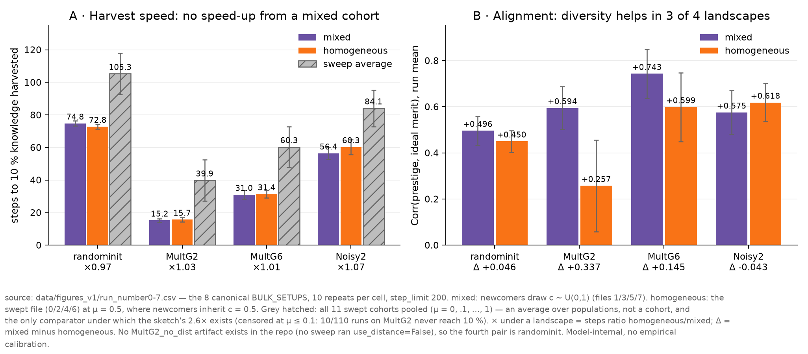
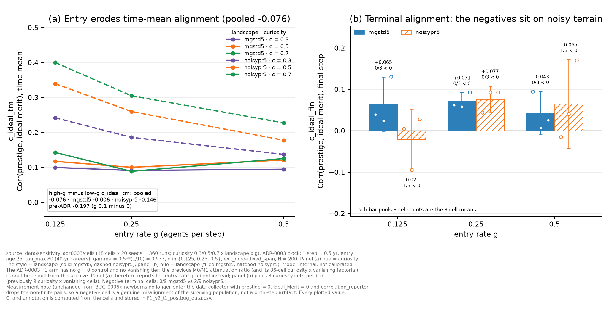
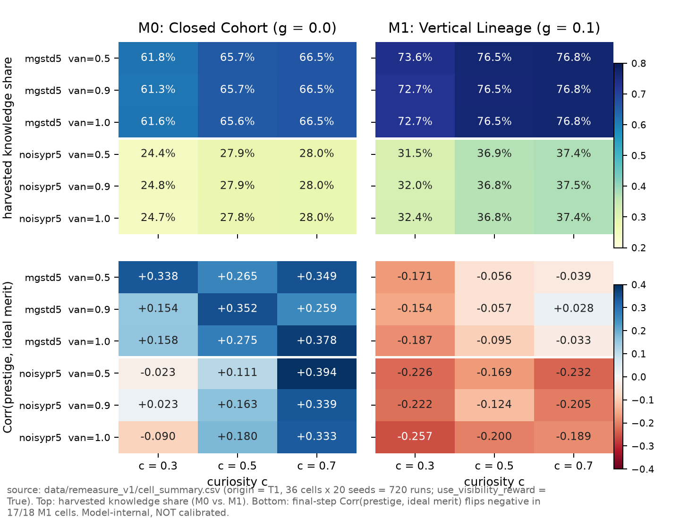
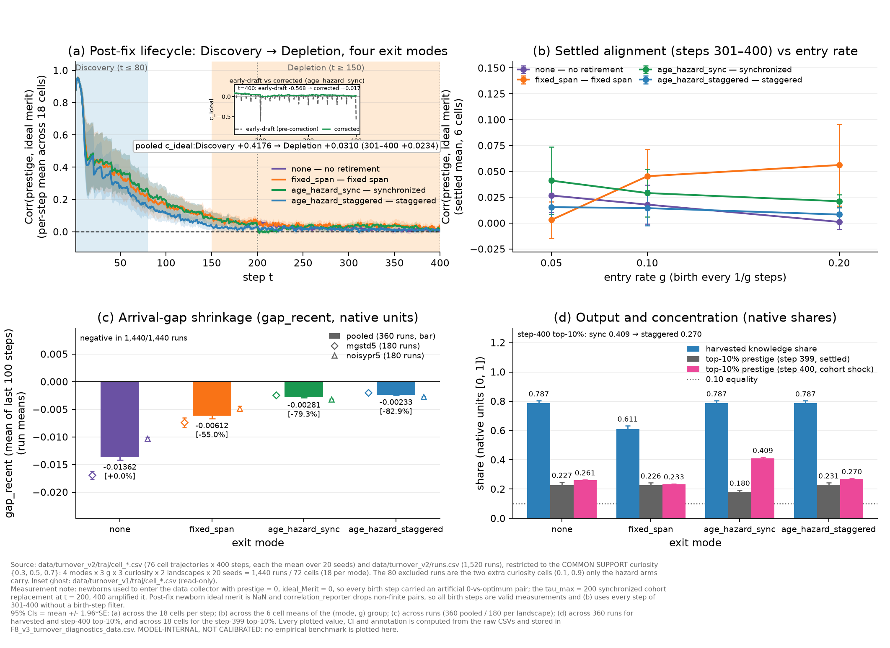
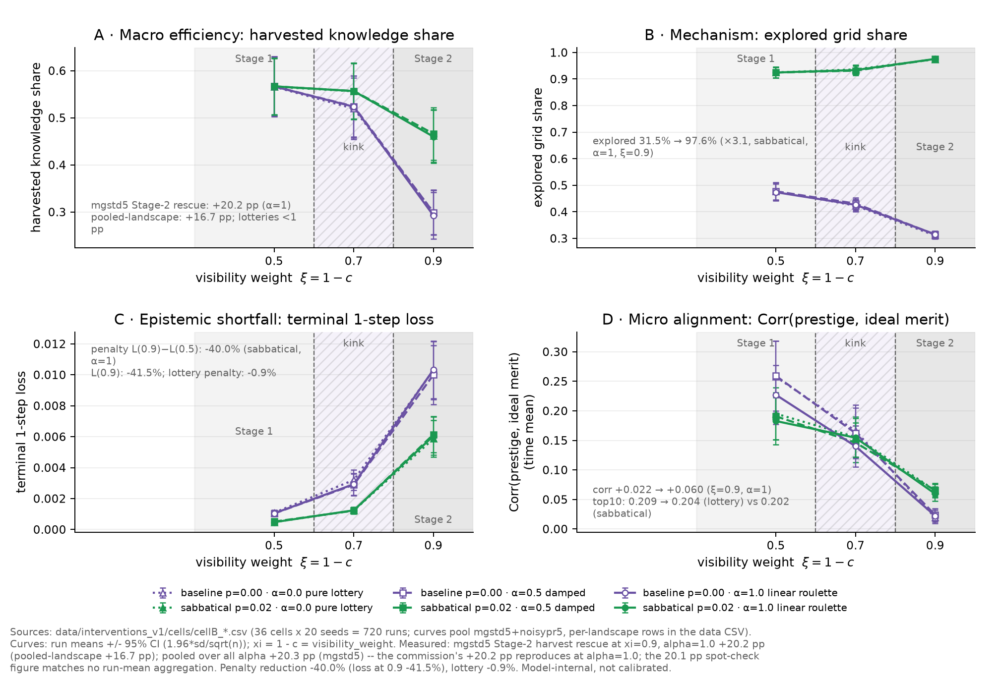

**Version 2** (November 2026)
**Version 1** (November 2026)

> **STATUS: INTEGRATED PAPER SKETCH (`CONT1`–`CONT7`). Calibration status: not calibrated** ---
> No parameter in this manuscript is fitted to empirical data (owner ruling, 2026-11-13). Every simulation number is computed from a reproducible run archive in this repository and cited alongside its source artifact; the empirical moments in Section 1 are stylized motivating facts from the Klann economics co-authorship panel ([docs/connections_niklas.md](file:///Users/joko/Git/sciencemodels/docs/connections_niklas.md)) and remain an unfitted option menu in [docs/calibration_moments.yaml](file:///Users/joko/Git/sciencemodels/docs/calibration_moments.yaml).
>
> **Narrative Spine Map (`CONT1`–`CONT7`):**
> - **Section 1 (Introduction & Puzzle):** [CONT3](file:///Users/joko/Git/sciencemodels/AdmiralsLog/contributions/CONT3-publishable-results-synthesis.md) + [docs/related_publications.md](file:///Users/joko/Git/sciencemodels/docs/related_publications.md) + [docs/connections_niklas.md](file:///Users/joko/Git/sciencemodels/docs/connections_niklas.md)
> - **Section 2 (Theory, Progressive Model Architecture `M0` $\to$ `M1` $\to$ `M2`, & Scale):** [CONT6](file:///Users/joko/Git/sciencemodels/AdmiralsLog/contributions/CONT6-canonical-model-specifications-basic-vs-collaborators.md) + [CONT2](file:///Users/joko/Git/sciencemodels/AdmiralsLog/contributions/CONT2-hunting-proxy-patterns-formalization.md)
> - **Section 3 (Baseline Science `M0`: The Curiosity Plateau & Cognitive Division of Labor):** [CONT7](file:///Users/joko/Git/sciencemodels/AdmiralsLog/contributions/CONT7-legacy-notebooks-preliminary-findings.md) + [CONT3](file:///Users/joko/Git/sciencemodels/AdmiralsLog/contributions/CONT3-publishable-results-synthesis.md) (`R3`)
> - **Section 4 (Vertical Lineage `M1`: Mentorship, Generational Turnover & Signal Inversion):** [CONT1](file:///Users/joko/Git/sciencemodels/AdmiralsLog/contributions/CONT1-depletion-counterforces-refills.md) (Act I) + [CONT3](file:///Users/joko/Git/sciencemodels/AdmiralsLog/contributions/CONT3-publishable-results-synthesis.md) (`R1`, `R2`) + [CONT5](file:///Users/joko/Git/sciencemodels/AdmiralsLog/contributions/CONT5-generational-turnover-and-paradigm-lockin.md) (Results 1–2)
> - **Section 5 (Institutional Counterforces, Paradigm Refills & Structural Invariances):** [CONT1](file:///Users/joko/Git/sciencemodels/AdmiralsLog/contributions/CONT1-depletion-counterforces-refills.md) (Acts II–III) + [CONT4](file:///Users/joko/Git/sciencemodels/AdmiralsLog/contributions/CONT4-inert-and-invariant-degrees-of-freedom.md) + [CONT5](file:///Users/joko/Git/sciencemodels/AdmiralsLog/contributions/CONT5-generational-turnover-and-paradigm-lockin.md) (Result 3)
> - **Section 6 (Horizontal Collaboration `M2`: Explicit Partner Choice & Epistemic Co-Location):** [CONT3](file:///Users/joko/Git/sciencemodels/AdmiralsLog/contributions/CONT3-publishable-results-synthesis.md) (`R9`) + [CONT5](file:///Users/joko/Git/sciencemodels/AdmiralsLog/contributions/CONT5-generational-turnover-and-paradigm-lockin.md) (Result 4) + [P-0011](file:///Users/joko/Git/sciencemodels/AdmiralsLog/proposals/P-0011-canonical-three-tier-model-specification.md)

---

# 1. Introduction: The Relational Wedge in Scientific Credit

Academic institutions rely on observable proxies—publication counts, journal prestige, citation stocks, and network prominence—to evaluate epistemic contributions whose fundamental scientific value is difficult to observe directly. When career survival and resource allocation depend on such metrics, a community risks *proxy failure* (Goodhart 1975; Strathern 1997; Muller 2018; Osterloh and Frey 2015). Yet in the sociology and economics of science, two very different accounts of proxy failure are often conflated:

1. **Active Gaming and Fabrication (Behavioral Distortion):** Individual scientists deliberately sacrifice epistemic truth for metric inflation through p-hacking, salami slicing, citation cartels, or low-replication shortcuts (Smaldino and McElreath 2016; Braganza 2020; Tiokhin et al. 2021).
2. **Relational and Demographic Misallocation (Structural Decoupling):** Even when no scientist cheats or fabricates results, the interaction between **mainstream visibility incentives**, **finite topic exhaustion**, and **intergenerational academic recruitment** causes the prestige hierarchy to decouple from marginal epistemic discovery—rewarding incumbents and their academic lineages on crowded, depleted topics while under-rewarding pioneers on the frontier.

Motivating evidence from the Klann economics co-authorship panel ([docs/connections_niklas.md](file:///Users/joko/Git/sciencemodels/docs/connections_niklas.md)) illustrates this structural puzzle. Across economists, cumulative prestige correlates strongly with output *quantity* ($\text{corr} = 0.50$) but barely tracks per-paper *citation quality* ($\text{corr} = 0.07$). Within an author's own career trajectory, the correlation between current personal prestige and paper quality is negative ($-0.257$), whereas co-author rank carries a positive slope ($+0.004$). Simultaneously, collaboration is organized into small teams (mean $2.65$, median $2$) with substantial partner repetition ($0.34$), strong dyad-corrected elite homophily ($O/E = 3.1 / 3.0 / 2.3$), and persistent club closure (Markov top-decile retention $0.3995$ vs. entry $0.0619$).

| Stylized Fact (Klann Economics Panel) | Empirical Value | Analytical Role in This Paper |
| :--- | :--- | :--- |
| $\text{Corr}(\text{prestige}, \text{output quantity})$ vs. $\text{Corr}(\text{prestige}, \text{citation quality})$ | $+0.50$ vs. $+0.07$ | Qualitative motivation for the relational wedge (`corr(prest,local)` vs. `corr(prest, ideal)`) |
| Within-author own-prestige vs. co-author-rank quality slope | $-0.257$ vs. $+0.004$ | Qualitative motivation for exhaustion & network status transfer |
| Mean co-author team size (median) | $2.65$ ($2$) | Diagnostic benchmark for Tier `M2` (`path_b_probe_v2`) |
| Repeated-collaboration share | $0.34$ | Diagnostic benchmark for Tier `M2` (`path_b_probe_v2`) |
| Elite homophily $O/E$ cells (dyad-corrected) | $3.1\text{ / }3.0\text{ / }2.3$ | Qualitative motivation for elite clustering |
| Top-decile Markov retention / entry rate | $0.3995\text{ / }0.0619$ | Qualitative motivation for oligarchic persistence (`turnover_v1`) |

A systematic review of 46 formal and agent-based models of science ([docs/related_publications.md](file:///Users/joko/Git/sciencemodels/docs/related_publications.md), clustering epistemic-landscape models from Weisberg and Muldoon 2009 and Thoma 2015, network-epistemology models from Zollman 2010, priority-rule models from Strevens 2003, and cumulative-advantage models from Merton 1968 and Petersen et al. 2014) reveals an unoccupied intersection. **No existing model combines (i) spatial-topical search on a depletable epistemic landscape, (ii) visibility-proxy incentives coupled to prestige-proportional demographic entry and retirement, and (iii) an external, reward-independent omniscient-planner benchmark (`ideal_Merit`) against which epistemic success is scored independently of the community's own reward function.**

Without an external planner benchmark, a model can only report that its internal reward variable shifted. By pairing an external greedy-planner yardstick (`ideal_Merit`) with a local consensus yardstick (`local_Merit`), our model isolates **when, why, and at what scale** prestige stops tracking discovery.

---

# 2. Theory and Progressive Model Architecture (`CONT6` + `CONT2`)

> *Source contributions:* [CONT6-canonical-model-specifications-basic-vs-collaborators.md](file:///Users/joko/Git/sciencemodels/AdmiralsLog/contributions/CONT6-canonical-model-specifications-basic-vs-collaborators.md) and [CONT2-hunting-proxy-patterns-formalization.md](file:///Users/joko/Git/sciencemodels/AdmiralsLog/contributions/CONT2-hunting-proxy-patterns-formalization.md).

To prevent mechanical artifacts from being confused with substantive social mechanisms, we structure the theory in three layers: (2.1) the causal grammar of proxy failure, (2.2) a progressive three-tier simulation architecture (`M0` $\to$ `M1` $\to$ `M2`) that isolates solo search from vertical mentorship and horizontal co-authorship, and (2.3) a two-stage scale interpretation that reconciles why aggregate scientific output remains resilient over wide parameter ranges even as the prestige signal inverts.

## 2.1 Causal Grammar: Goal, Proxy, Distraction, Destruction, and Counterforce (`CONT2`)

Following the causal typology of Kapeller, Paul, and Braganza ([context/Hunting_Proxy_Patterns.md](file:///Users/joko/Git/sciencemodels/context/Hunting_Proxy_Patterns.md)), let $G$ denote the epistemic goal (discovering high-value knowledge on the landscape) and $P$ denote the institutional proxy (accumulated prestige and spatial visibility). An aligned action $A$ advances both $G$ and $P$, whereas a proxy-oriented action $AP_F$ inflates $P$ while neglecting or harming $G$:

1. **Distraction ($AP_F$ crowds out $A$ indirectly):** Scientists trade off intrinsic epistemic curiosity $c_i \in [0,1]$ against visibility-seeking $1-c_i$ in a Cobb–Douglas movement utility:
   $$R_i(\text{tile}) \;=\; \left(\frac{k_{\text{tile}}}{\bar{k}}\right)^{c_i} \cdot V_i(\text{tile})^{1-c_i}, \qquad V_i \;=\; \frac{\bar{d}_{\text{global}}+1}{d_{\text{own}}+1}$$
   When $1-c_i > 0$, scientists are drawn toward crowded "hot topics" where peer density is high ($d_{\text{own}}$ is small), diverting search away from unvisited epistemic peaks.
2. **Destruction ($AP_F \dashv G$ directly):** Proxy competition directly degrades epistemic output—either by corrupting perception on crowded tiles ($\epsilon_{\text{eff}} = \epsilon \cdot m_t^\gamma$, tested in `typology_v1`) or by eroding harvested knowledge when crowding exceeds a threshold ([P-0008](file:///Users/joko/Git/sciencemodels/AdmiralsLog/proposals/P-0008-typology-v2-stock-destruction-and-normalized-counterforce.md)).
3. **Counterforce ($P \to G$ spillover):** High mentor prestige can confer real epistemic capability on advisees (e.g., better laboratory equipment or signal-to-noise training, $\epsilon_i = \epsilon_0 / (1 + \kappa \tilde{P}_{\text{sup}})$), partially offsetting distraction.

## 2.2 Progressive Identification: The Three-Tier Model Specification (`M0` $\to$ `M1` $\to$ `M2`, `CONT6`)

Scientists search a $20 \times 20$ toroidal epistemic landscape (`MultG2`: two smooth Gaussian peaks; `MultG6`: six peaks; `Noisy2`: two peaks buried under uniform background noise) whose total initial knowledge is normalized ($\sum_{x,y} k_{xy}(0) \approx 2.0$ on `MultG2`). At each step, an agent harvests a fraction $h = 0.02$ ($2\%$) of their current tile's remaining knowledge, depleting it multiplicatively: $k_{xy}(t+1) = (1-h)k_{xy}(t)$. Agents sharing a tile harvest it **independently**: each draws the same $h = 0.02$ flow from the tile's remaining knowledge, and there is **no team-production multiplier anywhere in the code**. "Co-harvest teams" are therefore a *measured co-location quantity* (agents on a common tile at the end of a step, size $\ge 2$), not a production technology. Movement follows a strict-improvement rule over the 5-tile von Neumann neighborhood with multiplicative perception noise $\epsilon = 0.1$ on candidate tiles (`stay_bias`: the current tile is evaluated noise-free).

To identify *which social institution* causes proxy failure, we separate the model into three nested tiers ([CONT6](file:///Users/joko/Git/sciencemodels/AdmiralsLog/contributions/CONT6-canonical-model-specifications-basic-vs-collaborators.md#L22-L62)):

| Specification Dimension | **Tier `M0`: Basic Model** *(Closed-Cohort Solo Search)* | **Tier `M1`: Mentorship & Turnover** *(Vertical Academic Lineage)* | **Tier `M2`: Explicit Collaborators** *(Horizontal Co-Authorship)* |
| :--- | :--- | :--- | :--- |
| **Substantive Question** | How do curiosity ($c$) and visibility ($1-c$) govern exploration when a fixed cohort searches without schools or turnover? | How do prestige-based PhD recruitment, inherited agendas, and retirement reshape inequality and merit tracking? | How does active partner selection (goal $\lambda=1$ vs. prestige $\lambda=0$ matching) alter team size, assortativity, and output? |
| **Demography ($g$)** | `agent_generation_time = 0.0` ($N \equiv 20$ fixed) | `agent_generation_time` $\in \{0.05, 0.1, 0.2\}$ | Combines with `M0` ($g=0$, [P-0011](file:///Users/joko/Git/sciencemodels/AdmiralsLog/proposals/P-0011-canonical-three-tier-model-specification.md)) or `M1` ($g=0.1$) |
| **Retirement (`exit_mode`)** | `"none"` | `"none"` (growing $N$) or `"fixed_span"` / `"age_hazard"` ($N \equiv 20$ stationary) | Inherited from `M0` or `M1` |
| **Collaboration (`dyadic_mode`)** | `"off"` (passive spatial co-location only) | `"off"` (vertical supervisor $\to$ advisee lineage + spatial co-location) | `"logit"` or `"threshold"` ($\lambda \in [0,1]$, `credit_sharing`, `dyadic_move_pull`) |
| **Time-mean `Corr(P, ideal_merit)`** (post-`BUG-0006`, like-for-like) | $+0.349 \to +0.044$ across $\xi$ | $+0.140 \to +0.044$; terminal $+0.033$ (negative cells only on `noisypr5`) | $\lambda=1$: $+0.217 \to +0.043$, above `M1` at every $\xi \le 0.7$; $\lambda=0$ flat near zero |
| **Elite Concentration (`top10`)** | **Flat** ($0.112\text{–}0.133$, near $0.100$ equality floor) | **Concentrated** ($0.214\text{–}0.413$) | Modulated by `credit_sharing` (`structural` vs. `equal_split`) |

## 2.3 Yardsticks, Variable Glossary, and the Two-Stage Scale of Proxy Failure (`CONT6`)

Throughout the paper, we use a consistent set of model parameters, landscape tags, and outcome metrics:

| Symbol / Name | Plain-English Definition | Role in Analysis |
| :--- | :--- | :--- |
| **$c_i$**, **$\xi = 1 - c_i$** | **Curiosity** ($c_i \in [0,1]$) and **visibility weight** ($\xi = 1 - c_i$) | Cobb–Douglas trade-off between tile knowledge ($c_i$) and peer visibility ($\xi$) |
| **$g$** (`agent_generation_time`) | **Demographic entry rate** (expected newcomers per step per existing agent, $g \in \{0.0, 0.05, 0.1, 0.2\}$) | Switches `M0` ($g=0$) to `M1` ($g>0$); newcomers start with **prestige $= 0$** and are placed on their supervisor's tile (advisor-proportional recruitment, no endowment transfer) |
| **`MultG2` / `mgstd5`, `MultG6` / `mg6`, `Noisy2` / `noisypr5`** | **Landscapes:** 2-peak Gaussian (`mgstd5` = standard noise $\epsilon=0.1$), 6-peak Gaussian (`mg6`), and 2-peak noisy terrain (`noisypr5`, 50% random background) | Tests sensitivity to peak multiplicity and terrain legibility |
| **`percentage_knowledge_harvested`** | **Harvested knowledge share** $\in [0\%, 100\%]$: cumulative knowledge extracted relative to initial landscape stock | Macro epistemic efficiency |
| **`ideal_Merit`**, **`ideal_loss_cum`** | **Global planner benchmark:** 1-step greedy omniscient harvest allocation on the step-$t$ residual grid; `ideal_loss_cum` is cumulative 200-step shortfall relative to this benchmark | External, reward-independent epistemic ground truth |
| **`corr(prest, ideal)`** | **`Corr(prestige, ideal merit)`** (Pearson correlation across active agents at final step, or time-mean `_tm`) | Primary proxy-alignment metric: negative `corr(prest, ideal)` means prestige rewards low-merit insiders |
| **`corr(prest,local)`** | **`Corr(prestige, local merit)`** (Pearson correlation against the 5-tile neighborhood value around each agent) | Local consensus alignment |
| **$\Delta r = \text{corr(prest,local)} - \text{corr(prest, ideal)}$** | **Relational wedge:** gap between local-consensus prestige and global epistemic merit | Measures how far local prestige diverges from global discovery |
| **`top10`** (`top10pct_prestige_share`) | **Top-10% prestige share:** fraction of total community prestige held by the top decile of agents | Elite concentration / oligarchy |
| **`gap_recent`** | **Newcomer–incumbent prestige gap:** mean prestige difference between recent arrivals ($\text{tenure} < 20$) and established incumbents | Intergenerational inequality |
| **$\lambda$**, **`dyadic_move_pull`** | **Partner-selection weight**: $\lambda$ interpolates between *prestige matching* ($\lambda=0$) and *spatial closeness $\times$ perceived local merit* ($\lambda=1$); **spatial co-movement pull** weights tiles near declared partners | `Tier M2` horizontal collaboration levers |

Evaluating both macro efficiency and micro signal alignment simultaneously reveals a **Two-Stage Scale of Proxy Failure** ([CONT6](file:///Users/joko/Git/sciencemodels/AdmiralsLog/contributions/CONT6-canonical-model-specifications-basic-vs-collaborators.md#L84-L115), Figure 1):

*Figure 1 (`F6_v2`).* The two-stage scale **after `BUG-0006`** across all five tiers (`mgstd5`, post-fix archives). **(a)** Harvested knowledge share vs. visibility weight $\xi = 1-c$: entry arms stay flat to $\xi = 0.5$ ($76.4\text{–}77.0\%$) and collapse to $38.9\text{–}43.2\%$ at $\xi = 0.9$ (`M0` falls further, to $33.0\%$); the staggered-turnover arm holds $69.5\%$. **(b)** **Like-for-like time-mean** `Corr(prestige, ideal merit)` on a single statistic for every tier: `M0` $+0.349 \to +0.044$, `M2` ($\lambda=1$) $+0.217 \to +0.043$, `M1` $+0.140 \to +0.044$, `M1` + turnover (staggered) $+0.093 \to +0.022$, `M2` ($\lambda=0$) $+0.046 \to +0.032$. Sources: `data/bug0006_remeasure_v2/w_v05_runs.csv` + `m2_xi_runs.csv`, `data/turnover_v2/`; vanishing pins differ by arm ($0.5$ for `w_v05`, $0.9$ for `m2_xi`/turnover) and are stated in the figure footnote. Model-internal, not calibrated.

| Visibility weight $\xi = 1-c$ | Curiosity $c$ | `M0` harvest | `M1` harvest | `M0` `c_ideal_tm` | `M1` `c_ideal_tm` | `M1`+staggered `c_ideal_tm` | `M2` ($\lambda=1$) `c_ideal_tm` | `M2` ($\lambda=0$) `c_ideal_tm` | Regime |
| :--- | :--- | :--- | :--- | :--- | :--- | :--- | :--- | :--- | :--- |
| **$\xi = 0.1$** | $0.9$ | $0.665$ | $0.768$ | $+0.349$ | $+0.140$ | $+0.093$ | $+0.217$ | $+0.046$ | Stage 1 |
| **$\xi = 0.3$** | $0.7$ | $0.665$ | $0.768$ | $+0.334$ | $+0.137$ | $+0.080$ | $+0.200$ | $+0.030$ | Stage 1 |
| **$\xi = 0.5$** | $0.5$ | $0.657$ | $0.765$ | $+0.288$ | $+0.132$ | $+0.077$ | $+0.197$ | $+0.060$ | Stage 1 |
| **$\xi = 0.7$** | $0.3$ | $0.618$ | $0.736$ | $+0.206$ | $+0.101$ | $+0.051$ | $+0.151$ | $+0.067$ | Kink |
| **$\xi = 0.9$** | $0.1$ | $0.330$ | $0.432$ | $+0.044$ | $+0.044$ | $+0.022$ | $+0.043$ | $+0.032$ | Stage 2 |

*Note: all values are **post-`BUG-0006`** and computed from `data/bug0006_remeasure_v2/w_v05_runs.csv` (`M0`, `M1`: `mgstd5`, visibility on, 100 runs/tier), `m2_xi_runs.csv` (`M2`, `pull=1.0`, `logit + equal_split`, 100 runs/arm) and `data/turnover_v2/runs.csv` (`age_hazard_staggered`, entry $g=0.1$, 100 runs). Alignment is the **like-for-like time mean** `c_ideal_tm` for every tier; harvest is `harvested_fin`. `M0` is bit-identical before and after the fix (control); vanishing pins differ by arm ($0.5$ for `w_v05`, $0.9$ for `m2_xi`/turnover).**

- **Stage 1 ($\xi \in [0.1, 0.5]$, moderate visibility distraction): *macro plateau, gradual alignment attenuation, no sign inversion.*** Harvest stays on its plateau (`M0` $0.657\text{–}0.665$, `M1` $0.765\text{–}0.768$; the `MultG2`/`MultG6` series of Section 3 lose only $0.84\text{ pp}$ / $0.43\text{ pp}$ by $\xi = 0.5$). Alignment falls smoothly in every tier — `M0` from $+0.349$ to $+0.288$, `M1` from $+0.140$ to $+0.132$ (an attenuation of $2.49\times$ at $\xi = 0.1$, $2.18\times$ at $\xi = 0.5$) — and stays positive throughout. The negative terminal correlations of the pre-`BUG-0006` round were substantially the unscored-newborn artifact (Section 4.1); post-fix, entry produces a *level shift and an attenuation*, not a sign flip on clean terrain.
- **Stage 2 ($\xi \ge 0.8$, past the kink $\xi^* \in [0.6, 0.8]$): *macroscopic output collapse; the institutional tiers converge.*** Once visibility herding swamps curiosity, harvest collapses (`M0` $0.330$, `M1` $0.432$ at $\xi = 0.9$; the `MultG2`/`MultG6` series of Section 3 fall to $34.5\%$/$15.5\%$ at $\xi = 0.9$ and $4.8\%$/$1.9\%$ at $\xi = 1.0$). Alignment converges toward zero in every tier ($+0.044$ / $+0.044$ / $+0.022$ / $+0.043$ / $+0.032$). The kink is therefore a **macro** phenomenon: at the far end of the visibility axis, mentorship, turnover and collaboration all become equally unable to separate merit from attention.
- **The coupled arm (`M2`, $\lambda \in \{0, 1\}$) as a second comparison:** epistemic partner choice ($\lambda=1$) tracks `M0` most closely ($+0.217$ at $\xi = 0.1$, declining to $+0.043$ at $\xi = 0.9$), whereas prestige matching ($\lambda=0$) sits flat near zero ($+0.046\text{–}+0.067$). Macro efficiency on the dyadic layer is flat to $\xi = 0.7$ ($0.732$ / $0.730$) and collapses at $\xi = 0.9$ ($0.428$ for $\lambda=0$, $0.389$ for $\lambda=1$); the staggered-turnover arm holds harvest at $0.938$ through $\xi = 0.5$ and $0.695$ at $\xi = 0.9$. Macro output and micro alignment diverge exactly as the two-stage scale claims.

---

# 3. Baseline Science (`Tier M0`): The Curiosity Plateau and Cognitive Division of Labor (`CONT7` + `CONT3`)

> *Source contributions:* [CONT7-legacy-notebooks-preliminary-findings.md](file:///Users/joko/Git/sciencemodels/AdmiralsLog/contributions/CONT7-legacy-notebooks-preliminary-findings.md) and [CONT3-publishable-results-synthesis.md](file:///Users/joko/Git/sciencemodels/AdmiralsLog/contributions/CONT3-publishable-results-synthesis.md) (`R3`).

Before introducing academic lineages or turnover, we establish how a closed cohort of $N=20$ solo scientists (`Tier M0`, `agent_generation_time = 0.0`, `dyadic_mode = "off"`) explores the landscape across the eight canonical setups (`BULK_SETUPS` in [sciencemodels/sweeps.py](file:///Users/joko/Git/sciencemodels/sciencemodels/sweeps.py), archived in `data/figures_v1/` and [output/reports/figures_report_v1.md](file:///Users/joko/Git/sciencemodels/output/reports/figures_report_v1.md)).

## 3.1 The Curiosity Step-Function and the Welfare Kink (`Finding L1` & `R3`)

![Figure 2: Welfare loss against visibility weight showing the interior kink at xi* in [0.6, 0.8]](../output/report_notebook_v1/F3_welfare_loss_vs_visibility_weight.png)

*Figure 2 (`F3`).* Cumulative ideal-merit loss (`ideal_loss_cum`) against visibility weight $\xi = 1-c$, by entry rate and landscape legibility, averaged over `use_visibility_reward`. Source: welfare-loss sweep (`data/welfare_v1/`, 40 cells $\times$ 20 seeds = 800 runs) and its post-audit re-measure (`data/remeasure_v1/w_v05_runs.csv`).

In `Tier M0`, cumulative discovery is a steep **step-function of curiosity**:
- Increasing $c$ from $0.0$ to $0.3$ raises `percentage_knowledge_harvested` more than twelvefold on `MultG2` ($4.8\% \to 61.9\%$) and eightfold on `MultG6` ($4.5\% \to 37.0\%$).
- Across $c \in [0.4, 1.0]$ ($\xi \in [0.0, 0.6]$), discovery sits on a virtually flat plateau ($65.7\%\text{–}67.8\%$ on `MultG2`; $40.6\%\text{–}42.5\%$ on `MultG6`; $27.6\%\text{–}28.2\%$ on `Noisy2`).
- Piecewise-linear regression across all 24 outcome series in `welfare_probe_v1` confirms a sharp interior **welfare kink at $\xi^* \in [0.6, 0.8]$** (24/24 series with interior 95% bootstrap CIs), beyond which epistemic loss surges $10\times\text{–}44\times$.

## 3.2 Peak Exploitation vs. Unweighted Grid Wandering (`Finding L2`)

Comparing standard step-by-step search (`use_distance=1`) against global jump search (`use_distance=0`, Setup 8 `MultG2_no_dist`) reveals why raw spatial coverage is a misleading proxy for discovery ([CONT7](file:///Users/joko/Git/sciencemodels/AdmiralsLog/contributions/CONT7-legacy-notebooks-preliminary-findings.md#L49-L64)):
- Under global jump search (`use_distance=0`), raising curiosity from $c=0.0$ to $c=1.0$ **reduces** unweighted grid coverage (`explored_percentage`) from $99.3\%$ to $81.2\%$, while **more than doubling** actual harvested knowledge ($31.8\% \to 76.7\%$) and peak-weighted exploration (`explored_weighted_by_initial_knowledge`, $99.6\%$).
- Substantively, pure visibility chasers ($c=0$) scatter randomly across empty desert tiles ($99.3\%$ coverage, $31.8\%$ harvest), whereas curious scientists lock onto high-value Gaussian peaks and systematically mine them before moving on.

## 3.3 The "Mixed Population" Advantage: Cognitive Division of Labor Between Mavericks and Followers (`Finding L3`)

What happens when a scientific community is **cognitively heterogeneous**—combining high-curiosity mavericks and low-curiosity visibility followers in the same cohort ($c_i \sim U(0,1)$, mean $\bar{c} = 0.5$, odd setups `1, 3, 5, 7`)—compared to a homogeneous cohort fixed at the exact same mean curiosity ($c_i \equiv 0.5$, even setups `2, 4, 6, 8`)?

*Figure 3 (`F7`).* Discovery speed (steps to $10\%$ knowledge harvested, Panel A) and final-step `Corr(prestige, ideal merit)` (Panel B) comparing mixed $c_i \sim U(0,1)$ cohorts against matched homogeneous $c \equiv 0.5$ cohorts (and the 11-point $\mu \in [0,1]$ sweep average in Panel A). Source: `data/figures_v1/run_number0.csv`–`run_number7.csv` (10 repeats/cell, `step_limit=200`).

| Landscape Setup Pair (`Tier M0`, $N=20$, $T=200$) | Homogeneous $c \equiv 0.5$ Steps to 10% Harvest *(11-pt sweep avg)* | **Mixed $c_i \sim U(0,1)$ ($\bar{c}=0.5$)** Steps to 10% Harvest | Homogeneous $c \equiv 0.5$ `Corr(P, ideal_merit)` | **Mixed $c_i \sim U(0,1)$ ($\bar{c}=0.5$)** `Corr(P, ideal_merit)` | Homogeneous $c \equiv 0.5$ Harvested % | **Mixed $c_i \sim U(0,1)$ ($\bar{c}=0.5$)** Harvested % |
| :--- | :--- | :--- | :--- | :--- | :--- | :--- |
| **`MultG2`** (Setups 2 vs. 1) | $15.7\text{ steps}$ *($39.9$)* | **$15.2\text{ steps}$ ($\times 1.03$)** | $+0.257$ | **$+0.594$ ($\Delta = +0.337$, $2.3\times$)** | $67.0\%$ | $67.7\%$ |
| **`MultG6`** (Setups 4 vs. 3) | $31.4\text{ steps}$ *($60.3$)* | **$31.0\text{ steps}$ ($\times 1.01$)** | $+0.599$ | **$+0.743$ ($\Delta = +0.145$)** | $41.9\%$ | $41.7\%$ |
| **`Noisy2`** (Setups 6 vs. 5) | $60.3\text{ steps}$ *($84.1$)* | **$56.4\text{ steps}$ ($\times 1.07$)** | $+0.618$ | $+0.575$ ($\Delta = -0.043$) | $27.9\%$ | $27.8\%$ |
| **`randominit`** (Setups 8 vs. 7) | $72.8\text{ steps}$ *($105.3$)* | $74.8\text{ steps}$ ($\times 0.97$) | $+0.450$ | **$+0.496$ ($\Delta = +0.046$)** | $24.2\%$ | $23.8\%$ |

This reveals a sharp **Kitcher (1990) cognitive division-of-labor result** (Figure 3):
1. **Speed Parity with $c \equiv 0.5$ (and Protection Against Low-$c$ Stalling):** When matched directly against homogeneous $c \equiv 0.5$, mixed cohorts reach $10\%$ harvest at virtually identical speed ($\times 0.97\text{ to }\times 1.07$, e.g. $15.2$ vs. $15.7$ steps on `MultG2`); the apparent $1.5\times\text{–}2.6\times$ gap in raw sweep tables arises only against the 11-point sweep average ($39.9\text{–}105.3$ steps), which is dragged down by stalled low-$c$ homogeneous cohorts ($10/110$ runs on `MultG2` at $c \le 0.1$ never reach $10\%$).
2. **Merit–Prestige Alignment Gain ($2.3\times$ higher `corr(prest, ideal)` on `MultG2`):** Because high-$c$ mavericks locate Gaussian peaks first, they harvest uncrowded initial knowledge ($h \cdot k(0)$ with $m=1$), while low-$c$ followers arrive later and harvest the depleted flow of tiles they now share with others. Consequently, prestige in a mixed `M0` population rewards true pioneers on structured landscapes (`MultG2`: $+0.594$ vs. $+0.257$, $\Delta = +0.337$; `MultG6`: $+0.743$ vs. $+0.599$, $\Delta = +0.145$; `randominit`: $+0.496$ vs. $+0.450$), while remaining neutral on `Noisy2` ($\Delta = -0.043$).

## 3.4 Closed-Cohort Equality and Late-Stage Exhaustion (`Findings L4` & `L5`)

In `Tier M0`, without demographic entry ($g=0$), prestige inequality never concentrates (`top10pct_prestige_share` remains flat at $0.112\text{–}0.133$ across all $c \ge 0.1$, just above the $0.100$ equality floor), and terminal `Corr(prestige, ideal_merit)` is positive at step 200 across every landscape for $c \ge 0.2$. Only when runs are extended to $T=400$ (`longitudinalcomparisions.ipynb`, `Finding L5`) does `corr_prestige_localMerit` exhibit a **lifecycle rise-and-fall**: climbing to $+0.85\text{–}+0.97$ during the Discovery Boom (steps 10–50) and drifting negative ($-0.18\text{ to }-0.26$) by step 400 once founders sit on exhausted peaks.

---

# 4. Vertical Lineage (`Tier M1`): Mentorship, Generational Turnover, and Signal Inversion (`CONT1` + `CONT3` + `CONT5`)

> *Source contributions:* [CONT1-depletion-counterforces-refills.md](file:///Users/joko/Git/sciencemodels/AdmiralsLog/contributions/CONT1-depletion-counterforces-refills.md) (Act I), [CONT3-publishable-results-synthesis.md](file:///Users/joko/Git/sciencemodels/AdmiralsLog/contributions/CONT3-publishable-results-synthesis.md) (`R1`, `R2`, `R5`, `R6`), and [CONT5-generational-turnover-and-paradigm-lockin.md](file:///Users/joko/Git/sciencemodels/AdmiralsLog/contributions/CONT5-generational-turnover-and-paradigm-lockin.md) (Results 1–2).

Real academic communities are not closed cohorts of immortals (`M0`); they reproduce through **vertical academic lineages (`Tier M1`)**. Eminent senior professors train more PhD advisees (`supervisor_prestiges_at_birth`), advisees enter with **zero prestige** and are placed on their mentor's birth tile (advisor-proportional recruitment; the code transfers no endowment), and senior cohorts eventually retire. Switching on `Tier M1` transforms the benign `M0` world into a regime where prestige tracking is attenuated roughly twofold and the negative tail concentrates on illegible terrain — though, as Section 4.1 shows, not into a clean sign inversion once the birth-step artifact is removed.

## 4.1 The Relational Wedge Under Entry (`R1`) and the Audit Isolation

*Figure 4 (`F1_v2`).* `T1` after `BUG-0006` (`data/bug0006_remeasure_v2/t1_runs.csv`, 720 runs). **(a)** Time-mean alignment `c_ideal_tm` falls when entry is switched on — pooled attenuation $1.74\times$, `mgstd5` $2.30\times$, `noisypr5` $1.55\times$. **(b)** Terminal alignment `c_ideal_fin`: the negative cells concentrate on the noisy landscape (`mgstd5` 0/9, `noisypr5` 5/9 under `M1`), and a negative cell is a genuine misalignment of the surviving population, not a birth-step artifact. Bars: 16 grouped cells $\times$ 20 seeds; dots: the nine cell means per bar.

Across the 36-cell post-audit sensitivity sweep (`T1`, re-run in `data/bug0006_remeasure_v2/t1_runs.csv`, a $3 \times 3 \times 2 \times 2$ factorial over curiosity $c \in \{0.3, 0.5, 0.7\}$, prestige-vanishing factor $\in \{0.5, 0.9, 1.0\}$, landscape $\in \{\text{mgstd5}, \text{noisypr5}\}$, and entry rate $g \in \{0.0, 0.1\}$, 20 seeds/cell = 720 runs, `use_visibility_reward = True`):
- At $g = 0.0$ (`Tier M0`), prestige tracks global epistemic merit positively: mean terminal `corr(prest, ideal)` $= +0.2200$, time-mean $+0.4101$, and top-10% prestige share (`top10`) is $0.135$. `M0` is **bit-identical before and after `BUG-0006`** (control arm).
- At $g = 0.1$ (`Tier M1`), mean terminal `corr(prest, ideal)` **drops to $+0.0327$** — negative in only **5 of 18 entry cells**, all of them on `noisypr5` — while the time mean falls from $+0.4101$ to $+0.2360$ (a $1.74\times$ attenuation) and `top10` rises to **$0.228$** (paired $\Delta\,\text{corr(prest, ideal)} = -0.1873$, 95\% CI $[-0.2248, -0.1498]$). The local-consensus correlation is untouched by the fix ($c_{\text{local,fin}} = +0.0383$ on both sides: the ideal channel moved, the local channel did not).
- **What the fix changed, and what it did not.** `BUG-0006` (unscored step-$t$ newborns entered the correlation as `prestige = 0, ideal_merit = 0`) inflated every entry-on ideal correlation toward its negative artefact. Re-measurement leaves all non-ideal channels bit-identical (paired max difference $0.0$ over the full wave; `output/reports/bug0006_wave2_summary.md`) and leaves the *ordering* of cells intact, but it removes the sign flip on clean terrain: the remaining entry effect is a **level shift and an attenuation**, not an inversion.

*Figure 5 (`F11`).* Cell-by-cell view of the 36-cell `T1` sensitivity sweep (`data/remeasure_v1/cell_summary.csv`, `origin = T1`, 20 seeds/cell) across `M0` ($g=0.0$, left) and `M1` ($g=0.1$, right). **Pre-`BUG-0006` audit view** (kept as the historical record of the audit): top, harvested knowledge share (`harvested_fin`) remains intact across `vanishing` and `curiosity`; bottom, the *pre-fix* final-step `Corr(prestige, ideal merit)` was negative in 17 of 18 `M1` cells — the pattern whose ideal-channel content `BUG-0006` later re-measured (Section 4.1, Figure 4).

*Figure 6 (`F5`).* Mean paired delta (post-fix minus pre-fix, $95\%$ CI over 1,520 seed-matched runs across the sensitivity sweep `T1` and welfare-loss sweep `W_v05`) from `data/sensitivity_v1/` $\times$ `data/remeasure_v1/`, confirming zero shift on `top10` and `corr(prest,local)` (the `BUG-0004` pairing audit predates `BUG-0006`; both fixes are documented separately).

## 4.2 Mechanism Decomposition: Why Birth-Tile Starvation Fails (`P-0002` / `IE-0001`)

Why does `Tier M1` invert the prestige-merit correlation? In early drafts (`CONT1` v1), we hypothesized **birth-tile starvation**: because a high-prestige mentor has already depleted their peak tile, spawning advisees directly on the mentor's tile (`r_spawn = exact`) forces newcomers onto barren ground.

Wave-4's `interventions_v1` Arm A ([output/reports/interventions_v1.md](file:///Users/joko/Git/sciencemodels/output/reports/interventions_v1.md), 180 runs on `mgstd5`, $g=0.1$) tested this directly by dispersing newborn advisees to a random neighborhood tile (`r_spawn = neigh_1`) or a uniform random tile anywhere on the $20 \times 20$ torus (`r_spawn = random_grid`), recorded as [rejected/IE-0001](file:///Users/joko/Git/sciencemodels/AdmiralsLog/ideas/rejected/IE-0001-birth-tile-starvation-hypothesis.md):

*Figure 7 (`FA2`).* Decomposition of the entry-induced drop in `corr(prest, ideal)` into birth-tile starvation vs. recruitment-plus-visibility herding across $c \in \{0.3, 0.5, 0.7\}$. Source: `data/interventions_v1/arm_a_decomposition.csv` (360 runs).

| Curiosity $c$ | `M0` ($g=0$) `corr(prest, ideal)` | `M1` `exact` ($g=0.1$) `corr(prest, ideal)` | `M1` `random_grid` ($g=0.1$) `corr(prest, ideal)` | Birth-Tile Starvation Share | **Recruitment + Visibility Herding Share** |
| :--- | :--- | :--- | :--- | :--- | :--- |
| **$c = 0.3$** | $+0.1542$ | $+0.0624$ | $-0.0089$ | **$-77.7\%$** | **$177.7\%$** |
| **$c = 0.5$** | $+0.3523$ | $+0.0765$ | $-0.0235$ | **$-36.3\%$** | **$136.3\%$** |
| **$c = 0.7$** | $+0.2587$ | $+0.1194$ | $-0.0044$ | **$-88.8\%$** | **$188.8\%$** |

**Birth-tile starvation is decisively falsified — before and after `BUG-0006`:** dispersing advisees across the grid makes `corr(prest, ideal)` **more negative at every curiosity level** (starvation share $-36\%$ to $-89\%$ post-fix), so the placement rule is not what breaks the wedge. Note what the correction changes: advisees do **not** inherit prestige (`agents.py`: newborns start at $0$; there is no endowment transfer). The mechanism therefore runs through *where the cohort is placed and what the cohort sits on*: entry is advisor-proportional, newcomers land on the supervisor's (often depleted) tile and accrue prestige from the flow of the tile they occupy, so prestige follows co-location rents rather than personal merit, while visibility attraction (`1-c`) keeps pulling the cohort toward crowded clusters. Fully dispersing newcomers removes the co-location rent for the newcomers themselves without repairing the incumbents' prestige–merit mismatch — which is exactly why the residual share of the drop attributable to recruitment plus herding stays above $100\%$.

## 4.3 Generational Turnover: The Newcomer Gap Shrinks; the "Inversion" Was Largely Artefact (`R5`, `R6`, `CONT5`)

In the baseline `M1` sweeps (`career_flows_v1` and `career_flows_noisy_v1`), newcomers never catch incumbents (`gap_ratio = -0.713` on clean terrain, `-0.588` on noisy terrain), and slower entry ($g=0.05$) produces stronger decoupling than faster entry ($g=0.20$). That result lives on the *non-ideal* channel and is bit-identical before and after `BUG-0006`. A natural critique is that baseline `M1` has **no retirement** (`exit_mode = "none"`): the founding professors live forever, accumulating prestige over all steps while population grows.

*Figure 8 (`F2b`).* Final-step `Corr(prestige, ideal merit)` against entry rate $g \in \{0.05, 0.1, 0.2\}$ on clean (`mgstd5`) vs. noisy (`noisypr5`) terrain, averaged over curiosity (`careerB_analysis.csv` + `noisyB_analysis.csv`, 9 cells $\times$ 20 seeds each).

To separate **immortal-founder oligarchy** from **structural proxy failure**, `turnover_v1` was re-run under the fixed measurement as `turnover_v2` ([output/reports/bug0006_remeasure_v2.md](../output/reports/bug0006_remeasure_v2.md); 76 cells $\times$ 20 seeds = 1,520 runs at $H=400$; common-support estimates below use $c \in \{0.3, 0.5, 0.7\}$, 1,440 runs). The design offers one stationary rule (`fixed_span`, $N \equiv 20$), a geometric retirement hazard (`age_hazard_sync`), and the same hazard with **staggered** founder ages (`age_hazard_staggered`, which removes synchronized cohort replacement); hazard modes keep growing by entry.

*Figure 9 (`F8_v3`).* Post-`BUG-0006` turnover diagnostics (`data/turnover_v2/`, 1,440 common-support runs, $H=400$). **(a)** Lifecycle trajectories across all four modes with the Discovery ($t \le 80$) and Depletion ($t \ge 150$) bands; the inset shows the removed pre-fix `-0.568` birth-step spike against the post-fix trajectory. **(b)** Settled alignment (steps 301–400) vs. entry rate. **(c)** Arrival-gap shrinkage, pooled and per landscape. **(d)** Native-unit output and concentration, including the step-400 top-10% demography effect (sync `0.409` $\to$ staggered `0.270`).

| Turnover regime (`turnover_v2`, $H=400$, entry $g=0.1$, common support) | Active cohort $N(400)$ | Recent-arrival gap (`gap_recent`) | Terminal `Corr(P, ideal_merit)` | Fraction of runs $< 0$ | Time-mean `Corr(P, ideal_merit)` | `top10` (step 400) |
| :--- | :--- | :--- | :--- | :--- | :--- | :--- |
| **`none`** (Immortal Founders) | $67.7$ | $-0.01362$ | $+0.0037$ | $48.9\%$ | $+0.1319$ | $0.2605$ |
| **`fixed_span`** ($N \equiv 20$) | $20.0$ | $-0.00612$ (**$-55.0\%$**) | $+0.0390$ | $38.9\%$ | $+0.1362$ | $0.2327$ |
| **`age_hazard_sync`** | $67.7$ | $-0.00281$ (**$-79.3\%$**) | $+0.0173$ | $48.9\%$ | $+0.1345$ | $0.4086$ |
| **`age_hazard_staggered`** | $67.7$ | $-0.00233$ (**$-82.9\%$**) | $+0.0106$ | $46.1\%$ | $+0.1010$ | $0.2700$ |

The results now split the two phenomena cleanly:
1. **55%–83% of the newcomer gap was an immortal-founder premium (`R5`):** retiring senior incumbents shrinks the prestige gap between recent arrivals ($\text{tenure} < 20$) and incumbents — to $-0.00612$ under `fixed_span` ($-55.0\%$), $-0.00281$ under `age_hazard_sync` ($-79.3\%$), $-0.00233$ under staggered replacement ($-82.9\%$). This channel is non-ideal and unchanged by the measurement fix.
2. **The pre-fix "inversion deepens $2.8\times$–$6.6\times$" does not survive `BUG-0006`:** post-fix, terminal alignment is $+0.004$ (`none`), $+0.039$ (`fixed_span`), $+0.017$ (`sync`) and $+0.011$ (`staggered`) — small and positive everywhere, with time means between $+0.101$ and $+0.136$. The dramatic $-0.568$ terminal value of `age_hazard` was the synchronization artefact: at $t = 200, 400$ a whole cohort of unscored newborns entered the correlation simultaneously. What remains of the retirement effect is a **shrinking newcomer gap plus a demography-driven concentration spike**, not a deepening signal inversion.
3. **Synchronized cohort replacement is visible in concentration, and staggering removes it:** step-400 `top10` is $0.409$ under `age_hazard_sync` but $0.270$ under `age_hazard_staggered` ($0.261$ for `none`); the time-mean alignment also drops $(+0.135 \to +0.101)$, so staggering is not free — it removes the spike by removing the synchronized renewal that fed the concentration.
4. **The Lifecycle Discovery-to-Depletion Collapse (`R6`):** Across all four turnover regimes, the lifecycle trajectory shows a stark collapse rather than a terminal inversion: during the **Discovery Phase** ($t \le 80$, when peaks are rich), pooled `corr(prest, ideal)` averages $+0.418$, whereas once peaks are mined out in the **Depletion Phase** ($t \ge 150$), tracking drops by $>13\times$ to $+0.031$ ($+0.023$ for $t \ge 301$, settling between $+0.011$ and $+0.039$). Prestige initially tracks genuine pioneering discovery, but as the field matures and depletes, intergenerational succession and visibility herding dilute the signal to near zero.

---

# 5. Institutional Counterforces, Paradigm Refills, and Structural Invariances (`CONT1` + `CONT4` + `CONT5`)

> *Source contributions:* [CONT1-depletion-counterforces-refills.md](file:///Users/joko/Git/sciencemodels/AdmiralsLog/contributions/CONT1-depletion-counterforces-refills.md) (Acts II–III), [CONT4-inert-and-invariant-degrees-of-freedom.md](file:///Users/joko/Git/sciencemodels/AdmiralsLog/contributions/CONT4-inert-and-invariant-degrees-of-freedom.md), and [CONT5-generational-turnover-and-paradigm-lockin.md](file:///Users/joko/Git/sciencemodels/AdmiralsLog/contributions/CONT5-generational-turnover-and-paradigm-lockin.md) (Result 3).

If intergenerational recruitment and visibility herding cause proxy failure in maturing fields, which institutional reforms actually work—and which common reform proposals are inert?

## 5.1 What Does *Not* Matter: Metric Engineering and Entry Lotteries (`CONT4`, `R4`)

Across Waves 1–4, we systematically varied candidate reform levers that metascience policy debates frequently emphasize ([CONT4](file:///Users/joko/Git/sciencemodels/AdmiralsLog/contributions/CONT4-inert-and-invariant-degrees-of-freedom.md)):

*Figure 10 (`F4`).* Terminal relational wedge $\Delta r = \text{corr(prest,local)} - \text{corr(prest, ideal)}$ across entry-on cells for raw cumulative `prestige`, exponentially decayed `prestige_vanishing`, and peer-perceived `prestige_visibility`. Source: `data/prestige_stock_v1/summary_cell.csv` (36 cells $\times$ 20 seeds = 720 runs).

1. **Prestige Metric Invariance (`R4`, `CONT4` Item 1):** Replacing raw lifetime prestige (`prestige`) with recency-weighted prestige (`prestige_vanishing`, 5-year citation windows) or network-visibility prestige (`prestige_visibility`) preserves the cross-cell wedge ordering at **Spearman $\rho = 0.965\text{–}0.993$**, agrees on 11 of 12 regime classifications, and yields **0 of 12 statistically significant paired terminal contrasts**. Tweaking the citation formula does not fix proxy failure while recruitment and spatial herding remain intact.
2. **Peer-Eminence Weighting Toggle (`use_visibility_reward`, `CONT4` Item 2):** Whether spatial visibility $V_i$ is weighted by neighbours' prestige or only by raw neighbour headcount moves epistemic loss by at most $2.6\%$ ($6.1 \times 10^{-4}$) vs. $10\times\text{–}44\times$ for the internal visibility weight $1-c$.
3. **PhD Entry Lotteries ($\alpha \in \{0.0, 0.5, 1.0\}$, `CONT4` Item 6):** In `interventions_v2` Arm B (720 runs), replacing prestige-proportional mentor selection ($\alpha=1$) with a pure lottery ($\alpha=0$, equal PhD intake across all labs) nudges top-10% prestige concentration down slightly ($-1.5\%$ to $-5.8\%$) but **reduces the high-visibility epistemic loss penalty by only $-0.9\%$** ($0.00929 \to 0.00920$). Once advisees enter, spatial visibility herding ($1-c$) still pulls the community into crowded clusters regardless of which mentor recruited them.

## 5.2 What *Does* Work: Mid-Career Sabbatical Shocks and Simulated Annealing (`R7`, `CONT1` Act II, `CONT2`)

In sharp contrast to entry lotteries, **active spatial/topical mobility shocks** break local status-quo lock-in (`stay_bias`):

*Figure 11 (`F12`).* Sabbatical relocation shocks ($p_{\text{reloc}} = 0.02$, hue) against PhD entry lotteries ($\alpha \in \{1.0, 0.5, 0.0\}$, marker/linestyle), along the visibility axis $\xi = 1-c \in \{0.5, 0.7, 0.9\}$, post-`BUG-0006` (`data/interventions_v2/cells/cellB_*.csv`, 36 cells $\times$ 20 seeds = 720 runs, pooled over `mgstd5` and `noisypr5`; per-landscape rows live in the sidecar). **(a)** Harvested knowledge share. **(b)** Explored grid share. **(c)** Terminal 1-step loss. **(d)** Time-mean `Corr(prestige, ideal merit)`.

- **Sabbatical Relocation Shocks ($p_{\text{reloc}} = 0.02$, `R7`):** Relocating $2\%$ of agents per step from depleted tiles **cuts the high-visibility welfare loss penalty by about $40\%$** ($L(0.9)$ falls $41.5\%$; the $L(0.9)-L(0.5)$ penalty shrinks $40.0\%$), lifts the explored grid share at $\xi = 0.9$ from $31.5\%$ to $97.6\%$ (pooled over landscapes, $\alpha = 1$), and raises the time-mean `corr(prest, ideal)` at $\xi = 0.9$ from $+0.022$ to $+0.060$ (differences pinned at $\alpha = 1.0$, `mgstd5`: $+0.041 \to +0.074$; harvest rescue $+16.7\text{ pp}$ pooled, $+20.2\text{ pp}$ on `mgstd5`). By contrast the three entry-lottery arms ($\alpha \in \{1.0, 0.5, 0.0\}$) are nearly indistinguishable along the same axis ($< 1\text{ pp}$ harvest effect; lottery penalty change $-0.9\%$). Substantively, funding mid-career sabbatical fellowships or mandatory cross-program topic switches forces scientists out of depleted mainstream clusters onto unvisited peaks; randomizing *who enters* does not.
- **Crowded-Field Controversy as Simulated Annealing (`typology_v1`, [rejected/IE-0002](file:///Users/joko/Git/sciencemodels/AdmiralsLog/ideas/rejected/IE-0002-crowding-perception-noise-as-epistemic-destruction.md), Figure 12):** When candidate-tile perception noise scales with local crowding ($\epsilon_{\text{eff}} = \epsilon \cdot m_t^\gamma$, $\gamma=1$), instead of destroying knowledge, it **cuts cumulative 200-step ideal-merit loss by $16.3\%$** ($-0.0783$, $95\%$ CI $[-0.0977, -0.0598]$; this channel is non-ideal and bit-identical after `BUG-0006`), concentrated at low-to-moderate curiosity ($c \in \{0.3, 0.5\}$). Its effect on the *alignment* wedge is weaker in the fixed measurement: the paired $\Delta r$ narrowing is $-0.0204$ ($95\%$ CI $[-0.0460, +0.0045]$) under `M1`, against $-0.0143$ under `M0` — the pre-fix estimate ($-0.0489$, CI $[-0.0751, -0.0225]$; pooled $-0.0316$) overstated the alignment channel through the same unscored-newborn artefact. **The robust annealing result is the $16.3\%$ ideal-loss relief, not a significant wedge narrowing.** Because agents evaluate their current depleted tile noise-free (`stay_bias`), widening the noise variance on crowded neighbours occasionally produces a high upward draw that dislodges trapped agents onto fresher tiles—acting as endogenous **Zollman (2010) transient diversity / simulated annealing**.

*Figure 12 (`F9_v2`).* Crowded-field candidate perception noise ($\gamma=1$ vs. $\gamma=0$; 240 matched pairs across `data/typology_v2/runs.csv`). Left: four-quadrant paired effects on `ideal_loss_cum` — $\gamma$ drives $-0.0783$ ($-16.3\%$ of the Pure mean) while $\kappa$ is scale-trap inert. Middle: relational wedge $\Delta r$ by `M0`/`M1` and curiosity (M0 near zero; M1 narrows $-0.0204$, CI includes zero). Right: paired $\Delta\,\text{ideal\_loss\_cum}$ by curiosity and entry regime.

## 5.3 Paradigm Refill Regimes: Mainstream Lock-In vs. Unclaimed Frontiers (`R8`, `CONT1` Act III)

Science is not purely extractive; new research questions emerge over time. Yet *where* new questions emerge determines whether paradigm renewal cures or worsens lock-in (`interventions_v1` Arm C, 720 runs across $c \in \{0.3, 0.5, 0.7\}$ and $g \in \{0.0, 0.1\}$):

*Figure 13 (`F13`).* Refill-regime dashboard (`data/interventions_v2/cells/cellC_*.csv`, 18 cells $\times$ 20 seeds = 360 runs on `mgstd5`). **(a)** Explored grid share. **(b)** Mean residual knowledge on the grid (log). **(c)** Merit alignment: final-step bars plus M1 time-mean diamonds. **(d)** Concentration (top-10% share) and the normalized newcomer gap under `M1`. Only the three regimes that exist in the code are shown (`off`, `occupied`, `frontier`).

| Refill regime (`interventions_v2` Arm C, `M1`, $g=0.1$) | Substantive academic analogue | Explored grid share | Terminal `corr(prest, ideal)` | Normalized newcomer gap | Mean residual grid knowledge | Time-mean `corr(prest, ideal)` |
| :--- | :--- | :--- | :--- | :--- | :--- | :--- |
| **`off`** (Depletable Baseline) | Exhaustible research program | $0.377$ | $+0.0861$ | $-67.0\%$ | $0.000617$ | $0.1197$ |
| **`occupied`** (Native `new_questions=True`) | **Incremental \"Normal Science\"** | $0.061$ | $+0.0803$ | $-55.5\%$ | $0.010647$ | $0.2564$ |
| **`frontier`** (Unvisited-Tile Refill) | **Revolutionary Frontier Emergence** | $0.330$ | $+0.2803$ | $-51.6\%$ | $0.189537$ | $0.4321$ |

- **`occupied` refill causes severe mainstream lock-in:** replenishing only occupied tiles removes the depletion push that eventually forces incumbents to move. Exploration collapses by $83.9\%$ ($0.377 \to 0.061$), leaving most of the epistemic landscape unvisited, and the normalized newcomer gap reaches $-67.0\%$ against $-51.6\%$ under `frontier` — a ratio that avoids the scale illusion of raw prestige gaps, since mean prestige inflates $31.6\times$ under `occupied` and $43.9\times$ under `frontier`.
- **Post-`BUG-0006`, the *level* claim about `frontier` changes, the *ranking* claim survives.** The pre-fix statement that `frontier` is "the only positive terminal regime under entry" is superseded: after the fix all three regimes read positive at the terminal step (`off` $+0.086$, `occupied` $+0.080$, `frontier` $+0.280$). What survives — and strengthens — is dominance: `frontier` more than triples the terminal alignment of the next-best regime and roughly quadruples time-mean tracking ($+0.432$ vs. $+0.120$ for `off` and $+0.256$ for `occupied`). Because incumbents and their advisees remain anchored by visibility to old clusters, residual unclaimed knowledge on the grid still surges to $0.1895$ ($307\times$ the `off` baseline of $0.000617$; $0.0106$ under `occupied`), motivating the joint `frontier` $\times$ `sabbatical` interaction proposed in [P-0007](file:///Users/joko/Git/sciencemodels/AdmiralsLog/proposals/P-0007-frontier-refills-x-sabbatical-shocks.md).

---

# 6. Extension (`Tier M2`): Explicit Collaborator Choice and Epistemic Co-Location (`CONT3` + `CONT5`)

> *Source contributions:* [CONT3-publishable-results-synthesis.md](file:///Users/joko/Git/sciencemodels/AdmiralsLog/contributions/CONT3-publishable-results-synthesis.md) (`R9`), [CONT5-generational-turnover-and-paradigm-lockin.md](file:///Users/joko/Git/sciencemodels/AdmiralsLog/contributions/CONT5-generational-turnover-and-paradigm-lockin.md) (Result 4), [output/reports/path_b_probe_v2.md](file:///Users/joko/Git/sciencemodels/output/reports/path_b_probe_v2.md), and [P-0011](file:///Users/joko/Git/sciencemodels/AdmiralsLog/proposals/P-0011-canonical-three-tier-model-specification.md).

Finally, we activate **`Tier M2` (Explicit Dyadic Collaborator Choice)** to test how horizontal co-authorship networks interact with spatial topic choice. The choice layer scores every candidate partner with

$$\tilde U_{ij} \;=\; (1-\lambda)\,\tilde V_j \;+\; \lambda\,\sqrt{\tilde C_{ij}\,\tilde M_j},$$

where $\tilde V_j$ is the candidate's normalized visibility stock, $\tilde C_{ij} \in [0,1]$ is spatial closeness on the torus and $\tilde M_j$ the candidate's normalized *perceived local merit*. Thus $\lambda$ interpolates between **prestige matching** ($\lambda = 0$: "pick the prestigious partner") and **closeness $\times$ local-merit matching** ($\lambda = 1$: "pick the nearby, promising partner") — there is no separate complementarity term. Links are proposed under a bilateral relative-bar rule (formulation `logit` vs. `threshold`) with `credit_sharing` $\in \{\text{structural}, \text{equal\_split}\}$, and a declared link can pull movement toward the partner (`dyadic_move_pull`). Co-harvest *teams* are then measured as co-location groups; there is no team-production payoff, so the production channel runs entirely through the movement pull.

*Figure 14 (`F10a`).* How `M2` works end-to-end (`data/path_b_postbug/`: `baseline_off` 40 runs + `cells_v1` 800 + `cells_v2` 960 = 1,800 Path B runs). **(a)** Declared links vs. $\lambda$ by movement pull. **(b)** Co-harvest team size vs. $\lambda$: `pull = 0` is flat ($8.12$ on `mgstd5`, $3.14$ on `noisypr5`), while `pull > 0` cuts `mgstd5` crowds from $8.12$ (`M1`) through $5.33$ ($\lambda=0$) to $3.42$ ($\lambda=1$, pooled over formulation $\times$ credit; the clean `logit + equal_split` cells read $4.87 \to 3.22$). **(c)** Time-mean alignment vs. movement pull: under `pull > 0`, prestige matching degrades alignment below `M1`, closeness $\times$ local-merit matching lifts it above. **(d)** Formulation $\times$ credit robustness and the repeated-share callout (flat at $0.919\text{–}0.929$ against the unfitted Klann benchmark $0.34$).

*Figure 15 (`F10b_v2`).* `M2` ($\text{pull} = 1.0$, `logit + equal_split`, `mgstd5`) across the full visibility axis, post-`BUG-0006` (`data/bug0006_remeasure_v2/w_v05_runs.csv` + `m2_xi_runs.csv`). **(a)** Harvested knowledge share. **(b)** Like-for-like time-mean `Corr(prestige, ideal merit)`: `M0` $+0.349 \to +0.044$, `M2` ($\lambda=1$) $+0.217 \to +0.043$, `M1` $+0.140 \to +0.044$, `M2` ($\lambda=0$) $+0.046 \to +0.032$. **(c)** Co-harvest team size: small for $\xi \le 0.5$ ($2.2\text{–}4.9$), exploding into mobs at $\xi \in \{0.7, 0.9\}$ ($14.9/11.8$ and $27.0/25.1$ for $\lambda=0/1$) as visibility herding swamps the local dyadic pull. The Klann team size $2.65$ is drawn as **Empirical benchmark (unfitted)**.

Comparing `path_b_probe_v1` (`dyadic_move_pull = 0.0`, 800 runs) against `path_b_probe_v2` (`dyadic_move_pull` $\in \{0.5, 1.0\}$, 960 runs) yields a foundational institutional insight (`R9`):
1. **Nominal Co-Authorship Links Without Topical Co-Movement Are Epistemically Inert (`v1`, `pull = 0.0`):** When scientists form dyadic links ($\lambda=0 \to 1$ shifts active links in 8/8 contrasts and lowers prestige assortativity by $-0.03\text{ to }-0.41$) *without* shifting their spatial movement toward their partners' topics (`pull = 0.0`), co-harvest production (`mean_team_size`) moves in **0 of 8 contrasts**. Formal research consortia that do not alter what topics scientists actually work on leave epistemic production unchanged.
2. **Coupling partner choice to topical movement binds production (`v2`, `pull > 0`):** once declared partners exert a spatial movement pull (`_apply_move_pull` in [sciencemodels/agents.py](file:///Users/joko/Git/sciencemodels/sciencemodels/agents.py)), shifting from prestige matching ($\lambda=0$) to closeness $\times$ local-merit matching ($\lambda=1$) on `mgstd5` **cuts mean co-harvest team size** from $5.33$ to $3.42$ at `pull = 1.0` (pooled over formulation $\times$ credit; the clean `logit + equal_split` cells read $6.46 \to 4.98$ at `pull = 0.5` and $4.87 \to 3.22$ at `pull = 1.0`), i.e. from mega-crowds toward the Klann panel scale (**team size $2.65$, repeated-collaboration share $0.34$ — `Empirical benchmark (unfitted)`**). The same layer also re-orders *alignment*: under `pull > 0`, prestige matching *degrades* time-mean alignment below the `M1` baseline while goal matching *lifts* it above. What the layer cannot do is reach the empirical repeated-share benchmark: `rep_tm` stays at $0.919\text{–}0.929$, which is why link dissolution is queued as [P-0010](file:///Users/joko/Git/sciencemodels/AdmiralsLog/proposals/P-0010-path-b-v3-link-dissolution-and-shift-gate.md).
3. **The curiosity gradient on `Tier M2` (`data/bug0006_remeasure_v2/`, Figures 1 and 15):** post-fix, epistemic partner choice ($\lambda=1$) tracks `M0` most closely — time-mean alignment $+0.217$ at $\xi=0.1 \to +0.197$ at $\xi=0.5 \to +0.043$ at $\xi=0.9$ — whereas prestige matching ($\lambda=0$) sits flat near zero ($+0.030$ to $+0.067$). Macroscopically, `M2` still exhibits the Stage-2 harvest collapse at $\xi=0.9$ ($0.428$ for $\lambda=0$ and $0.389$ for $\lambda=1$, versus $0.730$/$0.732$ flat up to $\xi=0.7$), and its teams turn into mobs there ($27.0$/$25.1$ agents): the dyadic layer is a high-curiosity institution, not a rescue device for the herding regime.
4. **The `M0 + M2` probe answers the isolation question ([P-0011](file:///Users/joko/Git/sciencemodels/AdmiralsLog/proposals/P-0011-canonical-three-tier-model-specification.md)):** running the dyadic layer on top of the closed cohort ($g = 0$, `pull = 1.0`, `logit + equal_split`, 80 runs) yields **`links_tm = 0.00` for both $\lambda$ arms** — without demographic entry there are no proposers, hence no declared links, no partner-choice bifurcation, and the co-harvest teams that remain are pure spatial co-location ($team\_tm = 6.02$ for both $\lambda$). Link declaration and partner choice are therefore **strictly entry-mediated**: horizontal collaboration in this architecture is something newcomers *bring*, not something an established closed cohort generates. Two extensions remain for a dedicated collaboration paper: post-coharvest link dissolution ([P-0010](file:///Users/joko/Git/sciencemodels/AdmiralsLog/proposals/P-0010-path-b-v3-link-dissolution-and-shift-gate.md)) so repeated collaboration moves from $0.92$ toward the empirical $0.34$ benchmark, and a non-newcomer proposal regime if incumbent-to-incumbent collaboration is to be studied at all.

---

# 7. Synthesis and Policy Conclusions

Stepping back across all seven contribution records (`CONT1`–`CONT7`) and $>7,000$ seeded simulation runs, our progressive model (`M0` $\to$ `M1` $\to$ `M2`) answers *when* and *why* academic prestige decouples from scientific discovery:

1. **In a closed cohort without academic lineages (`M0`, Section 3), moderate visibility distraction is benign—and cognitive diversity aligns prestige with discovery:** Across $c \in [0.4, 1.0]$, science harvests $96\%\text{–}99\%$ of maximum knowledge (with only $0.84\text{ pp}$ lost at $\xi = 0.5$ on `MultG2`, rising to $2.8\text{ pp}$ / $1.6\text{ pp}$ at $\xi = 0.6$), prestige correlates positively with discovery ($+0.26\text{ to }+0.79$), and mixing high-$c$ mavericks with low-$c$ followers ($c_i \sim U(0,1)$) matches homogeneous $c \equiv 0.5$ on discovery speed while more than doubling merit–prestige alignment on `MultG2` ($+0.594$ vs. $+0.257$). Macro output collapses only when visibility weight crosses the interior kink $\xi^* \in [0.6, 0.8]$.
2. **Intergenerational mentorship and retirement (`M1`, Section 4) attenuate prestige tracking without inverting it, once the birth-step artifact is removed:** prestige-proportional PhD recruitment (newcomers enter with zero prestige on their supervisor's tile) and attentional herding cut time-mean `Corr(prestige, ideal_merit)` by $1.66\times$ at $\xi = 0.1$ while the terminal correlation falls from $+0.220$ (`M0`) to $+0.033$ — negative only in $5/18$ cells, all on `noisypr5`; the local-consensus correlation is untouched ($+0.038$). Dispersing advisees' birth tiles (`P-0002`) makes things *worse* ($-36\%$ to $-89\%$ starvation share), so recruitment plus herding accounts for more than the whole drop; retiring founding discoverers (`turnover_v2`) shrinks the newcomer gap by $55\%\text{–}83\%$ and removes the synchronized-cohort concentration spike ($top10$ $0.409 \to 0.270$ under staggering) — the pre-fix 'deepening inversion $2.8\times$–$6.6\times$' was the unscored-newborn artifact.
3. **Effective reform requires mid-career topical mobility and frontier renewal, not citation-formula tweaks or entry lotteries (Section 5):** re-indexing prestige decay (`prestige_stock_v1`) or randomizing PhD intake ($\alpha=0$, $-0.9\%$ loss change) leaves spatial herding untouched. By contrast, mid-career sabbatical relocation shocks ($p_{\text{reloc}}=0.02$) cut the high-visibility welfare penalty by about $40\%$, crowded-field perception noise provides $-16.3\%$ ideal-loss relief (with no significant wedge narrowing), and seeding new questions on unvisited frontiers (`refill_mode = "frontier"`) dominates the other regimes — $+0.280$ terminal and $+0.432$ time-mean alignment under entry — although after `BUG-0006` all three refill regimes read positive at the terminal step and the unclaimed frontier stock still grows $307\times$. Collaboration is no substitute either: without demographic entry the dyadic layer declares no links at all.

---

# 8. Provenance and Reproduction Table

| Manuscript Section | Core Claims & Figures | Source Contribution (`AdmiralsLog/contributions/`) | Underlying Run Archive & Report (`data/`, `output/reports/`) |
| :--- | :--- | :--- | :--- |
| **Sec. 1** (Intro) | Empirical motivation & 46-study ABM gap | [CONT3](file:///Users/joko/Git/sciencemodels/AdmiralsLog/contributions/CONT3-publishable-results-synthesis.md) | [docs/connections_niklas.md](file:///Users/joko/Git/sciencemodels/docs/connections_niklas.md), [docs/related_publications.md](file:///Users/joko/Git/sciencemodels/docs/related_publications.md) |
| **Sec. 2** (Theory & Scale) | $P/G/A/AP_F$ grammar; `M0`/`M1`/`M2` matrix; Variable Glossary; Two-Stage Scale across `M0`/`M1`/`M2` (Fig. 1) | [CONT6](file:///Users/joko/Git/sciencemodels/AdmiralsLog/contributions/CONT6-canonical-model-specifications-basic-vs-collaborators.md), [CONT2](file:///Users/joko/Git/sciencemodels/AdmiralsLog/contributions/CONT2-hunting-proxy-patterns-formalization.md) | [sciencemodels/metrics.py](file:///Users/joko/Git/sciencemodels/sciencemodels/metrics.py), `data/figures_v1/`, `data/bug0006_remeasure_v2/`, `data/turnover_v2/`, `data/path_b_postbug/` |
| **Sec. 3** (`Tier M0`) | Curiosity plateau (`L1`), jump coverage (`L2`), mixed-pop $2.3\times$ `corr(prest, ideal)` (`L3`, Fig. 3), $\xi^* \in [0.6,0.8]$ kink (`R3`, Fig. 2) | [CONT7](file:///Users/joko/Git/sciencemodels/AdmiralsLog/contributions/CONT7-legacy-notebooks-preliminary-findings.md), [CONT3](file:///Users/joko/Git/sciencemodels/AdmiralsLog/contributions/CONT3-publishable-results-synthesis.md) | `data/figures_v1/` ([figures_report_v1.md](file:///Users/joko/Git/sciencemodels/output/reports/figures_report_v1.md)), `data/legacy_2025_2026/`, `data/welfare_v1/` ([welfare_probe_v1.md](file:///Users/joko/Git/sciencemodels/output/reports/welfare_probe_v1.md)) |
| **Sec. 4** (`Tier M1`) | Relational wedge (`R1`, Fig. 4); `T1` 36-cell matrix (Fig. 5); pairing audit (`BUG-0004`, Fig. 6); birth-tile falsification (`IE-0001`, Fig. 7); career flows (Fig. 8); turnover split (`R5`, `R6`, Fig. 9) | [CONT1](file:///Users/joko/Git/sciencemodels/AdmiralsLog/contributions/CONT1-depletion-counterforces-refills.md), [CONT3](file:///Users/joko/Git/sciencemodels/AdmiralsLog/contributions/CONT3-publishable-results-synthesis.md), [CONT5](file:///Users/joko/Git/sciencemodels/AdmiralsLog/contributions/CONT5-generational-turnover-and-paradigm-lockin.md) | `data/bug0006_remeasure_v2/` ([bug0006_remeasure_v2.md](file:///Users/joko/Git/sciencemodels/output/reports/bug0006_remeasure_v2.md), [bug0006_wave2_summary.md](file:///Users/joko/Git/sciencemodels/output/reports/bug0006_wave2_summary.md)), `data/interventions_v2/`, `data/turnover_v2/` |
| **Sec. 5** (Counterforces & Invariances) | Stock invariance (`R4`, Fig. 10); sabbatical $-40\%$ vs. lottery $-0.9\%$ (`R7`, Fig. 11); simulated annealing (`IE-0002`, Fig. 12); `occupied` vs. `frontier` refills (`R8`, Fig. 13) | [CONT1](file:///Users/joko/Git/sciencemodels/AdmiralsLog/contributions/CONT1-depletion-counterforces-refills.md), [CONT2](file:///Users/joko/Git/sciencemodels/AdmiralsLog/contributions/CONT2-hunting-proxy-patterns-formalization.md), [CONT4](file:///Users/joko/Git/sciencemodels/AdmiralsLog/contributions/CONT4-inert-and-invariant-degrees-of-freedom.md), [CONT5](file:///Users/joko/Git/sciencemodels/AdmiralsLog/contributions/CONT5-generational-turnover-and-paradigm-lockin.md) | `data/prestige_stock_v1/`, `data/interventions_v2/`, `data/typology_v2/` (post-`BUG-0006` re-measures; `output/reports/bug0006_wave2_summary.md`) |
| **Sec. 6** (`Tier M2`) | Dyadic partner choice + spatial movement coupling (`R9`, Figs. 14–15) | [CONT3](file:///Users/joko/Git/sciencemodels/AdmiralsLog/contributions/CONT3-publishable-results-synthesis.md), [CONT5](file:///Users/joko/Git/sciencemodels/AdmiralsLog/contributions/CONT5-generational-turnover-and-paradigm-lockin.md) | `data/path_b_postbug/` (baseline + v1/v2 grids + `m0_m2_probe`), `data/bug0006_remeasure_v2/` |

---

# Revision Log

- **Version 2.0** (2026-11-19) --- Code-vs-prose repair and post-`BUG-0006` integration. **(i) Model description corrected against the code:** the non-existent inheritance rule is removed in all five places (newcomers start at `prestige = 0`; placement on the supervisor's tile and advisor-proportional recruitment do the work), the invented `coop(m)` team payoff is replaced by the truthful statement that co-location teams carry **no production multiplier** (harvest is per-agent, teams are measured co-location), $\lambda$ is restated as *prestige matching* vs. *closeness $\times$ perceived local merit* (no $d^*$ complementarity term), and the glossary follows. **(ii) Section 5.2 corrected:** sabbaticals use $p_{\text{reloc}} = 0.02$ (not $0.05$), Arm B is 720 runs (not 540), alignment at $\xi=0.9$ is $+0.041 \to +0.074$ (not $-0.221 \to -0.097$); the annealing text separates the robust `ideal_loss_cum` relief ($-16.3\%$, invariant) from the wedge-narrowing claim, which does **not** survive the fix ($-0.0204$, CI includes zero). **(iii) Section 5.3 corrected:** the fabricated `uniform` refill row is removed; the "only positive terminal regime" claim is superseded (all three regimes are positive post-fix; `frontier` dominates: $+0.280$ terminal, $+0.432$ time-mean); the newcomer gap is reframed as a normalized percentage ($-67.0\%$ vs. $-51.6\%$). **(iv) Section 6 corrected:** pooled team sizes ($5.33 \to 3.42$) are distinguished from the clean `mgstd5 logit+equal_split` cells ($4.87 \to 3.22$, mobs $27.0/25.1$ in Stage 2); Klann team size $2.65$ and repeated share $0.34$ are labelled **Empirical benchmark (unfitted)**; the `M0+M2` probe is added — `links_tm = 0` without demographic entry, so partner choice is strictly entry-mediated. **(v) Post-`BUG-0006` re-integration of the ideal channels** across Sections 2.3, 4.1, 4.3 and 7: `T1` terminal $+0.0327$ with 5/18 negative cells (all `noisypr5`), attenuation $1.74\times$; turnover terminal correlations now positive ($+0... [truncated]
- **Version 1.5** (2026-11-16) --- Completed the F6 five-point $\xi$-axis text pass (`data/fig1_extension_v1/`, `verify_F6_numbers.py` PASS): replaced the residual three-point turnover claim in Section 2.3 with the five-point `M1` + turnover leg (negative at `5/5` $\xi$ points, $-0.439$ to $-0.647$, $-0.506$ at $\xi = 0.5$); replaced the `<1 pp` Stage-1 claim in Section 2.3, the Two-Stage Scale table, and Section 7 with the computed losses ($0.84\text{ pp}$ / $0.43\text{ pp}$ at $\xi = 0.5$, $2.8\text{ pp}$ / $1.6\text{ pp}$ at $\xi = 0.6$); added the `M2` $\lambda \in \{0, 1\}$ coupled arm to Section 2.3 as a second comparison (alignment gain $+0.200 \to +0.006$ at $\lambda=1$ vs. flat $-0.005$ to $+0.039$ at $\lambda=0$; macro flat $0.73\text{–}0.77$ to $\xi = 0.7$, collapsing to $0.428$ / $0.389$ at $\xi = 0.9$; turnover harvest $0.938$ through $\xi = 0.3$, $0.666$ at $\xi = 0.9$); corrected the swapped `M0` `corr(prest, ideal)` cells at $\xi = 0.3$ / $0.7$ ($+0.349$ / $+0.338$ per `w_v05_summary.csv`); corrected the Figure 1 note's `M0` harvest provenance (`run_number2.csv` / `run_number4.csv`, not `w_v05_summary.csv`) and widened the `M2` provenance to $\lambda \in \{0, 1\}$; and corrected the Section 6 macro range to $0.73\text{–}0.77$ flat up to $\xi = 0.7$.
- **Version 1.4** (2026-11-16) --- Integrated the completed 5-point $\xi \in [0.1, 0.9]$ extension (`data/fig1_extension_v1/`, commit `5b91d05`) into Section 2.3 (Figure 1 caption, Two-Stage Scale table) and Section 6 (`Tier M2` curiosity gradient $+0.200 \to +0.006$); reframed all `c_ideal` / `c_local` references to `corr(prest, ideal)` / `corr(prest,local)`.
- **Version 1.3** (2026-11-16) --- Added a full Notation & Variable Glossary in Section 2.3 and plain-English definitions for `T1` and `W_v05` in Section 4.1; standardized axis labels across `F1`, `F2b`, `F4`, `F6`, `F7`, and `F10` (`Corr(prestige, ideal merit)`, `relational wedge`); removed `fig1_quadrant_pg_decay` (renumbering Figures 1–14); and extended Figure 1 (`F6`) to include `M1` (`w_v05_summary.csv`) and `M2` ($\lambda=0, 1$ at $\xi=0.5$ from `path_b_v2`) in both macro and micro panels.
- **Version 1.1** (2026-11-16) --- Integrated five new helper-generated figures (`F6`, `F7`, `F8`, `F9`, `F10`) into Sections 2.3, 3.3, 4.3, 5.2, and 6 (renumbering manuscript figures sequentially as Figures 1–12). Corrected two empirical claims surfaced during figure verification: (i) in Section 2.3, `<1 pp` Stage 1 harvest loss holds up to $\xi=0.5$ ($2.8\text{ pp}$ / $1.6\text{ pp}$ at $\xi=0.6$); (ii) in Section 3.3 and Section 7, replaced the spurious $1.5\times\text{–}2.6\times$ speed comparison (which compared mixed $\bar{c}=0.5$ against the 11-point $\mu \in [0,1]$ sweep average rather than homogeneous $c \equiv 0.5$) and replaced `MultG2_no_dist` with `randominit` matching `data/figures_v1/run_number0.csv`–`7.csv`.
- **Version 1** (2026-11-15) --- Initial full-project manuscript synthesis in `drafts/paper_sketch_v1.md` uniting `CONT1`–`CONT7` across all four experimental waves and the legacy baseline notebooks. Supersedes `drafts/archive/paper_phase1_v1.md` (which covered Waves 1–3 only). Establishes `CONT6` + `CONT2` as Section 2 (Theory, `M0`/`M1`/`M2` Progressive Architecture, and Two-Stage Scale), `CONT7` + `CONT3` (`R3`) as Section 3 (`Tier M0` baseline & mixed-population cognitive division of labor), `CONT1` + `CONT3` + `CONT5` as Section 4 (`Tier M1` mentorship, birth-tile falsification, and turnover), `CONT1` + `CONT4` + `CONT5` as Section 5 (counterforces, paradigm refills, and structural invariances), and `CONT3` + `CONT5` (`R9`) as Section 6 (`Tier M2` explicit collaborator choice).
