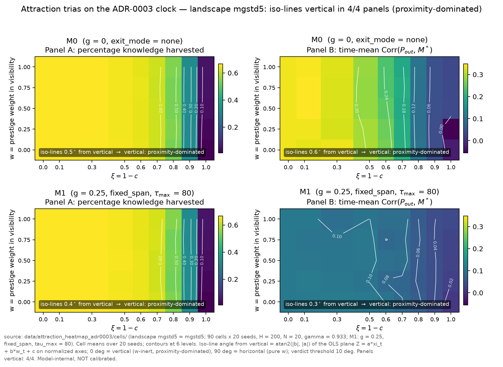
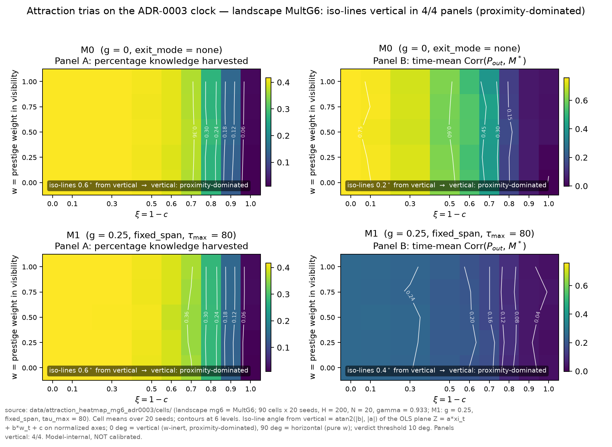
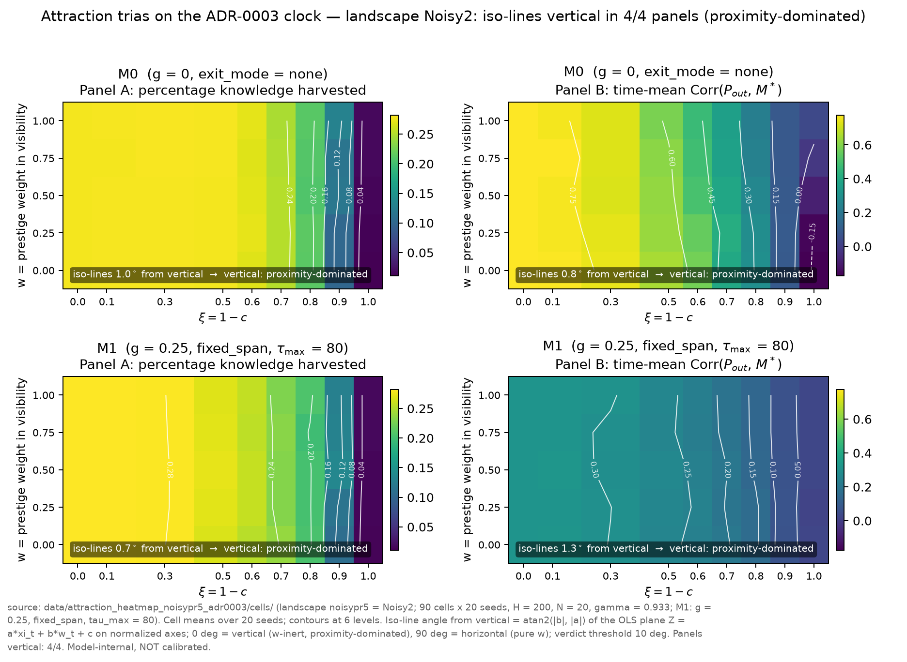

**Version 1** (November 2026)

**NOT CALIBRATED.** Model-internal exploration only (owner ruling 2026-11-13).
Every number below was written by
`scripts/attraction_heatmap/run_attraction_heatmap.py` and
`scripts/attraction_heatmap/plot_attraction_heatmap.py` from
`data/attraction_heatmap{,_mg6,_noisypr5}_adr0003/` at analysis time.

# Purpose and scope

Task `attraction-trias-landscapes` (Prompt F3b) is the landscape check for
the F3 attraction-trias result. F3 found the $w$-by-$\xi$ surfaces on
`mgstd5` **proximity-dominated**: iso-lines of both aggregates vertical in
the $(\xi, w)$ plane, with past-prestige weighting binding only at the
$\xi = 1$ herding corner. This report replicates the same 90-cell design on
two further house landscapes and reports the iso-line tilt angles $\theta$
across all three:

| Tag | Display | Bundle |
| :--- | :--- | :--- |
| `mgstd5` | mgstd5 (= `MultG2`) | `multipleGaussians {std: 5, number_gaussians: 2}` |
| `mg6` | `MultG6` | `multipleGaussians {std: 5, number_gaussians: 6}` |
| `noisypr5` | `Noisy2` | `noisyGaussian {prop_random: 5, std: 5, std_curiosity: 0.1}` |

Naming note: the prompt's "Noisy2" is the modern `noisypr5` bundle; the
legacy `Noisy2` files of the 2025/26 rounds used `std_curiosity = 0.2`
(`scripts/report_notebook/fig_3_2_breadth_vs_depth.py`), so this is a
bundle-level replication, not a bit-level replay of the legacy landscape.

# Design and run verification

Identical to F3 per landscape: $\xi = 1-c \in \{0.0, 0.1, 0.3, 0.5, 0.6,
0.7, 0.8, 0.9, 1.0\}$ $\times$ $w \in \{0.0, 0.25, 0.5, 0.75, 1.0\}$
$\times$ tiers $\{M0\ (g{=}0,\ \texttt{none}),\ M1\ (g{=}0.25,\
\texttt{fixed\_span},\ \tau_{\max}{=}80)\}$ = 90 cells $\times$ 20 seeds
(`agent_seed` 0–19) = 1,800 runs on the ADR-0003 clock ($\gamma = 0.933$,
$H = 200$, $N = 20$, grid $20 \times 20$). The runner gained a
`--landscape {mgstd5,mg6,noisypr5}` flag and writes per-landscape archives
(`mgstd5` keeps the F3 directory for checkpoint continuity); the plotter
gained the same flag and names the landscape in each figure's main title.

| Landscape | Archive | Gross / net runs | Wall | Canaries |
| :--- | :--- | :--- | :--- | :--- |
| `mgstd5` | `data/attraction_heatmap_adr0003/` | 1,800 / 1,800 (F3) | 301.7 s | OK (F3) |
| `mg6` | `data/attraction_heatmap_mg6_adr0003/` | 1,800 / 1,800 | 463.0 s | determinism OK, drift n/a (fresh), $w$-extremes OK |
| `noisypr5` | `data/attraction_heatmap_noisypr5_adr0003/` | 1,800 / 1,800 | 400.5 s | determinism OK, drift n/a (fresh), $w$-extremes OK |

In-run canaries per the F3 driver (determinism; drift probe against the
stored anchor cell; $w{=}0.0 \equiv$ `use_visibility_reward=False` and
$w{=}1.0 \equiv$ `True`). All three figures pass
`visual_qa.assert_figure_clean` with **0 failures** (layout contract; the
data layer is verified in the builder against the checkpoints, exact values
in the `_data.csv` sidecars).

# Iso-line tilt across the three landscapes

OLS plane $Z = a\,\xi_t + b\,w_t + c$ on normalized axes; $\theta =
\operatorname{atan2}(|b|, |a|)$ from vertical ($0^\circ$ = vertical,
$w$-inert, *proximity-dominated*; $90^\circ$ = horizontal, pure $w$);
verdict threshold $10^\circ$.

| Landscape | Panel | $a$ ($\xi$ slope) | $b$ ($w$ slope) | $\theta$ | Verdict |
| :--- | :--- | :--- | :--- | :--- | :--- |
| mgstd5 | $M0$ harvest | $-0.4602$ | $+0.0037$ | $0.47^\circ$ | vertical |
| mgstd5 | $M0$ Corr($P_{out}$, $M^*$) | $-0.3510$ | $+0.0039$ | $0.63^\circ$ | vertical |
| mgstd5 | $M1$ harvest | $-0.4610$ | $+0.0034$ | $0.42^\circ$ | vertical |
| mgstd5 | $M1$ Corr($P_{out}$, $M^*$) | $-0.0790$ | $-0.0005$ | $0.33^\circ$ | vertical |
| `MultG6` | $M0$ harvest | $-0.3298$ | $+0.0033$ | $0.56^\circ$ | vertical |
| `MultG6` | $M0$ Corr($P_{out}$, $M^*$) | $-0.7999$ | $-0.0031$ | $0.22^\circ$ | vertical |
| `MultG6` | $M1$ harvest | $-0.3304$ | $+0.0037$ | $0.63^\circ$ | vertical |
| `MultG6` | $M1$ Corr($P_{out}$, $M^*$) | $-0.2321$ | $-0.0016$ | $0.38^\circ$ | vertical |
| `Noisy2` | $M0$ harvest | $-0.2042$ | $+0.0035$ | $0.99^\circ$ | vertical |
| `Noisy2` | $M0$ Corr($P_{out}$, $M^*$) | $-0.8331$ | $-0.0109$ | $0.75^\circ$ | vertical |
| `Noisy2` | $M1$ harvest | $-0.2101$ | $+0.0028$ | $0.75^\circ$ | vertical |
| `Noisy2` | $M1$ Corr($P_{out}$, $M^*$) | $-0.2872$ | $-0.0067$ | $1.33^\circ$ | vertical |

**12/12 panels vertical**, $\theta \in [0.22^\circ, 1.33^\circ]$, every one
far inside the $10^\circ$ verdict threshold. Mean first differences along
$w$ are $3\%$–$8\%$ of those along $\xi$ for harvest and $10\%$–$47\%$ for
alignment (the upper end is mgstd5's $M1$ panel, where the surface is nearly
flat in absolute terms), i.e. the surface's dominant direction is $\xi$ on
every landscape.

**Selected cell means (20 seeds; full grids in the sidecars).** Corr($P_{out}$,
$M^*$), $M0$, $w = 0 \to w = 1$ at the axis ends:

| Landscape | $\xi = 0$ ($w=0$ / $w=1$) | $\xi = 1$ ($w=0$ / $w=1$) | harvest plateau | harvest $\xi=1$ ($w=0$ / $w=1$) |
| :--- | :--- | :--- | :--- | :--- |
| mgstd5 | 0.340 / 0.340 | $-0.023$ / $+0.031$ | 0.666 | 0.010 / 0.042 |
| `MultG6` | 0.759 / 0.759 | $-0.002$ / $+0.036$ | 0.415 | 0.010 / 0.019 |
| `Noisy2` | 0.775 / 0.775 | $-0.174$ / $+0.034$ | 0.277 | 0.011 / 0.016 |

**Headline contrasts (paired by `agent_seed`, 10,000 bootstrap resamples).**

| Contrast | mgstd5 | `MultG6` | `Noisy2` |
| :--- | :--- | :--- | :--- |
| $M0$ Corr, $\xi{=}1.0$: $w{=}1$ minus $w{=}0$ | $+0.0545$ $[+0.020, +0.108]$ | $+0.0382$ $[+0.005, +0.091]$ | $+0.2087$ $[+0.080, +0.347]$ |
| $M0$ harvest, $\xi{=}1.0$: $w{=}1$ minus $w{=}0$ | $+0.0320$ $[+0.021, +0.043]$ | $+0.0092$ $[+0.006, +0.012]$ | $+0.0054$ $[+0.003, +0.009]$ |
| $M1$ Corr, $\xi{=}1.0$: $w{=}1$ minus $w{=}0$ | $+0.0275$ $[+0.016, +0.039]$ | $+0.0039$ $[-0.008, +0.015]$ | $+0.0036$ $[-0.011, +0.018]$ |
| $M0$ Corr, $\xi{=}0.9$ minus $\xi{=}0$ @ $w{=}0.5$ | $-0.2969$ $[-0.443, -0.158]$ | $-0.7051$ $[-0.764, -0.643]$ | $-0.6829$ $[-0.712, -0.653]$ |
| $M1$ minus $M0$ Corr @ $\xi{=}0$, $w{=}0.5$ | $-0.2315$ $[-0.360, -0.107]$ | $-0.5040$ $[-0.569, -0.439]$ | $-0.4579$ $[-0.496, -0.421]$ |

# Figures

*mgstd5 (= `MultG2`), regenerated with the landscape named in the title*
(`output/report_notebook_v1/F_attraction_trias_heatmap.{png,pdf}`).

*`MultG6`* (`output/report_notebook_v1/F_attraction_trias_heatmap_mg6.{png,pdf}`).

*`Noisy2` (`noisypr5` bundle)*
(`output/report_notebook_v1/F_attraction_trias_heatmap_noisypr5.{png,pdf}`).
All figures: rows $M0$ / $M1$; Panel A `percentage_knowledge_harvested`,
Panel B time-mean Corr($P_{out}$, $M^*$); contours at 6 levels; per-panel
annotations carry the computed $\theta$ and verdict. Sidecars
`*_data.csv` hold every plotted value.

# Findings

**The proximity-dominated verdict replicates on all three landscapes: 12/12
panels vertical.** $\theta$ stays between $0.22^\circ$ and $1.33^\circ$
across `mgstd5`, `MultG6` and `Noisy2` — one to two orders of magnitude
inside the $10^\circ$ threshold. Weighting peer proximity by past prestige
does not tilt the aggregates anywhere; the attraction trias is governed by
the visibility axis $\xi$ and by proximity as such.

**The $\xi$ gradient dominates everywhere, and terrain composition sets
levels, not geometry.** The alignment gradient over the axis is $-0.30$
(mgstd5), $-0.71$ (`MultG6`) and $-0.68$ (`Noisy2`), 3–13$\times$ the
corner $w$ effect; harvest plateaus fall from $0.666$ to $0.415$ to $0.277$
as gaussians/noise disperse the peaks, and $M0$ alignment at $\xi = 0$ rises
($0.340$ / $0.759$ / $0.775$) — the surfaces rescale, their orientation does
not change.

**The corner correction replicates and is terrain-dependent.** At $\xi = 1$,
past-prestige weighting rescues $M0$ alignment on every landscape
($+0.055$ / $+0.038$ / $+0.209$, all paired CIs excluding zero), most
strongly on `Noisy2`, where pure peer-proximity herding drives alignment
deepest negative ($-0.174$) and $w = 1$ brings it back above zero ($+0.034$).
Under canonical $M1$ turnover the rescue is significant only on mgstd5
($+0.028$ $[+0.016, +0.039]$; `MultG6` and `Noisy2` CIs straddle zero) —
turnover already compresses the corner's severity there.

**Turnover's alignment attenuation replicates across terrains.** $M1 - M0$
at $\xi = 0$ is $-0.232$ / $-0.504$ / $-0.458$ (all CIs excluding zero),
attaching to the same geometry ($\theta \le 1.33^\circ$ on both tiers).

# QA and disclosure

All three figures pass `visual_qa.assert_figure_clean` (**0 failures**;
vision spot-check clean). Disclosed scope: the QA's rendered-artist data
contract covers bar/line/errorbar panels; heatmap meshes and contour
collections sit outside its artist inventory, so the enforced contract on
this canvas is the collision-free layout one, and the data layer is verified
in the builder (full $9 \times 5$ coverage per tier, 20 seeds/cell, plotted
matrix == checkpointed cell means) with exact values in the sidecars.

**Caveats.** The vertical/tilted verdict uses the declared $10^\circ$
convention on an OLS plane fit over normalized axes; $\theta$ is descriptive
over 45 cell means per panel, the paired contrasts are the inferential
statements. "Noisy2" denotes the modern `noisypr5` bundle
(`std_curiosity = 0.1`, not the legacy 0.2). The mgstd5 figure was
regenerated with the named title and reproduces the F3 tilt values exactly.

# Provenance

- Runner (extended with `--landscape`):
  `scripts/attraction_heatmap/run_attraction_heatmap.py` -> per-landscape
  checkpoints and manifests under `data/attraction_heatmap{,_mg6,_noisypr5}_adr0003/`
  (schema `attraction_heatmap_adr0003_v2` for the F3b archives; the F3
  mgstd5 manifest is preserved untouched).
- Plotter (extended with `--landscape`, named titles):
  `scripts/attraction_heatmap/plot_attraction_heatmap.py` ->
  `output/report_notebook_v1/F_attraction_trias_heatmap{,_mg6,_noisypr5}.{png,pdf}`
  + `_data.csv` sidecars.
- F3 origin: `output/reports/attraction_heatmap_v1.{md,pdf}` (mgstd5 sweep,
  method and QA scope); governance ADR-0001/-0002/-0003 as cited there.
