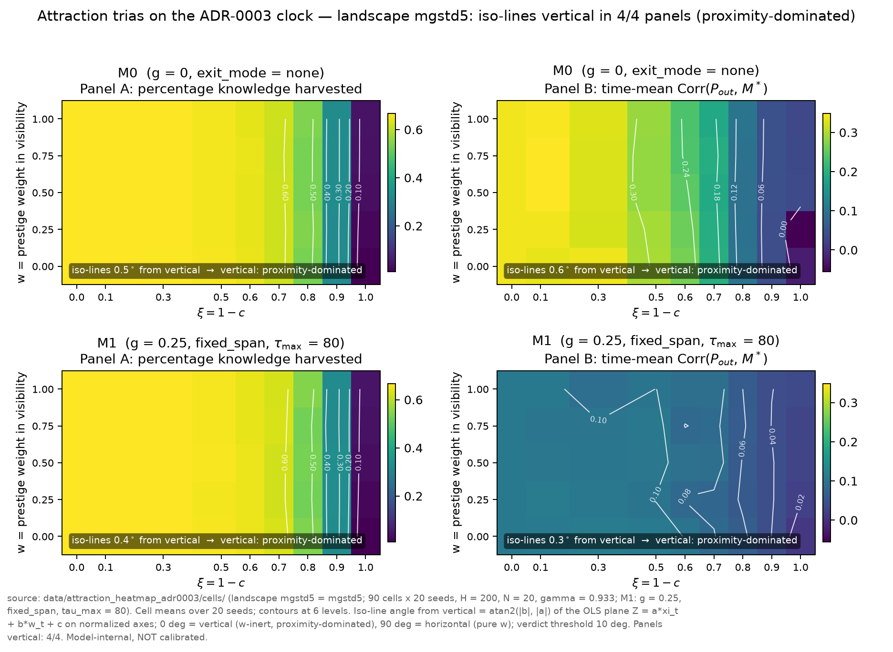

**Version 1** (November 2026)

**NOT CALIBRATED.** Model-internal exploration only (owner ruling 2026-11-13);
the ADR-0003 values are conceptual scale anchors, not empirical fits. Every
number below was written by
`scripts/attraction_heatmap/run_attraction_heatmap.py` and
`scripts/attraction_heatmap/plot_attraction_heatmap.py` from
`data/attraction_heatmap_adr0003/` at analysis time.

# Purpose and scope

Task `attraction-trias-heatmap` (Prompt F3, worktree
`task/attraction-trias-heatmap`) extends the model by one backward-compatible
lever and maps its interaction with the visibility axis on the ADR-0003
clock. The new knob **`prestige_weight_in_visibility`** ($w \in [0, 1]$)
interpolates the visibility denominator between *unweighted* mean Manhattan
distance to peers (continuous peer proximity, $w = 0$) and
*prestige-vanishing-weighted* mean distance (past-prestige-modulated
proximity, $w = 1$):

$$d_{\text{eff}}(w) = (1-w)\,d_{\text{own}} + w\,d_{\text{own},P},
\qquad
V_{\text{eff}}(w) = \frac{\bar{d}_{\text{global}} + 1}{d_{\text{eff}}(w) + 1}$$

with $d_{\text{own},P}$ falling back to $d_{\text{own}}$ when total
`prestige_vanishing == 0`. The 2D sweep ($\xi = 1-c$ against $w$) then
answers one structural question per panel: are the metric's **iso-lines
vertical** (the metric tracks $\xi$ only — *proximity-dominated*) or **tilted
by $w$** (*past-prestige-modulated*)?

# Backward-compatible code extension

**`sciencemodels/model.py`** adds `prestige_weight_in_visibility: float | None
= None` to `MyModel.__init__`, validated to $[0, 1]$ when not `None`
(`ValueError` on out-of-range and NaN). **`sciencemodels/agents.py`**
(`Scientist.compute_all_rewards`) resolves the visibility term: `None` keeps
the pre-existing code path byte-for-byte ($w = 1$ if
`use_visibility_reward=True`, $w = 0$ if `False`); a set $w$ computes
$V_{\text{eff}}(w)$ as above.

**Canary (tests/test_smoke.py #14), all PASS.** (a) `None` is bit-identical
to the pre-edit code path — asserted against two report digests measured in
the pre-edit tree (branch point `fb797fb`), so the equality is an identity
claim, not a tolerance. (b) $w = 0.0$ is bit-identical to
`use_visibility_reward=False`, reports and full `model_vars` trajectories
alike. (c) $w = 1.0$ is bit-identical to `use_visibility_reward=True`. (d)
$w = 0.5$ binds: trajectories move off both extremes and stay finite.
Out-of-range and NaN values are refused. `tests/test_smoke.py`:
**ALL SMOKE TESTS PASSED**.

# Design and run verification

| Item | Spec |
| :--- | :--- |
| Grid | $\xi = 1-c \in \{0.0, 0.1, 0.3, 0.5, 0.6, 0.7, 0.8, 0.9, 1.0\}$ $\times$ $w \in \{0.0, 0.25, 0.5, 0.75, 1.0\}$ $\times$ tiers $\{M0, M1\}$ = 90 cells |
| Tiers | $M0$: $g = 0$, `exit_mode="none"`; canonical $M1$: $g = 0.25$, `exit_mode="fixed_span"`, `tau_max = 80` |
| ADR-0003 clock | $\gamma = 0.5^{1/10} \approx 0.933$, $H = 200$ steps, $N = 20$, grid $20 \times 20$, `mgstd5` (multipleGaussians, std 5, 2 gaussians) |
| Seeds | `agent_seed` 0–19 (drives agent + landscape RNG jointly), 20 per cell |
| Gross / net | 90 cells × 20 seeds = **1,800 runs requested / 1,800 completed**, 0 failed, 0 crashed (wall 301.7 s, `n_jobs=3`) |
| Metrics | Panel A: `percentage_knowledge_harvested`; Panel B: `Mean_of_Corr_prestige_ideal_merit` = time-mean Corr($P_{out}$, $M^*$) |
| Checkpoints | one CSV per cell under `data/attraction_heatmap_adr0003/cells/`, atomic writes; restarts skip completed cells (exercised: one timeout kill resumed from 24/90 checkpoints with zero loss) |

**In-run canaries (all OK on the writing run).** Determinism (same seeded
run twice, every key exact); drift probe (seed 0 of the anchor cell re-run
and diffed exactly against its stored checkpoint row — a code change under a
stored cell aborts the run instead of writing outputs; the first
implementation caught a real comparison defect, int `80` vs float `80.0`
after the CSV round-trip, and NaN `gap_recent` on $M0$, both fixed in the
comparison signature, not in the model); $w$-extreme identity ($w = 0.0 \equiv$
`use_visibility_reward=False`, $w = 1.0 \equiv$ `True`) on a short config.
Manifest: `data/attraction_heatmap_adr0003/manifest.json`.

# Results

**Iso-line tilt (OLS plane $Z = a\,\xi_t + b\,w_t + c$ on normalized axes;
$\theta = \operatorname{atan2}(|b|,|a|)$ from vertical; $0^\circ$ = vertical,
$w$-inert; verdict threshold $10^\circ$).**

| Panel | $a$ ($\xi$ slope) | $b$ ($w$ slope) | $\theta$ | Verdict |
| :--- | :--- | :--- | :--- | :--- |
| $M0$ harvest | $-0.4602$ | $+0.0037$ | $0.47^\circ$ | vertical: proximity-dominated |
| $M0$ Corr($P_{out}$, $M^*$) | $-0.3510$ | $+0.0039$ | $0.63^\circ$ | vertical: proximity-dominated |
| $M1$ harvest | $-0.4610$ | $+0.0034$ | $0.42^\circ$ | vertical: proximity-dominated |
| $M1$ Corr($P_{out}$, $M^*$) | $-0.0790$ | $-0.0005$ | $0.33^\circ$ | vertical: proximity-dominated |

**Cell means (20 seeds).** Panel A, `percentage_knowledge_harvested`:

| | $\xi=0.0$ | 0.1 | 0.3 | 0.5 | 0.6 | 0.7 | 0.8 | 0.9 | 1.0 |
| :--- | :--- | :--- | :--- | :--- | :--- | :--- | :--- | :--- | :--- |
| $M0$ $w{=}0$ | 0.666 | 0.665 | 0.665 | 0.657 | 0.644 | 0.618 | 0.533 | 0.324 | 0.010 |
| $M0$ $w{=}1$ | 0.666 | 0.665 | 0.665 | 0.657 | 0.641 | 0.618 | 0.539 | 0.327 | 0.042 |
| $M1$ $w{=}0$ | 0.667 | 0.667 | 0.665 | 0.659 | 0.648 | 0.628 | 0.539 | 0.327 | 0.009 |
| $M1$ $w{=}1$ | 0.667 | 0.667 | 0.667 | 0.658 | 0.642 | 0.625 | 0.546 | 0.324 | 0.045 |

(intermediate $w \in \{0.25, 0.5, 0.75\}$ interpolate monotonically in the
corner; full grid in the sidecar CSV). Panel B, time-mean
Corr($P_{out}$, $M^*$):

| | $\xi=0.0$ | 0.1 | 0.3 | 0.5 | 0.6 | 0.7 | 0.8 | 0.9 | 1.0 |
| :--- | :--- | :--- | :--- | :--- | :--- | :--- | :--- | :--- | :--- |
| $M0$ $w{=}0$ | 0.340 | 0.334 | 0.338 | 0.295 | 0.264 | 0.200 | 0.099 | 0.040 | $-0.023$ |
| $M0$ $w{=}0.5$ | 0.340 | 0.347 | 0.325 | 0.282 | 0.247 | 0.188 | 0.094 | 0.043 | 0.035 |
| $M0$ $w{=}1$ | 0.340 | 0.344 | 0.327 | 0.286 | 0.234 | 0.186 | 0.100 | 0.045 | 0.031 |
| $M1$ $w{=}0$ | 0.108 | 0.109 | 0.113 | 0.109 | 0.099 | 0.081 | 0.064 | 0.040 | 0.008 |
| $M1$ $w{=}0.5$ | 0.108 | 0.105 | 0.103 | 0.105 | 0.093 | 0.091 | 0.059 | 0.041 | 0.026 |
| $M1$ $w{=}1$ | 0.108 | 0.108 | 0.089 | 0.100 | 0.090 | 0.091 | 0.060 | 0.040 | 0.036 |

**Headline contrasts (paired by `agent_seed`, 10,000 bootstrap resamples).**

| Contrast | $\Delta$ | 95% CI |
| :--- | :--- | :--- |
| $M0$ Corr, $\xi{=}1.0$: $w{=}1$ minus $w{=}0$ | $+0.0545$ | $[+0.020, +0.108]$ |
| $M0$ harvest, $\xi{=}1.0$: $w{=}1$ minus $w{=}0$ | $+0.0320$ | $[+0.021, +0.043]$ |
| $M1$ Corr, $\xi{=}1.0$: $w{=}1$ minus $w{=}0$ | $+0.0275$ | $[+0.016, +0.039]$ |
| $M0$ Corr, $\xi{=}0.9$ minus $\xi{=}0$ @ $w{=}0.5$ | $-0.2969$ | $[-0.443, -0.158]$ |
| $M0$ harvest, $\xi{=}0.9$ minus $\xi{=}0$ @ $w{=}0.5$ | $-0.3383$ | $[-0.349, -0.327]$ |
| $M1$ minus $M0$ Corr @ $\xi{=}0$, $w{=}0.5$ | $-0.2315$ | $[-0.363, -0.107]$ |

# Figure

*Attraction-trias heatmap* (`data/attraction_heatmap_adr0003/`, 90 cells ×
20 seeds, ADR-0003 clock). Rows: $M0$ (closed cohort) and canonical $M1$
($g = 0.25$, `fixed_span`, $\tau_{\max} = 80$). Columns: Panel A
`percentage_knowledge_harvested`, Panel B time-mean Corr($P_{out}$, $M^*$).
Contours at 6 levels; each panel's annotation carries the computed
iso-line angle from vertical and the verdict. Vector companion
`F_attraction_trias_heatmap.pdf`; exact plotted values in
`F_attraction_trias_heatmap_data.csv`.

# Findings

**Contours are vertical in 4/4 panels: the attraction trias is
proximity-dominated.** Iso-lines sit $0.33^\circ$–$0.63^\circ$ from vertical
($w$-slopes $|b| \le 0.004$ against $\xi$-slopes $|a| = 0.08$–$0.46$);
mean first differences along $w$ are $3\%$–$5\%$ of those along $\xi$ for
Panel A and $16\%$–$47\%$ for Panel B (the Panel B ratio inflates where the
$M1$ surface is nearly flat in absolute terms). Whether proximity is
weighted by past prestige or not barely moves the aggregates: what pulls
agents is proximity to peers as such.

**The $\xi$ axis carries the whole story, with the kink at $\xi \approx
0.7$–$0.9$ and the collapse at $\xi = 1$.** Harvest share holds
$0.66$–$0.67$ up to $\xi = 0.5$, falls through $0.53$–$0.62$ at
$\xi = 0.7$–$0.8$, and collapses to $0.01$–$0.04$ at $\xi = 1$; the
alignment gradient is $-0.297$ over the axis (paired CI excluding zero).
The $w$ contrast at the same cells is an order of magnitude smaller.

**The $w$ lever binds exactly at the herding corner.** At $\xi = 1$, where
pure peer proximity collapses production and turns $M0$ alignment slightly
negative ($-0.023$), past-prestige weighting ($w = 1$) cushions the harvest
collapse ($0.010 \to 0.042$) and flips alignment positive ($+0.031$):
paired $\Delta = +0.0545$ $[+0.020, +0.108]$ ($M0$) and $+0.0275$
$[+0.016, +0.039]$ ($M1$). Past prestige is a corner-corrective, not a
contour-tilter: it matters when visibility herding is maximal, and is
negligible elsewhere.

**Canonical turnover compresses alignment without changing the geometry.**
$M1$ starts at $0.108$ where $M0$ reads $0.340$ ($\Delta = -0.232$
$[-0.363, -0.107]$ at $\xi = 0$) and stays flatter along $\xi$ ($a = -0.079$
vs. $-0.351$), yet its contours are just as vertical ($\theta = 0.33^\circ$):
turnover attenuates the prestige signal but does not change which lever
the metric responds to.

# QA and disclosure

The figure passes `visual_qa.assert_figure_clean` with **0 failures** (vision
spot-check clean). Disclosed scope: the QA's rendered-artist *data* contract
covers bar/line/errorbar panels; heatmap meshes and contour collections sit
outside its artist inventory, so what is enforced on this canvas is the full
*collision-free layout* contract (canvas clipping, pairwise text overlap
including titles, duplicate legend labels). The data layer is verified in the
builder instead: full $9 \times 5$ cell coverage per tier, 20 seeds and
`agent_seed` 0–19 per cell, all values finite, plotted matrix == checkpointed
cell means, exact values persisted in the sidecar CSV.

**Caveats.** The vertical/tilted verdict uses a declared $10^\circ$
convention on the OLS plane fit over normalized axes; the tilt statistic is
descriptive (45 cell means), and the corner contrasts are the inferential
statements. Cell means pool 20 seeds without trimming. Metric is the
time-mean house read (`Mean_of_Corr_prestige_ideal_merit` = time-mean
Corr($P_{out}$, $M^*$)); Panel A is the terminal harvest share. No empirical
claim rides on these surfaces.

# Provenance

- Code extension: `sciencemodels/model.py` (`prestige_weight_in_visibility`
  parameter + validation), `sciencemodels/agents.py`
  (`Scientist.compute_all_rewards` resolution rule), `tests/test_smoke.py`
  (canary #14 with pre-edit digests).
- Sweep: `scripts/attraction_heatmap/run_attraction_heatmap.py` -> checkpoints
  `data/attraction_heatmap_adr0003/cells/cell_xi{tag}_w{tag}_{tier}.csv`,
  manifest `data/attraction_heatmap_adr0003/manifest.json`
  (`attraction_heatmap_adr0003_v1`, gross/net 1,800/1,800).
- Figure: `scripts/attraction_heatmap/plot_attraction_heatmap.py` ->
  `output/report_notebook_v1/F_attraction_trias_heatmap.{png,pdf}` +
  `_data.csv` sidecar.
- Governance: ADR-0001 (worktree isolation, inbox log handoff, checkpointing,
  canary discipline), ADR-0002 (scripts over notebooks, seeded runs, tagged
  outputs), ADR-0003 (6-month clock: $\gamma = 0.933$, $H = 200$,
  `tau_max = 80`, $g = 0.25$).
