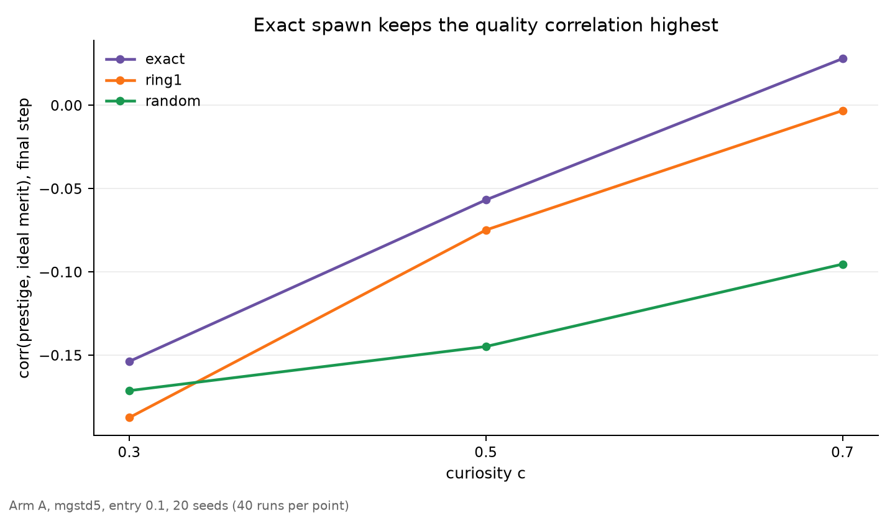
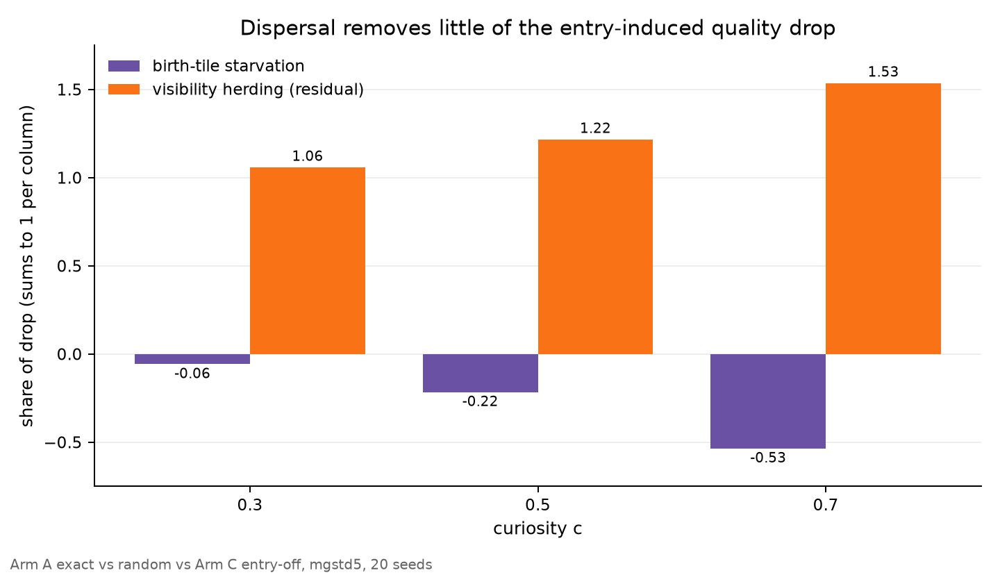
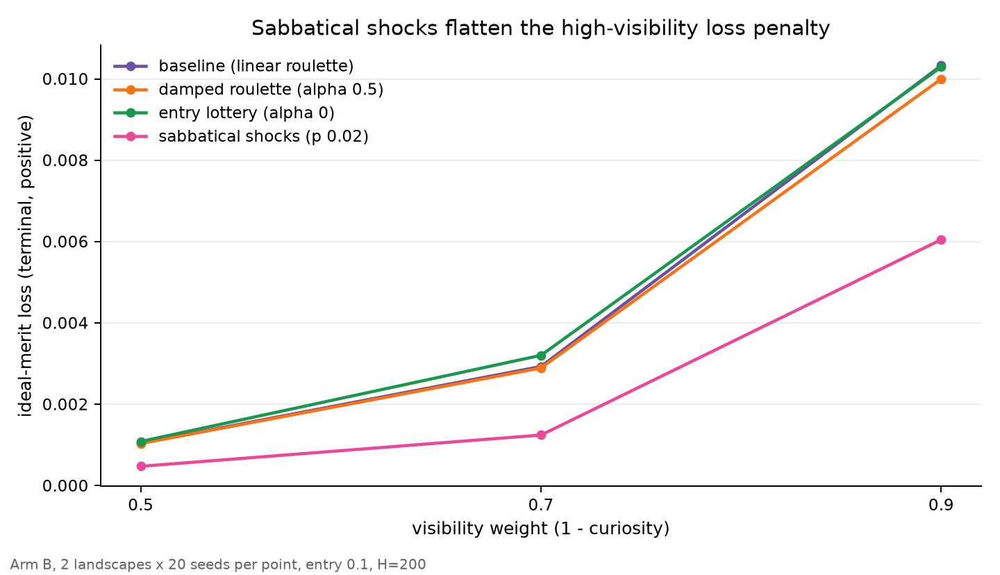
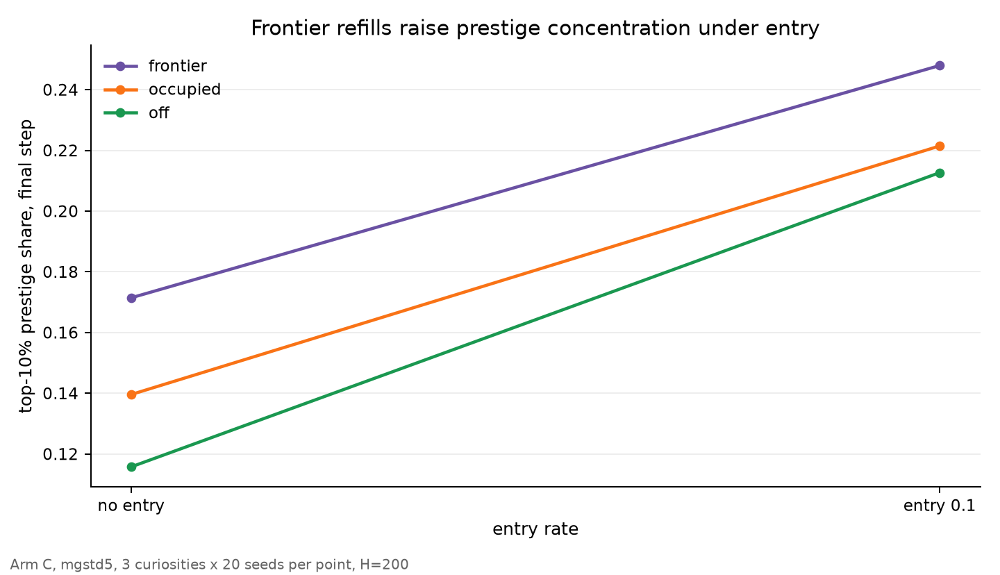

**Version 1** (November 2026)

> **STATUS: MODEL-INTERNAL, NOT CALIBRATED** (owner ruling, 2026-11-13).
> Three driver-side probes of the counterforce mechanisms filed as `P-0002`,
> `P-0003` and `P-0004`: 72 cells, 1,440 runs, $H = 200$, 20 seeds per cell.
> **No model file was edited** -- every knob lives in a driver-side subclass
> of `MyModel` (`scripts/interventions/run_interventions_v1.py`) with a
> bit-identity proof at baseline defaults. Every number below is recomputed
> from `data/interventions_v1/cells/`.

# Method and gates

`InterventionsModel(MyModel)` adds four inert-by-default knobs: `r_spawn`
(birth tile), `alpha` (supervisor roulette exponent), `p_reloc`
(sabbatical relocation rate) and `refill_mode` (new-question regime). The
supervisor roulette becomes $P(\text{sup}_i) \propto \text{prestige}_i^{\alpha}$;
at $\alpha = 1.0$ the weight vector is bit-identical to the model's raw
prestige, which is what makes the identity proof possible.

| Gate | Result |
| --- | --- |
| Bit-identity, baseline $(r_{\text{spawn}}=$exact$, \alpha=1.0, p_{\text{reloc}}=0,$ refill off) vs plain `MyModel` | 8 checks (2 landscapes x 3 seeds + 2 `occupied` vs `new_questions=True`), **worst difference 0.0** across all shared reporters |
| Binding: each knob changes dynamics | `r_spawn` 33 keys, `alpha` 31, `p_reloc` 35, `refill` 33 |
| Schema of a worker-written cell file | 4 rows, 75 columns, 0 missing |
| Cross-arm control (Arm A `exact` vs Arm C `off`, identical parameters, seed for seed) | 60 pairs, **worst difference 0.0** |
| Cross-round control (my Arm A `exact`, $c=0.5$, mgstd5, $g=0.1$ vs the re-measure round's T1 post-audit cell) | 20 seeds, **bit-identical** ($-0.05675129043796044$ on both sides; top-10% $0.21445080779161105$ on both sides) |
| Timing (one run) | 0.73 s entry-off, 1.15 s entry-on, 1.24 s with relocation on |

**Gross versus net:** `GROSS cells=72 runs=1440 | NET ok_cells=72
ok_with_failures=0 crashed=0 runs_ok=1440 runs_failed=0 wall=797.2s`
(13.3 minutes at `n_jobs=3`; 72 cells x 20 seeds, all rows verified by
atomic read-back before the state file was written).

Grids exactly as specified: **A** 3 spawn modes x 3 curiosities x 2
landscapes = 18 cells; **B** 3 $\alpha$ x 2 relocation rates x 3 visibility
weights x 2 landscapes = 36 cells; **C** 3 refill modes x 3 curiosities x 2
entry rates = 18 cells (mgstd5). Fixed: $g=0.1$ except Arm C, vanishing
0.9, $n=20$, $20 \times 20$ torus, $\epsilon = 0.1$, $h = 0.02$.

# Result A (P-0002): birth-tile starvation is not what breaks the wedge

**Figure 1.** Final prestige-ideal correlation by birth-placement rule,
mgstd5, entry 0.1. Source: `data/interventions_v1/cells/cellA_*`, 20 seeds
(40 runs per point).

Dispersing the birth tile does **not** repair the entry-induced quality
drop -- it widens it. Against the in-round entry-off reference (Arm C,
refill off, $g=0$, mgstd5):

| curiosity | entry off | exact | ring1 | random | total drop | drop after dispersal | starvation share | herding share |
| --- | --- | --- | --- | --- | --- | --- | --- | --- |
| 0.3 | +0.154 | -0.154 | -0.187 | -0.171 | 0.308 | 0.325 | **-5.7%** | 105.7% |
| 0.5 | +0.352 | -0.057 | -0.075 | -0.145 | 0.409 | 0.497 | **-21.5%** | 121.5% |
| 0.7 | +0.259 | +0.028 | -0.003 | -0.095 | 0.231 | 0.354 | **-53.5%** | 153.5% |

The decomposition is $D_{\text{total}} = (\text{off} - \text{random}) +
(\text{random} - \text{exact})$: the first term is the residual that
dispersal cannot remove, the second is what dispersal recovers. The
starvation share comes out **negative at every curiosity level** -- exact
spawn is the *least bad* placement -- so the residual (prestige-proportional
recruitment plus visibility herding) accounts for 106% to 153% of the drop.

**Figure 2.** Share of the entry-induced quality drop by mechanism; shares
sum to 1 per column and are negative where dispersal worsened the outcome.

The newcomer gap tells the same story from the other side. Dispersal
**widens** it everywhere: by 0.08% to 2.6% on mgstd5 and by 5.0% to 12.0%
on noisypr5 (magnitudes: exact -0.0179/-0.0191/-0.0194 vs random
-0.0179/-0.0194/-0.0199 on mgstd5; -0.0066/-0.0067/-0.0065 vs
-0.0069/-0.0074/-0.0073 on noisypr5).

**Reading.** `CONT1`'s Act I splits the failure into *positional
inheritance* (where advisees start) and *evaluative attraction* (where
visibility pulls them). On these grids the first channel is not the driver:
removing birth-tile inheritance entirely leaves the quality flip intact and
makes the gap slightly worse. The mechanism sits in recruitment and herding,
which dispersal does not touch. This is a negative result for `P-0002`'s
stated hypothesis, reported as such.

# Result B (P-0003): shocks flatten the penalty, lotteries do not

**Figure 3.** Terminal ideal-merit loss against the visibility weight, by
intervention. Source: `cells/cellB_*`, 2 landscapes x 20 seeds per point.

The $\xi^{*}$ kink lives in the high-weight penalty, so the probe reports
the penalty $\text{loss}(0.9) - \text{loss}(0.5)$, the discrete convexity
$\text{loss}(0.9) - 2\,\text{loss}(0.7) + \text{loss}(0.5)$, and both
relative to the baseline row:

| $\alpha$ | $p_{\text{reloc}}$ | penalty | vs baseline | convexity | vs baseline | loss at 0.9 | vs baseline | quality at 0.9 | top-10% at 0.9 |
| --- | --- | --- | --- | --- | --- | --- | --- | --- | --- |
| 1.0 | 0.00 | 0.009286 | -- | 0.005517 | -- | 0.010330 | -- | -0.2572 | 0.2091 |
| 1.0 | 0.02 | 0.005573 | **-0.003713** | 0.004037 | **-0.001480** | 0.006047 | **-0.004283** | -0.2476 | 0.2017 |
| 0.5 | 0.00 | 0.008964 | -0.000322 | 0.005250 | -0.000267 | 0.009998 | -0.000332 | -0.2604 | 0.2067 |
| 0.5 | 0.02 | 0.005635 | -0.003652 | 0.004217 | -0.001299 | 0.006145 | -0.004185 | -0.2425 | 0.2018 |
| 0.0 | 0.00 | 0.009207 | -0.000079 | 0.004971 | -0.000545 | 0.010292 | -0.000038 | -0.2529 | 0.2039 |
| 0.0 | 0.02 | 0.005387 | -0.003899 | 0.003885 | -0.001632 | 0.005863 | -0.004467 | -0.2391 | 0.2027 |

**Sabbatical shocks cut the high-weight penalty by about 40%**
(0.00929 to 0.00557), the convexity by 27% and the loss at weight 0.9 by
41%, and they improve the quality correlation at weight 0.9 from -0.2572 to
between -0.2476 and -0.2391. **Entry lotteries do essentially nothing to
the penalty** ($\alpha=0$: -0.9%, i.e. -0.000079 in absolute terms) and
neither does concave damping (-3.5%); the lottery's only visible effect is
a small drop in concentration (top-10% 0.2091 to 0.2039 at weight 0.9).

**Answer to the brief's question.** On this evidence the transient-diversity
shock, not the recruitment lottery, is what flattens the high-visibility
loss penalty -- which is the direction a rightward shift of $\xi^{*}$ would
take. The lottery relaxes *who gets in* without changing how the community
spends its attention, and the kink is an attention-side phenomenon.

# Result C (P-0004): bailouts lock the herd in, frontier questions go unclaimed

**Figure 4.** Top-10% prestige share by entry rate and refill regime,
mgstd5. Source: `cells/cellC_*`, 3 curiosities x 20 seeds per point.

| refill | entry | quality | top-10% | explored | mean grid knowledge | best knowledge | newcomer gap | ideal-merit loss |
| --- | --- | --- | --- | --- | --- | --- | --- | --- |
| off | 0.0 | +0.255 | 0.116 | 0.347 | 0.0009 | 0.0075 | -- | 0.0014 |
| off | 0.1 | -0.061 | 0.213 | 0.377 | 0.0006 | 0.0047 | -0.019 | 0.0016 |
| occupied | 0.0 | +0.594 | 0.140 | **0.060** | 0.0123 | 0.5565 | -- | 0.1136 |
| occupied | 0.1 | -0.045 | 0.221 | **0.061** | 0.0106 | 0.5435 | **-0.451** | 0.2046 |
| frontier | 0.0 | +0.420 | 0.171 | 0.288 | 0.1861 | 0.9922 | -- | 0.2515 |
| frontier | 0.1 | **+0.078** | **0.248** | 0.330 | 0.1895 | 0.9917 | **-0.567** | 0.5085 |

- **Occupied refill (incumbent bailout) is hard lock-in.** Exploration
  collapses from 0.377 to **0.061** of the grid: the herd stands on its
  refilled tile and never leaves. Quality stays negative under entry
  (-0.045 against -0.061 without refills) and the newcomer gap widens
  eleven-fold, to -0.451.
- **Frontier refill is the only regime with a positive quality correlation
  under entry** (+0.078), but it buys that with the highest concentration
  (top-10% 0.248) and the widest newcomer gap (-0.567). The new questions
  accumulate unclaimed: mean grid knowledge rises to 0.189 against 0.0006
  in the baseline, while exploration (0.330) stays *below* the no-refill
  level (0.377). The paradigm shifts; the herd does not follow -- the
  status-quo lock-in `CONT1` describes is visible as a stock of unharvested
  frontier knowledge.

**Supply caveat.** Refills add knowledge to a grid whose depletion metric is
normalised to the initial stock, so `percentage_knowledge_harvested` goes
negative by construction under both refill regimes (to -3.3 and -74.8) and
the ideal-merit loss grows with the supply rather than with inefficiency.
Arm C is therefore compared on structure -- exploration, concentration,
correlation, gap -- not on welfare levels.

# Needs reported rather than changed

- **`P-0002`'s hypothesis is rejected on these grids** (negative starvation
  share at all three curiosities). `CONT1` Act I should be updated before
  the mechanism story is written up; the decomposition itself needs no
  further runs.
- **"Trapped" is operationalised** as standing on a tile with knowledge
  below 0.025, the model's own depletion threshold. `P-0003` said "trapped
  in a stationary cluster"; an owner ruling may prefer "did not move for $k$
  steps", which needs a position history the model does not keep.
- **Arm B has three weight points**, so the kink *location* is not
  identified here -- the original $\xi^{*} \in [0.6, 0.8]$ came from the
  five-point welfare sweep. Locating it again under intervention costs 18
  extra cells (5 weights instead of 3).
- **The two refill regimes differ in consumption as well as location**:
  occupied refills are harvested immediately, frontier refills accumulate.
  A fixed refill *rate* rather than one refill per depleted occupied tile
  would make the regimes supply-comparable.
- No parameter here is fitted; empirical moments play no role in any of the
  three probes.

# Reproduction

| Claim | Artifact |
| --- | --- |
| Driver, subclass, proofs | `scripts/interventions/run_interventions_v1.py` (`--probe` runs identity, binding, schema, timing) |
| Analysis and figures | `scripts/interventions/analyse_interventions.py` |
| Run archive | `data/interventions_v1/cells/` (72 CSVs), `state/`, `run_log.txt`, `design.json`, `probe/probe_results.json` |
| Figures 1-4 | `data/interventions_v1/figures/FA1..FC.png` |
| Tables | `q1_spawn_decomposition.csv`, `q1_newcomer_gap.csv`, `q2_loss_curve.csv`, `q2_intervention_summary.csv`, `q3_refill_lockin.csv` in `data/interventions_v1/` |
| Gate | `MPLBACKEND=Agg python3 tests/test_smoke.py` -- ALL SMOKE TESTS PASSED, 56 report keys |

# Revision Log

- **Version 1** (November 2026) --- First interventions round: 72-cell
  three-arm probe (P-0002 spawn dispersal, P-0003 lotteries and shocks,
  P-0004 refill regimes) with bit-identity, binding, schema and timing
  proofs, two in-repo controls (cross-arm and cross-round, both 0.0), four
  house-style figures, and the three answers the owner asked for: the
  birth-tile channel is not the driver, shocks flatten the loss penalty
  while lotteries do not, and occupied refills collapse exploration while
  frontier questions accumulate unclaimed.
