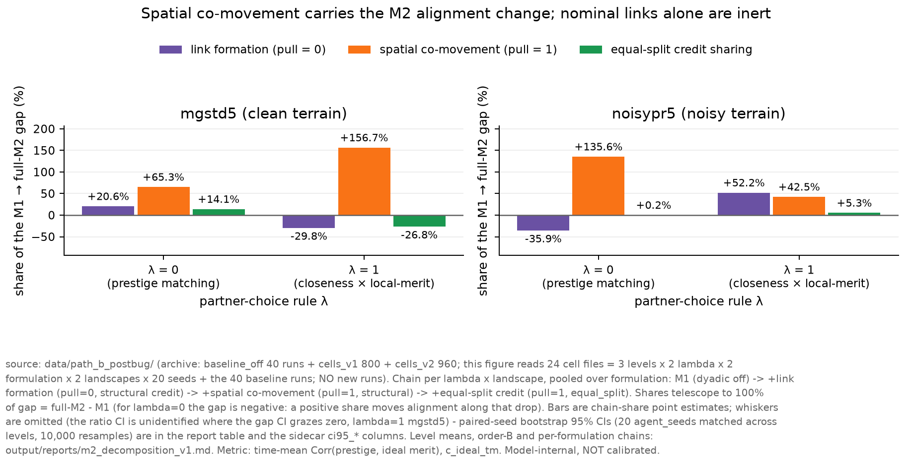

**Version 1** (November 2026)

**NOT CALIBRATED.** Model-internal exploration only (owner ruling 2026-11-13).
Every number below was written by
`scripts/report_notebook/fig_M2_decomposition_v1.py` from
`data/path_b_postbug/` at analysis time. **No new runs**: the archive already
contains every cell the decomposition needs (verified in the cell inventory
below), so no sweep was launched.

# Purpose and scope

Workplan §2.3 item 12 (independent; external helper prompt H4) asks for the
counterfactual ablation-share decomposition of the birth-tile figure — the
entry-induced drop decomposition called "Figure 9" in the workplan
(`FA2_v2_drop_decomposition`, builder
`scripts/report_notebook/fig_FA2_v2_arm_a_decomposition.py`, paper §4.2 and
the Section 8 figure-to-artifact map) — to be extended to one additional
contested model lever. This report applies it to `dyadic_move_pull` in
**Tier M2**, isolating the three mechanisms the dyadic layer adds on top of
the `M1` baseline: **link formation only** (`pull = 0`), **spatial
co-movement** (`pull = 1`) and **equal-split credit sharing**, across the two
partner-choice rules $\lambda \in \{0, 1\}$ on both Path B landscapes.

The deliverable is the verification table (levels, gap, shares, decomposition
identity) and the draft figure below. Everything is read from the post-`BUG-0006`
archive `data/path_b_postbug/` (baseline 40 + `cells_v1` 800 + `cells_v2` 960
runs); the seed-matched design (`agent_seed` 0–19 drives agent and landscape
RNG jointly) is asserted during loading, including `landscape_seed` alignment
between the baseline and every cell file.

# Method: the counterfactual chain

Figure 9 decomposes the entry-induced drop in `corr(prestige, ideal)` into
two additive shares from three counterfactual levels: the $M0$ reference
($g = 0$), the full mechanism (`exact` spawn) and one ablation arm (`random`
spawn). With $\text{drop} = M0 - \text{exact}$, the starvation share is
$(\text{random} - \text{exact})/\text{drop}$ and the herding share is
$(M0 - \text{random})/\text{drop}$; the two telescope to exactly $100\%$.

The Tier M2 analogue replaces the entry mechanism by the dyadic layer and
walks a counterfactual chain through its three components, in the order the
prompt names them (chain A, the primary convention):

| Level | Configuration | Archive source |
| :--- | :--- | :--- |
| $M1$ (reference) | dyadic layer off | `baseline_off.csv` (20 runs/landscape) |
| $+\,$link formation only | links declared, `pull = 0`, structural credit | `cells_v1/cell_lam{000,100}_{logit,threshold}_struct_{land}.csv` |
| $+\,$spatial co-movement | `pull = 1`, structural credit | `cells_v2/cell_lam{000,100}_pull100_{logit,threshold}_struct_{land}.csv` |
| $+\,$equal-split credit (full $M2$) | `pull = 1`, `equal_split` | `cells_v2/cell_lam{000,100}_pull100_{logit,threshold}_equal_{land}.csv` |

With $\Delta = \text{full-}M2 - M1$, each step divided by $\Delta$ is that
mechanism's share of the $M1 \to$ full-$M2$ alignment change, and the three
shares sum to exactly $100\%$ (asserted to $10^{-9}$ at point estimates and
across all bootstrap replicates). Two conventions matter for reading the
signs. First, for $\lambda = 0$ the gap is *negative* (the layer degrades
alignment below $M1$), so a positive share means the step pushes alignment
down along that drop (a negative share runs against the total change). Second, this is a *sequential* decomposition: the two
non-inert steps (pull, credit) interact, so their individual shares depend on
the order in which the steps are taken. Chain B (credit step before the pull
step) is reported as robustness; the co-movement share is stable within
$7.7\,\text{pp}$ across the two orderings.

**Metric.** Time-mean `Corr(prestige, ideal merit)` (`c_ideal_tm`), the
alignment metric the Tier M2 section of the paper uses throughout; the
archive aggregates to time means, and Figure 9's terminal metric is not
extracted in this archive. Secondary chains are run for `mean_team_size`
(`team_tm`, the production moment) and the prestige-ideal wedge
(`c_local_tm - c_ideal_tm`). **Levels** are pooled over formulation
(`logit`/`threshold`), $n = 40$ runs per level ($2 \times 20$ seeds; $M1$
$n = 20$). **Uncertainty:** paired bootstrap over the 20 `agent_seed` values,
10,000 resamples; an unpaired (independent-per-level) bootstrap is reported as
robustness, because enabling the dyadic layer shifts the RNG stream, so
same-seed cross-level runs are seed-matched but not bit-paired.

# Data and cell inventory

| Level (chain A) | Files | Runs |
| :--- | :--- | :--- |
| $M1$ (dyadic off) | `baseline_off.csv` | 40 (2 landscapes $\times$ 20 seeds) |
| link formation only (`pull = 0`, structural) | `cells_v1/cell_lam{000,100}_{logit,threshold}_struct_*` | 160 (8 cells $\times$ 20 seeds) |
| `pull = 0`, equal-split (chain-robustness arm) | `cells_v1/cell_lam{000,100}_{logit,threshold}_equal_*` | 160 |
| spatial co-movement (`pull = 1`, structural) | `cells_v2/cell_lam{000,100}_pull100_{logit,threshold}_struct_*` | 160 |
| equal-split credit (`pull = 1`, `equal_split`) | `cells_v2/cell_lam{000,100}_pull100_{logit,threshold}_equal_*` | 160 |

All 32 required cell files exist in the archive — **no cell is missing, no new
sweep was needed or run**. Loading asserts 20 runs and `agent_seed` 0–19 per
file and `landscape_seed` agreement with the baseline per seed.

**Channel audit (why the link-formation step is mechanically inert).** At
`pull = 0` with structural credit, the $\lambda = 0$ and $\lambda = 1$ cells
are **bit-identical on every dynamics column** (`c_ideal_tm`, `c_local_tm`,
`team_tm`, `percentage_knowledge_harvested`, `mean_prestige`,
`explored_percentage`) in all four formulation $\times$ landscape
combinations: nominal links change only the declared link set, never the
epistemic dynamics. This is structural in the code: the movement-pull block
is skipped entirely at `pull = 0` (`sciencemodels/agents.py`;
`output/reports/path_b_probe_v2.md` records the bit-identity canary against
Path B v1) and structural credit "needs no links" (`sciencemodels/model.py`,
`compute_teams` comment; `end_loop_update` redistributes only under
`equal_split`). With `equal_split` the $\lambda$ contrast *does* move dynamics
(mean $c\_ideal\_tm$ differences between $-0.0062$ and $+0.0001$ across
formulations/landscapes), because linked co-located agents pool prestige even
without co-movement — which is exactly the credit step of the chain.

**Boundary check ($g = 0$).** The closed-cohort probe
(`m0_m2_probe/probe_summary.csv`) declares `links_tm = 0.00` in both $\lambda$
arms and collapses to the $M0$ control ($c\_ideal\_tm$ $0.2837/0.5871$ vs.
$0.2827/0.5948$ for `M0 dyadic=off`), confirming the decomposed gap is
strictly entry-mediated, as Section 6 of the paper states.

# Verification table

Primary chain, pooled over formulation. Levels are means with paired-seed
bootstrap 95% CIs; shares are steps over $\Delta$ with 95% CIs; $\Sigma$ is
the decomposition identity check.

| $\lambda$ | landscape | $M1$ | $+\,$links (`pull = 0`) | $+\,$co-move (`pull = 1`) | $+\,$equal-split (full $M2$) | $\Delta = M2 - M1$ |
| :--- | :--- | :--- | :--- | :--- | :--- | :--- |
| **0** | `mgstd5` | $+0.1318$ $[+0.079, +0.192]$ | $+0.1159$ $[+0.078, +0.162]$ | $+0.0654$ $[+0.024, +0.117]$ | $+0.0545$ $[+0.016, +0.103]$ | $-0.0772$ $[-0.119, -0.041]$ |
| **0** | `noisypr5` | $+0.3669$ $[+0.340, +0.393]$ | $+0.3913$ $[+0.359, +0.425]$ | $+0.2992$ $[+0.263, +0.334]$ | $+0.2990$ $[+0.265, +0.332]$ | $-0.0679$ $[-0.096, -0.040]$ |
| **1** | `mgstd5` | $+0.1318$ $[+0.079, +0.192]$ | $+0.1159$ $[+0.078, +0.162]$ | $+0.1994$ $[+0.176, +0.231]$ | $+0.1851$ $[+0.162, +0.215]$ | $+0.0533$ $[-0.002, +0.103]$ |
| **1** | `noisypr5` | $+0.3669$ $[+0.340, +0.393]$ | $+0.3913$ $[+0.359, +0.425]$ | $+0.4111$ $[+0.383, +0.439]$ | $+0.4136$ $[+0.384, +0.442]$ | $+0.0467$ $[+0.022, +0.071]$ |

| $\lambda$ | landscape | link-formation share | co-movement share | equal-split credit share | $\Sigma$ |
| :--- | :--- | :--- | :--- | :--- | :--- |
| **0** | `mgstd5` | $+20.6\%$ $[-24.6, +41.6]$ | $+65.3\%$ $[+41.5, +121.8]$ | $+14.1\%$ $[-7.8, +28.1]$ | $100.000\%$ |
| **0** | `noisypr5` | $-35.9\%$ $[-116.6, -0.5]$ | $+135.6\%$ $[+90.7, +233.9]$ | $+0.2\%$ $[-36.8, +25.9]$ | $100.000\%$ |
| **1** | `mgstd5` | $-29.8\%$ $[-445.2, +200.9]$ | $+156.7\%$ $[-213.9, +865.2]$ | $-26.8\%$ $[-308.9, +111.6]$ | $100.000\%$ |
| **1** | `noisypr5` | $+52.2\%$ $[+2.1, +78.8]$ | $+42.5\%$ $[+15.8, +105.0]$ | $+5.3\%$ $[-21.1, +24.4]$ | $100.000\%$ |

Reading notes. The identity holds exactly in every cell ($100.000\%$, zero
near-degenerate bootstrap gaps in 40,000 replicates). Where $\Delta$ is
identified (three of four cells, both $\lambda = 0$ gaps and the $\lambda = 1$
`noisypr5` gap have CIs excluding zero) the share CIs are informative; for
$\lambda = 1$ on `mgstd5` the gap CI grazes zero ($[-0.002, +0.103]$), so the
ratio shares are **not identified** and their bootstrap CIs explode
($-445\%$ to $+865\%$) — the point shares are reported, the cell is flagged
in the figure, and whiskers are omitted from the bars for that reason.

# Robustness

**Chain order (B: credit step before the pull step).** The co-movement share
is order-stable; the credit step is small in both orders.

| $\lambda$ | landscape | link-formation | equal-split credit | co-movement | $\Sigma$ |
| :--- | :--- | :--- | :--- | :--- | :--- |
| **0** | `mgstd5` | $+20.6\%$ | $+21.1\%$ $[+5.5, +32.4]$ | $+58.3\%$ $[+33.8, +109.5]$ | $100.000\%$ |
| **0** | `noisypr5` | $-35.9\%$ | $+7.9\%$ $[-16.7, +34.6]$ | $+127.9\%$ $[+95.4, +200.9]$ | $100.000\%$ |
| **1** | `mgstd5` | $-29.8\%$ | $-27.6\%$ $[-314.7, +138.7]$ | $+157.4\%$ $[-245.4, +855.1]$ | $100.000\%$ |
| **1** | `noisypr5` | $+52.2\%$ | $-1.8\%$ $[-29.9, +47.9]$ | $+49.6\%$ $[+17.6, +88.8]$ | $100.000\%$ |

**Two-share sub-case (Figure 9's exact shape: `dyadic_move_pull` as the
single ablated lever, credit held at `equal_split`).** The pull lever carries
$+58.3\%$ / $+127.9\%$ / $+157.4\%$ / $+49.6\%$ (same steps as chain B's
co-movement column), the residual (links + credit at `pull = 0`) absorbs the
rest: $+41.7\%$ $[-9.5, +66.2]$ / $-27.9\%$ $[-100.9, +4.6]$ / $-57.4\%$
$[-755.1, +345.4]$ / $+50.4\%$ $[+11.2, +82.4]$.

**Per-formulation chains (point shares, links / co-move / credit).**
`logit`: $+6.0/+88.5/+5.5$ ($\lambda=0$ `mgstd5`), $-23.0/+118.7/+4.3$
(`noisypr5`), $-6.5/+139.0/-32.5$ ($\lambda=1$ `mgstd5`),
$+63.7/+37.5/-1.2$ (`noisypr5`). `threshold`: $+33.2/+45.4/+21.4$,
$-328.9/+521.6/-92.7$, $-66.5/+184.5/-18.0$, $+40.5/+47.5/+12.0$. The
co-movement share is positive and dominant in all eight cells; the
`threshold` `noisypr5` $\lambda=0$ cell is the unstable one (its
formulation-level gap is small, so its ratios inflate).

**Unpaired bootstrap (independent resampling per level).** Gap CIs widen but
keep their signs: $-0.0772$ $[-0.150, -0.005]$, $-0.0679$
$[-0.112, -0.025]$, $+0.0533$ $[-0.013, +0.114]$, $+0.0467$
$[+0.007, +0.086]$. The co-movement share keeps positive lower bounds where
the gap is identified ($+135.6\%$ $[+55.9, +398.7]$ on $\lambda=0$
`noisypr5`); the link-formation share CIs all include zero here, which is the
honest calibration of that step given the RNG-stream caveat below.

# Secondary metrics (primary chain, point shares)

| metric | $\lambda$ | landscape | $\Delta$ | links | co-move | credit |
| :--- | :--- | :--- | :--- | :--- | :--- | :--- |
| `team_tm` (mean team size) | 0 | `mgstd5` | $-2.773$ | $-4.7\%$ | $+106.3\%$ | $-1.6\%$ |
| | 0 | `noisypr5` | $-0.483$ | $+4.9\%$ | $+110.3\%$ | $-15.2\%$ |
| | 1 | `mgstd5` | $-4.713$ | $-2.7\%$ | $+102.1\%$ | $+0.7\%$ |
| | 1 | `noisypr5` | $-0.880$ | $+2.7\%$ | $+96.8\%$ | $+0.5\%$ |
| wedge (`c_local_tm - c_ideal_tm`) | 0 | `mgstd5` | $+0.0170$ | $-18.4\%$ | $+101.2\%$ | $+17.2\%$ |
| | 0 | `noisypr5` | $+0.0643$ | $-1.0\%$ | $+91.8\%$ | $+9.2\%$ |
| | 1 | `mgstd5` | $-0.0608$ | $+5.1\%$ | $+87.5\%$ | $+7.4\%$ |
| | 1 | `noisypr5` | $-0.0041$ | $+15.8\%$ | $+153.8\%$ | $-69.6\%$ |

# Draft figure

*Draft figure.* Chain-share decomposition of the $M1 \to$ full-$M2$ gap in
time-mean `Corr(prestige, ideal merit)`, per $\lambda \in \{0, 1\}$ on
`mgstd5` and `noisypr5`, pooled over formulation. Bars are point shares
(whiskers omitted because the ratio CI is unidentified where the gap CI
grazes zero, $\lambda=1$ `mgstd5`; the 95% CIs are in the verification table
and in the `ci95_*` columns of the sidecar
`m2_decomposition_v1_shares_data.csv`). The figure passes the house
`visual_qa.assert_figure_clean` contracts on the rendered canvas
(**0 failures**). Vector companion `m2_decomposition_v1_shares.pdf`.

# Findings

**Spatial co-movement carries the M2 alignment change.** The
`dyadic_move_pull` step explains $+42.5\%$ to $+156.7\%$ of the gap across
the four $\lambda \times$ landscape cells (chain A), $+49.6\%$ to $+157.4\%$
under chain B's ordering, $+37.5\%$ to $+139.0\%$ under `logit` alone and
$+45.4\%$ to $+521.6\%$ under `threshold` alone (the extreme cell inflates
from a small formulation-level gap; see Robustness). For production the
concentration is even starker: the co-movement step explains $+96.8\%$ to
$+110.3\%$ of the team-size change in every cell. This is the decomposition
version of the paper's Section 6 claim that the production channel runs
entirely through the movement pull — now quantified as an ablation share.

**Nominal links without co-movement are exactly inert, not merely weak.** The
link-formation-only level differs from $M1$ only by Monte Carlo noise: at
`pull = 0` with structural credit the $\lambda = 0$ and $\lambda = 1$ cells
are bit-identical on every dynamics column (channel audit above), so the step
has no mechanism to act through and its true share is zero. The observed
share swings between $-35.9\%$ and $+52.2\%$ purely from RNG-stream
re-labeling when the layer is switched on; the paired bootstrap marginally
excludes zero on `noisypr5` $\lambda = 0$ ($-35.9\%$ $[-116.6, -0.5]$) but
the unpaired bootstrap does not ($[-199.2, +22.3]$). Read as noise-level, in
agreement with Section 6's "0 of 8 contrasts" for `pull = 0` production.

**Equal-split credit sharing is a second-order lever with a sign that depends
on the partner rule.** Its share is $-26.8\%$ to $+14.1\%$ (chain A) and
$-27.6\%$ to $+21.1\%$ (chain B). It binds only through linked co-location
pooling (the $\lambda$ contrast moves dynamics under `equal_split` even at
`pull = 0`, as the audit shows) and its largest effect is at $\lambda = 1$ on
clean terrain, where equal-split pooling takes back about a quarter of the
co-movement gain — pooling prestige across linked partners partially
re-blurs the individual signal that closeness $\times$ local-merit matching
had sharpened.

**The sign structure of the gap reproduces Section 6, with one statistical
qualification.** $\lambda = 0$ (prestige matching) degrades alignment below
$M1$ on both terrains ($-0.0772$ and $-0.0679$, paired CIs excluding zero),
while $\lambda = 1$ (closeness $\times$ local-merit) lifts it ($+0.0533$ and
$+0.0467$). The lift is solid on `noisypr5` ($[+0.022, +0.071]$ paired;
$[+0.007, +0.086]$ unpaired) but only marginal on `mgstd5`
($[-0.002, +0.103]$ paired; $[-0.013, +0.114]$ unpaired): the paper's
"goal matching lifts it above $M1$" on clean terrain rests on point values
and does not clear a two-sided 5% seed-matched test at $n = 20$ seeds. Worth
disclosing if the claim is kept at submission.

# Caveats

**Sequential decomposition.** Shares of the two active mechanisms interact;
chain A and chain B bracket the orderings and the co-movement share moves by
at most $7.7\,\text{pp}$ between them, but the split between pull and credit
is order-dependent by construction.

**Ratio identification.** Share CIs are ratios over $\Delta$; where the gap
CI includes zero ($\lambda = 1$ `mgstd5`) they are not identified and are
reported as such rather than trimmed.

**RNG-stream pairing.** Enabling the dyadic layer shifts the RNG stream, so
cross-level runs are seed- and landscape-matched but not bit-paired; the
paired bootstrap is anti-conservative for the inert link step, which is why
both resampling schemes are reported.

**Metric scope.** Time-mean alignment only (the archive aggregates to time
means); Figure 9's terminal metric is not extracted here, so the extension is
metric-consistent with the Tier M2 section rather than with Figure 9's
terminal read.

**Not calibrated.** Model-internal; no empirical claim rides on these shares.

# Provenance

- Builder (analysis + figure, one home per measure):
  `scripts/report_notebook/fig_M2_decomposition_v1.py` (prints every table in
  this report; asserts the $100\%$ identity and the seed/landscape pairing).
- Archive (read-only): `data/path_b_postbug/` — `baseline_off.csv`,
  `cells_v1/` (800 runs), `cells_v2/` (960 runs), `m0_m2_probe/probe_summary.csv`;
  manifest `data/path_b_postbug/manifest.json` (`bug0006_wave2_path_b` schema,
  seeds 0–19, `H = 200`, $g = 0.1$, $c = 0.5$, vanishing $0.9$).
- Figure artifacts: `data/path_b_postbug/figures/m2_decomposition_v1_shares.png`
  / `.pdf`, sidecar `m2_decomposition_v1_shares_data.csv` (shares, `ci95_*`
  bootstrap CIs, level values, gap).
- Method origin: `scripts/report_notebook/fig_FA2_v2_arm_a_decomposition.py`
  (Figure 9, `FA2_v2_drop_decomposition`, paper §4.2; workplan §2.3 item 12).
- Bootstrap: 10,000 resamples, seed 20261126; paired over `agent_seed` and
  unpaired as robustness.
