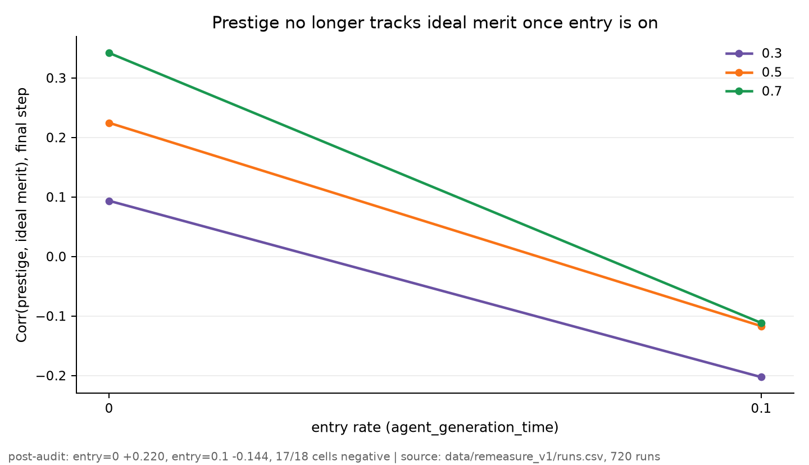
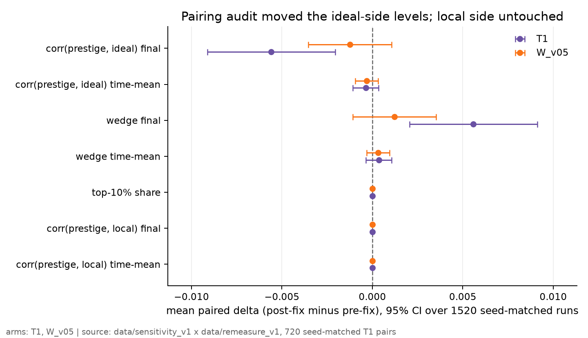
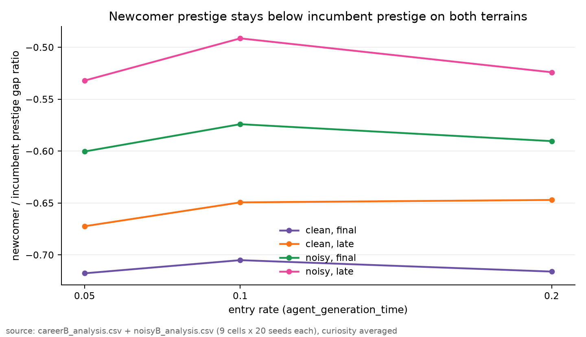
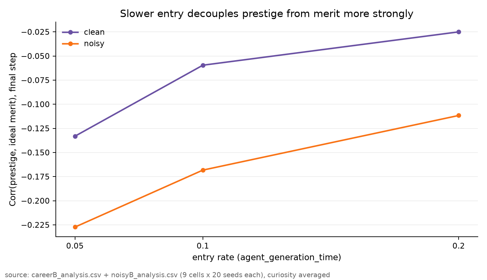
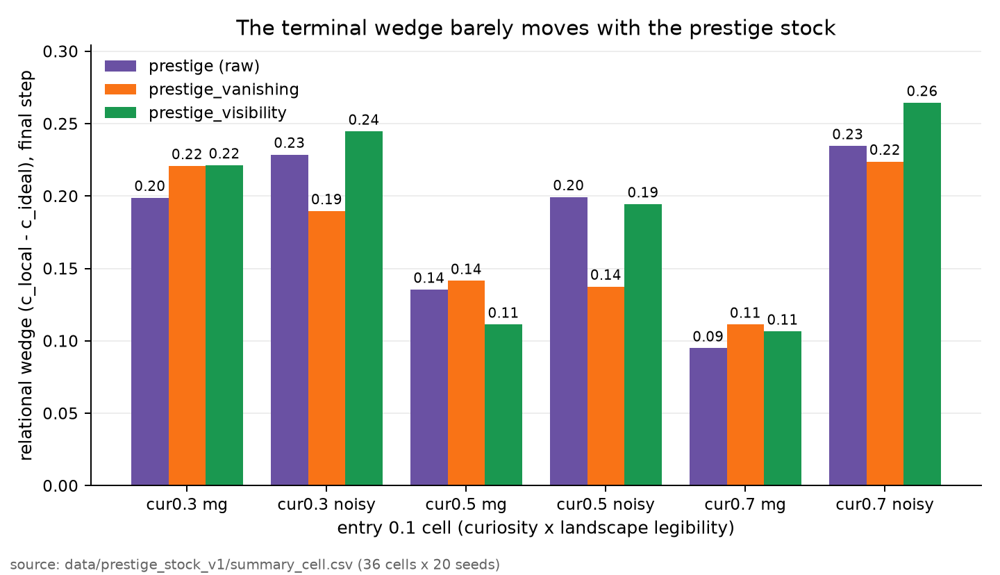
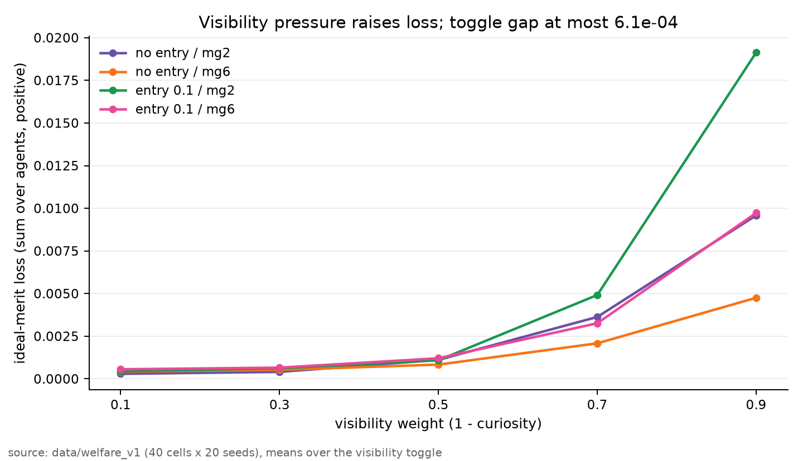

**Version 1** (November 2026)

> **STATUS: DRAFT, MODEL-INTERNAL. Calibration status: not calibrated** --
> nothing in this paper is fitted to empirical data (owner ruling,
> 2026-11-13). Every simulation number is recomputed from a run archive in
> this repository and named beside the
> claim; the empirical moments in Section 1 are stylized motivating facts
> from the Klann panel and are **never** used as fitting targets (they remain
> a documented option menu in `docs/calibration_moments.yaml`). Every figure
> is regenerated by `scripts/report_notebook/` and executed in
> `notebooks/round_results_report_v1.ipynb`.

# Introduction and stylized facts

A community that rewards an observable metric invites activity that inflates
the metric without advancing the goal the metric was meant to track. In the
causal grammar of Kapeller, Paul and Braganza
(`context/Hunting_Proxy_Patterns.md`), a proxy $P$ is meant to track a goal
$G$; an aligned action $A$ advances both, while a proxy-oriented action
$AP_F$ boosts $P$ while neglecting or harming $G$. The failure modes are
*distraction* ($AP_F$ crowds out $A$) and *destruction* ($AP_F \dashv G$
directly), attenuated by a built-in *counterforce* ($P \to G$, genuine
superstar spillovers). Metascience has documented the empirical shadow of
this grammar -- the irreproducibility crisis (Braganza 2020), citation and
impact distortion (John et al. 2023) -- but published models of science
tend to instantiate only one leg of it.

The motivating empirical wedge comes from the Klann economics co-authorship
panel (`docs/connections_niklas.md`): prestige tracks the *quantity* of
output at $\text{corr} = 0.50$ but its *citation quality* at only $0.07$,
and within authors the own-prestige correlation is $-0.257$ while the
co-author-rank slope is $+0.004$ -- status travels through the network, not
through the work. The same panel shows the structural facts that make a
proxy possible at all: mean team size 2.65 (median 2), repeated-collaboration
share 0.34, dyad-corrected elite homophily O/E cells 3.1 / 3.0 / 2.3, and
Markov club closure with retention 0.3995 and entry 0.0619.

| Stylized fact (Klann panel) | Value | Role here |
| --- | --- | --- |
| corr(prestige, quantity) vs corr(prestige, citation quality) | 0.50 vs 0.07 | motivation only |
| within-author own-prestige vs co-author-rank slope | -0.257 vs +0.004 | motivation only |
| mean team size (median) | 2.65 (2) | motivation only |
| repeated-collaboration share | 0.34 | motivation only |
| O/E elite homophily cells (dyad-corrected) | 3.1 / 3.0 / 2.3 | motivation only |
| Markov retention / entry | 0.3995 / 0.0619 | motivation only |

None of these values enters any parameter. They are what the model would
have to reproduce *after* the fact to be taken to data, and the option menu
for that exercise is documented separately.

Our claim is narrower and, we argue, unoccupied: **no published model
combines (i) spatial-topical landscape search, (ii) visibility-proxy
incentives with prestige-proportional recruitment, and (iii) an external
omniscient-planner benchmark against which success is scored independent of
the reward** (`docs/related_publications.md`, 34 verified studies). Item
(iii) is what turns "prestige diverged" from a story into a measurement:
without a reward-independent yardstick, an ABM can only report that its own
reward variable moved.

# Model architecture and degrees of freedom

Scientists occupy a $20 \times 20$ toroidal epistemic landscape whose tile
knowledge is normalised and depleted multiplicatively on harvest,
$k_{xy} \leftarrow (1-h)k_{xy}$ ($h = 0.02$). Each agent maximises a
Cobb-Douglas reward

$$R_i \;=\; \left(\frac{k_i}{\bar{k}}\right)^{c_i} \cdot V_i^{\,1-c_i},
\qquad V_i \;=\; \frac{\bar{d}_{\text{global}}+1}{d_{\text{own}}+1},$$

so curiosity $c_i$ buys epistemic ground truth and its complement $1-c_i$
buys visibility -- the internal visibility weight that Section 5 shows to be
the dominant lever. Movement is a strict-improvement rule over the von
Neumann neighbourhood with multiplicative perception noise $\epsilon = 0.1$,
which yields status-quo lock-in on the noise-free current tile.

Prestige accrues from the harvested flow $h \cdot k$ into one of three
stocks -- raw `prestige`, exponentially decaying `prestige_vanishing`, and
peer-perceived `prestige_visibility` -- and entry is supervisor-proportional:
newcomers are drawn to a supervisor with probability proportional to the
stock that weights the channel (`entry_prestige_stock`) and spawn on that
supervisor's tile. The yardstick is the sorted-to-sorted planner benchmark
`ideal_Merit`: the loss of an agent's harvest against a greedy omniscient
allocation of the same grid, with its cumulative form `ideal_merit_cum`
added by the pairing audit. Local merit (mean knowledge of the five-tile
cross) is the quantity-side benchmark the proxy is allowed to track.

The architecture is deliberately under-determined: `docs/conceptual_degrees
_of_freedom.md` catalogues 104 assumptions with their code anchors, among
them dead levers (agent age is recorded and does nothing) and dormant
channels (`new_questions` refills only occupied tiles). The Path B dyadic
collaborator layer now exists in the model and is gated off by default --
the smoke test proves off-mode bit-identity against the anchor
`mean_prestige = 0.025399760810316363` -- but no dyadic sweep is reported
here. This paper reports waves 1-3 only.

# Result 1: the relational wedge and its sensitivity map

**Figure 1.** Final correlation between prestige and ideal merit against the
entry rate, post-audit arm. Source: `data/remeasure_v1/runs.csv`, 720 runs,
36 cells; means over vanishing factor and landscape legibility.

Without entry the hierarchy is uninformative but benign: prestige and ideal
merit co-move positively. Switching on prestige-proportional entry at rate
0.1 flips the quality correlation from **+0.220 to -0.144** (post-audit arm,
720 seed-matched runs), with **17 of 18 entry cells negative**, while the
quantity correlation stays positive at **+0.038** and the top-10% prestige
share nearly doubles from **0.135 to 0.228**. Curiosity is protective: at
both entry rates the higher-curiosity series sits above the lower one.

Two features make this a *relational* failure rather than a gaming one.
First, no agent anywhere performs an explicit proxy-oriented action: the
flip emerges from demographic matching on a depletable landscape. Second,
the failure is channel-specific -- prestige tracks quantity and fails to
track quality -- which is exactly the shape of the empirical wedge in
Section 1.

**Figure 2.** Mean paired delta (post-fix minus pre-fix) with 95% confidence
intervals over 1,520 seed-matched runs, dodged by arm. Source:
`data/sensitivity_v1` and `data/welfare_v1` (pre-fix) against
`data/remeasure_v1/runs.csv` and `data/remeasure_v1/w_v05_runs.csv`
(post-fix).

The measurement audit that preceded this draft is itself a result. Re-running
every T1 cell under the corrected `ideal_Merit` pairing moved the ideal-side
levels -- $\Delta$ corr(prestige, ideal) final $= -0.0056 \pm 0.0018$ on the
T1 arm and $-0.0012 \pm 0.0012$ on the 800-run welfare arm (whose interval
crosses zero) -- and moved nothing else: the local-side reporters and the
top-10% share are **exactly 0.0000** in all 1,520 runs of both arms, and
**0 of 36 cells changed sign** between the pre-fix and post-fix T1 arms. The
wedge moves by the mirror image of the ideal side, as it must. Two
provenance traps are recorded in the notebook because they would otherwise
have produced confident nonsense: the re-measure writer stores
`wedge = c_ideal - c_local`, the opposite sign to the analysis convention,
and the welfare arm embedded in that same file was re-run at a different
vanishing factor, so it is excluded from the paired delta while the separate
`w_v05` arm -- re-run on the original grid -- is paired in.

# Result 2: endogenous cumulative advantage and stock invariance

**Figure 3.** Newcomer-to-incumbent prestige gap ratio against the entry
rate, by terrain and statistic. Source: `careerB_analysis.csv` and
`noisyB_analysis.csv`, 9 cells x 20 seeds each, curiosity averaged.

**Figure 4.** Final prestige-ideal correlation against the entry rate, by
terrain. Source: as Figure 3.

Cumulative advantage is endogenous and it does not close. Newcomers never
catch incumbents at any entry rate $g \in \{0.05, 0.10, 0.20\}$: the final
gap ratio runs **-0.713** on clean terrain (late-window mean -0.656) and
**-0.588** on noisy terrain (late-window mean -0.516), negative in every
cell of both terrains. The gradient is counterintuitive: decoupling is
strongest when entry is *slowest*. Final prestige-ideal correlation at
$g = 0.05$ is -0.133 (clean) and -0.227 (noisy), improving to -0.025 and
-0.112 at $g = 0.20$. Slow entry lets founder hierarchies harden before
advisees arrive; a rapid influx dilutes the oligarchy. This qualifies the
Matthew-effect literature (Merton 1968; Petersen et al. 2014): it is low
turnover, not high prestige, that maximises epistemic misallocation.

**Figure 5.** Terminal wedge by entry-on cell and prestige stock. Source:
`data/prestige_stock_v1/summary_cell.csv`, 36 cells x 20 seeds.

Which stock weights the selection channel changes *how fast* the wedge
opens, not *where*. Across the three stocks the cross-cell ordering of the
terminal wedge is preserved at Spearman $\rho = 0.965$ to $0.993$
($p \le 4 \times 10^{-7}$), the open/closed classification agrees in 11 of
12 cells under a 0.10 threshold rule, and **0 of 12** seed-matched terminal
wedge contrasts exclude zero. The entry-off cells are bit-identical across
stocks -- the axis has no channel outside the supervisor roulette -- so the
stock can only act on the entry-on half of the grid. Practical reading:
replacing cumulative counts with decayed or visibility-adjusted indices does
not repair proxy failure while recruitment stays prestige-proportional
(Muller 2018; Osterloh and Frey 2015).

# Result 3: the epistemic welfare kink

**Figure 6.** Ideal-merit loss against the visibility weight, by entry and
landscape legibility, means over the visibility toggle. Source:
`data/welfare_v1`, 40 cells x 20 seeds.

Measured against the planner benchmark, welfare loss is gently sloped up to
a visibility weight $\xi = 1-c$ of about 0.5 and then kinks sharply upward
at $\xi^{*} \in [0.6, 0.8]$ -- a breakpoint with an interior bootstrap
95% interval in 24 of 24 outcome series. Total loss rises between $10\times$
and $44\times$ along the weight axis, while the peer-prestige toggle
`use_visibility_reward` moves loss by at most $6.1 \times 10^{-4}$ (about
2.6%). The asymmetry is the substantive point: **the agent's internal
visibility elasticity drives epistemic loss roughly 31 times harder than
whether visibility is weighted by peer eminence.** Entry doubles total loss
through population growth rather than per-agent pressure. This is Kitcher's
(1990) division-of-cognitive-labor loss appearing as a phase transition
(Smaldino and Epstein 2015), and it says the reform target is the reward
weighting, not the prestige weighting.

# Discussion: mechanism, counterforces, typology

**Why it happens.** Two mechanisms are fused at birth in the current
demographic rule: supervisor selection is prestige-proportional, and the
advisee spawns exactly on the supervisor's tile. Because harvesting depletes
tiles multiplicatively, a high-prestige incumbent has necessarily exhausted
their own peak, so advisees inherit *exhausted ground* while increasing local
density, which inflates the visibility reward and traps neighbours via
strict-improvement inertia. The negative quality correlation under entry thus
mixes **positional inheritance** (where advisees start) with **evaluative
attraction** (how visibility rewards pull searchers toward crowded clusters)
-- a decomposition that maps directly onto the Matthew-effect debate
(`AdmiralsLog/contributions/CONT1-...`). Separating them is the next
experimental design, not a claim of this draft.

**Counterforces.** Because proxy failure here arises from status-quo lock-in
combined with linear prestige-proportional recruitment, three institutional
mechanisms act as theoretical counterforces: recruitment de-targeting
(damped entry or funding lotteries, which stop depleted peaks from becoming
demographic sinks), transient-diversity preservation (Zollman 2010, which
breaks lock-in inside high-visibility clusters without requiring altruism),
and topical complementarity in co-production (which rewards intermediate
epistemic distance over pure visibility assortativity). A fourth lever sits
dormant in the code: the `new_questions` refill runs only on *occupied*
tiles, i.e. incumbent hot-field bailout rather than frontier emergence --
manufactured novelty under the crowd's feet versus genuinely new questions
on unoccupied ground (Dobusch and Kapeller 2009, 2012).

**Typology.** The model already carries the primitives of the causal
grammar, which lets Section 1's $P$/$G$/$A$/$AP_F$ distinctions be
parameterised rather than asserted:

| Typology element | ABM counterpart | Status |
| --- | --- | --- |
| goal $G$ | `ideal_Merit` / `ideal_merit_cum` (planner loss) | measured |
| proxy $P$ | three prestige stocks + spatial visibility $V_i$ | measured |
| aligned action $A$ | curiosity-driven search ($c_i \to 1$) | baseline |
| distraction ($AP_F$ indirect) | visibility-weighted movement ($1-c_i \to 1$), low-$\lambda$ partner choice | active in baseline; source of the $\xi^{*}$ kink |
| destruction ($AP_F \dashv G$) | crowding-driven noise amplification $\epsilon_{\text{eff}} = \epsilon \cdot m^{\gamma}$ | one-parameter extension, $\gamma \ge 0$ |
| counterforce ($P \to G$) | superstar spillover $\epsilon_i = \epsilon_0/(1+\kappa P_{\text{sup}})$ | one-parameter extension, $\kappa \ge 0$ |

The baseline model instantiates *pure distraction*: proxy competition grows
by spatial neglect, not by active falsification. Whether destruction or the
counterforce dominates is a $2 \times 2 \times 3$ sweep that belongs to the
theory companion (Path D), and its gating question -- what plays the role of
$AP_F$ -- is an owner decision recorded in the Path B design menu (Q9).

**Honest limits.** No parameter here is fitted; the empirical moments are
motivation, not targets. One model step maps to no empirical year yet, so
all empirical claims must stay at the level of correlations and shares, never
levels. The ideal-merit yardstick is model-internal by construction. The
dyadic collaborator layer (Path B) is implemented and gated off but not
swept, so the flagship collaborator-choice claim of `docs/way_forward.md`
is not yet tested. Venue and authorship framing await the P-0001 ruling.

# Reproduction

| Claim | Artifact |
| --- | --- |
| Figures 1-6 | `output/report_notebook_v1/F1..F5` (+ `F2b`), regenerated by `scripts/report_notebook/`, executed in `notebooks/round_results_report_v1.ipynb` |
| Figure 1 / 2 numbers | `data/remeasure_v1/runs.csv` (720 T1 runs), `data/remeasure_v1/w_v05_runs.csv` (800 W_v05 runs), `data/sensitivity_v1/` pre arm |
| Figures 3-4 numbers | `data/career_flows_v1/careerB_analysis.csv`, `data/career_flows_noisy_v1/noisyB_analysis.csv` |
| Figure 5 numbers | `data/prestige_stock_v1/summary_cell.csv`, `paired_contrasts.csv` |
| Figure 6 numbers | `data/welfare_v1/cell_*.csv` (40 cells), `output/reports/welfare_probe_v1.md` |
| Gate | `MPLBACKEND=Agg python3 tests/test_smoke.py` -- ALL SMOKE TESTS PASSED, 56 report keys |

# Revision Log

- **Version 1** (November 2026) --- Initial Phase-1 draft along the P-0001
  spine, following `CONT3-publishable-results-synthesis.md`. Six sections:
  motivation with stylized facts, architecture and degrees of freedom, three
  results (relational wedge with post-audit numbers, cumulative advantage and
  stock invariance, welfare kink), and a discussion integrating `CONT1`
  (birth-tile starvation vs attentional herding, institutional
  counterforces) and `CONT2` (distraction vs destruction vs counterforce).
  Figures F1-F5 (six images) regenerated post-audit; no code changes outside
  `scripts/report_notebook/`.
