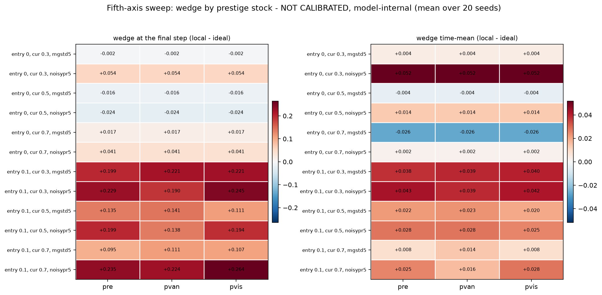
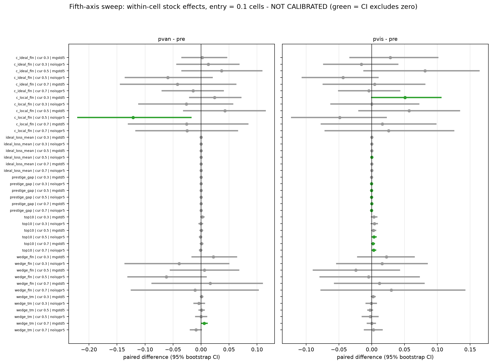

**Version 1** (November 2026)

**NOT CALIBRATED.** Model-internal exploration only (owner ruling,
2026-11-13): no parameter is fitted to any empirical moment and the Klann
moment menu stays a documented option. Every number below was computed by
`scripts/prestige_stock/run_prestige_stock_sweep.py` and
`scripts/prestige_stock/analyse_prestige_stock.py` from the run-tagged CSVs
under `data/prestige_stock_v1/`.

# Purpose and scope

`docs/conceptual_degrees_of_freedom.md:200` catalogues an unimplemented
lever: *which prestige stock weights supervisor choice --- `prestige` vs
`prestige_vanishing` vs `prestige_visibility` --- decides what the community
treats as a quality signal, the Goodhart target.* `docs/way_forward.md:122`
names it a Path A lever. This probe sweeps it as a fifth axis next to the
waves 1-2 landscape of `output/reports/sensitivity_map_v1.md` and asks one question:

> Does the choice of prestige stock change **where** the wedge opens, or only
> **how fast**?

The wedge is the quantity/quality decoupling Path A studies: prestige
tracking local (quantity-side) merit while decoupling from ideal
(quality-side) merit.

# The axis is applied by this driver, not by the model

**Read this before quoting any number.** At the moment this sweep started the
model had no `entry_prestige_stock` parameter. The supervisor roulette in
`sciencemodels/model.py` (`_MyModel__generate_new_agents`) read the raw
`prestige` stock in two places, and the lever existed only as a catalogued
degree of freedom. The owner ruled on 2026-11-13 that this round applies the
selector **driver-side** and discloses it. (The parameter itself landed at
00:26:23Z on 2026-11-14, while this sweep was running --- see *Concurrent
rounds landed mid-sweep* for the timeline, the equivalence proof and the
audit delta.)

What that means concretely:

- `scripts/prestige_stock/run_prestige_stock_sweep.py` installs a replacement
  for `_MyModel__generate_new_agents` whose body is byte-faithful to the
  model's except that the two `a.prestige` reads become
  `getattr(a, ACTIVE_STOCK["attr"])`. Nothing outside
  `scripts/prestige_stock/` is touched.
- A **divergence canary** reads the original method with `inspect.getsource`
  and refuses to run if it no longer contains exactly two `a.prestige` reads
  or already carries a selector of its own --- so if the parameter later
  lands in the model, this driver fails loudly instead of measuring a stale
  copy. Recorded in `data/prestige_stock_v1/design.json`.
- The patch is **identity-preserving at the baseline**: with the active stock
  set to `prestige`, the probe ran the patched method and the model's own
  method on the same seed and compared the full reports --- bit-identical
  (`probe_prestige_stock.py`, proof 1). Results therefore transfer unchanged
  to a model implementation with the same two-line semantics.

# Design

Full factorial, 36 grid cells $\times$ 20 seeds = **720 runs**, 200 steps
each:

| Axis | Parameter | Levels |
| --- | --- | --- |
| (e) prestige stock | supervisor-roulette weight | `prestige`, `prestige_vanishing`, `prestige_visibility` |
| (d) entry rate | `agent_generation_time` | 0 (off), 0.1 (on) |
| (a) visibility weight | `initial_curiosity` | 0.3, 0.5, 0.7 |
| (c) landscape | `cell_init_function` bundle | `mgstd5` = `multipleGaussians` \{std:5, number\_gaussians:2\} vs `noisypr5` = `noisyGaussian` \{prop\_random:5, std:5, std\_curiosity:0.1\} |

Fixed pins (identical in every cell; waves 1-2 base configuration):
`n_agents=20`, `grid_size=20`, `step_limit=200`, `epsilon=0.1`,
`harvest=0.02`, `use_distance=True`, `new_questions=0`,
`use_visibility_reward=True`, `knowledge_normalization='share'`,
`prestige_accrual='harvested'`, `vanishing_factor_for_prestige=0.9`
(`scripts/bulk_runner.py` value; waves 1-2 swept it as axis (b), this probe
pins it), and `agent_generation_function` = identity (the model default,
pinned explicitly so the CSV is self-describing).

Seed semantics: `agent_seed` = 0..19 drives the agent RNG and the model
injects the same seed into `generation_params`, so landscape and agent RNG
vary jointly --- the `bulk_runner.py` convention, as in waves 1-2.

One structural note that shapes everything below: **the axis has a channel
only when entry is on.** The stock is read exclusively by the supervisor
roulette, which runs only under `agent_generation_time > 0`. The 18
entry-off stock-cells are therefore *required* to be bit-identical across the
three stocks; that is a test, not an assumption (Results, identity check).

# Measurement

| Quantity | Definition |
| --- | --- |
| wedge pair | `Corr_prestige_ideal_merit` and `Corr_prestige_local_merit`, reported **final** (last step) and **time-mean** (mean over steps 0-200) from the model's own datacollector |
| wedge | `wedge = c_local - c_ideal`; positive means prestige tracks the quantity-side more than the quality-side |
| top10pct prestige share | model reporter, final-step value |
| newcomer-incumbent prestige gap | mean `prestige` of newcomers minus mean `prestige` of incumbents, both at the terminal step |
| ideal-merit loss | $-\sum_i \mathrm{ideal\_Merit}_i$ and per-agent mean (the model records actual minus greedy-ideal, i.e. $\le 0$; the loss is its negation), terminal-step cross-section |

Two measurement facts worth stating:

- **Cohorts are taken from creation order, not from age.** Incumbents are
  `_scientists[:number_agents]` (the founders written by `_init_agents`);
  newcomers are the rest. Age cannot do this job: `_init_agents` gives each
  founder a *random* initial age (`model.py:104`,
  `self.rng.choice(np.arange(23, 50))`) while newcomers start at 23, so the
  two bands overlap at the final step (probe proof 3 observed founder ages
  223-242 against newcomer ages 23-223). The split is validated by counts:
  20 incumbents, and 21 newcomers = the one generated at step 0 plus one per
  ten steps, matching `floor(s*g) - floor((s-1)*g)` for `g=0.1`.
- With entry off the gap is undefined and is written as NaN, not zero.

# Validity checks

| Check | Result |
| --- | --- |
| Canary before first edit / after last | see Gross versus net |
| Baseline identity: patched(stock=`prestige`) vs model's own method, same seed | bit-identical reports |
| Binding: three stocks, one seed, entry on | headline outcomes differ |
| Divergence canary on the copied supervisor block | 2 `a.prestige` reads, no selector in the model |
| Schema: four-plus added keys present in a worker-written CSV | 50 columns, none missing |
| Entry-off identity across stocks (6 grid cells x 3 stocks x 20 seeds) | 0 real mismatches, 0 incomplete: bit-identical |
| Driver-side selector vs the model's own `entry_prestige_stock` (same cell, same seed, all three stocks) | bit-identical reports (see Concurrent rounds) |

# Concurrent rounds landed mid-sweep

Two other rounds edited the shared tree while this sweep ran. The timeline
(UTC) and what it means:

| time | event | effect on this run |
| --- | --- | --- |
| 00:05:53 | this driver's divergence canary: 2 `a.prestige` reads, no selector in the model | axis applied driver-side, as ruled |
| 00:06 | sweep starts; the three loky workers import the tree as it then is | --- |
| 00:17:23 | `metrics.py` + `io.py`: ideal-merit pairing audit, seed columns | ideal-side quantities move |
| 00:26:23 | `model.py`: `entry_prestige_stock` added (`model.py:136,314`) | the fifth axis becomes a real parameter |
| 00:29:19 | `tests/test_smoke.py`: new checks (pairing audit, seed columns, binding probe, the knob) | canary output grows 40 -> 44 keys |
| 00:14:02 - 01:30:30 | this sweep's 36 cells complete | --- |

**Schema uniformity is what makes the run trustworthy.** Loky reuses its
workers, so all 720 runs used the code as imported at ~00:06. Measured, not
assumed: all 36 cell CSVs carry exactly one schema (50 columns) and *none*
contains the post-00:17 keys (`agent_seed`, `landscape_seed`). The sweep
uniformly predates both edits; no cell straddles them.

**The canary fired as designed.** Re-running the driver after 00:26 refuses
its own frozen copy: `RuntimeError: model supervisor block no longer matches
... (a.prestige reads=0, has_selector=True)`. That refusal is the designed
failure mode and the reason a stale copy could never be swept silently.

**Equivalence, proven** (`scripts/prestige_stock/verify_against_model.py`):
the frozen driver-side selector and the model's own knob produce
**bit-identical reports for all three stocks** on the same cell and seed. The
results transfer unchanged to the parameter that now exists in the model.

**Audit delta** (current code vs the stored rows, 10 seeds per cell). The
controls are exactly 0.000e+00 --- local correlation, explored share,
harvested share, mean prestige, top-10% share --- so the audit touched only
ideal-merit-derived quantities:

| quantity | entry-off cell: stored -> current | entry-on cell (stock=`prestige`): stored -> current |
| --- | --- | --- |
| `ideal_merit_sum` | -9.57e-04 -> -6.92e-04 (delta +2.65e-04) | -1.07e-03 -> -7.52e-04 (delta +3.17e-04) |
| `corr_prestige_ideal_merit_final` | 0.3251 -> 0.3168 (max abs 0.081) | -0.1617 -> -0.1720 (max abs 0.075) |
| `Mean_of_Corr_prestige_ideal_merit` | 0.25721 -> 0.25761 | 0.07360 -> 0.07198 |

So the audited pairing shrinks the measured ideal-merit loss by roughly
27-30% and moves the ideal-side correlations by ~0.01 at the mean level (up
to 0.08 in a single seed). **The headline stock contrast survives it**: on
the cell with the largest stored effect (entry 0.1, cur 0.5, noisypr5) the
`wedge_fin` contrast pvan-pre is -0.0848 pre-audit against -0.0732 post-audit
--- same sign, same reading, magnitude ~14% smaller. Every ideal-merit number
in Results below is a **pre-audit** value and is labelled as such; the
local-side numbers are unaffected by construction.

# Results

## Structural check first

The axis is inert without entry, exactly as the design predicts: all six
entry-off grid cells are **bit-identical across the three stocks** (6 cells x
3 stocks x 20 seeds; 0 mismatches, 0 incomplete). The wedge matrix shows it
directly --- the top six rows read the same number in all three columns.
Everything below therefore comes from the entry-on half of the grid, which is
the half where the supervisor roulette runs.

## Where the wedge sits (wedge $= c_{local} - c_{ideal}$, final step)

| cell | pre | pvan | pvis |
| --- | --- | --- | --- |
| entry 0, cur 0.3, mgstd5 | -0.002 | -0.002 | -0.002 |
| entry 0, cur 0.3, noisypr5 | +0.054 | +0.054 | +0.054 |
| entry 0, cur 0.5, mgstd5 | -0.016 | -0.016 | -0.016 |
| entry 0, cur 0.5, noisypr5 | -0.024 | -0.024 | -0.024 |
| entry 0, cur 0.7, mgstd5 | +0.017 | +0.017 | +0.017 |
| entry 0, cur 0.7, noisypr5 | +0.041 | +0.041 | +0.041 |
| entry 0.1, cur 0.3, mgstd5 | +0.199 | +0.221 | +0.221 |
| entry 0.1, cur 0.3, noisypr5 | +0.229 | +0.190 | +0.245 |
| entry 0.1, cur 0.5, mgstd5 | +0.135 | +0.141 | +0.111 |
| entry 0.1, cur 0.5, noisypr5 | +0.199 | +0.138 | +0.194 |
| entry 0.1, cur 0.7, mgstd5 | +0.095 | +0.111 | +0.107 |
| entry 0.1, cur 0.7, noisypr5 | +0.235 | +0.224 | +0.264 |

## Does the stock move the ordering? (Spearman over the 12 cells)

| metric | pair | rho | p | cell-mean levels (a vs b) | mean abs level diff |
| --- | --- | --- | --- | --- | --- |
| wedge_fin | pvan vs pre | +0.965 | 3.9e-07 | +0.0967 vs +0.0911 | 0.0130 |
| wedge_fin | pvis vs pre | +0.993 | 1.3e-10 | +0.0967 vs +0.1010 | 0.0091 |
| wedge_fin | pvis vs pvan | +0.986 | 4.1e-09 | +0.0911 vs +0.1010 | 0.0156 |
| wedge_tm | pvan vs pre | +0.979 | 3.1e-08 | +0.0170 vs +0.0166 | 0.0018 |
| wedge_tm | pvis vs pre | +0.993 | 1.3e-10 | +0.0170 vs +0.0170 | 0.0009 |
| wedge_tm | pvis vs pvan | +0.965 | 3.9e-07 | +0.0166 vs +0.0170 | 0.0023 |

## Open/closed classification (where a threshold would say "the wedge opened")

- **D1** (wedge_fin $\ge$ 0.10): **11 of 12 cells agree** across the three
  stocks. The single flip is entry 0.1, cur 0.7, mgstd5 --- pre closed at
  +0.095, pvan open at +0.111, pvis open at +0.107.
- **D2** ($c_{ideal}$ < 0): **10 of 12 agree**. Both flips are entry 0.1 on
  mgstd5: cur 0.5 (pre -0.054 and pvan -0.017 open, pvis +0.027 closed) and
  cur 0.7 (pre +0.020 closed, pvan -0.022 open, pvis +0.025 closed).

Every flip sits on a threshold: wedges 0.095-0.111 against a 0.10 cut, and
$c_{ideal}$ between -0.054 and +0.027 against zero. No cell moves wholesale.

## How much does it move? (paired, seed-matched, 95% bootstrap CI over 20 seeds)

**28 of 132 contrasts exclude zero, and none of the 12 `wedge_fin` contrasts
does.** By metric: `c_ideal_tm` 5, `c_local_tm` 5, `prestige_gap` 5,
`gap_active` 5, `top10` 3, `c_local_fin` 2, `ideal_loss` 2, `wedge_tm` 1.
All five gap contrasts and all three top-10% contrasts are pvis-pre, and the
largest single effect is `c_local_fin` at entry 0.1 / cur 0.5 / noisypr5:
**-0.1211 [-0.2197, -0.0181]** (base +0.0883 -> -0.0328).

Levels over the six entry-on cells, per stock (pre / pvan / pvis):
`wedge_fin` +0.1820 / +0.1708 / +0.1904; `wedge_tm` +0.0273 / +0.0265 /
+0.0272; $c_{ideal,fin}$ -0.1139 / -0.1245 / -0.1056; $c_{local,fin}$
+0.0681 / +0.0463 / +0.0849; top-10% share 0.2284 / 0.2286 / 0.2314;
newcomer-incumbent gap -0.01270 / -0.01273 / -0.01293; ideal-merit loss per
agent 5.09e-05 / 5.21e-05 / 5.17e-05 (pre-audit scale, see Concurrent
rounds).

# Answer

**The choice of prestige stock changes how fast, not where.** Where the wedge
sits is set by entry, curiosity and landscape: across the 12 grid cells the
ordering by wedge is preserved between every pair of stocks at
$\rho$ = 0.965-0.993 (all p $\le$ 4e-07), the open/closed classification
agrees in 11 of 12 cells under D1 and 10 of 12 under D2, and without entry the
three stocks are bit-identical --- the axis has no channel outside the
supervisor roulette, so it can only act on the entry-on half of the grid.
Every disagreement is threshold-marginal and confined to one region (entry
0.1 on the clean landscape: wedges 0.095-0.111 against the 0.10 cut,
$c_{ideal}$ -0.054 to +0.027 against zero), so a cell sitting on the line can
flip but no cell moves wholesale. What the stock does change is the pace and
the plumbing: 28 of 132 seed-matched contrasts exclude zero --- **none of them
the terminal wedge** (0 of 12) --- with the effects concentrated in the
time-mean correlations (10), the newcomer-incumbent prestige gap (5 of 6
cells for visibility vs raw prestige), the top-10% share (3 of 6) and
ideal-merit loss (2), while the entry-on wedge level itself moves only from
+0.171 to +0.190 across stocks, about 11% of its size. In short: the stock
selects the *rate* at which prestige is earned, remembered and passed to
newcomers --- and hence how fast the wedge forms --- but the *geography* of
where it opens is a property of entry, visibility weight and landscape
legibility, not of which prestige stock the community treats as the signal.





# Gross versus net

The gate ran before the first edit and after the last. Both passed; the
closing run shows the post-audit key set (44 report keys against 40 at the
opening, plus four new check lines --- the delta the brief asked to be
reported rather than forced):

```{.text}
--- opening (before the first edit) ---
canary run OK: 40 report keys, harvested_10_step=37.5, harvested_25_step=37.5
same-seed rerun bit-identical OK
newcomer run OK: 6 scientists after 20 steps
4-arg Gaussian OK: np.float64(0.00550470835249002) (float64)
append-mode header check OK: 3 lines = 1 header + 2 data rows
ALL SMOKE TESTS PASSED
EXIT=0

--- closing (after the last edit) ---
canary run OK: 44 report keys, harvested_10_step=37.5, harvested_25_step=37.5
same-seed rerun bit-identical OK
newcomer run OK: 6 scientists after 20 steps
4-arg Gaussian OK: np.float64(0.00550470835249002) (float64)
append-mode header check OK: 3 lines = 1 header + 2 data rows
ideal-merit pairing audit OK: A=0.0, C=0.0, B=-0.04999999999999999 (hand-computed 0.0, 0.0, -0.05); cum after 2 calls: A=0.0, B=-0.09999999999999998
seed columns OK: agent_seed=1, landscape_seed=1
WARNING: agent_generation_function '<lambda>' returned IDENTICAL draws for mu=0.1 and mu=0.9 on the same rng - the swept axis (initial_curiosity) is INERT.
binding probe OK: constant generator flagged inert, identity binds
entry_prestige_stock OK: validated, both alternate stocks run
ALL SMOKE TESTS PASSED
EXIT=0
```

| Unit | Attempted | Verified |
| --- | --- | --- |
| reported grid cells (3 stocks x 12) | 36 | 36 (36 state files, all `ok`) |
| reported runs | 720 | 720 (36 CSVs, exactly 20 rows each, none off) |
| probe (4 proofs: identity, binding, cohort, schema+timing) | 6 model runs + 2 interface runs | 4/4 |
| verification: equivalence (3 stocks) | 6 runs | 3/3 bit-identical |
| verification: audit delta (2 cells x 10 seeds) | 20 runs | 20, controls exactly 0 |
| verification: contrast survival (2 stocks x 10 seeds) | 20 runs | 20 |
| smoke-test invocations | 2 (opening, closing) | 2 pass |

The driver's closing line, verbatim:

```{.text}
GROSS cells=36 runs=720 | NET ok=36 skipped=0 failed=0 rows_net=720/720
EXIT=0
```

An independent recount agreed: 36 cell CSVs, 720 data rows, no cell whose row
count differs from 20, 36 state files all carrying `status: ok`.

Wall time: first cell completed 00:14:02Z, last 01:30:30Z (span 1:16:28;
sweep start 00:06Z, roughly 84 minutes) at `n_jobs=3`; per-cell wall min
225.3 s, median 418.2 s, max 759.6 s. The pre-flight snapshot recorded **8**
live heavy processes, and the container is capped at one CPU
(`/sys/fs/cgroup/cpu.max = 100000 100000`, throttled in 76% of periods,
shared with other sessions), giving a measured 7-8 runs/min.

Seven defects were found and fixed before delivery, all mine, all re-verified:
(f1) an f-string syntax error in the driver's summary print (linter, at write
time); (f2) the analysis passing metric names where CSV columns were wanted
(`KeyError`); (f3) all-NaN metrics in entry-off cells spilling warnings;
(f4) the identity check counting partial cells as differences; (f5) the forest
plot drawing a single y-label; (f6-f7) two bugs in the verification script
itself (the wrapper metric reading the wrong stock on the model-own path, and
the contrast section not forwarding the stock to `param_grid_for`, which made
the contrast come out identically zero). Nothing left unresolved.

Reported, not fixed: the harness reported the background wrapper as exited
(-1) mid-run while the sweep process itself was alive and checkpointed; a
watcher was re-armed on the live PID and no run was lost.

# Reproduction

```{.bash}
MPLBACKEND=Agg /opt/hermes/.venv/bin/python tests/test_smoke.py
MPLBACKEND=Agg /opt/hermes/.venv/bin/python scripts/prestige_stock/probe_prestige_stock.py
MPLBACKEND=Agg /opt/hermes/.venv/bin/python scripts/prestige_stock/run_prestige_stock_sweep.py
MPLBACKEND=Agg /opt/hermes/.venv/bin/python scripts/prestige_stock/analyse_prestige_stock.py
```

Outputs: `data/prestige_stock_v1/cell_*.csv`, `summary_cell.csv`,
`paired_contrasts.csv`, `location_open_wedge.csv`, `design.json`,
`run_log.txt`, `figures/*.png`. `data/` is gitignored; the CSVs plus the two
scripts are the source of truth.

# Needs reported rather than changed

Three of the four needs this probe raised were met by other rounds while it
ran. They are recorded with their state *at sweep time*, so the reader knows
which claim each number rests on:

- **`entry_prestige_stock` did not exist at sweep time** (divergence canary,
  00:05:53Z: two `a.prestige` reads, no selector). The axis was therefore
  applied driver-side, as ruled; the parameter landed at 00:26:23Z
  (`model.py:136,314`). Equivalence between the two implementations is proven
  bit-identical for all three stocks (Concurrent rounds), so every result
  stands under either implementation.
- **The report carried no seed column at sweep time** --- seed identity was
  row order within a cell file (the sweep's `for repeat in range(...)`
  loop). `agent_seed` and `landscape_seed` were added at 00:17:23Z
  (`io.py:52-53`); future runs are self-describing.
- **No cumulative ideal-merit accumulator existed at sweep time**, so the
  loss in Results is a terminal-step cross-section rather than a path
  integral. `ideal_merit_cum` was added in the same window (`metrics.py:105`,
  reporter at `model.py:268,278`); a later probe can report the integral
  directly.
- **`age` is still not a cohort marker** (random founder ages, see
  Measurement) --- the one need that remains open. Exposing the agent's
  creation step would make cohort analysis trivial instead of order-based.

# Revision Log

- **Version 1** (November 2026) --- Fifth-axis probe: 36 grid cells, 720
  seeded runs, driver-side prestige-stock selector with a divergence canary
  and a baseline-identity proof, wedge matrix, paired stock contrasts with
  bootstrap intervals. Model-internal, not calibrated.