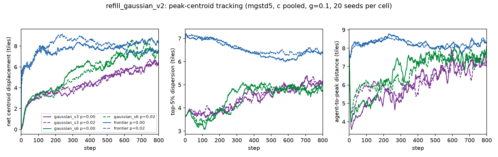
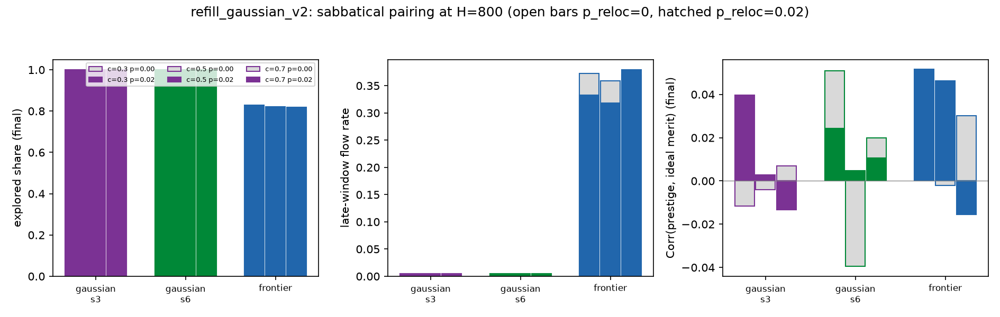

**Version 1** (November 2026)

> **STATUS: MODEL-INTERNAL, NOT CALIBRATED** (owner ruling, 2026-11-13).
> Slot 4 / prompt D4 follow-up to `refill_gaussian_v1` (`f459ce7`): peak-centroid
> tracking and the P-0007 sabbatical pairing. 18 cells, 360 runs, $H = 800$
> with $H = 400$ window summaries, 20 seeds per cell. **No model file was
> edited**; the sabbatical mechanism is imported unchanged from
> `scripts/interventions/run_interventions_v1.py`. Every number below is
> recomputed from `data/refill_gaussian_v2/` by
> `scripts/refill_gaussian/verify_refill_gaussian_v2.py`.

**Verdict.** (a) **No arm generates a traveling frontier.** All six
(mode $\times$ sabbatical) arms classify as *flat diffusion* under the
pre-declared rule: the top-5% knowledge mass wanders (path length $\approx$
300--330 tiles over 800 steps) while netting only 6--8 tiles, i.e. a
directedness of 0.023--0.032. `gaussian_s6`'s broad exploration is not peak
travel but wandering mass at the breadths' ceiling; its net centroid
displacement at $H = 800$ is 7.50 tiles against a path length of 319 tiles
(directedness 0.032), and even that net displacement sits below the
random-walk benchmark, so the motion is sub-diffusive churn rather than
drift. (b) **Sabbatical shocks change breadth, not throughput.** They
complete `gaussian_s3`'s exploration to the ceiling (paired explored-share
deltas +0.110, +0.053, +0.055 at $c = 0.3, 0.5, 0.7$, all CIs excluding
zero) and add +0.024, +0.022, +0.019 to `frontier`, while `gaussian_s6` is
already saturated (+0.001, +0.000, +0.000). Late-window harvest flow is
invariant to relocation in every arm: the Gaussian arms sit at
$\approx 0.0049$ per step with or without sabbaticals, `frontier` at
0.3434--0.3668 ($\approx 70\times$ higher) because `frontier` *injects*
new stock while the Gaussian kernels conserve it. P-0007's central
conjecture -- transient mobility unlocks frontier harvesting -- therefore
does **not** materialise in a stock-conserving refill world: relocating
agents does not move conserved stock into reach, so the throughput ceiling
is set by the refill kernel, not by mobility. Relocation incidence is
mean 143.1 (`gaussian_s3`) and 146.1 (`gaussian_s6`) per run against 16.4
(`frontier`), reflecting how much longer depleted ground persists under
stock-conserving refills.

# Design

| Element | Setting |
| --- | --- |
| Landscape | `mgstd5` = `multipleGaussians` (`std = 5`, `number_gaussians = 2`) |
| Population / horizon | $N = 20$, $H = 800$ (traj also summarised at $H = 400$) |
| Axes | refill regime $\times$ $p_{\text{reloc}} \in \{0.0, 0.02\}$ $\times c \in \{0.3, 0.5, 0.7\}$ |
| Seeds | 20 per cell (`agent_seed` 0--19, same seed identity as v1) |
| Fixed | $g = 0.1$; $\epsilon = 0.1$, harvest $= 0.02$, `use_distance=True`, retention $= 0.9$, visibility reward on, share normalization, harvested prestige accrual, `entry_prestige_stock="prestige"`, dyadic off -- the v1 pins, passed explicitly |
| Grid | 3 regimes $\times$ 2 sabbatical levels $\times$ 3 curiosity levels $= 18$ cells; 360 runs |

Mechanisms and measurement:

- **Refill regimes** as in v1: `gaussian_s3`/`gaussian_s6` move each harvested
  $\Delta k$ to a torus-Gaussian neighbour tile (stock conserved);
  `frontier` spawns new questions on random free tiles (stock injected).
- **Sabbatical shocks (`p_reloc = 0.02`)**: `InterventionsModel._sabbatical_relocate`
  imported read-only and called unchanged on every step: an agent standing on
  a depleted tile ($k < 0.025$) relocates to a random unoccupied tile with
  probability 0.02 per step. At $p_{\text{reloc}} = 0.0$ the hook is skipped
  entirely (no RNG draw), which is what makes the baseline bit-identical.
  The relocation count is measured by position diff around the call.
- **Peak-centroid tracking** (pure observation, no RNG): per step, the
  top-5% knowledge tiles (20 of 400) and their torus centroid (per-axis
  angle-mean, mass-weighted); the centroid's step displacement (minimal-image),
  its cumulative path length, its net displacement from the seed's own
  step-0 centroid, the mass-weighted RMS dispersion of the top-5% set, and
  the mean minimal-image agent-to-centroid distance. Windows $H = 400$ and
  $H = 800$ come from the same trajectory.
- **Pre-declared verdict rule** (tested for satisfiability in the probe,
  before the grid): traveling frontier iff directedness
  $=$ net$/\,$path $\ge 0.5$ **and** net displacement $\ge 2$ tiles **and**
  dispersion growth (last-800/last-400) $\le 1.25$ **and** agent-peak growth
  $\le 0.5$ tiles; flat diffusion iff directedness $\le 0.2$ or (net $< 2$
  tiles with dispersion growth $\ge 1.5$); otherwise mixed/wandering.

# Findings: part 1 -- does `gaussian_s6` travel?

| mode | p_reloc | net disp H400 | net disp H800 | path H800 | directedness | agent-peak H400 | agent-peak H800 | disp growth 800/400 | verdict (pre-declared rule) |
| --- | --- | --- | --- | --- | --- | --- | --- | --- | --- |
| gaussian_s3 | 0.00 | 4.69 | 6.26 | 316.0 | 0.026 | 5.22 | 6.04 | 1.21 | flat diffusion |
| gaussian_s3 | 0.02 | 4.17 | 6.54 | 331.7 | 0.023 | 5.65 | 6.21 | 1.20 | flat diffusion |
| gaussian_s6 | 0.00 | 6.36 | 7.50 | 319.4 | 0.032 | 5.99 | 6.74 | 1.03 | flat diffusion |
| gaussian_s6 | 0.02 | 5.48 | 7.62 | 327.1 | 0.029 | 6.05 | 6.75 | 1.13 | flat diffusion |
| frontier | 0.00 | 7.94 | 8.22 | 302.7 | 0.028 | 8.35 | 8.24 | 1.03 | flat diffusion |
| frontier | 0.02 | 8.67 | 7.48 | 313.3 | 0.025 | 8.33 | 8.23 | 1.02 | flat diffusion |

Reading: across all arms the net displacement grows only mildly from the
$H = 400$ window to $H = 800$ (4.69 $\to$ 6.26 for `gaussian_s3`, 6.36
$\to$ 7.50 for `gaussian_s6`, 7.94 $\to$ 8.22 for `frontier`; p_reloc = 0
arms) while the path length keeps accumulating -- the centroid is jittering,
not travelling. The
top-5% set's dispersion is roughly flat in every arm (growth ratios
1.02--1.21), so `gaussian_s6`'s breadth is a broadly *spread* mass, not a
coherent peak that moves. Agent-to-peak distance is largest for `frontier`
(8.35 at $H = 400$, 8.24 at $H = 800$): the injected frontier stock sits
farthest from where agents forage. Sabbatical relocation shifts the
tracking numbers only marginally (directedness 0.026 $\to$ 0.023 for
`gaussian_s3`, 0.032 $\to$ 0.029 for `gaussian_s6`) -- mobility does not
convert wandering mass into travelling peaks.

# Findings: part 2 -- the P-0007 sabbatical pairing

| mode | c | metric | mean (p=0) | mean (p=0.02) | paired delta | 95% CI (t, n=20) |
| --- | --- | --- | --- | --- | --- | --- |
| gaussian_s3 | 0.3 | explored_percentage_final | 0.890 | 1.000 | 0.110 | [0.079, 0.141] |
| gaussian_s3 | 0.3 | late_window_flow_rate | 0.0046 | 0.0045 | -0.0001 | [-0.0003, 0.0002] |
| gaussian_s3 | 0.3 | corr_prestige_ideal_merit_final | -0.012 | 0.040 | 0.051 | [-0.007, 0.110] |
| gaussian_s3 | 0.5 | explored_percentage_final | 0.947 | 1.000 | 0.053 | [0.035, 0.070] |
| gaussian_s3 | 0.5 | late_window_flow_rate | 0.0050 | 0.0050 | -0.0000 | [-0.0001, 0.0001] |
| gaussian_s3 | 0.5 | corr_prestige_ideal_merit_final | -0.004 | 0.003 | 0.007 | [-0.062, 0.076] |
| gaussian_s3 | 0.7 | explored_percentage_final | 0.945 | 1.000 | 0.055 | [0.036, 0.075] |
| gaussian_s3 | 0.7 | late_window_flow_rate | 0.0051 | 0.0051 | 0.0000 | [-0.0000, 0.0000] |
| gaussian_s3 | 0.7 | corr_prestige_ideal_merit_final | 0.007 | -0.013 | -0.020 | [-0.081, 0.040] |
| gaussian_s6 | 0.3 | explored_percentage_final | 0.999 | 1.000 | 0.001 | [-0.000, 0.002] |
| gaussian_s6 | 0.3 | late_window_flow_rate | 0.0043 | 0.0043 | 0.0000 | [-0.0002, 0.0003] |
| gaussian_s6 | 0.3 | corr_prestige_ideal_merit_final | 0.051 | 0.024 | -0.027 | [-0.091, 0.038] |
| gaussian_s6 | 0.5 | explored_percentage_final | 1.000 | 1.000 | 0.000 | [0.000, 0.000] |
| gaussian_s6 | 0.5 | late_window_flow_rate | 0.0048 | 0.0049 | 0.0001 | [-0.0000, 0.0002] |
| gaussian_s6 | 0.5 | corr_prestige_ideal_merit_final | -0.040 | 0.005 | 0.044 | [-0.030, 0.118] |
| gaussian_s6 | 0.7 | explored_percentage_final | 1.000 | 1.000 | 0.000 | [0.000, 0.000] |
| gaussian_s6 | 0.7 | late_window_flow_rate | 0.0050 | 0.0050 | 0.0000 | [-0.0000, 0.0000] |
| gaussian_s6 | 0.7 | corr_prestige_ideal_merit_final | 0.020 | 0.011 | -0.009 | [-0.055, 0.037] |
| frontier | 0.3 | explored_percentage_final | 0.804 | 0.828 | 0.024 | [0.007, 0.041] |
| frontier | 0.3 | late_window_flow_rate | 0.3722 | 0.3330 | -0.0392 | [-0.0869, 0.0084] |
| frontier | 0.3 | corr_prestige_ideal_merit_final | 0.009 | 0.052 | 0.042 | [-0.003, 0.088] |
| frontier | 0.5 | explored_percentage_final | 0.798 | 0.820 | 0.022 | [0.010, 0.034] |
| frontier | 0.5 | late_window_flow_rate | 0.3589 | 0.3181 | -0.0408 | [-0.1091, 0.0275] |
| frontier | 0.5 | corr_prestige_ideal_merit_final | -0.002 | 0.046 | 0.048 | [-0.015, 0.112] |
| frontier | 0.7 | explored_percentage_final | 0.801 | 0.820 | 0.019 | [0.005, 0.032] |
| frontier | 0.7 | late_window_flow_rate | 0.3693 | 0.3792 | 0.0100 | [-0.0507, 0.0706] |
| frontier | 0.7 | corr_prestige_ideal_merit_final | 0.030 | -0.015 | -0.046 | [-0.120, 0.029] |

Mode-level picture at $H = 800$ (means over the three curiosity levels):

| mode | $p_{\text{reloc}}$ | explored share | late flow / step | cum. harvest | corr (final) | relocations / run |
| --- | --- | --- | --- | --- | --- | --- |
| `gaussian_s3` | 0.00 | 0.9274 | 0.0049 | 3.63 | $-0.0029$ | 0.0 |
| `gaussian_s3` | 0.02 | 1.0000 | 0.0049 | 3.60 | 0.0097 | 143.1 |
| `gaussian_s6` | 0.00 | 0.9997 | 0.0047 | 2.98 | 0.0105 | 0.0 |
| `gaussian_s6` | 0.02 | 1.0000 | 0.0047 | 2.99 | 0.0132 | 146.1 |
| `frontier` | 0.00 | 0.8010 | 0.3668 | 197.93 | 0.0125 | 0.0 |
| `frontier` | 0.02 | 0.8225 | 0.3434 | 199.59 | 0.0274 | 16.4 |

Reading against `frontier` + sabbatical (the brief's comparator): neither
Gaussian arm approaches its throughput -- late flow 0.0047--0.0049 against
0.3434 per step -- but both Gaussian arms explore *more* of the grid
(1.0000 vs 0.8225), and neither alignment channel separates: every
correlation sits within $\pm 0.03$ and every paired relocation delta in
the pairing table has a CI covering or nearly covering zero. The relocation
dose itself is the informative asymmetry: `gaussian_s3`/`s6` accumulate
143.1/146.1 relocations per run because stock-conserving refills leave
depleted ground under the herd, while `frontier`'s injections keep tiles
above the depletion threshold and only 16.4 relocations fire.

# Cross-round comparability (control cell)

The grid ran on code that post-dates v1: `8b36a72` (ADR-0003 clock,
P-0009 turnover) landed after `f459ce7`. The control cell
(`gaussian_s3`, $c = 0.5$, $g = 0.1$, $p_{\text{reloc}} = 0$, $H = 400$,
20 seeds) re-runs the v1 archive's cell through this round's driver with
tracking on: **1,200 numeric comparisons (73 dynamics columns $\times$ 20
seeds) with worst absolute difference 0.0**, plus the internal checks that
the $H = 400$ mirrors equal the full-horizon values at $H = 400$. Exactly
one column moves, by construction and by measurement: `mean_age` (drift
ledger: 129.15), because ADR-0003 re-scaled the age bookkeeping (1 step =
0.5 yr). `mean_tenure` and every dynamics reporter are bit-identical, so
all v1$\leftrightarrow$v2 comparisons below the age semantics are exact;
no table in this report quotes `mean_age`.

# Verification

- **Canary (`tests/test_smoke.py`, bare, exit captured)** -- before edits:
  `ALL SMOKE TESTS PASSED` (exit 0; includes the ADR-0003 backward-compat and
  turnover checks). Note: the container's venv had lost `mesa`; it was
  restored from the uv cache at the pinned 3.2.0 before the gate would run.
  After edits: rerun recorded in the handover message.
- **Probe proofs** (`data/refill_gaussian_v2/probe/probe_results.json`):
  identity (baseline `off`, $p_{\text{reloc}} = 0$ vs plain `MyModel`,
  3 seeds, worst 0.0); conservation (total stock error 8.9e-16, flow/refill
  mismatch 0.0); binding (`p_reloc` moves 59 keys with 14 counted
  relocations on one seed; the tracking metrics move across $\sigma$ on 13
  keys, max 55.45); schema (worker-written file carries all 98 columns);
  cross-round control (above); timing 9.2--9.4 s per 800-step run.
- **Gross vs net**: GROSS cells=18 runs=360 | NET ok_cells=18
  ok_with_failures=0 crashed=0 runs_ok=360 runs_failed=0 wall=4562.9 s
  (driver log, `data/refill_gaussian_v2/run_log.txt`). Per-cell walls
  89--598 s: the container's 3-core quota was shared with two other
  sessions' pools (a long-running external job held $\approx 2$ cores), so
  throughput, not the driver, set the wall time.
- **Table round-trip**: every table above is emitted by the analysis
  script's single renderer and re-rendered from the CSVs by
  `verify_refill_gaussian_v2.py`; every prose number is recomputed and
  string-checked against this document.

# Provenance

- Runs: `data/refill_gaussian_v2/cells/` (18 cells $\times$ 20 rows),
  trajectories `data/refill_gaussian_v2/traj/` (18 $\times$ 20 $\times$ 801
  = 288,360 rows), `design.json` (grid, pins, mechanism provenance,
  sha256 of every module the dynamics touch, verdict rule).
- Code: `scripts/refill_gaussian/run_refill_gaussian_v2.py`,
  `analyse_refill_gaussian_v2.py`, `make_figures_refill_gaussian_v2.py`,
  `verify_refill_gaussian_v2.py`; v1 reused read-only via import.
- Boundary (ADR-0001): `sciencemodels/` untouched; the sabbatical mechanism
  keeps its single home in the interventions driver.

# Needs

- The `mean_age` semantics divergence between pre- and post-ADR-0003
  archives is a reporting-channel issue for any future cross-round table
  that quotes age; it is measured here, not fixed (model-side).
- P-0007 currently proposes a supply-matched 36-cell interaction probe at
  $H = 200$; this round's negative throughput result is directly relevant to
  that ruling -- the proposal's premise (mobility unlocks frontier
  harvesting) is not supported under stock-conserving refills.

# Revision Log

**Version 1** (2026-11-26).

- Initial version. Slot 4 / prompt D4: tracking extension + P-0007 pairing,
  18 cells / 360 runs at $H = 800$; all six arms flat diffusion under the
  pre-declared rule; sabbaticals complete breadth but leave throughput and
  alignment unchanged; control cell bit-exact against v1 apart from the
  declared `mean_age` drift.
