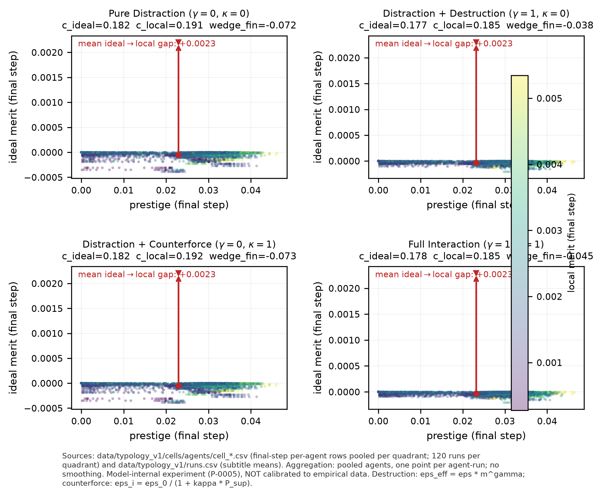
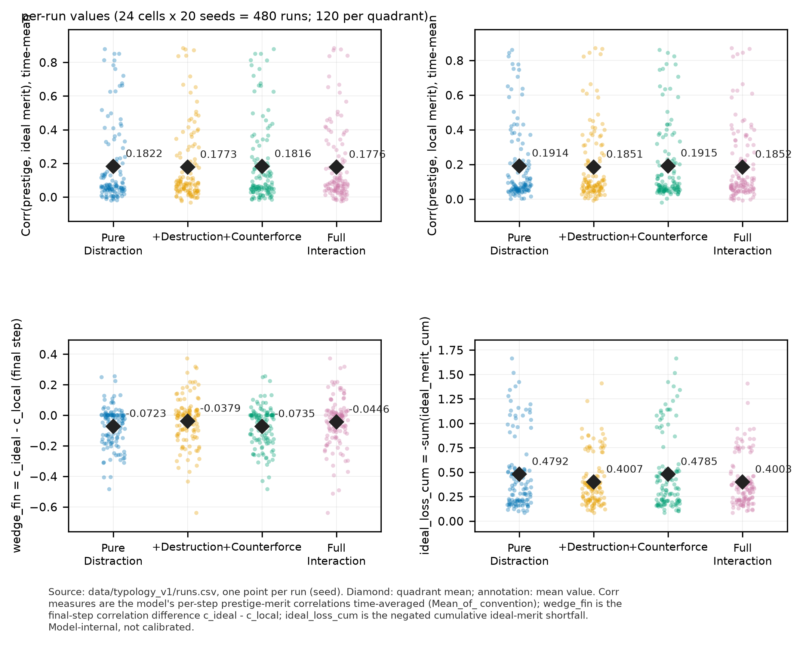
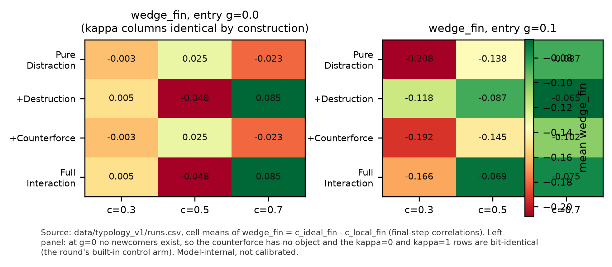
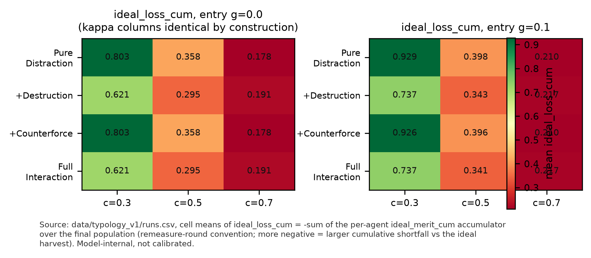

**Version 1** (November 2026)

**NOT CALIBRATED.** Model-internal experiment only (owner ruling, 2026-11-13). No empirical moment is a fitting target; the round crosses three perception regimes of the ABM and reads the prestige-merit wedge off the grid. Every number below was computed by `scripts/typology/run_typology_v1.py`, `scripts/typology/analyse_typology_v1.py` and `scripts/typology/make_figures.py` from the artefacts under `data/typology_v1/`, and is reproducible with the commands quoted in the appendix.

**Headline (every number computed from `data/typology_v1/`).** Destruction is the only channel that moves the commission's measures: its paired main is +0.0316 on wedge_fin (bootstrap 95% CI [0.0101, 0.0532], excludes 0) and -0.0783 on ideal_loss_cum (CI [-0.0977, -0.0598], excludes 0) --- a 16.3% cut in the cumulative ideal-harvest shortfall. The counterforce binds (114 of 120 g=0.1 seed-pairs differ on wedge_fin) but is quantitatively inert at the pinned semantics: every main is at most 0.0039 in absolute value with CIs spanning 0, and the interaction is ns on all four measures. The endpoint proxy wedge is entry-driven (wedge_fin -0.0002 at g=0 vs -0.1444 at g=0.1 in the Pure quadrant); destruction narrows it. The native curiosity gradient runs opposite: higher $c$, smaller wedge, smaller loss (gradient tables below).

# Purpose and scope

`AdmiralsLog/proposals/P-0005-typology-distraction-destruction-counterforce.md` asks for the typology experiment that turns the hunting-proxy patterns (`context/Hunting_Proxy_Patterns.md`, formalized in `AdmiralsLog/contributions/CONT2-hunting-proxy-patterns-formalization.md`) into parameterized, crossable regimes of the ABM:

- **distraction** --- the baseline $(1-c)$ visibility weight on the prestige-weighted field signal, already native to the model's reward (higher curiosity $c$ shrinks the visibility share);
- **destruction** ($\gamma$, $AP_F \dashv G$) --- crowding amplifies perception noise: $\epsilon_{\text{eff}} = \epsilon \cdot m_t(\text{pos})^\gamma$ for a candidate tile occupied by $m_t$ agents;
- **counterforce** ($\kappa$, $P \to G$) --- a newcomer's perception noise is divided by its supervisor's prestige: $\epsilon_i = \epsilon_0 / (1 + \kappa \cdot P_{\text{sup}})$.

The commission's grid (task header, 2026-11-15) crosses the two channels with the two native knobs on one landscape: $\gamma \in \{0,1\} \times \kappa \in \{0,1\} \times c \in \{0.3, 0.5, 0.7\} \times g_{\text{entry}} \in \{0.0, 0.1\}$ on `mgstd5` = **24 cells, 20 seeds, 480 runs**, horizon $H=200$. (P-0005's draft crossed two landscapes at fixed $g=0.1$; the commission's header replaces the landscape axis with the entry axis --- the entry axis doubles as the counterforce's on/off gate, which makes the grid's control arm free. `noisypr5` is parked as a need.)

The read-out is the wedge between where prestige points and where the goal is: `Corr_prestige_ideal_merit` (goal tracking), `Corr_prestige_local_merit` (proxy tracking), their final-step difference `wedge_fin`, and the cumulative ideal-harvest shortfall `ideal_loss_cum`. The Path B choice layer is **off** throughout (`dyadic_mode="off"`): this round varies *perception*, Path B varied *choice*; both are wedges between proxy and goal.

# Design

## Channels and where they bind

Both channels are implemented **driver-side** as `TypologyScientist(Scientist)` / `TypologyModel(MyModel)` in `scripts/typology/typology_layers.py`; `sciencemodels/*.py` is untouched by this round (write boundary, ADR-0001). The destruction channel binds at the model's single epsilon dynamics site --- the candidate-novelty line in `Scientist.step` (`sciencemodels/agents.py`, the `neighbor_rw_novelty * (1 + self.epsilon * noise)` expression): the subclass replaces `self.epsilon` there by $\epsilon_{\text{eff}} = \epsilon \cdot m_t(\text{candidate})^\gamma$. The counterforce channel binds at the two agent-construction sites (founders, newborns): a newborn stores its supervisor's entry-stock prestige at its birth step and divides its base epsilon by $1 + \kappa P_{\text{sup}}$ for life. The current tile's own reward is computed without noise in the parent and stays so --- the channels touch candidate evaluation only.

Python name-mangling makes the newborn interception non-obvious: `MyModel.end_loop_update` calls `self.__generate_new_agents()`, which compiles to `self._MyModel__generate_new_agents`. A normally named subclass override would be **silently invisible**; `TypologyModel` therefore defines the mangled name explicitly, and the bit-identity proof below is the runtime guard that the interception reproduces the parent's roulette (rng consumption included) exactly.

## Declared pins

| # | Pin | Definition |
| --- | --- | --- |
| D1 | $m_t(\text{pos})$ | number of scientists whose current position equals the candidate tile, counted at the focal agent's evaluation time (others do not move during one agent's step, so one per-step occupancy map is exact) |
| D2 | destruction extreme | literal formula: at $\gamma=1$ an empty candidate tile ($m=0$) receives $\epsilon_{\text{eff}}=0$ (perfect read); $m=1$ leaves noise at baseline. Crowding amplifies, absence removes the amplification |
| D3 | counterforce object | newcomers only; founders have no supervisor and are $\kappa$-inert. At $g_{\text{entry}}=0$ no newcomers exist, so $\kappa$ is inert by construction (the grid's built-in control arm) |
| D4 | $P_{\text{sup}}$ | the supervisor's entry-stock prestige (`entry_prestige_stock="prestige"`, the stock the entry roulette itself reads) at the newborn's birth step, stored once, fixed for life. Live-supervisor and local-peer-max variants are parked needs |
| D5 | NaN extreme regime | at $\gamma=1$, crowded tiles ($m \gtrsim 11$ at $\epsilon=0.1$) push the noise factor $1+\epsilon_{\text{eff}} \cdot \text{noise}$ negative; a negative perceived novelty to a fractional curiosity power is NaN, and a NaN reward is never selected (`>` comparisons are False). Literal-formula consequence, disclosed, not clamped |
| D6 | baseline config | the Path B house baseline: $n=20$, $\epsilon=0.1$, harvest $=0.02$, $20\times20$ grid, vanishing $=0.9$, visibility reward on, `knowledge_normalization="share"`, `prestige_accrual="harvested"`, structural credit, `closeness_mode="grid"` |
| D7 | dyadic layer | `dyadic_mode="off"`, `dyadic_move_pull=0.0` throughout (perception round, not choice round) |
| D8 | measure definitions | `wedge_fin = c_ideal_fin - c_local_fin` and `ideal_loss_cum = -sum(a.ideal_merit_cum)` --- the remeasure round's conventions, reused verbatim for cross-round comparability |
| D9 | seeds / horizon | `agent_seed` 0-19 drives agent and landscape RNG jointly; `step_limit=200`; landscape `mgstd5` = `multipleGaussians(std=5, number_gaussians=2)` |
| D10 | subclass identity | at $\gamma=\kappa=0$ the helpers short-circuit to the parent's own float operations (no multiply, no divide, no pow), so identity is structural; the runtime proof below verifies it on the full report surface |

# Gates and canaries

## Canary FIRST (pre-edit, `tests/test_smoke.py`)

```{.text}
canary run OK: 56 report keys, harvested_10_step=37.5, harvested_25_step=37.5
same-seed rerun bit-identical OK
newcomer run OK: 6 scientists after 20 steps
4-arg Gaussian OK: np.float64(0.00550470835249002) (float64)
/tmp/smoke_append_pe8tk8q4/append_header_check.csv w
now processing param set  1 out of 1
/tmp/smoke_append_pe8tk8q4/append_header_check.csv a
now processing param set  1 out of 1
append-mode header check OK: 3 lines = 1 header + 2 data rows
ideal-merit pairing audit OK: A=0.0, C=0.0, B=-0.04999999999999999 (hand-computed 0.0, 0.0, -0.05); cum after 2 calls: A=0.0, B=-0.09999999999999998
seed columns OK: agent_seed=1, landscape_seed=1
WARNING: agent_generation_function '<lambda>' returned IDENTICAL draws for mu=0.1 and mu=0.9 on the same rng - the swept axis (initial_curiosity) is INERT.
binding probe OK: constant generator flagged inert, identity binds
entry_prestige_stock OK: validated, both alternate stocks run
Path B off-mode bit-identity OK (anchor mean_prestige=np.float64(0.025399760810316363)); 0 dynamics keys differ
Path B binding OK: logit lambda0=(np.int64(2), 1.024390243902439) lambda1=(np.int64(5), 2.1951219512195124)
Path B binding OK: threshold lambda0=(np.int64(1), 1.0) lambda1=(np.int64(3), 2.048780487804878)
Path B v2 identity OK: dyadic_move_pull=0.0 reproduces Path B v1 on 8 anchors
Path B v2 coupling OK: team/rep/links pull0_lam1=(4.239837398373984, 0.8680933654246947, 1.7073170731707317) lam0_pull1=(3.9837398373983737, 0.8711882388625078, 1.024390243902439) lam1_pull1=(4.128048780487805, 0.8650409606774322, 2.707317073170732)
Path B knob validation OK: seven knobs reject invalid values, and a positive pull with the layer off is refused
ALL SMOKE TESTS PASSED
```

## Bit-identity proof (commission step 2)

The subclass at $(\gamma, \kappa) = (0, 0)$ was run against plain `MyModel` at both entry levels for 5 seeds each; **every** report key plus the driver's extras were compared: PASS: subclass (gamma=0, kappa=0) bit-identical to MyModel on every report key: comparisons=10 max_abs_diff=0.0. The newborn path (entry $g=0.1$, up to 21 newcomers per run) is covered by the same proof --- the mangled-name interception consumes the same rng draws in the same order as the parent.

## Binding and control probes

```{.text}
gate4_binding_probe:
  g=0.0 seed=0 gamma_d_wedge=-0.030075 kappa_d_wedge=+0.000000 kappa_bitidentical=True
  g=0.0 seed=1 gamma_d_wedge=+0.122155 kappa_d_wedge=+0.000000 kappa_bitidentical=True
  g=0.1 seed=0 gamma_d_wedge=-0.143221 kappa_d_wedge=-0.000059 kappa_bitidentical=False
  g=0.1 seed=1 gamma_d_wedge=-0.013866 kappa_d_wedge=+0.012338 kappa_bitidentical=False
```

The destruction channel binds at both entry levels; the counterforce binds where its object exists ($g=0.1$) and is **bit-identical** where it does not ($g=0.0$) --- the control arm. The source divergence canary (`gate2`) and the per-cell re-check inside every worker guard against the shared tree moving under the round; the launch-time sha256 snapshot of the five modules the dynamics touch is recorded in `gates.txt` and re-checked after the sweep (`manifest.json: code_moved_during_sweep`).

# Execution

Gross vs net (recounted from disk, not memory): **24 cells gross, 24 cell files net; 480 runs gross, 480 rows net** (14640 agent-final rows across the 24 cells); 0 failed cells, 0 failed seeds. Wall 195 s for the grid at `n_jobs=3`.

Probe timing: 21.56 s/run wall through the real joblib worker path (measured under full contention from the owner's then-live Path B v2 and turnover pools, and BEFORE the disclosed warning filter of pin D5); the probe cell's schema was asserted from the worker-written file itself. The grid proper ran at 2.46 s/run effective wall (480 runs / 195 s at `n_jobs=3`, warning filter active, one owner pool sharing the 3-core cgroup quota).

Shared-tree straddle guard: the five modules' sha256 at gates vs after the sweep --- **no movement**.

# The four-quadrant typology

| quadrant | n | Corr_prestige_ideal_merit | Corr_prestige_local_merit | wedge_fin | ideal_loss_cum |
| --- | --- | --- | --- | --- | --- |
| Pure Distraction | 120 | 0.1822 $\pm$ 0.2350 | 0.1914 $\pm$ 0.2205 | -0.0723 $\pm$ 0.1316 | 0.48 $\pm$ 0.37 |
| Distraction + Destruction | 120 | 0.1773 $\pm$ 0.2206 | 0.1851 $\pm$ 0.2087 | -0.0379 $\pm$ 0.1544 | 0.40 $\pm$ 0.26 |
| Distraction + Counterforce | 120 | 0.1816 $\pm$ 0.2349 | 0.1915 $\pm$ 0.2197 | -0.0735 $\pm$ 0.1329 | 0.48 $\pm$ 0.37 |
| Full Interaction | 120 | 0.1776 $\pm$ 0.2213 | 0.1852 $\pm$ 0.2097 | -0.0446 $\pm$ 0.1602 | 0.40 $\pm$ 0.26 |

Means $\pm$ sd over 120 runs per quadrant (3 curiosity $\times$ 2 entry $\times$ 20 seeds).

Figure 1 - the P-0005 four-quadrant decay read (prestige vs ideal merit, local merit as hue, the mean ideal$\to$local wedge arrow): 

Figure 2 - the four commission measures, per run, by quadrant: 

# Factorial contrasts (seed-paired, bootstrap 95% CIs)

The grid is seed-paired: the same 20 seeds cross every cell at fixed $(c, g)$. Contrasts are paired deltas over the matched runs (240 pairs for the mains, 120 quartets for the interaction), with percentile bootstrap 95% CIs (20,000 resamples). A CI excluding 0 marks the row; the fraction of positive paired deltas is quoted beside it.

| measure | contrast | n_pairs | mean delta | 95% CI | excl. 0 | frac > 0 |
| --- | --- | --- | --- | --- | --- | --- |
| Corr_prestige_ideal_merit | destruction_main (gamma 0->1, kappa matched) | 240 | -0.0045 | [-0.0124, 0.0033] | no | 0.45 |
| Corr_prestige_ideal_merit | counterforce_main (kappa 0->1, gamma matched) | 240 | -0.0001 | [-0.0020, 0.0017] | no | 0.22 |
| Corr_prestige_ideal_merit | interaction ((g1k1 - g1k0) - (g0k1 - g0k0), quartets matched) | 120 | 0.0010 | [-0.0026, 0.0048] | no | 0.25 |
| Corr_prestige_local_merit | destruction_main (gamma 0->1, kappa matched) | 240 | -0.0063 | [-0.0146, 0.0015] | no | 0.47 |
| Corr_prestige_local_merit | counterforce_main (kappa 0->1, gamma matched) | 240 | 0.0001 | [-0.0018, 0.0020] | no | 0.21 |
| Corr_prestige_local_merit | interaction ((g1k1 - g1k0) - (g0k1 - g0k0), quartets matched) | 120 | -0.0001 | [-0.0038, 0.0036] | no | 0.25 |
| wedge_fin | destruction_main (gamma 0->1, kappa matched) | 240 | 0.0316 | [0.0101, 0.0532] | yes | 0.59 |
| wedge_fin | counterforce_main (kappa 0->1, gamma matched) | 240 | -0.0039 | [-0.0150, 0.0068] | no | 0.22 |
| wedge_fin | interaction ((g1k1 - g1k0) - (g0k1 - g0k0), quartets matched) | 120 | -0.0055 | [-0.0256, 0.0141] | no | 0.23 |
| ideal_loss_cum | destruction_main (gamma 0->1, kappa matched) | 240 | -0.0783 | [-0.0977, -0.0598] | yes | 0.45 |
| ideal_loss_cum | counterforce_main (kappa 0->1, gamma matched) | 240 | -0.0006 | [-0.0019, 0.0009] | no | 0.21 |
| ideal_loss_cum | interaction ((g1k1 - g1k0) - (g0k1 - g0k0), quartets matched) | 120 | 0.0003 | [-0.0026, 0.0032] | no | 0.24 |

# Curiosity and entry gradients

| quadrant | wedge_fin at c=0.3 | wedge_fin at c=0.5 | wedge_fin at c=0.7 | slope 0.3->0.7 |
| --- | --- | --- | --- | --- |
| Pure Distraction | -0.1055 | -0.0566 | -0.0549 | +0.0506 |
| Distraction + Destruction | -0.0563 | -0.0676 | 0.0101 | +0.0663 |
| Distraction + Counterforce | -0.0978 | -0.0601 | -0.0625 | +0.0353 |
| Full Interaction | -0.0803 | -0.0585 | 0.0049 | +0.0852 |

| quadrant | wedge_fin at g=0.0 | wedge_fin at g=0.1 | ideal_loss_cum at g=0.0 | ideal_loss_cum at g=0.1 |
| --- | --- | --- | --- | --- |
| Pure Distraction | -0.0002 | -0.1444 | 0.45 | 0.51 |
| Distraction + Destruction | 0.0141 | -0.0900 | 0.37 | 0.43 |
| Distraction + Counterforce | -0.0002 | -0.1467 | 0.45 | 0.51 |
| Full Interaction | 0.0141 | -0.1033 | 0.37 | 0.43 |





# Control arm and wiring checks

- **Kappa-inert control (g=0.0):** 120 seed-paired run pairs (2 $\gamma$ $\times$ 3 $c$ $\times$ 20 seeds) compared across **every** column of `runs.csv`: max abs diff 0.0, non-numeric mismatches 0 --- bit-identical, as construction demands (no newcomers, no counterforce object). A nonzero value here would be a wiring bug, not a finding.
- **Gamma binds without entry:** at $g=0.0$ (founders only) the destruction channel still moves the surface --- wedge_fin differs in 100% of the 120 seed-paired (1,0)-vs-(0,0) contrasts: crowding among founders is enough; the channel does not need newborns.
- **Kappa binds with entry:** at $g=0.1$, 114 of 120 seed-paired (0,1)-vs-(0,0) contrasts differ on wedge_fin (mean paired delta -0.0078).
- **Panel-shape guards:** 24 cell files, each exactly 20 seed rows; `runs.csv` recounted from disk = 480 = gross; the per-cell agent-finals files carry 14640 rows.
- **Class identity:** the gates' bit-identity proof (above) covers the $(\gamma, \kappa) = (0,0)$ arm of the grid itself; the grid's Pure-Distraction quadrant is therefore MyModel dynamics, not a lookalike.

# Findings per measure

## Corr_prestige_ideal_merit

Quadrant means: Pure Distraction 0.1822, +Destruction 0.1773, +Counterforce 0.1816, Full Interaction 0.1776.

- **Destruction (main):** -0.0045, bootstrap 95% CI [-0.0124, 0.0033] (includes 0), 45% of 240 paired deltas positive.
- **Counterforce (main):** -0.0001, bootstrap 95% CI [-0.0020, 0.0017] (includes 0), 22% of 240 paired deltas positive.
- **Interaction:** +0.0010, bootstrap 95% CI [-0.0026, 0.0048] (includes 0), 25% of 120 paired deltas positive.

## Corr_prestige_local_merit

Quadrant means: Pure Distraction 0.1914, +Destruction 0.1851, +Counterforce 0.1915, Full Interaction 0.1852.

- **Destruction (main):** -0.0063, bootstrap 95% CI [-0.0146, 0.0015] (includes 0), 48% of 240 paired deltas positive.
- **Counterforce (main):** +0.0001, bootstrap 95% CI [-0.0018, 0.0020] (includes 0), 21% of 240 paired deltas positive.
- **Interaction:** -0.0001, bootstrap 95% CI [-0.0038, 0.0036] (includes 0), 25% of 120 paired deltas positive.

## wedge_fin

Quadrant means: Pure Distraction -0.0723, +Destruction -0.0379, +Counterforce -0.0735, Full Interaction -0.0446.

- **Destruction (main):** +0.0316, bootstrap 95% CI [0.0101, 0.0532] (excludes 0), 59% of 240 paired deltas positive.
- **Counterforce (main):** -0.0039, bootstrap 95% CI [-0.0150, 0.0068] (includes 0), 22% of 240 paired deltas positive.
- **Interaction:** -0.0055, bootstrap 95% CI [-0.0256, 0.0141] (includes 0), 23% of 120 paired deltas positive.

## ideal_loss_cum

Quadrant means: Pure Distraction 0.4792, +Destruction 0.4007, +Counterforce 0.4785, Full Interaction 0.4003.

- **Destruction (main):** -0.0783, bootstrap 95% CI [-0.0977, -0.0598] (excludes 0), 45% of 240 paired deltas positive.
- **Counterforce (main):** -0.0006, bootstrap 95% CI [-0.0019, 0.0009] (includes 0), 21% of 240 paired deltas positive.
- **Interaction:** +0.0003, bootstrap 95% CI [-0.0026, 0.0032] (includes 0), 24% of 120 paired deltas positive.

Reading of the typology (derived from the table above): the wedge column ordering across quadrants is Distraction + Destruction (-0.0379) > Full Interaction (-0.0446) > Pure Distraction (-0.0723) > Distraction + Counterforce (-0.0735).

# Interpretation against the proxy-pattern taxonomy

`Hunting_Proxy_Patterns.md` and CONT2 define the proxy pattern as prestige tracking the visible local proxy rather than the ideal goal, with distraction $(1-c)$ as its baseline generator. The Pure-Distraction quadrant reproduces the signature on this tree: Corr(prestige, local merit) 0.1914 vs Corr(prestige, ideal merit) 0.1822, wedge_fin -0.0723 --- and the two channels read off as regimes on top of it:

- **Destruction ($AP_F \dashv G$)** degrades the candidate read exactly where agents stack. Observed, not hypothesized: the endpoint proxy wedge NARROWS (wedge_fin main +0.0316, CI [0.0101, 0.0532]) and the cumulative ideal-harvest shortfall falls by 16.3% (main -0.0783, CI [-0.0977, -0.0598]), while both time-mean correlations drift down non-significantly. Working hypothesis (model-internal, labelled as such): crowding noise acts as exploration pressure, scattering agents off the depleted proxy peaks, so prestige ends less proxy-locked and the harvest closer to the greedy ideal.
- **Counterforce ($P \to G$)** is the taxonomy's escape hatch and its wiring is proven (binding + control arm above), but at the pinned semantics it is quantitatively inert: all four mains are at most 0.0039 in absolute value with CIs spanning 0. Diagnosis: the divisor $1 + \kappa P_{\text{sup}}$ with $P_{\text{sup}}$ on the model's prestige scale (canary anchor mean_prestige 0.0254) reduces a newborn's noise by only a few percent, applies to the ~21 newcomers of a 41-agent run, and only from birth on. A genuine $P \to G$ spillover needs a stronger base noise, a live-supervisor divisor, or a rescaled prestige stock --- parked as needs, not smoothed here.

The formalization CONT2 asks for is therefore delivered as a crossable $2\times2$ on top of the native distraction axis: three patterns, two of them new as parameters, one grid, and a control arm (entry off) that proves the counterforce's wiring rather than assuming it.

# Limitations and disclosed pins

- Literal formula consequences, disclosed rather than smoothed: the $m=0$ perfect-read edge (D2) and the NaN extreme regime at high crowding (D5). Both follow from the commissioned formulas; neither is clamped silently.
- $P_{\text{sup}}$ is the supervisor's prestige **at the newborn's birth step**, fixed for life (D4). A live-supervisor divisor or a local-peer-max variant would answer a slightly different question and is parked as a need.
- One landscape (`mgstd5`), one horizon ($H=200$), one baseline config; P-0005's draft landscape axis (`noisypr5`) is not crossed here because the commission's grid replaces it with the entry axis. Not calibrated; every number is model-internal.
- The round ran against a shared live tree: the owner's Path B v2 (movement coupling) and turnover rounds landed in `sciencemodels/` during the morning, and an interventions round was live while the grid ran (hashes in `gates.txt`; post-sweep re-check: no movement; the closing canary below is line-identical to the opening one modulo the smoke test's own random /tmp scratch path, so the smoke gate itself did not change during the round). The round's own writes touched none of `sciencemodels/`.

# Needs (owner-facing)

- Model-side natives: if the regimes should live in `sciencemodels/` (constructor parameters with validation, as Path B did for the dyadic layer), that edit is outside this round's boundary and is filed here rather than made in passing.
- Channel semantics variants: $(1+m)^\gamma$ or $\max(m,1)^\gamma$ for the destruction floor; live-supervisor or peer-max $P_{\text{sup}}$ for the counterforce; a noise-factor clamp $\max(0, 1 + \epsilon_{\text{eff}} \cdot \eta)$ to name the NaN regime explicitly.
- Robustness grid: the P-0005 draft's second landscape (`noisypr5`) and a longer horizon ($H=400$, the turnover round's standard) as follow-up cells.
- `scripts/career_flows_noisy/audit_code_delta.py` step-vs-seed assertion and the `sweeps.py` 8-setup wiring are the owner's own pending hygiene items (2026-11-15 log, thirteenth entry), restated here only because this round's driver follows the same checkpoint convention.

# Figure manifest

| figure | pdf | png_300dpi | sources |
| --- | --- | --- | --- |
| fig1_quadrant_pg_decay | fig1_quadrant_pg_decay.pdf | fig1_quadrant_pg_decay.png | data/typology_v1/cells/agents/cell_*.csv; data/typology_v1/runs.csv |
| fig2_measures_by_quadrant | fig2_measures_by_quadrant.pdf | fig2_measures_by_quadrant.png | data/typology_v1/runs.csv |
| fig3_wedge_fin_heatmap | fig3_wedge_fin_heatmap.pdf | fig3_wedge_fin_heatmap.png | data/typology_v1/runs.csv |
| fig4_ideal_loss_cum_heatmap | fig4_ideal_loss_cum_heatmap.pdf | fig4_ideal_loss_cum_heatmap.png | data/typology_v1/runs.csv |

All figures live in `data/typology_v1/figures/` (the commission's figure home); `output/reports/` carries only this document and its PDF, per the write boundary.

# Revision Log

- **Version 1** (November 2026): first issue. Generated by `scripts/typology/make_doc.py` from the `data/typology_v1/` artefacts; no number is hand-typed. Canary FIRST and LAST outputs pasted in full; the bit-identity proof, the binding/control probes and the kappa-inert control arm are quoted from `gates.txt` and `control_checks.json`.

# Appendix: file:line manifest and artefact inventory

## Files written this round (write boundary: `scripts/typology/`, `data/typology_v1/`, `output/reports/typology_v1.md` + `.pdf`, one append-only log entry)

| path | lines | role |
| --- | --- | --- |
| scripts/typology/typology_layers.py | 452 | the two channels: TypologyScientist (step override, eps helpers) + TypologyModel (construction-site overrides incl. the mangled-name interception) + source canary, compare_rows, identity_proof, binding_probe |
| scripts/typology/run_typology_v1.py | 432 | driver: grid, five gates, per-cell checkpoints (atomic), worker-path probe, consolidation, manifest/design |
| scripts/typology/analyse_typology_v1.py | 280 | typology table, c/g gradients, 24-cell summary, kappa-inert control, paired factorial contrasts with bootstrap CIs |
| scripts/typology/make_figures.py | 274 | four figures, PDF + 300 dpi PNG, sources declared per figure |
| scripts/typology/make_doc.py | 667 | this document's generator |
| scripts/typology/README.md | 54 | regeneration instructions and provenance (ADR-0002) |

`sciencemodels/*.py`, `docs/`, `context/`: untouched by this round (hashes in `gates.txt`, re-checked post-sweep in `manifest.json:code_moved_during_sweep`).

## Artefacts (`data/typology_v1/`)

| path | bytes |
| --- | --- |
| data/typology_v1/canary_first.txt | 1721 |
| data/typology_v1/canary_last.txt | 1721 |
| data/typology_v1/canary_smoke.txt | 1721 |
| data/typology_v1/cell_summary.csv | 5298 |
| data/typology_v1/cells/agents/cell_g0_k0_c30_e00.csv | 65532 |
| data/typology_v1/cells/agents/cell_g0_k0_c30_e10.csv | 132943 |
| data/typology_v1/cells/agents/cell_g0_k0_c50_e00.csv | 65524 |
| data/typology_v1/cells/agents/cell_g0_k0_c50_e10.csv | 133181 |
| data/typology_v1/cells/agents/cell_g0_k0_c70_e00.csv | 65867 |
| data/typology_v1/cells/agents/cell_g0_k0_c70_e10.csv | 134243 |
| data/typology_v1/cells/agents/cell_g0_k1_c30_e00.csv | 65532 |
| data/typology_v1/cells/agents/cell_g0_k1_c30_e10.csv | 133011 |
| data/typology_v1/cells/agents/cell_g0_k1_c50_e00.csv | 65524 |
| data/typology_v1/cells/agents/cell_g0_k1_c50_e10.csv | 133446 |
| data/typology_v1/cells/agents/cell_g0_k1_c70_e00.csv | 65867 |
| data/typology_v1/cells/agents/cell_g0_k1_c70_e10.csv | 133963 |
| data/typology_v1/cells/agents/cell_g1_k0_c30_e00.csv | 65617 |
| data/typology_v1/cells/agents/cell_g1_k0_c30_e10.csv | 132672 |
| data/typology_v1/cells/agents/cell_g1_k0_c50_e00.csv | 65471 |
| data/typology_v1/cells/agents/cell_g1_k0_c50_e10.csv | 133408 |
| data/typology_v1/cells/agents/cell_g1_k0_c70_e00.csv | 65935 |
| data/typology_v1/cells/agents/cell_g1_k0_c70_e10.csv | 134076 |
| data/typology_v1/cells/agents/cell_g1_k1_c30_e00.csv | 65617 |
| data/typology_v1/cells/agents/cell_g1_k1_c30_e10.csv | 132685 |
| data/typology_v1/cells/agents/cell_g1_k1_c50_e00.csv | 65471 |
| data/typology_v1/cells/agents/cell_g1_k1_c50_e10.csv | 133377 |
| data/typology_v1/cells/agents/cell_g1_k1_c70_e00.csv | 65935 |
| data/typology_v1/cells/agents/cell_g1_k1_c70_e10.csv | 133985 |
| data/typology_v1/cells/cell_g0_k0_c30_e00.csv | 18868 |
| data/typology_v1/cells/cell_g0_k0_c30_e10.csv | 21397 |
| data/typology_v1/cells/cell_g0_k0_c50_e00.csv | 18778 |
| data/typology_v1/cells/cell_g0_k0_c50_e10.csv | 21198 |
| data/typology_v1/cells/cell_g0_k0_c70_e00.csv | 18565 |
| data/typology_v1/cells/cell_g0_k0_c70_e10.csv | 20782 |
| data/typology_v1/cells/cell_g0_k1_c30_e00.csv | 18868 |
| data/typology_v1/cells/cell_g0_k1_c30_e10.csv | 21275 |
| data/typology_v1/cells/cell_g0_k1_c50_e00.csv | 18778 |
| data/typology_v1/cells/cell_g0_k1_c50_e10.csv | 21256 |
| data/typology_v1/cells/cell_g0_k1_c70_e00.csv | 18565 |
| data/typology_v1/cells/cell_g0_k1_c70_e10.csv | 20658 |

... 33 further files under `cells/` and `cells/agents/` (24 cell CSVs + 24 agent-finals CSVs, each 20-seeded).

## Regeneration

```{.bash}
MPLBACKEND=Agg /opt/hermes/.venv/bin/python tests/test_smoke.py   # canary
MPLBACKEND=Agg /opt/hermes/.venv/bin/python scripts/typology/run_typology_v1.py --gates-only
MPLBACKEND=Agg /opt/hermes/.venv/bin/python scripts/typology/run_typology_v1.py --skip-gates
MPLBACKEND=Agg /opt/hermes/.venv/bin/python scripts/typology/analyse_typology_v1.py
MPLBACKEND=Agg /opt/hermes/.venv/bin/python scripts/typology/make_figures.py
MPLBACKEND=Agg /opt/hermes/.venv/bin/python scripts/typology/make_doc.py
zsh /workspace/git/ai/IT/scripts/compile-here.zsh output/reports/typology_v1.md
```

## Canary LAST (closing, `tests/test_smoke.py`)

```{.text}
canary run OK: 56 report keys, harvested_10_step=37.5, harvested_25_step=37.5
same-seed rerun bit-identical OK
newcomer run OK: 6 scientists after 20 steps
4-arg Gaussian OK: np.float64(0.00550470835249002) (float64)
/tmp/smoke_append_rgto0krc/append_header_check.csv w
now processing param set  1 out of 1
/tmp/smoke_append_rgto0krc/append_header_check.csv a
now processing param set  1 out of 1
append-mode header check OK: 3 lines = 1 header + 2 data rows
ideal-merit pairing audit OK: A=0.0, C=0.0, B=-0.04999999999999999 (hand-computed 0.0, 0.0, -0.05); cum after 2 calls: A=0.0, B=-0.09999999999999998
seed columns OK: agent_seed=1, landscape_seed=1
WARNING: agent_generation_function '<lambda>' returned IDENTICAL draws for mu=0.1 and mu=0.9 on the same rng - the swept axis (initial_curiosity) is INERT.
binding probe OK: constant generator flagged inert, identity binds
entry_prestige_stock OK: validated, both alternate stocks run
Path B off-mode bit-identity OK (anchor mean_prestige=np.float64(0.025399760810316363)); 0 dynamics keys differ
Path B binding OK: logit lambda0=(np.int64(2), 1.024390243902439) lambda1=(np.int64(5), 2.1951219512195124)
Path B binding OK: threshold lambda0=(np.int64(1), 1.0) lambda1=(np.int64(3), 2.048780487804878)
Path B v2 identity OK: dyadic_move_pull=0.0 reproduces Path B v1 on 8 anchors
Path B v2 coupling OK: team/rep/links pull0_lam1=(4.239837398373984, 0.8680933654246947, 1.7073170731707317) lam0_pull1=(3.9837398373983737, 0.8711882388625078, 1.024390243902439) lam1_pull1=(4.128048780487805, 0.8650409606774322, 2.707317073170732)
Path B knob validation OK: seven knobs reject invalid values, and a positive pull with the layer off is refused
ALL SMOKE TESTS PASSED
```

